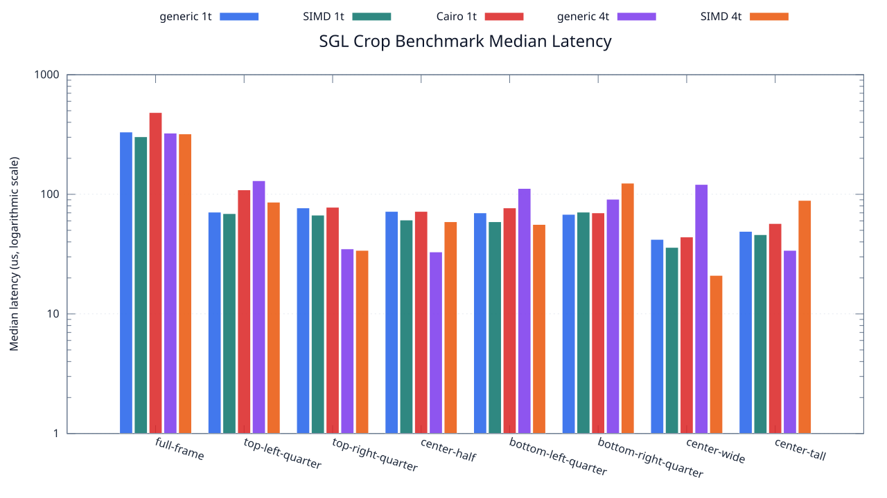
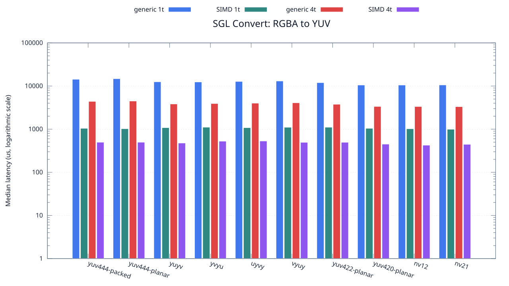
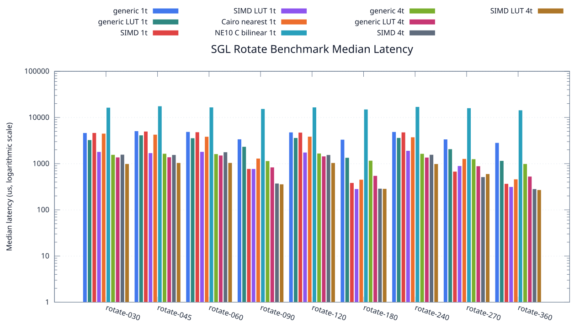
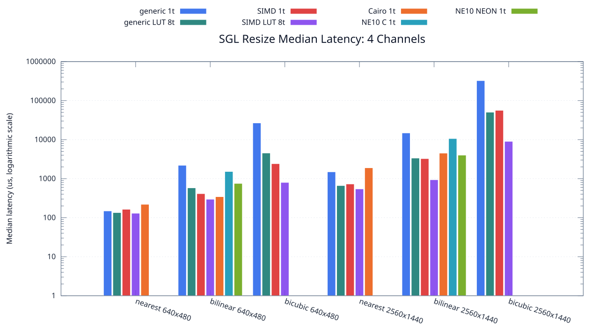

<!--
SPDX-License-Identifier: MIT

Copyright (c) 2025 Dylan Hong

This file is released under the MIT License.
For conditions of distribution and use, see the LICENSE file.
-->

Project Build and Run Guide
===========================

[](https://github.com/KOR-DYLAN/simple-graphics/actions/workflows/pages.yml)
[](https://github.com/KOR-DYLAN/simple-graphics/actions/workflows/release.yml)

[User Manual](https://kor-dylan.github.io/simple-graphics/) |
[Releases](https://github.com/KOR-DYLAN/simple-graphics/releases)

Overview
--------
Simple Graphics Library (SGL) is a small C graphics-processing library focused
on explicit memory management, portable scalar image operations, and optional
ARM NEON acceleration. The repository also contains test applications for
regression checks, PNG-based image-operation benchmarking, and AArch64 QEMU
execution.

The default Make target configures and builds the project. `make menu` opens
the persistent build-option menu, while `make run` opens the test selection and
argument menu before building and running the selected application. Native host
builds and AArch64 cross builds are supported through CMake toolchain files.

Contents
--------
- [Overview](#overview)
- [Project Status](#project-status)
- [Quick Start](#quick-start)
- [Directory Layout](#directory-layout)
- [Prerequisites](#prerequisites)
- [Platform Package Setup](#platform-package-setup)
- [Python Environment Setup](docs/python-setup.md)
- [Configuration Variables](#configuration-variables)
- [Build Targets](#build-targets)
- [Running the Application](#running-the-application)
- [Linux Profiling](docs/profiling-lttng.md)
- [Documentation](docs/README.md)
- [GitHub Pages and Release Publishing](docs/github-publishing.md)
- [Operation Benchmarks](#operation-benchmarks)
- [Resize Benchmark](#resize-benchmark)
- [Detailed Benchmark Reports](benchmark/README.md)
- [Notes](#notes)
- [Memory Pool](#memory-pool)

Project Status
--------------
Implemented:

| Area | Current support |
| --- | --- |
| Memory pool | Caller-owned process-wide pool with `sgl_malloc`, `sgl_calloc`, and `sgl_free`. |
| Memory operations | `sgl_memcpy` and `sgl_memset`, with NEON memory routines when available. |
| Resize | Nearest, bilinear, and bicubic resize for 1, 2, 3, and 4 byte-per-pixel inputs. |
| Resize acceleration | Generic scalar path plus ARM NEON SIMD paths when `WITH_SIMD=ON` and NEON is detected. |
| Resize LUT reuse | Optional prebuilt lookup tables for repeated resize operations with fixed geometry. |
| Crop, convert, rotate | Public generic, NEON, and optional threadpool APIs with dedicated regression and benchmark applications. |
| Threading | Optional pthread-backed threadpool on Linux, plus dummy backend when threading is disabled. |
| Queue | Fixed-capacity queue used by tests and threaded execution paths. |
| Profiling | Optional Linux LTTng-UST events for resize, threadpool, and queue contention analysis. |
| Test apps | `crop`, `convert`, `rotate`, `resize`, `memory`, `queue`, `threadpool`, and `sample` applications. |
| Test image I/O | PNG load/save helpers built from test-only zlib-ng/libpng dependencies. |
| Cross-run support | AArch64 Linux toolchains with QEMU runner and detected sysroot. |
| Packaging | Install/export rules, pkg-config metadata, CMake package config, CPack archives. |

Known limitations:

| Area | Current limitation |
| --- | --- |
| SIMD coverage | NEON paths exist for memory, crop, convert, rotate, and resize. x86 SIMD flags are detected, but image-operation backends are not implemented for x86. |
| Thread backend | pthread is supported on Linux. Windows thread detection exists, but the current library implementation is not wired as a Win32 backend. |
| External benchmark backends | Cairo rows are timing comparisons only. NE10 C/NEON consistency is checked, but reference pixel-accuracy validation is not implemented yet. |
| QEMU execution | QEMU support is intended for AArch64 Linux user-mode binaries, not full-system emulation. |

Planned or likely next support:

| Area | Direction |
| --- | --- |
| Validation | Add pixel-accuracy checks for resize and optional external benchmark backends. |
| SIMD | Expand optimized implementations beyond the current ARM NEON coverage. |
| Platform support | Improve non-Linux threading/runtime coverage after the core APIs stabilize. |
| Benchmark tooling | Keep CSV/SVG reporting useful for comparing compiler flags, SIMD, thread counts, and external backends. |

Quick Start
-----------
Use these commands after installing the packages for your platform.

| Task | Command |
| --- | --- |
| Configure build options | `make menu` |
| Configure and build | `make build` |
| Select and run a test application | `make run` |
| Run the resize app through AArch64 QEMU | Select the cross toolchain with `make menu`, then use `make run` |
| Disable cppcheck while iterating locally | Select `Cppcheck` with `make menu`, then press Space |
| Capture an LTTng resize trace | `make profile-lttng BUILD_TYPE=RelWithDebInfo` |

Default behavior:

| Default | Value | Meaning |
| --- | --- | --- |
| `TOOLCHAIN` | `llvm` | Build and run native host binaries with Clang/LLVM. |
| `BUILD_TYPE` | `Release` | Configure CMake for optimized release builds. |
| `TARGET` | `resize` | Run the resize benchmark application. |
| `INPUT` | `resource/sample.png` | Input image passed to `resize`. |
| `OUTPUT` | `$(BUILD)/resize-output` | Directory where resized PNG outputs are written. |
| `ARGS` | `$(INPUT) $(OUTPUT)` | Runtime arguments passed to the selected target. |
| `NPROC` | `nproc` output | Number of parallel build jobs. |
| `BUILD` | `build/$(TOOLCHAIN)` | Toolchain-specific CMake build tree. |
| `INSTALL_PREFIX` | `$(BUILD)/install` | Default CMake install prefix when none is provided. |

AArch64 toolchains, such as `aarch64-none-linux-llvm`, run target binaries
through QEMU when QEMU is available.

Directory Layout
----------------
| Path | Purpose |
| --- | --- |
| `Makefile` | Main entry point for configure, build, run, install, and package targets. |
| `build/<TOOLCHAIN>/` | Default CMake build tree for each toolchain. |
| `build/<TOOLCHAIN>/resize-output/` | Default resize PNG output directory for each build tree. |
| `resource/` | Input resources such as sample PNG images. |
| `script/` | Toolchain, package, QEMU, SIMD, thread, and analysis configuration. |
| `test/` | Sample, benchmark, regression, and shared test utility targets. |
| `library/` | Core SGL library target and implementation modules. |
| `docs/` | Design and implementation animations grouped by subsystem. |
| `benchmark/` | Versioned benchmark CSVs, Markdown tables, and gnuplot SVG charts. |

Prerequisites
-------------
Required for normal test builds:

| Requirement | Notes |
| --- | --- |
| Python 3.10 or newer | Required by the Kconfig menu, build dispatcher, and benchmark report generator. These core tools use the standard library only. |
| CMake and Make | CMake generates the build tree; Make drives common workflows. |
| C/C++ compiler | LLVM/Clang or GNU toolchain. |
| Git and network access | Used during configure when resolving test dependency release tags. |
| `gawk` | Required while building the test libpng dependency. |
| gnuplot | Required to generate benchmark SVG charts after benchmark tests. |
| Doxygen | Required only to generate or package the HTML user manual and public API reference. |
| `cppcheck` | Required only when `WITH_CPPCHECK=ON`. |
| `qemu-aarch64-static` or `qemu-aarch64` | Required only for AArch64 cross-run execution. |
| LTTng-UST, LTTng tools, and Babeltrace 2 with `bt2` | Required only for Linux tracing with `WITH_LTTNG=ON`; install the distribution's Python binding. |
| `nproc` | Used by the default Makefile flow to choose parallel jobs. |

Platform Package Setup
----------------------
Install the host-side packages for your platform:

| Platform | Command |
| --- | --- |
| Ubuntu / WSL | `sudo apt update`<br>`sudo apt install -y python3 python3-pip python3-venv build-essential cmake make git gawk gnuplot-nox doxygen clang llvm cppcheck qemu-user-static` |
| Fedora | `sudo dnf install -y python3 python3-pip gcc gcc-c++ cmake make git gawk gnuplot doxygen clang llvm cppcheck qemu-user-static` |
| Arch Linux | `sudo pacman -S --needed python python-pip base-devel cmake git gawk gnuplot doxygen clang llvm cppcheck qemu-user-static` |
| macOS / Homebrew | `brew install python cmake make git gawk gnuplot doxygen llvm cppcheck qemu coreutils` |

See the [Python environment setup guide](docs/python-setup.md) for standalone
package-manager installation, pyenv build dependencies, project-local Python
selection, virtual environments, pip usage, and the optional Babeltrace 2
binding.

On macOS, use a native toolchain first and pass GNU `nproc` explicitly:

  make TOOLCHAIN=llvm NPROC=$(gnproc)

Native GCC package names:

| Platform | Package |
| --- | --- |
| Ubuntu / WSL | `sudo apt install -y gcc g++` |
| Fedora | `sudo dnf install -y gcc gcc-c++` |
| Arch Linux | `sudo pacman -S --needed gcc` |
| macOS | Use `TOOLCHAIN=llvm` unless a separate GCC setup is needed. |

AArch64 cross builds in this repository use the
`aarch64-none-linux-gnu-` tool prefix. Install the Arm GNU Toolchain for
`aarch64-none-linux-gnu`, then add its `bin` directory to `PATH` so commands
such as `aarch64-none-linux-gnu-gcc` are available:

  export PATH=/opt/arm-gnu-toolchain-<version>-x86_64-aarch64-none-linux-gnu/bin:$PATH

Check the required tools:

  aarch64-none-linux-gnu-gcc -print-sysroot
  qemu-aarch64-static --version

If your platform installs QEMU without the `-static` suffix, check
`qemu-aarch64 --version` instead. CMake looks for `qemu-aarch64-static` first
and falls back to `qemu-aarch64`.

For `TOOLCHAIN=aarch64-none-linux-llvm`, both Clang/LLVM and the Arm GNU
Toolchain are needed. Clang emits AArch64 code, while the GNU toolchain
supplies the sysroot, linker runtime pieces, and target C library. For
`TOOLCHAIN=aarch64-none-linux-gnu`, the same Arm GNU Toolchain is used directly
as the compiler.

Configuration Variables
-----------------------
`Kconfig` is the root definition and sources the feature-specific files under
`kconfig/`. Together they define build-menu groups, option types, defaults,
choices, dependencies, runtime-preset relations, and CMake cache mappings.
Source paths are resolved relative to the file containing each `source`
directive. The Python menu parser automatically creates or refreshes the
ignored project-local `.config` file before Make targets run. The generated
file uses Make-readable assignments so the selected values are available to
recipes without a second generated configuration fragment.

`make menu` edits the Kconfig values through a curses interface. Command-line
Make assignments still override `.config` for non-interactive targets; the
Python configure command resolves those overrides against the same Kconfig
dependencies before invoking CMake. Direct CMake users can continue to use the
cache options declared in `option.cmake`.

The Makefile contains target aliases plus the `PYTHON` and `TOPDIR` bootstrap
variables. `PYTHON` defaults to `python3` and can be overridden, for example
with `make PYTHON=python3.12 menu`. `TOPDIR` is derived from the Makefile
location so targets also work when Make is invoked from another directory.
Project build options remain in `Kconfig`; `.EXPORT_ALL_VARIABLES` forwards
optional command-line assignments to the Python build dispatcher.

The menu uses a dialog-style interface: `Tab` and `Shift-Tab` move between the
option list and buttons, `Space` or `Enter` changes an item, `F1` opens help,
and `F10` saves and exits.

The executable `script/menuconfig.py` is a compatibility entry point. Its
implementation is split under `script/sgl_menuconfig/` into shared models,
Kconfig and `.config` handling, curses UI, build execution, command handlers,
and CLI dispatch.

The parser supports `mainmenu`, `menu`/`endmenu`, `config`, `bool`, `string`,
`int`, `enum`, `default`, `values`, `minimum`, `depends on`, `select`, `set`,
`source`, `cmake`, and indented `help` text. Dependency expressions support
`!`, `&&`, `||`, and parentheses. `enum`, `values`, `minimum`, `set`, and
`cmake` are the project extensions used to describe Make and CMake integration.
Following the kernel Kconfig style, config attributes use one tab and help text
uses one tab followed by two spaces.

| Variable | Default | Purpose | Example |
| --- | --- | --- | --- |
| `TOOLCHAIN` | `llvm` | Selects `script/toolchain/<TOOLCHAIN>.cmake`. Supported values: `llvm`, `gnu`, `aarch64-none-linux-llvm`, `aarch64-none-linux-gnu`. | `make TOOLCHAIN=gnu` |
| `BUILD_TYPE` | `Release` | CMake build type: `Debug`, `Release`, `RelWithDebInfo`, or `MinSizeRel`. | `make BUILD_TYPE=Debug` |
| `NPROC` | `nproc` output | Parallel build job count. | `make NPROC=4` |
| `V` | `0` | Set non-zero for verbose build output. | `make V=1` |
| `BUILD` | `build/$(TOOLCHAIN)` | CMake build directory. Separate defaults prevent native and cross caches from mixing. | `make BUILD=build/debug-llvm` |
| `INSTALL_PREFIX` | `$(BUILD)/install` | Forwarded to `CMAKE_INSTALL_PREFIX`. | `make INSTALL_PREFIX=/opt/sgl install` |
| `INPUT` | `resource/sample.png` | Input image path for non-interactive `resize` runs. | `make run-direct INPUT=resource/sample-4ch.png` |
| `OUTPUT` | `$(BUILD)/resize-output` | Output directory for non-interactive resize runs. | `make run-direct OUTPUT=/tmp/sgl-output` |
| `ARGS` | `$(INPUT) $(OUTPUT)` | Full argument string passed by `run-direct`. | `make run-direct TARGET=memory ARGS=` |

Feature and analysis options:

| Option | Default | Purpose | Example |
| --- | --- | --- | --- |
| `WITH_COMPILER_WARNINGS` | `ON` | Enables common `-Wall` and `-Wextra` warnings for C/C++. | `make WITH_COMPILER_WARNINGS=OFF` |
| `WITH_AUTO_VECTORIZATION` | `ON` | Allows compiler loop/SLP auto-vectorization. `OFF` adds the compiler-specific disable flags but leaves explicit SIMD/NEON code controlled by `WITH_SIMD`. | `make WITH_AUTO_VECTORIZATION=OFF` |
| `WITH_CPPCHECK` | `ON` | Enables cppcheck analysis for SGL library sources. | `make WITH_CPPCHECK=OFF` |
| `WITH_CPPCHECK_MISRA` | `ON` | Enables the cppcheck MISRA C:2012 addon when cppcheck is enabled. | `make WITH_CPPCHECK_MISRA=OFF` |
| `WITH_CPPCHECK_WARNINGS_AS_ERRORS` | `ON` | Makes cppcheck findings fail the build. | `make WITH_CPPCHECK_WARNINGS_AS_ERRORS=ON` |
| `CPPCHECK_MISRA_RULE_TEXTS` | empty | Optional licensed MISRA rule-headlines file. | `make WITH_CPPCHECK_MISRA=ON CPPCHECK_MISRA_RULE_TEXTS=/path/to/misra.txt` |
| `CPPCHECK_MAX_CTU_DEPTH` | `4` | CTU depth used by the standalone `cppcheck-report` target. | `make cppcheck-report CPPCHECK_MAX_CTU_DEPTH=6` |
| `WITH_RUNTIME_TEST` | `OFF` | Makefile preset for runtime-check test builds: `Debug`, sanitizer, stack protector, test apps, one measured call per operation benchmark, and `build/runtime-<toolchain>-<sanitizers>`. | `make test WITH_RUNTIME_TEST=ON` |
| `SANITIZERS` | `address,undefined` | Sanitizer list used when `WITH_SANITIZER=ON` or `WITH_RUNTIME_TEST=ON`. Use `thread` in a separate build. | `make test WITH_RUNTIME_TEST=ON SANITIZERS=thread` |
| `WITH_TEST_APP` | `ON` | Builds applications under `test/`. | `make WITH_TEST_APP=OFF` |
| `SGL_TEST_CROP_REPEAT_COUNT` | `10` | Crop benchmark repeat count. Runtime-test builds use `1`. | `make SGL_TEST_CROP_REPEAT_COUNT=20` |
| `SGL_TEST_CROP_WARMUP_COUNT` | `3` | Untimed crop warm-up count. Runtime-test builds use `0`. | `make SGL_TEST_CROP_WARMUP_COUNT=5` |
| `SGL_TEST_CONVERT_REPEAT_COUNT` | `10` | Convert benchmark repeat count. Runtime-test builds use `1`. | `make SGL_TEST_CONVERT_REPEAT_COUNT=20` |
| `SGL_TEST_CONVERT_WARMUP_COUNT` | `3` | Untimed convert warm-up count. Runtime-test builds use `0`. | `make SGL_TEST_CONVERT_WARMUP_COUNT=5` |
| `SGL_TEST_CONVERT_MATRIX_WIDTH` | `1280` | Width used by the convert benchmark and complete FourCC output matrix. | `make SGL_TEST_CONVERT_MATRIX_WIDTH=640` |
| `SGL_TEST_CONVERT_MATRIX_HEIGHT` | `720` | Height used by the convert benchmark and complete FourCC output matrix. | `make SGL_TEST_CONVERT_MATRIX_HEIGHT=360` |
| `SGL_TEST_ROTATE_REPEAT_COUNT` | `10` | Rotate benchmark repeat count. Runtime-test builds use `1`. | `make SGL_TEST_ROTATE_REPEAT_COUNT=20` |
| `SGL_TEST_ROTATE_WARMUP_COUNT` | `3` | Untimed rotate warm-up count. Runtime-test builds use `0`. | `make SGL_TEST_ROTATE_WARMUP_COUNT=5` |
| `SGL_TEST_RESIZE_REPEAT_COUNT` | `10` | Resize benchmark repeat count. `WITH_RUNTIME_TEST=ON` defaults this to `1` unless overridden. | `make test WITH_RUNTIME_TEST=ON SGL_TEST_RESIZE_REPEAT_COUNT=2` |
| `SGL_TEST_RESIZE_WARMUP_COUNT` | `3` | Untimed resize warm-up count. `WITH_RUNTIME_TEST=ON` defaults this to `0`. | `make run SGL_TEST_RESIZE_WARMUP_COUNT=5` |
| `WITH_BENCHMARK_COMPARE` | `ON` | Builds the required Cairo and NE10 resize comparison backends. Test-app configurations fail if this is disabled; library-only builds may set it to `OFF`. | `make WITH_TEST_APP=OFF WITH_BENCHMARK_COMPARE=OFF` |
| `WITH_SIMD` | `ON` | Enables architecture-specific SIMD detection and sources. | `make WITH_SIMD=OFF` |
| `WITH_THREAD` | `ON` | Enables platform thread support and the real threadpool backend. | `make WITH_THREAD=OFF` |
| `WITH_LTTNG` | `OFF` | Enables Linux LTTng-UST tracepoints. Instrumented timings are for diagnosis, not benchmark publication. | `make profile-lttng BUILD_TYPE=RelWithDebInfo` |
| `LTTNG_UST_ROOT` | empty | Optional prefix containing non-system LTTng-UST headers and libraries. | `make profile-lttng LTTNG_UST_ROOT=/opt/lttng` |

Build Targets
-------------
| Target | Purpose | Command |
| --- | --- | --- |
| `all` | Default target. Same as `build`. | `make` |
| `menu` | Edit persistent build options in the curses menu. | `make menu` |
| `config` | Configure the project using CMake. | `make config` |
| `build` | Build the configured project. | `make build` |
| `test` | Build and run CTest entries from the selected build tree. | `make test WITH_RUNTIME_TEST=ON` |
| `benchmark-update` | Run crop, convert, rotate, and resize benchmarks and refresh repo snapshots. | `make benchmark-update` |
| `profile-lttng` | Build an LTTng-UST resize binary and record a CTF trace. | `make profile-lttng BUILD_TYPE=RelWithDebInfo` |
| `install` | Install headers, library, and package metadata. | `make install` |
| `docs` | Generate the Doxygen HTML user manual and public API reference. | `make docs` |
| `package-docs` | Create versioned HTML manual archives and SHA-256 checksums under `package/`. | `make package-docs` |
| `package` | Build target-specific binary CPack archives. | `make package` |
| `package-source` | Build architecture-neutral source CPack archives. | `make package-source` |
| `clean` | Clean generated build outputs while keeping CMake cache. | `make clean` |
| `distclean` | Remove the entire build directory. | `make distclean` |
| `run` | Build and run the selected test application. | `make run` |
| `run-direct` | Non-interactive run using `TARGET` and `ARGS`. | `make run-direct TARGET=memory ARGS=` |
| `list-tests` | Print runnable test applications and their arguments. | `make list-tests` |
| `cppcheck-report` | Generate the standalone cppcheck report under `report/<date>-<commit>/`. | `make cppcheck-report` |

Binary package filenames use
`sgl-<version>-<target-os>-<target-architecture>.<archive>`, for example
`sgl-1.0.0.0-linux-aarch64.tar.gz`. The architecture comes from
`CMAKE_SYSTEM_PROCESSOR`, so cross-compiled archives identify the target rather
than the build host. Source and documentation archives remain architecture
independent.

`cppcheck-report` runs the standalone report script with exhaustive checking,
inconclusive findings, library checks, CTU analysis, and the optional MISRA
C:2012 addon. When `cppcheck-htmlreport` is installed, an HTML report is also
generated under the same report directory.

The profiling target uses one measured iteration and no warm-up calls by
default in the separate `build/profile-lttng/<toolchain>` build tree. Override
`PROFILE_BUILD`, `PROFILE_REPEAT_COUNT`, `PROFILE_WARMUP_COUNT`, or set
`PROFILE_KERNEL=1` to include available scheduler and futex kernel events. See
the [LTTng and Trace Compass profiling guide](docs/profiling-lttng.md) for event
semantics, CTF import steps, and measurement rules.

Running the Application
-----------------------
`make run` opens a curses menu containing every runnable test application. The
menu shows the selected program's default arguments; press `E` to edit them,
`D` to restore the built-in default, and `Enter` or `F10` to save and run.
`Tab` and `Shift-Tab` move between the program list and dialog buttons. The
selected target and per-test argument values are persisted in `.config`.

Execution behavior:
- Native toolchains (`llvm`, `gnu`) run the binary directly from the build tree.
- AArch64 cross toolchains (`aarch64-none-linux-llvm`,
  `aarch64-none-linux-gnu`) run the binary through `qemu-aarch64-static`.
- The default `BUILD` path includes the selected `TOOLCHAIN`, so native and
  cross CMake caches do not overwrite each other.
- The cross toolchain writes the detected sysroot to `<BUILD>/sysroot.txt`.
  The generated `<BUILD>/run-test.sh` uses the same sysroot with QEMU:

  qemu-aarch64-static -L <sysroot> <BUILD>/<BUILD_TYPE>/bin/<target> <args>

The default execution command is equivalent to:

  <BUILD>/<BUILD_TYPE>/bin/resize resource/sample.png <BUILD>/resize-output

Common run commands:

| Task | Command |
| --- | --- |
| Select build type and toolchain | `make menu` |
| Select and run a test | `make run` |
| List test applications | `make list-tests` |
| Inspect CTest commands | `ctest --test-dir build/<TOOLCHAIN> -N -V` |
| Run all AArch64 CTest entries | `cmake --build build/aarch64-none-linux-llvm --target run-qemu` |

Operation Benchmarks
--------------------
The repository keeps one representative chart for each operation in this
guide. Complete case matrices, methodology, environment details, Markdown
tables, CSV data, and additional charts are available from the linked reports.

| Application | Representative coverage | Detailed report |
| --- | --- | --- |
| Crop | Full-frame and representative rectangular regions | [Crop report](benchmark/crop/README.md) |
| Convert | RGBA source to all supported RGB and YUV destinations | [Complete FourCC matrix](benchmark/convert/README.md) |
| Rotate | Direct and caller-owned LUT paths across representative angles | [Rotate report](benchmark/rotate/README.md) |

### Crop


### Convert


### Rotate


Resize Benchmark
----------------
The representative resize view combines nearest, bilinear, and bicubic results
for a four-channel input. The [resize report](benchmark/resize/README.md)
contains the complete 1- through 4-channel matrix, method-specific charts,
comparison backend notes, output paths, and LUT measurement rules.



Browse all reports from the [benchmark index](benchmark/README.md). Refresh the
versioned CSV, Markdown, and gnuplot SVG snapshots with:

  make benchmark-update

Notes
-----
- Toolchain files live under `script/toolchain/<TOOLCHAIN>.cmake`.
- QEMU is required only when running non-host AArch64 binaries.
- The default resize input is `resource/sample.png`.
- The default resize output directory is `build/<toolchain>/resize-output`.

Memory Pool
-----------
SGL uses `sgl_malloc`, `sgl_calloc`, and `sgl_free` internally. Their calling
conventions match `malloc`, `calloc`, and `free`, but they never use the C
runtime heap. A caller-owned pool must be registered before using an SGL
operation that allocates memory:

```c
static unsigned char sgl_pool[1024 * 1024];

if (sgl_memory_pool_initialize(sgl_pool, sizeof(sgl_pool)) != SGL_SUCCESS) {
    /* handle initialization failure */
}

/* Use SGL normally. */

if (sgl_memory_pool_deinitialize() != SGL_SUCCESS) {
    /* Pool allocations are still alive. */
}
```

The allocator supports variable-size blocks, splits and coalesces free blocks,
and serializes allocation/free operations when thread support is enabled.
Initialize and deinitialize the pool outside concurrent SGL activity.
