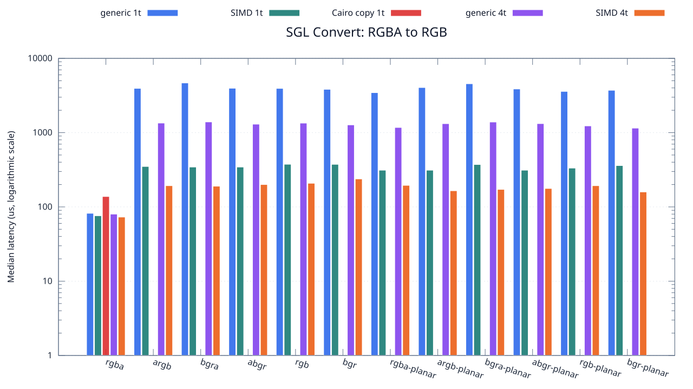
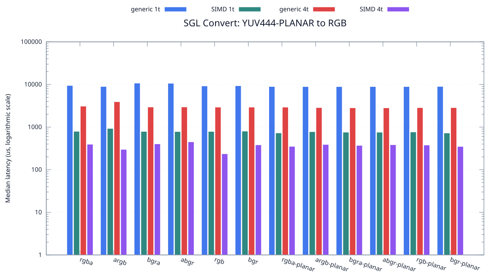
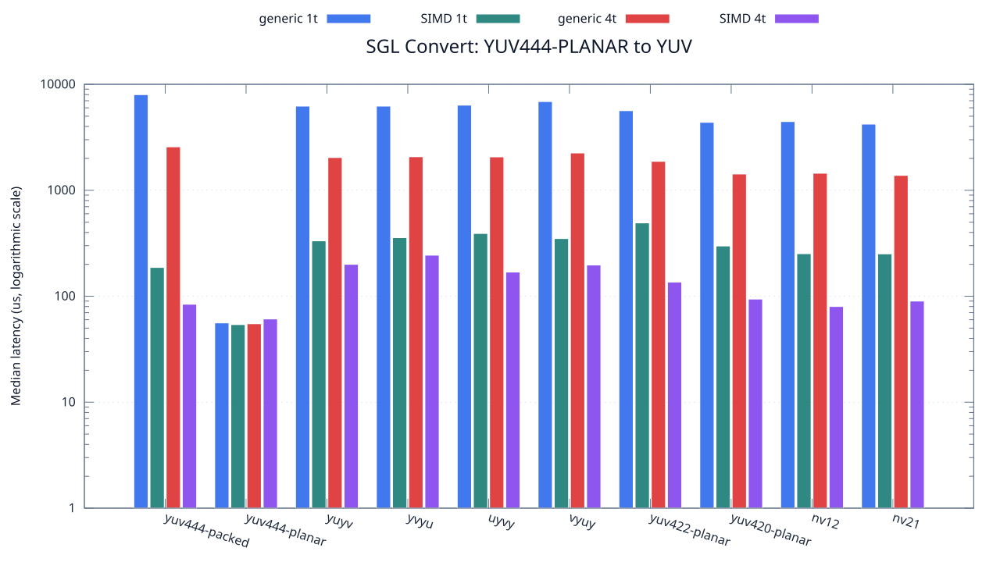

<!--
SPDX-License-Identifier: MIT

Copyright (c) 2025 Dylan Hong

This file is released under the MIT License.
For conditions of distribution and use, see the LICENSE file.
-->

Convert Benchmark
=================

[Benchmark index](../README.md) | [Main README](../../README.md#operation-benchmarks)

Measures every source and destination combination across the supported packed, planar, RGB, and YUV FourCC formats. Cairo is limited to byte-exact 32-bit packed identity copies because it has no arbitrary FourCC conversion API; NE10 has no color-convert API. The SGL matrix contains 484 FourCC
directions and 1,936 measured cases. External libraries add
4 capability-matched cases. Available configurations:
generic 1t, SIMD 1t, Cairo copy 1t, generic 4t, SIMD 4t.

Representative Overview
-----------------------
### RGBA source

### YUV444 planar source

Input and Raw Outputs
---------------------
The benchmark scales the complete `resource/sample.png` input to 1280x720,
then derives all 12 RGB and 10 YUV source FourCC images before measuring every
valid conversion direction. `SGL_TEST_CONVERT_MATRIX_WIDTH` and
`SGL_TEST_CONVERT_MATRIX_HEIGHT` configure this matrix resolution.

Every backend and worker-count result is saved under
`build/<toolchain>/convert-output/`, including byte-identical results. File
output time is outside the measured conversion interval. Names encode the case
index, conversion family, source and destination, worker count, and resolution:

    0000_convert_generic_rgb2rgb_rgba-to-rgba_1thread_1280x720.raw

Source Matrix
-------------
| Source FourCC | Result table | RGB chart | YUV chart |
| --- | --- | --- | --- |
| RGBA | [rgba results](rgba/README.md) | [12 RGB](rgba/rgb.svg) | [10 YUV](rgba/yuv.svg) |
| ARGB | [argb results](argb/README.md) | [12 RGB](argb/rgb.svg) | [10 YUV](argb/yuv.svg) |
| BGRA | [bgra results](bgra/README.md) | [12 RGB](bgra/rgb.svg) | [10 YUV](bgra/yuv.svg) |
| ABGR | [abgr results](abgr/README.md) | [12 RGB](abgr/rgb.svg) | [10 YUV](abgr/yuv.svg) |
| RGB | [rgb results](rgb/README.md) | [12 RGB](rgb/rgb.svg) | [10 YUV](rgb/yuv.svg) |
| BGR | [bgr results](bgr/README.md) | [12 RGB](bgr/rgb.svg) | [10 YUV](bgr/yuv.svg) |
| RGBA-PLANAR | [rgba-planar results](rgba-planar/README.md) | [12 RGB](rgba-planar/rgb.svg) | [10 YUV](rgba-planar/yuv.svg) |
| ARGB-PLANAR | [argb-planar results](argb-planar/README.md) | [12 RGB](argb-planar/rgb.svg) | [10 YUV](argb-planar/yuv.svg) |
| BGRA-PLANAR | [bgra-planar results](bgra-planar/README.md) | [12 RGB](bgra-planar/rgb.svg) | [10 YUV](bgra-planar/yuv.svg) |
| ABGR-PLANAR | [abgr-planar results](abgr-planar/README.md) | [12 RGB](abgr-planar/rgb.svg) | [10 YUV](abgr-planar/yuv.svg) |
| RGB-PLANAR | [rgb-planar results](rgb-planar/README.md) | [12 RGB](rgb-planar/rgb.svg) | [10 YUV](rgb-planar/yuv.svg) |
| BGR-PLANAR | [bgr-planar results](bgr-planar/README.md) | [12 RGB](bgr-planar/rgb.svg) | [10 YUV](bgr-planar/yuv.svg) |
| YUV444-PACKED | [yuv444-packed results](yuv444-packed/README.md) | [12 RGB](yuv444-packed/rgb.svg) | [10 YUV](yuv444-packed/yuv.svg) |
| YUV444-PLANAR | [yuv444-planar results](yuv444-planar/README.md) | [12 RGB](yuv444-planar/rgb.svg) | [10 YUV](yuv444-planar/yuv.svg) |
| YUYV | [yuyv results](yuyv/README.md) | [12 RGB](yuyv/rgb.svg) | [10 YUV](yuyv/yuv.svg) |
| YVYU | [yvyu results](yvyu/README.md) | [12 RGB](yvyu/rgb.svg) | [10 YUV](yvyu/yuv.svg) |
| UYVY | [uyvy results](uyvy/README.md) | [12 RGB](uyvy/rgb.svg) | [10 YUV](uyvy/yuv.svg) |
| VYUY | [vyuy results](vyuy/README.md) | [12 RGB](vyuy/rgb.svg) | [10 YUV](vyuy/yuv.svg) |
| YUV422-PLANAR | [yuv422-planar results](yuv422-planar/README.md) | [12 RGB](yuv422-planar/rgb.svg) | [10 YUV](yuv422-planar/yuv.svg) |
| YUV420-PLANAR | [yuv420-planar results](yuv420-planar/README.md) | [12 RGB](yuv420-planar/rgb.svg) | [10 YUV](yuv420-planar/yuv.svg) |
| NV12 | [nv12 results](nv12/README.md) | [12 RGB](nv12/rgb.svg) | [10 YUV](nv12/yuv.svg) |
| NV21 | [nv21 results](nv21/README.md) | [12 RGB](nv21/rgb.svg) | [10 YUV](nv21/yuv.svg) |

External Backend Coverage
-------------------------
| Library | Measured path | Coverage | Result relation |
| --- | --- | --- | --- |
| Cairo 1.18.4 | ARGB32 SOURCE copy | RGBA/ARGB/BGRA/ABGR identity, 1 thread | Byte-exact |
| NE10 v1.2.1 | Not available | No arbitrary FourCC/color-convert API | N/A |

Cairo surface and context setup is outside the timed region; the timed
operation includes `cairo_paint()` and destination surface flush.

Test Environment
----------------
| Environment | Value |
| --- | --- |
| Report generated | 2026-08-01T04:11:47+00:00 |
| OS | Ubuntu 24.04.4 LTS |
| Kernel | Linux 6.18.33.2-microsoft-standard-WSL2 (WSL2) |
| Runtime architecture | aarch64 |
| Target | Linux/aarch64 |
| CPU | ARM implementer 0x51, part 0x001 |
| Logical CPUs | 8 |
| Visible memory | 3.81 GiB |
| Execution | native |
| Input | resource/sample.png |
| Source revision | b815597 (dirty) |
| Chart generator | gnuplot 6.0 patchlevel 0 |

Build Configuration
-------------------
| Build option | Value |
| --- | --- |
| Toolchain | llvm |
| Compiler | Clang 18.1.3 |
| Compiler path | /usr/bin/clang |
| Build type | Release |
| C flags | `-O2 -DNDEBUG -std=gnu99 -Wall -Wextra -fno-vectorize -fno-slp-vectorize -fno-builtin-memcpy -fno-builtin-memset` |
| Compiler warnings | ON (-Wall, -Wextra) |
| Auto-vectorization | OFF (-fno-vectorize, -fno-slp-vectorize) |
| SIMD | ON (NEON) |
| Threading | ON (pthread) |
| Sanitizers | OFF |
| Stack protector | OFF |
| External comparison | ON (Cairo/NE10 where supported) |
| Warm-up calls | 3 |
| Measured calls | 10 |

The complete CSV is stored in [`benchmark.csv`](benchmark.csv). Results depend
on the input, CPU frequency policy, scheduler load, compiler, and build
options. Refresh them on the target machine before comparison.
