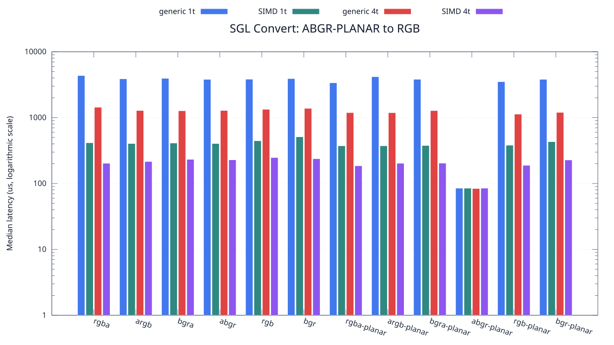
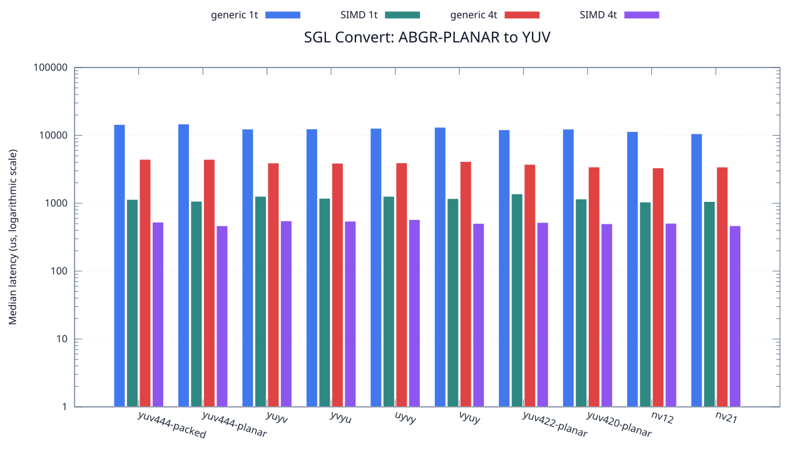

<!--
SPDX-License-Identifier: MIT

Copyright (c) 2025 Dylan Hong

This file is released under the MIT License.
For conditions of distribution and use, see the LICENSE file.
-->

Convert Benchmark: ABGR-PLANAR Source
=====================================

[Convert index](../README.md) | [Benchmark index](../../README.md) | [Main README](../../../README.md#operation-benchmarks)

Every supported RGB and YUV destination is measured from the
`abgr-planar` source format.

RGB Destinations
----------------

YUV Destinations
----------------

External Backend Coverage
-------------------------
| Library | Measured path | Coverage | Result relation |
| --- | --- | --- | --- |
| Cairo 1.18.4 | ARGB32 SOURCE copy | RGBA/ARGB/BGRA/ABGR identity, 1 thread | Byte-exact |
| NE10 v1.2.1 | Not available | No arbitrary FourCC/color-convert API | N/A |

Test Environment
----------------
| Environment | Value |
| --- | --- |
| Report generated | 2026-08-01T04:11:47+00:00 |
| OS | Ubuntu 24.04.4 LTS |
| Kernel | Linux 6.18.33.2-microsoft-standard-WSL2 (WSL2) |
| Runtime architecture | aarch64 |
| Target | Linux/aarch64 |
| CPU | ARM implementer 0x51, part 0x001 |
| Logical CPUs | 8 |
| Visible memory | 3.81 GiB |
| Execution | native |
| Input | resource/sample.png |
| Source revision | b815597 (dirty) |
| Chart generator | gnuplot 6.0 patchlevel 0 |

Build Configuration
-------------------
| Build option | Value |
| --- | --- |
| Toolchain | llvm |
| Compiler | Clang 18.1.3 |
| Compiler path | /usr/bin/clang |
| Build type | Release |
| C flags | `-O2 -DNDEBUG -std=gnu99 -Wall -Wextra -fno-vectorize -fno-slp-vectorize -fno-builtin-memcpy -fno-builtin-memset` |
| Compiler warnings | ON (-Wall, -Wextra) |
| Auto-vectorization | OFF (-fno-vectorize, -fno-slp-vectorize) |
| SIMD | ON (NEON) |
| Threading | ON (pthread) |
| Sanitizers | OFF |
| Stack protector | OFF |
| External comparison | ON (Cairo/NE10 where supported) |
| Warm-up calls | 3 |
| Measured calls | 10 |

Results
-------
| Case | Operation | Backend | Threads | Size | Median (us) | Average (us) | Min (us) | Max (us) | Pixels/s |
| --- | --- | --- | --- | --- | --- | --- | --- | --- | --- |
| 792 | abgr-planar-to-rgba | generic | 1 | 1280x720 | 4,357 | 4,347 | 4,269 | 4,455 | 211,521,689 |
| 793 | abgr-planar-to-rgba | generic | 4 | 1280x720 | 1,439 | 1,467 | 1,378 | 1,632 | 640,444,753 |
| 794 | abgr-planar-to-rgba | simd | 1 | 1280x720 | 416 | 434 | 405 | 491 | 2,215,384,615 |
| 795 | abgr-planar-to-rgba | simd | 4 | 1280x720 | 203 | 210 | 124 | 333 | 4,539,901,477 |
| 796 | abgr-planar-to-argb | generic | 1 | 1280x720 | 3,886 | 3,918 | 3,681 | 4,289 | 237,159,032 |
| 797 | abgr-planar-to-argb | generic | 4 | 1280x720 | 1,284 | 1,291 | 1,216 | 1,419 | 717,757,009 |
| 798 | abgr-planar-to-argb | simd | 1 | 1280x720 | 405 | 413 | 405 | 472 | 2,275,555,555 |
| 799 | abgr-planar-to-argb | simd | 4 | 1280x720 | 216 | 217 | 150 | 292 | 4,266,666,666 |
| 800 | abgr-planar-to-bgra | generic | 1 | 1280x720 | 3,952 | 4,021 | 3,775 | 4,451 | 233,198,380 |
| 801 | abgr-planar-to-bgra | generic | 4 | 1280x720 | 1,273 | 1,281 | 1,248 | 1,362 | 723,959,151 |
| 802 | abgr-planar-to-bgra | simd | 1 | 1280x720 | 412 | 417 | 405 | 456 | 2,236,893,203 |
| 803 | abgr-planar-to-bgra | simd | 4 | 1280x720 | 233 | 245 | 151 | 453 | 3,955,364,806 |
| 804 | abgr-planar-to-abgr | generic | 1 | 1280x720 | 3,813 | 3,828 | 3,764 | 3,983 | 241,699,449 |
| 805 | abgr-planar-to-abgr | generic | 4 | 1280x720 | 1,285 | 1,314 | 1,245 | 1,603 | 717,198,443 |
| 806 | abgr-planar-to-abgr | simd | 1 | 1280x720 | 405 | 420 | 404 | 513 | 2,275,555,555 |
| 807 | abgr-planar-to-abgr | simd | 4 | 1280x720 | 229 | 260 | 201 | 399 | 4,024,454,148 |
| 808 | abgr-planar-to-rgb | generic | 1 | 1280x720 | 3,837 | 3,898 | 3,769 | 4,155 | 240,187,646 |
| 809 | abgr-planar-to-rgb | generic | 4 | 1280x720 | 1,339 | 1,331 | 1,243 | 1,422 | 688,274,831 |
| 810 | abgr-planar-to-rgb | simd | 1 | 1280x720 | 446 | 459 | 436 | 515 | 2,066,367,713 |
| 811 | abgr-planar-to-rgb | simd | 4 | 1280x720 | 248 | 238 | 147 | 323 | 3,716,129,032 |
| 812 | abgr-planar-to-bgr | generic | 1 | 1280x720 | 3,914 | 4,012 | 3,762 | 4,440 | 235,462,442 |
| 813 | abgr-planar-to-bgr | generic | 4 | 1280x720 | 1,384 | 1,404 | 1,321 | 1,554 | 665,895,953 |
| 814 | abgr-planar-to-bgr | simd | 1 | 1280x720 | 512 | 519 | 512 | 543 | 1,800,000,000 |
| 815 | abgr-planar-to-bgr | simd | 4 | 1280x720 | 238 | 234 | 141 | 300 | 3,872,268,907 |
| 816 | abgr-planar-to-rgba-planar | generic | 1 | 1280x720 | 3,383 | 3,479 | 3,257 | 3,858 | 272,420,928 |
| 817 | abgr-planar-to-rgba-planar | generic | 4 | 1280x720 | 1,193 | 1,195 | 1,117 | 1,352 | 772,506,286 |
| 818 | abgr-planar-to-rgba-planar | simd | 1 | 1280x720 | 374 | 386 | 374 | 463 | 2,464,171,122 |
| 819 | abgr-planar-to-rgba-planar | simd | 4 | 1280x720 | 186 | 190 | 115 | 327 | 4,954,838,709 |
| 820 | abgr-planar-to-argb-planar | generic | 1 | 1280x720 | 4,188 | 3,980 | 3,559 | 4,384 | 220,057,306 |
| 821 | abgr-planar-to-argb-planar | generic | 4 | 1280x720 | 1,190 | 1,217 | 1,172 | 1,376 | 774,453,781 |
| 822 | abgr-planar-to-argb-planar | simd | 1 | 1280x720 | 374 | 380 | 374 | 414 | 2,464,171,122 |
| 823 | abgr-planar-to-argb-planar | simd | 4 | 1280x720 | 203 | 218 | 190 | 325 | 4,539,901,477 |
| 824 | abgr-planar-to-bgra-planar | generic | 1 | 1280x720 | 3,825 | 3,847 | 3,770 | 4,069 | 240,941,176 |
| 825 | abgr-planar-to-bgra-planar | generic | 4 | 1280x720 | 1,280 | 1,290 | 1,228 | 1,393 | 720,000,000 |
| 826 | abgr-planar-to-bgra-planar | simd | 1 | 1280x720 | 378 | 383 | 377 | 404 | 2,438,095,238 |
| 827 | abgr-planar-to-bgra-planar | simd | 4 | 1280x720 | 204 | 203 | 177 | 234 | 4,517,647,058 |
| 828 | abgr-planar-to-abgr-planar | generic | 1 | 1280x720 | 85 | 86 | 84 | 96 | 10,842,352,941 |
| 829 | abgr-planar-to-abgr-planar | generic | 4 | 1280x720 | 84 | 85 | 82 | 96 | 10,971,428,571 |
| 830 | abgr-planar-to-abgr-planar | simd | 1 | 1280x720 | 85 | 84 | 84 | 85 | 10,842,352,941 |
| 831 | abgr-planar-to-abgr-planar | simd | 4 | 1280x720 | 85 | 85 | 84 | 94 | 10,842,352,941 |
| 832 | abgr-planar-to-rgb-planar | generic | 1 | 1280x720 | 3,518 | 3,611 | 3,327 | 3,926 | 261,967,026 |
| 833 | abgr-planar-to-rgb-planar | generic | 4 | 1280x720 | 1,132 | 1,149 | 1,066 | 1,298 | 814,134,275 |
| 834 | abgr-planar-to-rgb-planar | simd | 1 | 1280x720 | 382 | 396 | 374 | 440 | 2,412,565,445 |
| 835 | abgr-planar-to-rgb-planar | simd | 4 | 1280x720 | 189 | 208 | 123 | 354 | 4,876,190,476 |
| 836 | abgr-planar-to-bgr-planar | generic | 1 | 1280x720 | 3,816 | 3,680 | 3,272 | 3,957 | 241,509,433 |
| 837 | abgr-planar-to-bgr-planar | generic | 4 | 1280x720 | 1,203 | 1,249 | 1,087 | 1,666 | 766,084,788 |
| 838 | abgr-planar-to-bgr-planar | simd | 1 | 1280x720 | 432 | 418 | 374 | 475 | 2,133,333,333 |
| 839 | abgr-planar-to-bgr-planar | simd | 4 | 1280x720 | 228 | 260 | 195 | 408 | 4,042,105,263 |
| 840 | abgr-planar-to-yuv444-packed | generic | 1 | 1280x720 | 14,445 | 14,399 | 14,127 | 14,576 | 63,800,623 |
| 841 | abgr-planar-to-yuv444-packed | generic | 4 | 1280x720 | 4,432 | 4,489 | 4,276 | 4,877 | 207,942,238 |
| 842 | abgr-planar-to-yuv444-packed | simd | 1 | 1280x720 | 1,138 | 1,181 | 1,098 | 1,345 | 809,841,827 |
| 843 | abgr-planar-to-yuv444-packed | simd | 4 | 1280x720 | 527 | 533 | 479 | 616 | 1,748,766,603 |
| 844 | abgr-planar-to-yuv444-planar | generic | 1 | 1280x720 | 14,689 | 14,741 | 14,136 | 15,783 | 62,740,826 |
| 845 | abgr-planar-to-yuv444-planar | generic | 4 | 1280x720 | 4,427 | 4,432 | 4,353 | 4,541 | 208,177,095 |
| 846 | abgr-planar-to-yuv444-planar | simd | 1 | 1280x720 | 1,069 | 1,091 | 1,063 | 1,212 | 862,114,125 |
| 847 | abgr-planar-to-yuv444-planar | simd | 4 | 1280x720 | 466 | 468 | 413 | 517 | 1,977,682,403 |
| 848 | abgr-planar-to-yuyv | generic | 1 | 1280x720 | 12,380 | 12,414 | 12,208 | 12,899 | 74,442,649 |
| 849 | abgr-planar-to-yuyv | generic | 4 | 1280x720 | 3,918 | 3,917 | 3,845 | 4,014 | 235,222,052 |
| 850 | abgr-planar-to-yuyv | simd | 1 | 1280x720 | 1,266 | 1,295 | 1,247 | 1,437 | 727,962,085 |
| 851 | abgr-planar-to-yuyv | simd | 4 | 1280x720 | 550 | 549 | 470 | 619 | 1,675,636,363 |
| 852 | abgr-planar-to-yvyu | generic | 1 | 1280x720 | 12,441 | 12,531 | 12,360 | 12,978 | 74,077,646 |
| 853 | abgr-planar-to-yvyu | generic | 4 | 1280x720 | 3,889 | 3,903 | 3,850 | 3,980 | 236,976,086 |
| 854 | abgr-planar-to-yvyu | simd | 1 | 1280x720 | 1,182 | 1,188 | 1,154 | 1,252 | 779,695,431 |
| 855 | abgr-planar-to-yvyu | simd | 4 | 1280x720 | 544 | 557 | 470 | 647 | 1,694,117,647 |
| 856 | abgr-planar-to-uyvy | generic | 1 | 1280x720 | 12,722 | 12,751 | 12,668 | 13,008 | 72,441,440 |
| 857 | abgr-planar-to-uyvy | generic | 4 | 1280x720 | 3,936 | 3,941 | 3,840 | 4,010 | 234,146,341 |
| 858 | abgr-planar-to-uyvy | simd | 1 | 1280x720 | 1,265 | 1,292 | 1,253 | 1,409 | 728,537,549 |
| 859 | abgr-planar-to-uyvy | simd | 4 | 1280x720 | 575 | 581 | 533 | 687 | 1,602,782,608 |
| 860 | abgr-planar-to-vyuy | generic | 1 | 1280x720 | 13,168 | 13,235 | 12,984 | 14,014 | 69,987,849 |
| 861 | abgr-planar-to-vyuy | generic | 4 | 1280x720 | 4,121 | 4,211 | 4,000 | 4,726 | 223,635,040 |
| 862 | abgr-planar-to-vyuy | simd | 1 | 1280x720 | 1,171 | 1,214 | 1,154 | 1,355 | 787,019,641 |
| 863 | abgr-planar-to-vyuy | simd | 4 | 1280x720 | 505 | 509 | 414 | 599 | 1,824,950,495 |
| 864 | abgr-planar-to-yuv422-planar | generic | 1 | 1280x720 | 12,096 | 12,108 | 11,871 | 12,402 | 76,190,476 |
| 865 | abgr-planar-to-yuv422-planar | generic | 4 | 1280x720 | 3,739 | 3,755 | 3,642 | 3,923 | 246,483,016 |
| 866 | abgr-planar-to-yuv422-planar | simd | 1 | 1280x720 | 1,374 | 1,377 | 1,362 | 1,397 | 670,742,358 |
| 867 | abgr-planar-to-yuv422-planar | simd | 4 | 1280x720 | 521 | 551 | 463 | 750 | 1,768,905,950 |
| 868 | abgr-planar-to-yuv420-planar | generic | 1 | 1280x720 | 12,361 | 12,739 | 11,746 | 16,265 | 74,557,074 |
| 869 | abgr-planar-to-yuv420-planar | generic | 4 | 1280x720 | 3,422 | 3,399 | 3,288 | 3,577 | 269,316,189 |
| 870 | abgr-planar-to-yuv420-planar | simd | 1 | 1280x720 | 1,155 | 1,148 | 1,055 | 1,249 | 797,922,077 |
| 871 | abgr-planar-to-yuv420-planar | simd | 4 | 1280x720 | 499 | 499 | 417 | 608 | 1,846,893,787 |
| 872 | abgr-planar-to-nv12 | generic | 1 | 1280x720 | 11,381 | 11,609 | 10,702 | 13,654 | 80,977,067 |
| 873 | abgr-planar-to-nv12 | generic | 4 | 1280x720 | 3,315 | 3,320 | 3,222 | 3,476 | 278,009,049 |
| 874 | abgr-planar-to-nv12 | simd | 1 | 1280x720 | 1,041 | 1,042 | 1,028 | 1,056 | 885,302,593 |
| 875 | abgr-planar-to-nv12 | simd | 4 | 1280x720 | 507 | 566 | 407 | 1,091 | 1,817,751,479 |
| 876 | abgr-planar-to-nv21 | generic | 1 | 1280x720 | 10,571 | 10,565 | 10,427 | 10,797 | 87,181,912 |
| 877 | abgr-planar-to-nv21 | generic | 4 | 1280x720 | 3,416 | 3,398 | 3,256 | 3,495 | 269,789,227 |
| 878 | abgr-planar-to-nv21 | simd | 1 | 1280x720 | 1,060 | 1,110 | 1,044 | 1,329 | 869,433,962 |
| 879 | abgr-planar-to-nv21 | simd | 4 | 1280x720 | 467 | 462 | 386 | 520 | 1,973,447,537 |

Results depend on the input, CPU frequency policy, scheduler load, compiler,
and build options. Refresh them on the target machine before comparison.
