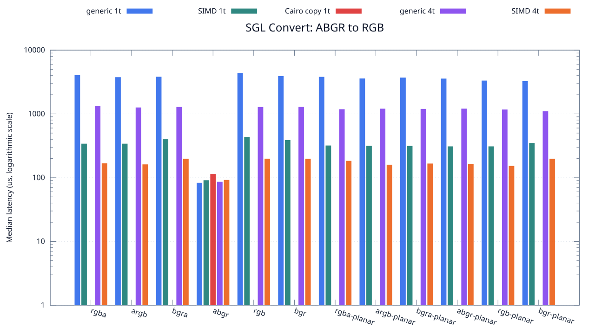
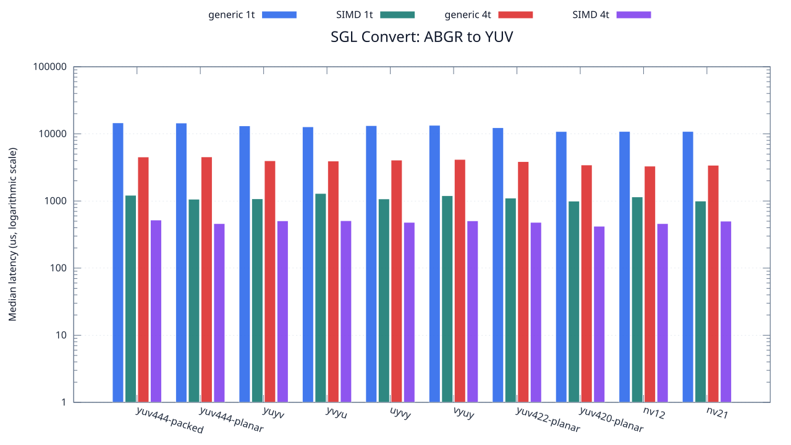

<!--
SPDX-License-Identifier: MIT

Copyright (c) 2025 Dylan Hong

This file is released under the MIT License.
For conditions of distribution and use, see the LICENSE file.
-->

Convert Benchmark: ABGR Source
==============================

[Convert index](../README.md) | [Benchmark index](../../README.md) | [Main README](../../../README.md#operation-benchmarks)

Every supported RGB and YUV destination is measured from the
`abgr` source format.

RGB Destinations
----------------

YUV Destinations
----------------

External Backend Coverage
-------------------------
| Library | Measured path | Coverage | Result relation |
| --- | --- | --- | --- |
| Cairo 1.18.4 | ARGB32 SOURCE copy | RGBA/ARGB/BGRA/ABGR identity, 1 thread | Byte-exact |
| NE10 v1.2.1 | Not available | No arbitrary FourCC/color-convert API | N/A |

Test Environment
----------------
| Environment | Value |
| --- | --- |
| Report generated | 2026-08-01T04:11:47+00:00 |
| OS | Ubuntu 24.04.4 LTS |
| Kernel | Linux 6.18.33.2-microsoft-standard-WSL2 (WSL2) |
| Runtime architecture | aarch64 |
| Target | Linux/aarch64 |
| CPU | ARM implementer 0x51, part 0x001 |
| Logical CPUs | 8 |
| Visible memory | 3.81 GiB |
| Execution | native |
| Input | resource/sample.png |
| Source revision | b815597 (dirty) |
| Chart generator | gnuplot 6.0 patchlevel 0 |

Build Configuration
-------------------
| Build option | Value |
| --- | --- |
| Toolchain | llvm |
| Compiler | Clang 18.1.3 |
| Compiler path | /usr/bin/clang |
| Build type | Release |
| C flags | `-O2 -DNDEBUG -std=gnu99 -Wall -Wextra -fno-vectorize -fno-slp-vectorize -fno-builtin-memcpy -fno-builtin-memset` |
| Compiler warnings | ON (-Wall, -Wextra) |
| Auto-vectorization | OFF (-fno-vectorize, -fno-slp-vectorize) |
| SIMD | ON (NEON) |
| Threading | ON (pthread) |
| Sanitizers | OFF |
| Stack protector | OFF |
| External comparison | ON (Cairo/NE10 where supported) |
| Warm-up calls | 3 |
| Measured calls | 10 |

Results
-------
| Case | Operation | Backend | Threads | Size | Median (us) | Average (us) | Min (us) | Max (us) | Pixels/s |
| --- | --- | --- | --- | --- | --- | --- | --- | --- | --- |
| 264 | abgr-to-rgba | generic | 1 | 1280x720 | 4,080 | 4,102 | 4,019 | 4,273 | 225,882,352 |
| 265 | abgr-to-rgba | generic | 4 | 1280x720 | 1,345 | 1,389 | 1,321 | 1,639 | 685,204,460 |
| 266 | abgr-to-rgba | simd | 1 | 1280x720 | 344 | 353 | 343 | 419 | 2,679,069,767 |
| 267 | abgr-to-rgba | simd | 4 | 1280x720 | 169 | 154 | 107 | 206 | 5,453,254,437 |
| 268 | abgr-to-argb | generic | 1 | 1280x720 | 3,799 | 3,954 | 3,692 | 4,393 | 242,590,155 |
| 269 | abgr-to-argb | generic | 4 | 1280x720 | 1,271 | 1,274 | 1,215 | 1,354 | 725,098,347 |
| 270 | abgr-to-argb | simd | 1 | 1280x720 | 344 | 357 | 343 | 439 | 2,679,069,767 |
| 271 | abgr-to-argb | simd | 4 | 1280x720 | 163 | 162 | 106 | 218 | 5,653,987,730 |
| 272 | abgr-to-bgra | generic | 1 | 1280x720 | 3,852 | 3,887 | 3,787 | 4,224 | 239,252,336 |
| 273 | abgr-to-bgra | generic | 4 | 1280x720 | 1,298 | 1,332 | 1,252 | 1,558 | 710,015,408 |
| 274 | abgr-to-bgra | simd | 1 | 1280x720 | 404 | 423 | 345 | 622 | 2,281,188,118 |
| 275 | abgr-to-bgra | simd | 4 | 1280x720 | 199 | 210 | 131 | 280 | 4,631,155,778 |
| 276 | abgr-to-abgr | generic | 1 | 1280x720 | 84 | 85 | 84 | 99 | 10,971,428,571 |
| 277 | abgr-to-abgr | generic | 4 | 1280x720 | 87 | 93 | 83 | 123 | 10,593,103,448 |
| 278 | abgr-to-abgr | simd | 1 | 1280x720 | 92 | 93 | 88 | 108 | 10,017,391,304 |
| 279 | abgr-to-abgr | simd | 4 | 1280x720 | 93 | 98 | 91 | 115 | 9,909,677,419 |
| 280 | abgr-to-rgb | generic | 1 | 1280x720 | 4,419 | 4,224 | 3,772 | 4,529 | 208,553,971 |
| 281 | abgr-to-rgb | generic | 4 | 1280x720 | 1,294 | 1,342 | 1,208 | 1,806 | 712,210,200 |
| 282 | abgr-to-rgb | simd | 1 | 1280x720 | 440 | 439 | 375 | 486 | 2,094,545,454 |
| 283 | abgr-to-rgb | simd | 4 | 1280x720 | 200 | 205 | 138 | 292 | 4,608,000,000 |
| 284 | abgr-to-bgr | generic | 1 | 1280x720 | 3,955 | 4,018 | 3,770 | 4,581 | 233,021,491 |
| 285 | abgr-to-bgr | generic | 4 | 1280x720 | 1,303 | 1,330 | 1,232 | 1,587 | 707,290,867 |
| 286 | abgr-to-bgr | simd | 1 | 1280x720 | 392 | 395 | 374 | 437 | 2,351,020,408 |
| 287 | abgr-to-bgr | simd | 4 | 1280x720 | 199 | 210 | 180 | 303 | 4,631,155,778 |
| 288 | abgr-to-rgba-planar | generic | 1 | 1280x720 | 3,840 | 3,691 | 3,265 | 3,950 | 240,000,000 |
| 289 | abgr-to-rgba-planar | generic | 4 | 1280x720 | 1,193 | 1,196 | 1,114 | 1,287 | 772,506,286 |
| 290 | abgr-to-rgba-planar | simd | 1 | 1280x720 | 322 | 331 | 312 | 391 | 2,862,111,801 |
| 291 | abgr-to-rgba-planar | simd | 4 | 1280x720 | 185 | 189 | 113 | 293 | 4,981,621,621 |
| 292 | abgr-to-argb-planar | generic | 1 | 1280x720 | 3,618 | 3,706 | 3,578 | 4,294 | 254,726,368 |
| 293 | abgr-to-argb-planar | generic | 4 | 1280x720 | 1,218 | 1,261 | 1,188 | 1,482 | 756,650,246 |
| 294 | abgr-to-argb-planar | simd | 1 | 1280x720 | 318 | 334 | 311 | 378 | 2,898,113,207 |
| 295 | abgr-to-argb-planar | simd | 4 | 1280x720 | 161 | 180 | 106 | 383 | 5,724,223,602 |
| 296 | abgr-to-bgra-planar | generic | 1 | 1280x720 | 3,734 | 3,753 | 3,647 | 3,980 | 246,813,069 |
| 297 | abgr-to-bgra-planar | generic | 4 | 1280x720 | 1,206 | 1,215 | 1,193 | 1,273 | 764,179,104 |
| 298 | abgr-to-bgra-planar | simd | 1 | 1280x720 | 317 | 321 | 311 | 347 | 2,907,255,520 |
| 299 | abgr-to-bgra-planar | simd | 4 | 1280x720 | 168 | 166 | 114 | 231 | 5,485,714,285 |
| 300 | abgr-to-abgr-planar | generic | 1 | 1280x720 | 3,606 | 3,631 | 3,583 | 3,710 | 255,574,043 |
| 301 | abgr-to-abgr-planar | generic | 4 | 1280x720 | 1,220 | 1,258 | 1,187 | 1,553 | 755,409,836 |
| 302 | abgr-to-abgr-planar | simd | 1 | 1280x720 | 312 | 315 | 311 | 327 | 2,953,846,153 |
| 303 | abgr-to-abgr-planar | simd | 4 | 1280x720 | 166 | 170 | 117 | 231 | 5,551,807,228 |
| 304 | abgr-to-rgb-planar | generic | 1 | 1280x720 | 3,358 | 3,506 | 3,314 | 3,977 | 274,449,076 |
| 305 | abgr-to-rgb-planar | generic | 4 | 1280x720 | 1,181 | 1,183 | 1,128 | 1,261 | 780,355,630 |
| 306 | abgr-to-rgb-planar | simd | 1 | 1280x720 | 312 | 319 | 311 | 355 | 2,953,846,153 |
| 307 | abgr-to-rgb-planar | simd | 4 | 1280x720 | 154 | 164 | 105 | 245 | 5,984,415,584 |
| 308 | abgr-to-bgr-planar | generic | 1 | 1280x720 | 3,285 | 3,320 | 3,256 | 3,454 | 280,547,945 |
| 309 | abgr-to-bgr-planar | generic | 4 | 1280x720 | 1,107 | 1,111 | 1,086 | 1,139 | 832,520,325 |
| 310 | abgr-to-bgr-planar | simd | 1 | 1280x720 | 353 | 357 | 311 | 438 | 2,610,764,872 |
| 311 | abgr-to-bgr-planar | simd | 4 | 1280x720 | 199 | 215 | 169 | 282 | 4,631,155,778 |
| 312 | abgr-to-yuv444-packed | generic | 1 | 1280x720 | 14,612 | 14,660 | 14,393 | 15,265 | 63,071,448 |
| 313 | abgr-to-yuv444-packed | generic | 4 | 1280x720 | 4,532 | 4,562 | 4,357 | 4,825 | 203,353,927 |
| 314 | abgr-to-yuv444-packed | simd | 1 | 1280x720 | 1,218 | 1,233 | 1,205 | 1,357 | 756,650,246 |
| 315 | abgr-to-yuv444-packed | simd | 4 | 1280x720 | 521 | 555 | 453 | 704 | 1,768,905,950 |
| 316 | abgr-to-yuv444-planar | generic | 1 | 1280x720 | 14,524 | 14,575 | 14,396 | 14,989 | 63,453,594 |
| 317 | abgr-to-yuv444-planar | generic | 4 | 1280x720 | 4,546 | 4,542 | 4,333 | 4,675 | 202,727,672 |
| 318 | abgr-to-yuv444-planar | simd | 1 | 1280x720 | 1,064 | 1,073 | 995 | 1,295 | 866,165,413 |
| 319 | abgr-to-yuv444-planar | simd | 4 | 1280x720 | 461 | 461 | 404 | 526 | 1,999,132,321 |
| 320 | abgr-to-yuyv | generic | 1 | 1280x720 | 13,177 | 13,635 | 12,661 | 14,810 | 69,940,047 |
| 321 | abgr-to-yuyv | generic | 4 | 1280x720 | 3,981 | 3,984 | 3,838 | 4,129 | 231,499,623 |
| 322 | abgr-to-yuyv | simd | 1 | 1280x720 | 1,079 | 1,080 | 1,061 | 1,105 | 854,124,189 |
| 323 | abgr-to-yuyv | simd | 4 | 1280x720 | 507 | 517 | 474 | 591 | 1,817,751,479 |
| 324 | abgr-to-yvyu | generic | 1 | 1280x720 | 12,758 | 12,802 | 12,557 | 13,232 | 72,237,027 |
| 325 | abgr-to-yvyu | generic | 4 | 1280x720 | 3,940 | 3,949 | 3,860 | 4,073 | 233,908,629 |
| 326 | abgr-to-yvyu | simd | 1 | 1280x720 | 1,296 | 1,298 | 1,290 | 1,319 | 711,111,111 |
| 327 | abgr-to-yvyu | simd | 4 | 1280x720 | 509 | 516 | 465 | 603 | 1,810,609,037 |
| 328 | abgr-to-uyvy | generic | 1 | 1280x720 | 13,281 | 13,543 | 12,936 | 15,074 | 69,392,365 |
| 329 | abgr-to-uyvy | generic | 4 | 1280x720 | 4,071 | 4,051 | 3,848 | 4,249 | 226,381,724 |
| 330 | abgr-to-uyvy | simd | 1 | 1280x720 | 1,075 | 1,108 | 1,062 | 1,258 | 857,302,325 |
| 331 | abgr-to-uyvy | simd | 4 | 1280x720 | 481 | 501 | 432 | 571 | 1,916,008,316 |
| 332 | abgr-to-vyuy | generic | 1 | 1280x720 | 13,432 | 13,422 | 13,238 | 13,572 | 68,612,269 |
| 333 | abgr-to-vyuy | generic | 4 | 1280x720 | 4,165 | 4,224 | 4,004 | 4,927 | 221,272,509 |
| 334 | abgr-to-vyuy | simd | 1 | 1280x720 | 1,200 | 1,203 | 1,100 | 1,356 | 768,000,000 |
| 335 | abgr-to-vyuy | simd | 4 | 1280x720 | 507 | 525 | 408 | 685 | 1,817,751,479 |
| 336 | abgr-to-yuv422-planar | generic | 1 | 1280x720 | 12,365 | 12,379 | 12,044 | 12,804 | 74,532,955 |
| 337 | abgr-to-yuv422-planar | generic | 4 | 1280x720 | 3,866 | 3,897 | 3,618 | 4,154 | 238,385,928 |
| 338 | abgr-to-yuv422-planar | simd | 1 | 1280x720 | 1,105 | 1,133 | 1,093 | 1,237 | 834,027,149 |
| 339 | abgr-to-yuv422-planar | simd | 4 | 1280x720 | 481 | 492 | 395 | 580 | 1,916,008,316 |
| 340 | abgr-to-yuv420-planar | generic | 1 | 1280x720 | 10,865 | 10,992 | 10,689 | 12,154 | 84,822,825 |
| 341 | abgr-to-yuv420-planar | generic | 4 | 1280x720 | 3,445 | 3,501 | 3,288 | 3,903 | 267,518,142 |
| 342 | abgr-to-yuv420-planar | simd | 1 | 1280x720 | 996 | 1,013 | 984 | 1,103 | 925,301,204 |
| 343 | abgr-to-yuv420-planar | simd | 4 | 1280x720 | 421 | 423 | 384 | 454 | 2,189,073,634 |
| 344 | abgr-to-nv12 | generic | 1 | 1280x720 | 10,884 | 10,917 | 10,685 | 11,300 | 84,674,751 |
| 345 | abgr-to-nv12 | generic | 4 | 1280x720 | 3,311 | 3,406 | 3,189 | 3,809 | 278,344,910 |
| 346 | abgr-to-nv12 | simd | 1 | 1280x720 | 1,151 | 1,168 | 1,143 | 1,312 | 800,695,047 |
| 347 | abgr-to-nv12 | simd | 4 | 1280x720 | 461 | 457 | 361 | 509 | 1,999,132,321 |
| 348 | abgr-to-nv21 | generic | 1 | 1280x720 | 10,883 | 10,889 | 10,698 | 11,196 | 84,682,532 |
| 349 | abgr-to-nv21 | generic | 4 | 1280x720 | 3,411 | 3,409 | 3,312 | 3,610 | 270,184,696 |
| 350 | abgr-to-nv21 | simd | 1 | 1280x720 | 999 | 1,009 | 981 | 1,084 | 922,522,522 |
| 351 | abgr-to-nv21 | simd | 4 | 1280x720 | 501 | 536 | 436 | 706 | 1,839,520,958 |
| 1939 | abgr-to-abgr | cairo-copy | 1 | 1280x720 | 115 | 117 | 110 | 130 | 8,013,913,043 |

Results depend on the input, CPU frequency policy, scheduler load, compiler,
and build options. Refresh them on the target machine before comparison.
