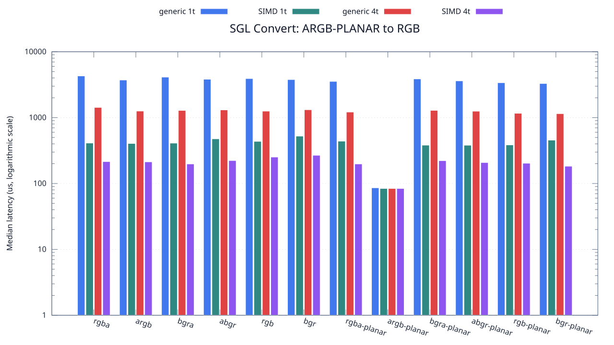
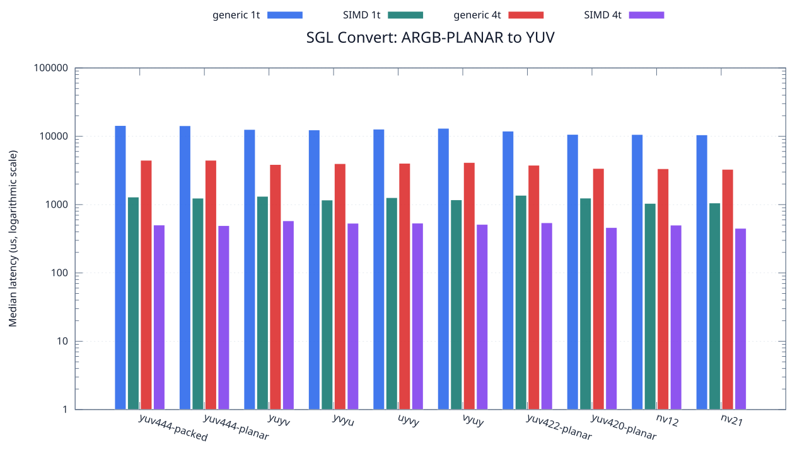

<!--
SPDX-License-Identifier: MIT

Copyright (c) 2025 Dylan Hong

This file is released under the MIT License.
For conditions of distribution and use, see the LICENSE file.
-->

Convert Benchmark: ARGB-PLANAR Source
=====================================

[Convert index](../README.md) | [Benchmark index](../../README.md) | [Main README](../../../README.md#operation-benchmarks)

Every supported RGB and YUV destination is measured from the
`argb-planar` source format.

RGB Destinations
----------------

YUV Destinations
----------------

External Backend Coverage
-------------------------
| Library | Measured path | Coverage | Result relation |
| --- | --- | --- | --- |
| Cairo 1.18.4 | ARGB32 SOURCE copy | RGBA/ARGB/BGRA/ABGR identity, 1 thread | Byte-exact |
| NE10 v1.2.1 | Not available | No arbitrary FourCC/color-convert API | N/A |

Test Environment
----------------
| Environment | Value |
| --- | --- |
| Report generated | 2026-08-01T04:11:47+00:00 |
| OS | Ubuntu 24.04.4 LTS |
| Kernel | Linux 6.18.33.2-microsoft-standard-WSL2 (WSL2) |
| Runtime architecture | aarch64 |
| Target | Linux/aarch64 |
| CPU | ARM implementer 0x51, part 0x001 |
| Logical CPUs | 8 |
| Visible memory | 3.81 GiB |
| Execution | native |
| Input | resource/sample.png |
| Source revision | b815597 (dirty) |
| Chart generator | gnuplot 6.0 patchlevel 0 |

Build Configuration
-------------------
| Build option | Value |
| --- | --- |
| Toolchain | llvm |
| Compiler | Clang 18.1.3 |
| Compiler path | /usr/bin/clang |
| Build type | Release |
| C flags | `-O2 -DNDEBUG -std=gnu99 -Wall -Wextra -fno-vectorize -fno-slp-vectorize -fno-builtin-memcpy -fno-builtin-memset` |
| Compiler warnings | ON (-Wall, -Wextra) |
| Auto-vectorization | OFF (-fno-vectorize, -fno-slp-vectorize) |
| SIMD | ON (NEON) |
| Threading | ON (pthread) |
| Sanitizers | OFF |
| Stack protector | OFF |
| External comparison | ON (Cairo/NE10 where supported) |
| Warm-up calls | 3 |
| Measured calls | 10 |

Results
-------
| Case | Operation | Backend | Threads | Size | Median (us) | Average (us) | Min (us) | Max (us) | Pixels/s |
| --- | --- | --- | --- | --- | --- | --- | --- | --- | --- |
| 616 | argb-planar-to-rgba | generic | 1 | 1280x720 | 4,290 | 4,351 | 4,259 | 4,800 | 214,825,174 |
| 617 | argb-planar-to-rgba | generic | 4 | 1280x720 | 1,428 | 1,510 | 1,380 | 1,878 | 645,378,151 |
| 618 | argb-planar-to-rgba | simd | 1 | 1280x720 | 411 | 413 | 405 | 433 | 2,242,335,766 |
| 619 | argb-planar-to-rgba | simd | 4 | 1280x720 | 215 | 214 | 150 | 272 | 4,286,511,627 |
| 620 | argb-planar-to-argb | generic | 1 | 1280x720 | 3,724 | 3,773 | 3,668 | 3,978 | 247,475,832 |
| 621 | argb-planar-to-argb | generic | 4 | 1280x720 | 1,258 | 1,291 | 1,216 | 1,641 | 732,591,414 |
| 622 | argb-planar-to-argb | simd | 1 | 1280x720 | 405 | 410 | 404 | 443 | 2,275,555,555 |
| 623 | argb-planar-to-argb | simd | 4 | 1280x720 | 213 | 222 | 132 | 315 | 4,326,760,563 |
| 624 | argb-planar-to-bgra | generic | 1 | 1280x720 | 4,120 | 4,114 | 3,772 | 4,441 | 223,689,320 |
| 625 | argb-planar-to-bgra | generic | 4 | 1280x720 | 1,285 | 1,291 | 1,229 | 1,373 | 717,198,443 |
| 626 | argb-planar-to-bgra | simd | 1 | 1280x720 | 410 | 425 | 405 | 489 | 2,247,804,878 |
| 627 | argb-planar-to-bgra | simd | 4 | 1280x720 | 198 | 210 | 151 | 270 | 4,654,545,454 |
| 628 | argb-planar-to-abgr | generic | 1 | 1280x720 | 3,825 | 3,882 | 3,758 | 4,217 | 240,941,176 |
| 629 | argb-planar-to-abgr | generic | 4 | 1280x720 | 1,309 | 1,322 | 1,244 | 1,428 | 704,048,892 |
| 630 | argb-planar-to-abgr | simd | 1 | 1280x720 | 476 | 482 | 475 | 509 | 1,936,134,453 |
| 631 | argb-planar-to-abgr | simd | 4 | 1280x720 | 223 | 236 | 131 | 364 | 4,132,735,426 |
| 632 | argb-planar-to-rgb | generic | 1 | 1280x720 | 3,916 | 4,099 | 3,774 | 4,544 | 235,342,185 |
| 633 | argb-planar-to-rgb | generic | 4 | 1280x720 | 1,255 | 1,289 | 1,210 | 1,633 | 734,342,629 |
| 634 | argb-planar-to-rgb | simd | 1 | 1280x720 | 436 | 443 | 436 | 461 | 2,113,761,467 |
| 635 | argb-planar-to-rgb | simd | 4 | 1280x720 | 252 | 228 | 160 | 270 | 3,657,142,857 |
| 636 | argb-planar-to-bgr | generic | 1 | 1280x720 | 3,781 | 3,821 | 3,761 | 3,964 | 243,745,040 |
| 637 | argb-planar-to-bgr | generic | 4 | 1280x720 | 1,317 | 1,331 | 1,220 | 1,424 | 699,772,209 |
| 638 | argb-planar-to-bgr | simd | 1 | 1280x720 | 524 | 533 | 511 | 639 | 1,758,778,625 |
| 639 | argb-planar-to-bgr | simd | 4 | 1280x720 | 268 | 262 | 191 | 363 | 3,438,805,970 |
| 640 | argb-planar-to-rgba-planar | generic | 1 | 1280x720 | 3,546 | 3,560 | 3,256 | 3,951 | 259,898,477 |
| 641 | argb-planar-to-rgba-planar | generic | 4 | 1280x720 | 1,215 | 1,183 | 1,041 | 1,305 | 758,518,518 |
| 642 | argb-planar-to-rgba-planar | simd | 1 | 1280x720 | 439 | 433 | 373 | 490 | 2,099,316,628 |
| 643 | argb-planar-to-rgba-planar | simd | 4 | 1280x720 | 198 | 198 | 141 | 249 | 4,654,545,454 |
| 644 | argb-planar-to-argb-planar | generic | 1 | 1280x720 | 86 | 88 | 84 | 99 | 10,716,279,069 |
| 645 | argb-planar-to-argb-planar | generic | 4 | 1280x720 | 84 | 85 | 83 | 99 | 10,971,428,571 |
| 646 | argb-planar-to-argb-planar | simd | 1 | 1280x720 | 84 | 83 | 83 | 84 | 10,971,428,571 |
| 647 | argb-planar-to-argb-planar | simd | 4 | 1280x720 | 84 | 83 | 83 | 84 | 10,971,428,571 |
| 648 | argb-planar-to-bgra-planar | generic | 1 | 1280x720 | 3,869 | 3,995 | 3,763 | 4,439 | 238,201,085 |
| 649 | argb-planar-to-bgra-planar | generic | 4 | 1280x720 | 1,288 | 1,283 | 1,228 | 1,329 | 715,527,950 |
| 650 | argb-planar-to-bgra-planar | simd | 1 | 1280x720 | 382 | 392 | 378 | 451 | 2,412,565,445 |
| 651 | argb-planar-to-bgra-planar | simd | 4 | 1280x720 | 222 | 230 | 147 | 419 | 4,151,351,351 |
| 652 | argb-planar-to-abgr-planar | generic | 1 | 1280x720 | 3,613 | 3,648 | 3,564 | 3,766 | 255,078,881 |
| 653 | argb-planar-to-abgr-planar | generic | 4 | 1280x720 | 1,252 | 1,277 | 1,181 | 1,461 | 736,102,236 |
| 654 | argb-planar-to-abgr-planar | simd | 1 | 1280x720 | 381 | 388 | 374 | 430 | 2,418,897,637 |
| 655 | argb-planar-to-abgr-planar | simd | 4 | 1280x720 | 208 | 198 | 116 | 241 | 4,430,769,230 |
| 656 | argb-planar-to-rgb-planar | generic | 1 | 1280x720 | 3,384 | 3,398 | 3,317 | 3,518 | 272,340,425 |
| 657 | argb-planar-to-rgb-planar | generic | 4 | 1280x720 | 1,163 | 1,183 | 1,104 | 1,454 | 792,433,361 |
| 658 | argb-planar-to-rgb-planar | simd | 1 | 1280x720 | 385 | 390 | 374 | 447 | 2,393,766,233 |
| 659 | argb-planar-to-rgb-planar | simd | 4 | 1280x720 | 203 | 197 | 164 | 212 | 4,539,901,477 |
| 660 | argb-planar-to-bgr-planar | generic | 1 | 1280x720 | 3,294 | 3,313 | 3,265 | 3,380 | 279,781,420 |
| 661 | argb-planar-to-bgr-planar | generic | 4 | 1280x720 | 1,148 | 1,148 | 1,111 | 1,216 | 802,787,456 |
| 662 | argb-planar-to-bgr-planar | simd | 1 | 1280x720 | 455 | 451 | 374 | 541 | 2,025,494,505 |
| 663 | argb-planar-to-bgr-planar | simd | 4 | 1280x720 | 183 | 172 | 115 | 220 | 5,036,065,573 |
| 664 | argb-planar-to-yuv444-packed | generic | 1 | 1280x720 | 14,360 | 14,641 | 14,171 | 17,381 | 64,178,272 |
| 665 | argb-planar-to-yuv444-packed | generic | 4 | 1280x720 | 4,459 | 4,486 | 4,356 | 4,675 | 206,683,112 |
| 666 | argb-planar-to-yuv444-packed | simd | 1 | 1280x720 | 1,291 | 1,311 | 1,287 | 1,466 | 713,865,220 |
| 667 | argb-planar-to-yuv444-packed | simd | 4 | 1280x720 | 503 | 508 | 464 | 582 | 1,832,206,759 |
| 668 | argb-planar-to-yuv444-planar | generic | 1 | 1280x720 | 14,283 | 14,422 | 14,136 | 15,128 | 64,524,259 |
| 669 | argb-planar-to-yuv444-planar | generic | 4 | 1280x720 | 4,459 | 4,494 | 4,308 | 4,724 | 206,683,112 |
| 670 | argb-planar-to-yuv444-planar | simd | 1 | 1280x720 | 1,243 | 1,229 | 1,084 | 1,361 | 741,432,019 |
| 671 | argb-planar-to-yuv444-planar | simd | 4 | 1280x720 | 493 | 513 | 467 | 596 | 1,869,371,196 |
| 672 | argb-planar-to-yuyv | generic | 1 | 1280x720 | 12,584 | 12,573 | 12,278 | 12,975 | 73,235,855 |
| 673 | argb-planar-to-yuyv | generic | 4 | 1280x720 | 3,864 | 3,888 | 3,826 | 3,993 | 238,509,316 |
| 674 | argb-planar-to-yuyv | simd | 1 | 1280x720 | 1,323 | 1,339 | 1,247 | 1,493 | 696,598,639 |
| 675 | argb-planar-to-yuyv | simd | 4 | 1280x720 | 580 | 597 | 559 | 658 | 1,588,965,517 |
| 676 | argb-planar-to-yvyu | generic | 1 | 1280x720 | 12,389 | 12,422 | 12,314 | 12,605 | 74,388,570 |
| 677 | argb-planar-to-yvyu | generic | 4 | 1280x720 | 3,978 | 4,043 | 3,830 | 4,379 | 231,674,208 |
| 678 | argb-planar-to-yvyu | simd | 1 | 1280x720 | 1,168 | 1,180 | 1,154 | 1,298 | 789,041,095 |
| 679 | argb-planar-to-yvyu | simd | 4 | 1280x720 | 534 | 554 | 488 | 676 | 1,725,842,696 |
| 680 | argb-planar-to-uyvy | generic | 1 | 1280x720 | 12,719 | 12,752 | 12,609 | 13,044 | 72,458,526 |
| 681 | argb-planar-to-uyvy | generic | 4 | 1280x720 | 4,026 | 4,035 | 3,928 | 4,252 | 228,912,071 |
| 682 | argb-planar-to-uyvy | simd | 1 | 1280x720 | 1,265 | 1,282 | 1,247 | 1,346 | 728,537,549 |
| 683 | argb-planar-to-uyvy | simd | 4 | 1280x720 | 536 | 537 | 517 | 563 | 1,719,402,985 |
| 684 | argb-planar-to-vyuy | generic | 1 | 1280x720 | 13,086 | 13,119 | 12,960 | 13,533 | 70,426,409 |
| 685 | argb-planar-to-vyuy | generic | 4 | 1280x720 | 4,135 | 4,182 | 3,952 | 4,519 | 222,877,871 |
| 686 | argb-planar-to-vyuy | simd | 1 | 1280x720 | 1,175 | 1,197 | 1,154 | 1,289 | 784,340,425 |
| 687 | argb-planar-to-vyuy | simd | 4 | 1280x720 | 514 | 502 | 408 | 593 | 1,792,996,108 |
| 688 | argb-planar-to-yuv422-planar | generic | 1 | 1280x720 | 11,898 | 12,045 | 11,817 | 12,794 | 77,458,396 |
| 689 | argb-planar-to-yuv422-planar | generic | 4 | 1280x720 | 3,772 | 3,777 | 3,578 | 3,976 | 244,326,617 |
| 690 | argb-planar-to-yuv422-planar | simd | 1 | 1280x720 | 1,369 | 1,379 | 1,356 | 1,475 | 673,192,111 |
| 691 | argb-planar-to-yuv422-planar | simd | 4 | 1280x720 | 543 | 539 | 444 | 629 | 1,697,237,569 |
| 692 | argb-planar-to-yuv420-planar | generic | 1 | 1280x720 | 10,658 | 10,724 | 10,411 | 11,232 | 86,470,257 |
| 693 | argb-planar-to-yuv420-planar | generic | 4 | 1280x720 | 3,383 | 3,397 | 3,251 | 3,557 | 272,420,928 |
| 694 | argb-planar-to-yuv420-planar | simd | 1 | 1280x720 | 1,246 | 1,247 | 1,235 | 1,257 | 739,646,869 |
| 695 | argb-planar-to-yuv420-planar | simd | 4 | 1280x720 | 462 | 454 | 386 | 525 | 1,994,805,194 |
| 696 | argb-planar-to-nv12 | generic | 1 | 1280x720 | 10,623 | 10,642 | 10,439 | 11,114 | 86,755,153 |
| 697 | argb-planar-to-nv12 | generic | 4 | 1280x720 | 3,353 | 3,383 | 3,254 | 3,577 | 274,858,335 |
| 698 | argb-planar-to-nv12 | simd | 1 | 1280x720 | 1,042 | 1,048 | 1,028 | 1,126 | 884,452,975 |
| 699 | argb-planar-to-nv12 | simd | 4 | 1280x720 | 501 | 486 | 427 | 548 | 1,839,520,958 |
| 700 | argb-planar-to-nv21 | generic | 1 | 1280x720 | 10,495 | 10,600 | 10,441 | 11,233 | 87,813,244 |
| 701 | argb-planar-to-nv21 | generic | 4 | 1280x720 | 3,283 | 3,286 | 3,112 | 3,417 | 280,718,854 |
| 702 | argb-planar-to-nv21 | simd | 1 | 1280x720 | 1,057 | 1,080 | 1,044 | 1,136 | 871,901,608 |
| 703 | argb-planar-to-nv21 | simd | 4 | 1280x720 | 450 | 477 | 365 | 690 | 2,048,000,000 |

Results depend on the input, CPU frequency policy, scheduler load, compiler,
and build options. Refresh them on the target machine before comparison.
