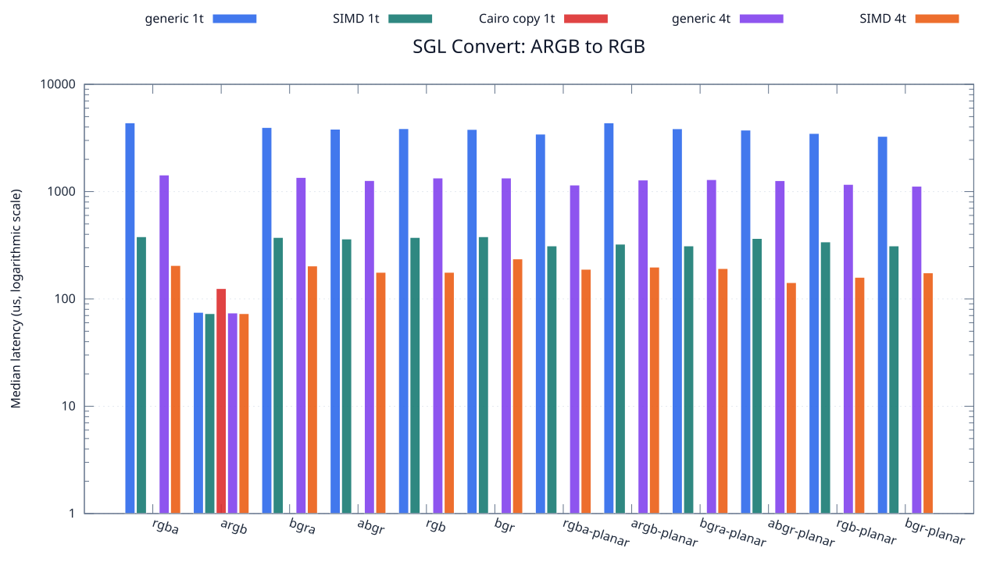
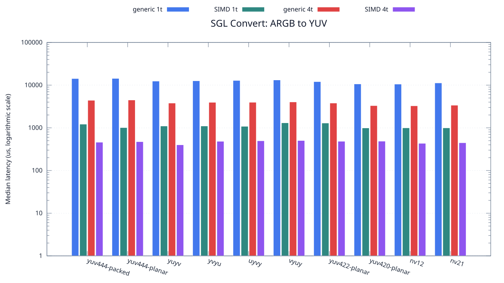

<!--
SPDX-License-Identifier: MIT

Copyright (c) 2025 Dylan Hong

This file is released under the MIT License.
For conditions of distribution and use, see the LICENSE file.
-->

Convert Benchmark: ARGB Source
==============================

[Convert index](../README.md) | [Benchmark index](../../README.md) | [Main README](../../../README.md#operation-benchmarks)

Every supported RGB and YUV destination is measured from the
`argb` source format.

RGB Destinations
----------------

YUV Destinations
----------------

External Backend Coverage
-------------------------
| Library | Measured path | Coverage | Result relation |
| --- | --- | --- | --- |
| Cairo 1.18.4 | ARGB32 SOURCE copy | RGBA/ARGB/BGRA/ABGR identity, 1 thread | Byte-exact |
| NE10 v1.2.1 | Not available | No arbitrary FourCC/color-convert API | N/A |

Test Environment
----------------
| Environment | Value |
| --- | --- |
| Report generated | 2026-08-01T04:11:47+00:00 |
| OS | Ubuntu 24.04.4 LTS |
| Kernel | Linux 6.18.33.2-microsoft-standard-WSL2 (WSL2) |
| Runtime architecture | aarch64 |
| Target | Linux/aarch64 |
| CPU | ARM implementer 0x51, part 0x001 |
| Logical CPUs | 8 |
| Visible memory | 3.81 GiB |
| Execution | native |
| Input | resource/sample.png |
| Source revision | b815597 (dirty) |
| Chart generator | gnuplot 6.0 patchlevel 0 |

Build Configuration
-------------------
| Build option | Value |
| --- | --- |
| Toolchain | llvm |
| Compiler | Clang 18.1.3 |
| Compiler path | /usr/bin/clang |
| Build type | Release |
| C flags | `-O2 -DNDEBUG -std=gnu99 -Wall -Wextra -fno-vectorize -fno-slp-vectorize -fno-builtin-memcpy -fno-builtin-memset` |
| Compiler warnings | ON (-Wall, -Wextra) |
| Auto-vectorization | OFF (-fno-vectorize, -fno-slp-vectorize) |
| SIMD | ON (NEON) |
| Threading | ON (pthread) |
| Sanitizers | OFF |
| Stack protector | OFF |
| External comparison | ON (Cairo/NE10 where supported) |
| Warm-up calls | 3 |
| Measured calls | 10 |

Results
-------
| Case | Operation | Backend | Threads | Size | Median (us) | Average (us) | Min (us) | Max (us) | Pixels/s |
| --- | --- | --- | --- | --- | --- | --- | --- | --- | --- |
| 88 | argb-to-rgba | generic | 1 | 1280x720 | 4,375 | 4,371 | 4,269 | 4,568 | 210,651,428 |
| 89 | argb-to-rgba | generic | 4 | 1280x720 | 1,429 | 1,457 | 1,410 | 1,686 | 644,926,522 |
| 90 | argb-to-rgba | simd | 1 | 1280x720 | 380 | 390 | 373 | 449 | 2,425,263,157 |
| 91 | argb-to-rgba | simd | 4 | 1280x720 | 205 | 201 | 119 | 300 | 4,495,609,756 |
| 92 | argb-to-argb | generic | 1 | 1280x720 | 75 | 77 | 74 | 98 | 12,288,000,000 |
| 93 | argb-to-argb | generic | 4 | 1280x720 | 74 | 74 | 73 | 76 | 12,454,054,054 |
| 94 | argb-to-argb | simd | 1 | 1280x720 | 73 | 75 | 73 | 87 | 12,624,657,534 |
| 95 | argb-to-argb | simd | 4 | 1280x720 | 73 | 72 | 72 | 73 | 12,624,657,534 |
| 96 | argb-to-bgra | generic | 1 | 1280x720 | 3,960 | 3,998 | 3,875 | 4,256 | 232,727,272 |
| 97 | argb-to-bgra | generic | 4 | 1280x720 | 1,355 | 1,391 | 1,293 | 1,754 | 680,147,601 |
| 98 | argb-to-bgra | simd | 1 | 1280x720 | 374 | 395 | 374 | 507 | 2,464,171,122 |
| 99 | argb-to-bgra | simd | 4 | 1280x720 | 203 | 202 | 113 | 363 | 4,539,901,477 |
| 100 | argb-to-abgr | generic | 1 | 1280x720 | 3,819 | 3,916 | 3,756 | 4,457 | 241,319,717 |
| 101 | argb-to-abgr | generic | 4 | 1280x720 | 1,268 | 1,276 | 1,247 | 1,354 | 726,813,880 |
| 102 | argb-to-abgr | simd | 1 | 1280x720 | 362 | 366 | 342 | 401 | 2,545,856,353 |
| 103 | argb-to-abgr | simd | 4 | 1280x720 | 177 | 178 | 105 | 262 | 5,206,779,661 |
| 104 | argb-to-rgb | generic | 1 | 1280x720 | 3,863 | 3,984 | 3,772 | 4,549 | 238,571,058 |
| 105 | argb-to-rgb | generic | 4 | 1280x720 | 1,340 | 1,381 | 1,245 | 1,750 | 687,761,194 |
| 106 | argb-to-rgb | simd | 1 | 1280x720 | 374 | 376 | 373 | 387 | 2,464,171,122 |
| 107 | argb-to-rgb | simd | 4 | 1280x720 | 177 | 183 | 114 | 244 | 5,206,779,661 |
| 108 | argb-to-bgr | generic | 1 | 1280x720 | 3,798 | 3,903 | 3,763 | 4,184 | 242,654,028 |
| 109 | argb-to-bgr | generic | 4 | 1280x720 | 1,340 | 1,369 | 1,311 | 1,515 | 687,761,194 |
| 110 | argb-to-bgr | simd | 1 | 1280x720 | 380 | 390 | 374 | 439 | 2,425,263,157 |
| 111 | argb-to-bgr | simd | 4 | 1280x720 | 236 | 213 | 128 | 272 | 3,905,084,745 |
| 112 | argb-to-rgba-planar | generic | 1 | 1280x720 | 3,435 | 3,508 | 3,325 | 3,944 | 268,296,943 |
| 113 | argb-to-rgba-planar | generic | 4 | 1280x720 | 1,152 | 1,161 | 1,110 | 1,237 | 800,000,000 |
| 114 | argb-to-rgba-planar | simd | 1 | 1280x720 | 312 | 318 | 312 | 355 | 2,953,846,153 |
| 115 | argb-to-rgba-planar | simd | 4 | 1280x720 | 189 | 175 | 96 | 218 | 4,876,190,476 |
| 116 | argb-to-argb-planar | generic | 1 | 1280x720 | 4,374 | 4,356 | 4,128 | 4,540 | 210,699,588 |
| 117 | argb-to-argb-planar | generic | 4 | 1280x720 | 1,283 | 1,298 | 1,201 | 1,450 | 718,316,445 |
| 118 | argb-to-argb-planar | simd | 1 | 1280x720 | 324 | 334 | 311 | 427 | 2,844,444,444 |
| 119 | argb-to-argb-planar | simd | 4 | 1280x720 | 198 | 234 | 98 | 465 | 4,654,545,454 |
| 120 | argb-to-bgra-planar | generic | 1 | 1280x720 | 3,856 | 3,853 | 3,767 | 3,937 | 239,004,149 |
| 121 | argb-to-bgra-planar | generic | 4 | 1280x720 | 1,294 | 1,291 | 1,244 | 1,373 | 712,210,200 |
| 122 | argb-to-bgra-planar | simd | 1 | 1280x720 | 312 | 327 | 311 | 413 | 2,953,846,153 |
| 123 | argb-to-bgra-planar | simd | 4 | 1280x720 | 192 | 176 | 105 | 230 | 4,800,000,000 |
| 124 | argb-to-abgr-planar | generic | 1 | 1280x720 | 3,746 | 3,773 | 3,702 | 3,930 | 246,022,423 |
| 125 | argb-to-abgr-planar | generic | 4 | 1280x720 | 1,266 | 1,262 | 1,220 | 1,293 | 727,962,085 |
| 126 | argb-to-abgr-planar | simd | 1 | 1280x720 | 366 | 378 | 312 | 504 | 2,518,032,786 |
| 127 | argb-to-abgr-planar | simd | 4 | 1280x720 | 142 | 149 | 97 | 215 | 6,490,140,845 |
| 128 | argb-to-rgb-planar | generic | 1 | 1280x720 | 3,485 | 3,575 | 3,442 | 3,865 | 264,447,632 |
| 129 | argb-to-rgb-planar | generic | 4 | 1280x720 | 1,168 | 1,175 | 1,154 | 1,232 | 789,041,095 |
| 130 | argb-to-rgb-planar | simd | 1 | 1280x720 | 340 | 341 | 311 | 376 | 2,710,588,235 |
| 131 | argb-to-rgb-planar | simd | 4 | 1280x720 | 159 | 160 | 96 | 237 | 5,796,226,415 |
| 132 | argb-to-bgr-planar | generic | 1 | 1280x720 | 3,274 | 3,305 | 3,261 | 3,408 | 281,490,531 |
| 133 | argb-to-bgr-planar | generic | 4 | 1280x720 | 1,123 | 1,133 | 1,082 | 1,224 | 820,658,949 |
| 134 | argb-to-bgr-planar | simd | 1 | 1280x720 | 312 | 322 | 311 | 387 | 2,953,846,153 |
| 135 | argb-to-bgr-planar | simd | 4 | 1280x720 | 175 | 173 | 137 | 222 | 5,266,285,714 |
| 136 | argb-to-yuv444-packed | generic | 1 | 1280x720 | 14,257 | 14,258 | 14,079 | 14,427 | 64,641,930 |
| 137 | argb-to-yuv444-packed | generic | 4 | 1280x720 | 4,414 | 4,417 | 4,228 | 4,551 | 208,790,212 |
| 138 | argb-to-yuv444-packed | simd | 1 | 1280x720 | 1,219 | 1,228 | 1,207 | 1,301 | 756,029,532 |
| 139 | argb-to-yuv444-packed | simd | 4 | 1280x720 | 460 | 448 | 363 | 483 | 2,003,478,260 |
| 140 | argb-to-yuv444-planar | generic | 1 | 1280x720 | 14,367 | 14,368 | 14,175 | 14,627 | 64,147,003 |
| 141 | argb-to-yuv444-planar | generic | 4 | 1280x720 | 4,486 | 4,466 | 4,343 | 4,612 | 205,439,144 |
| 142 | argb-to-yuv444-planar | simd | 1 | 1280x720 | 1,012 | 1,022 | 996 | 1,109 | 910,671,936 |
| 143 | argb-to-yuv444-planar | simd | 4 | 1280x720 | 474 | 488 | 426 | 624 | 1,944,303,797 |
| 144 | argb-to-yuyv | generic | 1 | 1280x720 | 12,434 | 12,496 | 12,254 | 12,865 | 74,119,350 |
| 145 | argb-to-yuyv | generic | 4 | 1280x720 | 3,802 | 3,863 | 3,710 | 4,188 | 242,398,737 |
| 146 | argb-to-yuyv | simd | 1 | 1280x720 | 1,102 | 1,122 | 1,062 | 1,217 | 836,297,640 |
| 147 | argb-to-yuyv | simd | 4 | 1280x720 | 400 | 451 | 316 | 685 | 2,304,000,000 |
| 148 | argb-to-yvyu | generic | 1 | 1280x720 | 12,634 | 12,724 | 12,321 | 13,505 | 72,946,018 |
| 149 | argb-to-yvyu | generic | 4 | 1280x720 | 3,954 | 3,933 | 3,712 | 4,222 | 233,080,424 |
| 150 | argb-to-yvyu | simd | 1 | 1280x720 | 1,103 | 1,123 | 1,092 | 1,229 | 835,539,437 |
| 151 | argb-to-yvyu | simd | 4 | 1280x720 | 483 | 535 | 406 | 728 | 1,908,074,534 |
| 152 | argb-to-uyvy | generic | 1 | 1280x720 | 12,873 | 12,940 | 12,578 | 13,586 | 71,591,703 |
| 153 | argb-to-uyvy | generic | 4 | 1280x720 | 3,967 | 4,093 | 3,854 | 5,090 | 232,316,612 |
| 154 | argb-to-uyvy | simd | 1 | 1280x720 | 1,084 | 1,108 | 1,062 | 1,194 | 850,184,501 |
| 155 | argb-to-uyvy | simd | 4 | 1280x720 | 497 | 488 | 445 | 518 | 1,854,325,955 |
| 156 | argb-to-vyuy | generic | 1 | 1280x720 | 13,217 | 13,287 | 13,156 | 13,682 | 69,728,380 |
| 157 | argb-to-vyuy | generic | 4 | 1280x720 | 4,038 | 4,036 | 3,896 | 4,126 | 228,231,797 |
| 158 | argb-to-vyuy | simd | 1 | 1280x720 | 1,309 | 1,323 | 1,282 | 1,440 | 704,048,892 |
| 159 | argb-to-vyuy | simd | 4 | 1280x720 | 504 | 510 | 453 | 620 | 1,828,571,428 |
| 160 | argb-to-yuv422-planar | generic | 1 | 1280x720 | 12,083 | 12,248 | 11,880 | 13,347 | 76,272,448 |
| 161 | argb-to-yuv422-planar | generic | 4 | 1280x720 | 3,805 | 3,850 | 3,649 | 4,252 | 242,207,621 |
| 162 | argb-to-yuv422-planar | simd | 1 | 1280x720 | 1,295 | 1,308 | 1,284 | 1,407 | 711,660,231 |
| 163 | argb-to-yuv422-planar | simd | 4 | 1280x720 | 484 | 489 | 426 | 541 | 1,904,132,231 |
| 164 | argb-to-yuv420-planar | generic | 1 | 1280x720 | 10,662 | 10,660 | 10,536 | 11,003 | 86,437,816 |
| 165 | argb-to-yuv420-planar | generic | 4 | 1280x720 | 3,313 | 3,405 | 3,222 | 3,901 | 278,176,878 |
| 166 | argb-to-yuv420-planar | simd | 1 | 1280x720 | 993 | 1,010 | 989 | 1,154 | 928,096,676 |
| 167 | argb-to-yuv420-planar | simd | 4 | 1280x720 | 487 | 486 | 381 | 588 | 1,892,402,464 |
| 168 | argb-to-nv12 | generic | 1 | 1280x720 | 10,579 | 10,581 | 10,411 | 10,823 | 87,115,984 |
| 169 | argb-to-nv12 | generic | 4 | 1280x720 | 3,279 | 3,386 | 3,212 | 3,660 | 281,061,299 |
| 170 | argb-to-nv12 | simd | 1 | 1280x720 | 998 | 1,013 | 970 | 1,105 | 923,446,893 |
| 171 | argb-to-nv12 | simd | 4 | 1280x720 | 433 | 449 | 371 | 639 | 2,128,406,466 |
| 172 | argb-to-nv21 | generic | 1 | 1280x720 | 11,268 | 11,315 | 10,450 | 12,346 | 81,789,137 |
| 173 | argb-to-nv21 | generic | 4 | 1280x720 | 3,386 | 3,368 | 3,250 | 3,453 | 272,179,562 |
| 174 | argb-to-nv21 | simd | 1 | 1280x720 | 997 | 1,009 | 982 | 1,106 | 924,373,119 |
| 175 | argb-to-nv21 | simd | 4 | 1280x720 | 447 | 818 | 331 | 4,177 | 2,061,744,966 |
| 1937 | argb-to-argb | cairo-copy | 1 | 1280x720 | 125 | 127 | 116 | 146 | 7,372,800,000 |

Results depend on the input, CPU frequency policy, scheduler load, compiler,
and build options. Refresh them on the target machine before comparison.
