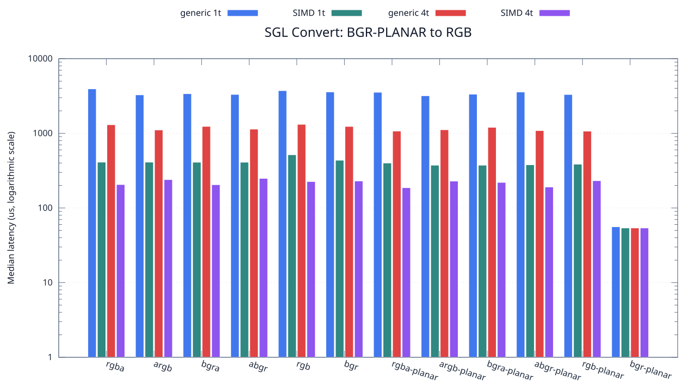
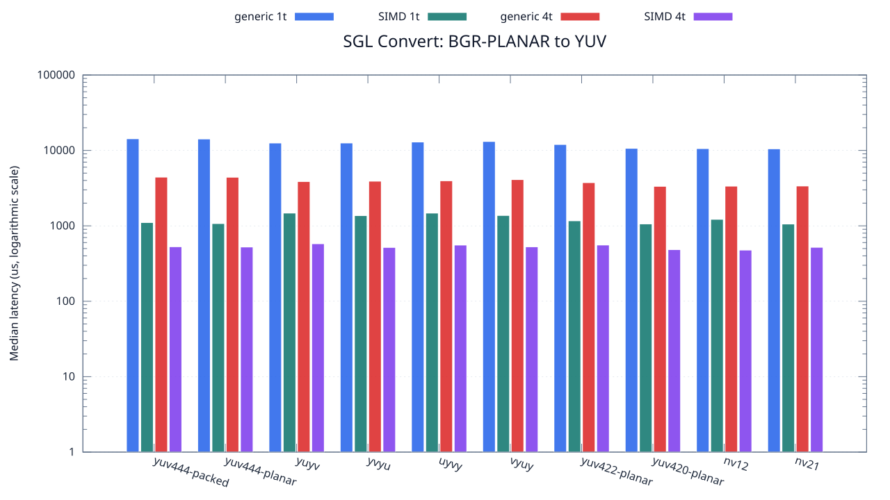

<!--
SPDX-License-Identifier: MIT

Copyright (c) 2025 Dylan Hong

This file is released under the MIT License.
For conditions of distribution and use, see the LICENSE file.
-->

Convert Benchmark: BGR-PLANAR Source
====================================

[Convert index](../README.md) | [Benchmark index](../../README.md) | [Main README](../../../README.md#operation-benchmarks)

Every supported RGB and YUV destination is measured from the
`bgr-planar` source format.

RGB Destinations
----------------

YUV Destinations
----------------

External Backend Coverage
-------------------------
| Library | Measured path | Coverage | Result relation |
| --- | --- | --- | --- |
| Cairo 1.18.4 | ARGB32 SOURCE copy | RGBA/ARGB/BGRA/ABGR identity, 1 thread | Byte-exact |
| NE10 v1.2.1 | Not available | No arbitrary FourCC/color-convert API | N/A |

Test Environment
----------------
| Environment | Value |
| --- | --- |
| Report generated | 2026-08-01T04:11:47+00:00 |
| OS | Ubuntu 24.04.4 LTS |
| Kernel | Linux 6.18.33.2-microsoft-standard-WSL2 (WSL2) |
| Runtime architecture | aarch64 |
| Target | Linux/aarch64 |
| CPU | ARM implementer 0x51, part 0x001 |
| Logical CPUs | 8 |
| Visible memory | 3.81 GiB |
| Execution | native |
| Input | resource/sample.png |
| Source revision | b815597 (dirty) |
| Chart generator | gnuplot 6.0 patchlevel 0 |

Build Configuration
-------------------
| Build option | Value |
| --- | --- |
| Toolchain | llvm |
| Compiler | Clang 18.1.3 |
| Compiler path | /usr/bin/clang |
| Build type | Release |
| C flags | `-O2 -DNDEBUG -std=gnu99 -Wall -Wextra -fno-vectorize -fno-slp-vectorize -fno-builtin-memcpy -fno-builtin-memset` |
| Compiler warnings | ON (-Wall, -Wextra) |
| Auto-vectorization | OFF (-fno-vectorize, -fno-slp-vectorize) |
| SIMD | ON (NEON) |
| Threading | ON (pthread) |
| Sanitizers | OFF |
| Stack protector | OFF |
| External comparison | ON (Cairo/NE10 where supported) |
| Warm-up calls | 3 |
| Measured calls | 10 |

Results
-------
| Case | Operation | Backend | Threads | Size | Median (us) | Average (us) | Min (us) | Max (us) | Pixels/s |
| --- | --- | --- | --- | --- | --- | --- | --- | --- | --- |
| 968 | bgr-planar-to-rgba | generic | 1 | 1280x720 | 3,938 | 4,009 | 3,762 | 4,452 | 234,027,425 |
| 969 | bgr-planar-to-rgba | generic | 4 | 1280x720 | 1,303 | 1,364 | 1,254 | 1,632 | 707,290,867 |
| 970 | bgr-planar-to-rgba | simd | 1 | 1280x720 | 411 | 421 | 405 | 491 | 2,242,335,766 |
| 971 | bgr-planar-to-rgba | simd | 4 | 1280x720 | 206 | 219 | 165 | 291 | 4,473,786,407 |
| 972 | bgr-planar-to-argb | generic | 1 | 1280x720 | 3,275 | 3,324 | 3,256 | 3,553 | 281,404,580 |
| 973 | bgr-planar-to-argb | generic | 4 | 1280x720 | 1,109 | 1,108 | 1,076 | 1,144 | 831,018,935 |
| 974 | bgr-planar-to-argb | simd | 1 | 1280x720 | 411 | 417 | 404 | 455 | 2,242,335,766 |
| 975 | bgr-planar-to-argb | simd | 4 | 1280x720 | 240 | 250 | 186 | 365 | 3,840,000,000 |
| 976 | bgr-planar-to-bgra | generic | 1 | 1280x720 | 3,393 | 3,415 | 3,322 | 3,581 | 271,618,037 |
| 977 | bgr-planar-to-bgra | generic | 4 | 1280x720 | 1,238 | 1,258 | 1,098 | 1,395 | 744,426,494 |
| 978 | bgr-planar-to-bgra | simd | 1 | 1280x720 | 410 | 429 | 405 | 479 | 2,247,804,878 |
| 979 | bgr-planar-to-bgra | simd | 4 | 1280x720 | 205 | 203 | 152 | 275 | 4,495,609,756 |
| 980 | bgr-planar-to-abgr | generic | 1 | 1280x720 | 3,318 | 3,373 | 3,266 | 3,779 | 277,757,685 |
| 981 | bgr-planar-to-abgr | generic | 4 | 1280x720 | 1,138 | 1,171 | 1,080 | 1,370 | 809,841,827 |
| 982 | bgr-planar-to-abgr | simd | 1 | 1280x720 | 410 | 434 | 405 | 610 | 2,247,804,878 |
| 983 | bgr-planar-to-abgr | simd | 4 | 1280x720 | 249 | 282 | 186 | 535 | 3,701,204,819 |
| 984 | bgr-planar-to-rgb | generic | 1 | 1280x720 | 3,730 | 3,847 | 3,509 | 4,393 | 247,077,747 |
| 985 | bgr-planar-to-rgb | generic | 4 | 1280x720 | 1,319 | 1,299 | 1,144 | 1,366 | 698,711,144 |
| 986 | bgr-planar-to-rgb | simd | 1 | 1280x720 | 516 | 521 | 512 | 550 | 1,786,046,511 |
| 987 | bgr-planar-to-rgb | simd | 4 | 1280x720 | 226 | 222 | 132 | 276 | 4,077,876,106 |
| 988 | bgr-planar-to-bgr | generic | 1 | 1280x720 | 3,581 | 3,710 | 3,510 | 4,135 | 257,358,279 |
| 989 | bgr-planar-to-bgr | generic | 4 | 1280x720 | 1,236 | 1,239 | 1,164 | 1,304 | 745,631,067 |
| 990 | bgr-planar-to-bgr | simd | 1 | 1280x720 | 436 | 449 | 436 | 511 | 2,113,761,467 |
| 991 | bgr-planar-to-bgr | simd | 4 | 1280x720 | 230 | 228 | 202 | 254 | 4,006,956,521 |
| 992 | bgr-planar-to-rgba-planar | generic | 1 | 1280x720 | 3,546 | 3,446 | 3,030 | 3,625 | 259,898,477 |
| 993 | bgr-planar-to-rgba-planar | generic | 4 | 1280x720 | 1,072 | 1,086 | 1,002 | 1,221 | 859,701,492 |
| 994 | bgr-planar-to-rgba-planar | simd | 1 | 1280x720 | 400 | 412 | 374 | 493 | 2,304,000,000 |
| 995 | bgr-planar-to-rgba-planar | simd | 4 | 1280x720 | 187 | 193 | 131 | 274 | 4,928,342,245 |
| 996 | bgr-planar-to-argb-planar | generic | 1 | 1280x720 | 3,184 | 3,241 | 3,146 | 3,420 | 289,447,236 |
| 997 | bgr-planar-to-argb-planar | generic | 4 | 1280x720 | 1,116 | 1,114 | 1,012 | 1,204 | 825,806,451 |
| 998 | bgr-planar-to-argb-planar | simd | 1 | 1280x720 | 374 | 381 | 373 | 422 | 2,464,171,122 |
| 999 | bgr-planar-to-argb-planar | simd | 4 | 1280x720 | 229 | 218 | 114 | 308 | 4,024,454,148 |
| 1000 | bgr-planar-to-bgra-planar | generic | 1 | 1280x720 | 3,343 | 3,394 | 3,256 | 3,707 | 275,680,526 |
| 1001 | bgr-planar-to-bgra-planar | generic | 4 | 1280x720 | 1,203 | 1,211 | 1,092 | 1,396 | 766,084,788 |
| 1002 | bgr-planar-to-bgra-planar | simd | 1 | 1280x720 | 374 | 384 | 374 | 449 | 2,464,171,122 |
| 1003 | bgr-planar-to-bgra-planar | simd | 4 | 1280x720 | 220 | 205 | 141 | 259 | 4,189,090,909 |
| 1004 | bgr-planar-to-abgr-planar | generic | 1 | 1280x720 | 3,574 | 3,475 | 3,159 | 3,747 | 257,862,339 |
| 1005 | bgr-planar-to-abgr-planar | generic | 4 | 1280x720 | 1,088 | 1,140 | 1,019 | 1,494 | 847,058,823 |
| 1006 | bgr-planar-to-abgr-planar | simd | 1 | 1280x720 | 379 | 391 | 373 | 443 | 2,431,662,269 |
| 1007 | bgr-planar-to-abgr-planar | simd | 4 | 1280x720 | 191 | 193 | 143 | 233 | 4,825,130,890 |
| 1008 | bgr-planar-to-rgb-planar | generic | 1 | 1280x720 | 3,310 | 3,302 | 3,012 | 3,555 | 278,429,003 |
| 1009 | bgr-planar-to-rgb-planar | generic | 4 | 1280x720 | 1,069 | 1,070 | 1,035 | 1,109 | 862,114,125 |
| 1010 | bgr-planar-to-rgb-planar | simd | 1 | 1280x720 | 386 | 400 | 373 | 471 | 2,387,564,766 |
| 1011 | bgr-planar-to-rgb-planar | simd | 4 | 1280x720 | 232 | 241 | 161 | 381 | 3,972,413,793 |
| 1012 | bgr-planar-to-bgr-planar | generic | 1 | 1280x720 | 56 | 56 | 55 | 60 | 16,457,142,857 |
| 1013 | bgr-planar-to-bgr-planar | generic | 4 | 1280x720 | 54 | 55 | 54 | 68 | 17,066,666,666 |
| 1014 | bgr-planar-to-bgr-planar | simd | 1 | 1280x720 | 54 | 53 | 53 | 54 | 17,066,666,666 |
| 1015 | bgr-planar-to-bgr-planar | simd | 4 | 1280x720 | 54 | 53 | 53 | 54 | 17,066,666,666 |
| 1016 | bgr-planar-to-yuv444-packed | generic | 1 | 1280x720 | 14,276 | 14,355 | 14,118 | 14,996 | 64,555,898 |
| 1017 | bgr-planar-to-yuv444-packed | generic | 4 | 1280x720 | 4,424 | 4,428 | 4,345 | 4,484 | 208,318,264 |
| 1018 | bgr-planar-to-yuv444-packed | simd | 1 | 1280x720 | 1,106 | 1,127 | 1,089 | 1,268 | 833,273,056 |
| 1019 | bgr-planar-to-yuv444-packed | simd | 4 | 1280x720 | 528 | 545 | 471 | 713 | 1,745,454,545 |
| 1020 | bgr-planar-to-yuv444-planar | generic | 1 | 1280x720 | 14,183 | 14,592 | 14,085 | 16,473 | 64,979,200 |
| 1021 | bgr-planar-to-yuv444-planar | generic | 4 | 1280x720 | 4,409 | 4,415 | 4,224 | 4,527 | 209,026,990 |
| 1022 | bgr-planar-to-yuv444-planar | simd | 1 | 1280x720 | 1,072 | 1,081 | 1,058 | 1,153 | 859,701,492 |
| 1023 | bgr-planar-to-yuv444-planar | simd | 4 | 1280x720 | 524 | 545 | 462 | 705 | 1,758,778,625 |
| 1024 | bgr-planar-to-yuyv | generic | 1 | 1280x720 | 12,541 | 12,661 | 12,215 | 14,193 | 73,486,962 |
| 1025 | bgr-planar-to-yuyv | generic | 4 | 1280x720 | 3,866 | 3,970 | 3,747 | 4,458 | 238,385,928 |
| 1026 | bgr-planar-to-yuyv | simd | 1 | 1280x720 | 1,477 | 1,433 | 1,247 | 1,611 | 623,967,501 |
| 1027 | bgr-planar-to-yuyv | simd | 4 | 1280x720 | 579 | 582 | 451 | 695 | 1,591,709,844 |
| 1028 | bgr-planar-to-yvyu | generic | 1 | 1280x720 | 12,548 | 12,582 | 12,338 | 12,873 | 73,445,967 |
| 1029 | bgr-planar-to-yvyu | generic | 4 | 1280x720 | 3,909 | 3,950 | 3,778 | 4,176 | 235,763,622 |
| 1030 | bgr-planar-to-yvyu | simd | 1 | 1280x720 | 1,367 | 1,345 | 1,166 | 1,466 | 674,177,029 |
| 1031 | bgr-planar-to-yvyu | simd | 4 | 1280x720 | 517 | 527 | 468 | 621 | 1,782,591,876 |
| 1032 | bgr-planar-to-uyvy | generic | 1 | 1280x720 | 12,927 | 12,904 | 12,605 | 13,252 | 71,292,643 |
| 1033 | bgr-planar-to-uyvy | generic | 4 | 1280x720 | 3,957 | 4,000 | 3,896 | 4,121 | 232,903,714 |
| 1034 | bgr-planar-to-uyvy | simd | 1 | 1280x720 | 1,476 | 1,494 | 1,465 | 1,643 | 624,390,243 |
| 1035 | bgr-planar-to-uyvy | simd | 4 | 1280x720 | 556 | 570 | 520 | 703 | 1,657,553,956 |
| 1036 | bgr-planar-to-vyuy | generic | 1 | 1280x720 | 13,137 | 13,149 | 12,922 | 13,483 | 70,153,002 |
| 1037 | bgr-planar-to-vyuy | generic | 4 | 1280x720 | 4,103 | 4,106 | 3,970 | 4,216 | 224,616,134 |
| 1038 | bgr-planar-to-vyuy | simd | 1 | 1280x720 | 1,372 | 1,386 | 1,361 | 1,491 | 671,720,116 |
| 1039 | bgr-planar-to-vyuy | simd | 4 | 1280x720 | 527 | 530 | 483 | 566 | 1,748,766,603 |
| 1040 | bgr-planar-to-yuv422-planar | generic | 1 | 1280x720 | 11,988 | 12,144 | 11,845 | 12,904 | 76,876,876 |
| 1041 | bgr-planar-to-yuv422-planar | generic | 4 | 1280x720 | 3,740 | 3,751 | 3,703 | 3,922 | 246,417,112 |
| 1042 | bgr-planar-to-yuv422-planar | simd | 1 | 1280x720 | 1,166 | 1,193 | 1,155 | 1,336 | 790,394,511 |
| 1043 | bgr-planar-to-yuv422-planar | simd | 4 | 1280x720 | 557 | 553 | 471 | 626 | 1,654,578,096 |
| 1044 | bgr-planar-to-yuv420-planar | generic | 1 | 1280x720 | 10,653 | 10,747 | 10,431 | 11,816 | 86,510,842 |
| 1045 | bgr-planar-to-yuv420-planar | generic | 4 | 1280x720 | 3,341 | 3,353 | 3,138 | 3,667 | 275,845,555 |
| 1046 | bgr-planar-to-yuv420-planar | simd | 1 | 1280x720 | 1,060 | 1,074 | 1,052 | 1,161 | 869,433,962 |
| 1047 | bgr-planar-to-yuv420-planar | simd | 4 | 1280x720 | 484 | 476 | 398 | 536 | 1,904,132,231 |
| 1048 | bgr-planar-to-nv12 | generic | 1 | 1280x720 | 10,571 | 11,055 | 10,432 | 12,404 | 87,181,912 |
| 1049 | bgr-planar-to-nv12 | generic | 4 | 1280x720 | 3,360 | 3,389 | 3,199 | 4,048 | 274,285,714 |
| 1050 | bgr-planar-to-nv12 | simd | 1 | 1280x720 | 1,220 | 1,230 | 1,208 | 1,320 | 755,409,836 |
| 1051 | bgr-planar-to-nv12 | simd | 4 | 1280x720 | 477 | 475 | 426 | 524 | 1,932,075,471 |
| 1052 | bgr-planar-to-nv21 | generic | 1 | 1280x720 | 10,497 | 10,552 | 10,423 | 10,810 | 87,796,513 |
| 1053 | bgr-planar-to-nv21 | generic | 4 | 1280x720 | 3,376 | 3,376 | 3,207 | 3,656 | 272,985,781 |
| 1054 | bgr-planar-to-nv21 | simd | 1 | 1280x720 | 1,057 | 1,058 | 1,050 | 1,072 | 871,901,608 |
| 1055 | bgr-planar-to-nv21 | simd | 4 | 1280x720 | 519 | 538 | 387 | 946 | 1,775,722,543 |

Results depend on the input, CPU frequency policy, scheduler load, compiler,
and build options. Refresh them on the target machine before comparison.
