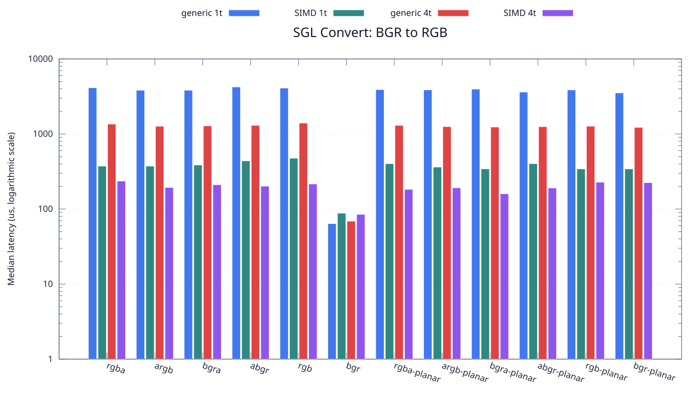
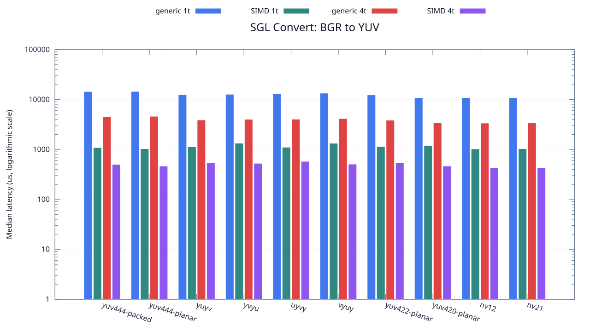

<!--
SPDX-License-Identifier: MIT

Copyright (c) 2025 Dylan Hong

This file is released under the MIT License.
For conditions of distribution and use, see the LICENSE file.
-->

Convert Benchmark: BGR Source
=============================

[Convert index](../README.md) | [Benchmark index](../../README.md) | [Main README](../../../README.md#operation-benchmarks)

Every supported RGB and YUV destination is measured from the
`bgr` source format.

RGB Destinations
----------------

YUV Destinations
----------------

External Backend Coverage
-------------------------
| Library | Measured path | Coverage | Result relation |
| --- | --- | --- | --- |
| Cairo 1.18.4 | ARGB32 SOURCE copy | RGBA/ARGB/BGRA/ABGR identity, 1 thread | Byte-exact |
| NE10 v1.2.1 | Not available | No arbitrary FourCC/color-convert API | N/A |

Test Environment
----------------
| Environment | Value |
| --- | --- |
| Report generated | 2026-08-01T04:11:47+00:00 |
| OS | Ubuntu 24.04.4 LTS |
| Kernel | Linux 6.18.33.2-microsoft-standard-WSL2 (WSL2) |
| Runtime architecture | aarch64 |
| Target | Linux/aarch64 |
| CPU | ARM implementer 0x51, part 0x001 |
| Logical CPUs | 8 |
| Visible memory | 3.81 GiB |
| Execution | native |
| Input | resource/sample.png |
| Source revision | b815597 (dirty) |
| Chart generator | gnuplot 6.0 patchlevel 0 |

Build Configuration
-------------------
| Build option | Value |
| --- | --- |
| Toolchain | llvm |
| Compiler | Clang 18.1.3 |
| Compiler path | /usr/bin/clang |
| Build type | Release |
| C flags | `-O2 -DNDEBUG -std=gnu99 -Wall -Wextra -fno-vectorize -fno-slp-vectorize -fno-builtin-memcpy -fno-builtin-memset` |
| Compiler warnings | ON (-Wall, -Wextra) |
| Auto-vectorization | OFF (-fno-vectorize, -fno-slp-vectorize) |
| SIMD | ON (NEON) |
| Threading | ON (pthread) |
| Sanitizers | OFF |
| Stack protector | OFF |
| External comparison | ON (Cairo/NE10 where supported) |
| Warm-up calls | 3 |
| Measured calls | 10 |

Results
-------
| Case | Operation | Backend | Threads | Size | Median (us) | Average (us) | Min (us) | Max (us) | Pixels/s |
| --- | --- | --- | --- | --- | --- | --- | --- | --- | --- |
| 440 | bgr-to-rgba | generic | 1 | 1280x720 | 4,134 | 4,239 | 4,011 | 4,798 | 222,931,785 |
| 441 | bgr-to-rgba | generic | 4 | 1280x720 | 1,358 | 1,386 | 1,314 | 1,570 | 678,645,066 |
| 442 | bgr-to-rgba | simd | 1 | 1280x720 | 374 | 382 | 374 | 421 | 2,464,171,122 |
| 443 | bgr-to-rgba | simd | 4 | 1280x720 | 236 | 219 | 139 | 322 | 3,905,084,745 |
| 444 | bgr-to-argb | generic | 1 | 1280x720 | 3,830 | 3,902 | 3,766 | 4,326 | 240,626,631 |
| 445 | bgr-to-argb | generic | 4 | 1280x720 | 1,271 | 1,302 | 1,194 | 1,527 | 725,098,347 |
| 446 | bgr-to-argb | simd | 1 | 1280x720 | 374 | 384 | 373 | 441 | 2,464,171,122 |
| 447 | bgr-to-argb | simd | 4 | 1280x720 | 194 | 189 | 116 | 312 | 4,750,515,463 |
| 448 | bgr-to-bgra | generic | 1 | 1280x720 | 3,835 | 3,832 | 3,748 | 3,988 | 240,312,907 |
| 449 | bgr-to-bgra | generic | 4 | 1280x720 | 1,285 | 1,319 | 1,242 | 1,503 | 717,198,443 |
| 450 | bgr-to-bgra | simd | 1 | 1280x720 | 387 | 396 | 374 | 439 | 2,381,395,348 |
| 451 | bgr-to-bgra | simd | 4 | 1280x720 | 211 | 207 | 115 | 280 | 4,367,772,511 |
| 452 | bgr-to-abgr | generic | 1 | 1280x720 | 4,239 | 4,214 | 3,777 | 4,843 | 217,409,766 |
| 453 | bgr-to-abgr | generic | 4 | 1280x720 | 1,305 | 1,328 | 1,227 | 1,439 | 706,206,896 |
| 454 | bgr-to-abgr | simd | 1 | 1280x720 | 439 | 445 | 439 | 471 | 2,099,316,628 |
| 455 | bgr-to-abgr | simd | 4 | 1280x720 | 202 | 205 | 182 | 259 | 4,562,376,237 |
| 456 | bgr-to-rgb | generic | 1 | 1280x720 | 4,097 | 4,301 | 4,007 | 4,740 | 224,945,081 |
| 457 | bgr-to-rgb | generic | 4 | 1280x720 | 1,400 | 1,400 | 1,310 | 1,536 | 658,285,714 |
| 458 | bgr-to-rgb | simd | 1 | 1280x720 | 476 | 484 | 475 | 536 | 1,936,134,453 |
| 459 | bgr-to-rgb | simd | 4 | 1280x720 | 216 | 222 | 186 | 290 | 4,266,666,666 |
| 460 | bgr-to-bgr | generic | 1 | 1280x720 | 64 | 65 | 63 | 77 | 14,400,000,000 |
| 461 | bgr-to-bgr | generic | 4 | 1280x720 | 69 | 81 | 67 | 171 | 13,356,521,739 |
| 462 | bgr-to-bgr | simd | 1 | 1280x720 | 88 | 100 | 68 | 181 | 10,472,727,272 |
| 463 | bgr-to-bgr | simd | 4 | 1280x720 | 85 | 85 | 75 | 95 | 10,842,352,941 |
| 464 | bgr-to-rgba-planar | generic | 1 | 1280x720 | 3,912 | 3,891 | 3,634 | 4,157 | 235,582,822 |
| 465 | bgr-to-rgba-planar | generic | 4 | 1280x720 | 1,305 | 1,282 | 1,197 | 1,346 | 706,206,896 |
| 466 | bgr-to-rgba-planar | simd | 1 | 1280x720 | 403 | 414 | 402 | 504 | 2,286,848,635 |
| 467 | bgr-to-rgba-planar | simd | 4 | 1280x720 | 183 | 189 | 141 | 262 | 5,036,065,573 |
| 468 | bgr-to-argb-planar | generic | 1 | 1280x720 | 3,875 | 3,924 | 3,551 | 4,414 | 237,832,258 |
| 469 | bgr-to-argb-planar | generic | 4 | 1280x720 | 1,255 | 1,266 | 1,212 | 1,367 | 734,342,629 |
| 470 | bgr-to-argb-planar | simd | 1 | 1280x720 | 363 | 374 | 342 | 448 | 2,538,842,975 |
| 471 | bgr-to-argb-planar | simd | 4 | 1280x720 | 192 | 213 | 182 | 303 | 4,800,000,000 |
| 472 | bgr-to-bgra-planar | generic | 1 | 1280x720 | 3,973 | 3,951 | 3,597 | 4,253 | 231,965,768 |
| 473 | bgr-to-bgra-planar | generic | 4 | 1280x720 | 1,240 | 1,284 | 1,175 | 1,498 | 743,225,806 |
| 474 | bgr-to-bgra-planar | simd | 1 | 1280x720 | 343 | 346 | 342 | 367 | 2,686,880,466 |
| 475 | bgr-to-bgra-planar | simd | 4 | 1280x720 | 160 | 162 | 105 | 248 | 5,760,000,000 |
| 476 | bgr-to-abgr-planar | generic | 1 | 1280x720 | 3,623 | 3,644 | 3,544 | 3,910 | 254,374,827 |
| 477 | bgr-to-abgr-planar | generic | 4 | 1280x720 | 1,254 | 1,261 | 1,187 | 1,370 | 734,928,229 |
| 478 | bgr-to-abgr-planar | simd | 1 | 1280x720 | 403 | 407 | 402 | 430 | 2,286,848,635 |
| 479 | bgr-to-abgr-planar | simd | 4 | 1280x720 | 191 | 190 | 129 | 235 | 4,825,130,890 |
| 480 | bgr-to-rgb-planar | generic | 1 | 1280x720 | 3,871 | 3,851 | 3,524 | 4,146 | 238,078,016 |
| 481 | bgr-to-rgb-planar | generic | 4 | 1280x720 | 1,272 | 1,275 | 1,176 | 1,372 | 724,528,301 |
| 482 | bgr-to-rgb-planar | simd | 1 | 1280x720 | 343 | 345 | 342 | 361 | 2,686,880,466 |
| 483 | bgr-to-rgb-planar | simd | 4 | 1280x720 | 228 | 222 | 120 | 359 | 4,042,105,263 |
| 484 | bgr-to-bgr-planar | generic | 1 | 1280x720 | 3,535 | 3,558 | 3,509 | 3,634 | 260,707,213 |
| 485 | bgr-to-bgr-planar | generic | 4 | 1280x720 | 1,227 | 1,218 | 1,171 | 1,257 | 751,100,244 |
| 486 | bgr-to-bgr-planar | simd | 1 | 1280x720 | 343 | 354 | 343 | 398 | 2,686,880,466 |
| 487 | bgr-to-bgr-planar | simd | 4 | 1280x720 | 225 | 245 | 107 | 463 | 4,096,000,000 |
| 488 | bgr-to-yuv444-packed | generic | 1 | 1280x720 | 14,475 | 14,517 | 14,370 | 14,810 | 63,668,393 |
| 489 | bgr-to-yuv444-packed | generic | 4 | 1280x720 | 4,535 | 4,548 | 4,460 | 4,655 | 203,219,404 |
| 490 | bgr-to-yuv444-packed | simd | 1 | 1280x720 | 1,093 | 1,107 | 1,070 | 1,216 | 843,183,897 |
| 491 | bgr-to-yuv444-packed | simd | 4 | 1280x720 | 504 | 522 | 373 | 726 | 1,828,571,428 |
| 492 | bgr-to-yuv444-planar | generic | 1 | 1280x720 | 14,552 | 14,565 | 14,329 | 14,796 | 63,331,500 |
| 493 | bgr-to-yuv444-planar | generic | 4 | 1280x720 | 4,620 | 4,607 | 4,400 | 4,972 | 199,480,519 |
| 494 | bgr-to-yuv444-planar | simd | 1 | 1280x720 | 1,036 | 1,068 | 1,027 | 1,348 | 889,575,289 |
| 495 | bgr-to-yuv444-planar | simd | 4 | 1280x720 | 465 | 501 | 418 | 831 | 1,981,935,483 |
| 496 | bgr-to-yuyv | generic | 1 | 1280x720 | 12,620 | 12,652 | 12,479 | 13,050 | 73,026,941 |
| 497 | bgr-to-yuyv | generic | 4 | 1280x720 | 3,905 | 3,933 | 3,818 | 4,128 | 236,005,121 |
| 498 | bgr-to-yuyv | simd | 1 | 1280x720 | 1,133 | 1,144 | 1,093 | 1,246 | 813,415,710 |
| 499 | bgr-to-yuyv | simd | 4 | 1280x720 | 545 | 533 | 467 | 591 | 1,691,009,174 |
| 500 | bgr-to-yvyu | generic | 1 | 1280x720 | 12,759 | 12,801 | 12,640 | 13,059 | 72,231,366 |
| 501 | bgr-to-yvyu | generic | 4 | 1280x720 | 4,030 | 4,060 | 3,854 | 4,356 | 228,684,863 |
| 502 | bgr-to-yvyu | simd | 1 | 1280x720 | 1,335 | 1,344 | 1,324 | 1,400 | 690,337,078 |
| 503 | bgr-to-yvyu | simd | 4 | 1280x720 | 529 | 528 | 488 | 576 | 1,742,155,009 |
| 504 | bgr-to-uyvy | generic | 1 | 1280x720 | 13,104 | 13,145 | 12,790 | 13,465 | 70,329,670 |
| 505 | bgr-to-uyvy | generic | 4 | 1280x720 | 4,051 | 4,057 | 3,879 | 4,325 | 227,499,382 |
| 506 | bgr-to-uyvy | simd | 1 | 1280x720 | 1,110 | 1,146 | 1,092 | 1,375 | 830,270,270 |
| 507 | bgr-to-uyvy | simd | 4 | 1280x720 | 578 | 605 | 479 | 919 | 1,594,463,667 |
| 508 | bgr-to-vyuy | generic | 1 | 1280x720 | 13,435 | 13,567 | 13,271 | 14,771 | 68,596,948 |
| 509 | bgr-to-vyuy | generic | 4 | 1280x720 | 4,163 | 4,210 | 4,114 | 4,507 | 221,378,813 |
| 510 | bgr-to-vyuy | simd | 1 | 1280x720 | 1,333 | 1,345 | 1,319 | 1,429 | 691,372,843 |
| 511 | bgr-to-vyuy | simd | 4 | 1280x720 | 510 | 509 | 449 | 580 | 1,807,058,823 |
| 512 | bgr-to-yuv422-planar | generic | 1 | 1280x720 | 12,376 | 12,414 | 12,078 | 12,913 | 74,466,709 |
| 513 | bgr-to-yuv422-planar | generic | 4 | 1280x720 | 3,865 | 3,921 | 3,665 | 4,217 | 238,447,606 |
| 514 | bgr-to-yuv422-planar | simd | 1 | 1280x720 | 1,146 | 1,145 | 1,124 | 1,167 | 804,188,481 |
| 515 | bgr-to-yuv422-planar | simd | 4 | 1280x720 | 547 | 568 | 462 | 759 | 1,684,826,325 |
| 516 | bgr-to-yuv420-planar | generic | 1 | 1280x720 | 10,879 | 10,918 | 10,671 | 11,132 | 84,713,668 |
| 517 | bgr-to-yuv420-planar | generic | 4 | 1280x720 | 3,473 | 3,436 | 3,298 | 3,564 | 265,361,359 |
| 518 | bgr-to-yuv420-planar | simd | 1 | 1280x720 | 1,205 | 1,221 | 1,191 | 1,351 | 764,813,278 |
| 519 | bgr-to-yuv420-planar | simd | 4 | 1280x720 | 467 | 463 | 388 | 531 | 1,973,447,537 |
| 520 | bgr-to-nv12 | generic | 1 | 1280x720 | 10,904 | 10,967 | 10,664 | 11,404 | 84,519,442 |
| 521 | bgr-to-nv12 | generic | 4 | 1280x720 | 3,376 | 3,399 | 3,272 | 3,573 | 272,985,781 |
| 522 | bgr-to-nv12 | simd | 1 | 1280x720 | 1,028 | 1,095 | 1,006 | 1,515 | 896,498,054 |
| 523 | bgr-to-nv12 | simd | 4 | 1280x720 | 433 | 464 | 400 | 654 | 2,128,406,466 |
| 524 | bgr-to-nv21 | generic | 1 | 1280x720 | 10,883 | 10,930 | 10,669 | 11,352 | 84,682,532 |
| 525 | bgr-to-nv21 | generic | 4 | 1280x720 | 3,447 | 3,450 | 3,318 | 3,636 | 267,362,924 |
| 526 | bgr-to-nv21 | simd | 1 | 1280x720 | 1,036 | 1,065 | 1,013 | 1,163 | 889,575,289 |
| 527 | bgr-to-nv21 | simd | 4 | 1280x720 | 434 | 444 | 395 | 531 | 2,123,502,304 |

Results depend on the input, CPU frequency policy, scheduler load, compiler,
and build options. Refresh them on the target machine before comparison.
