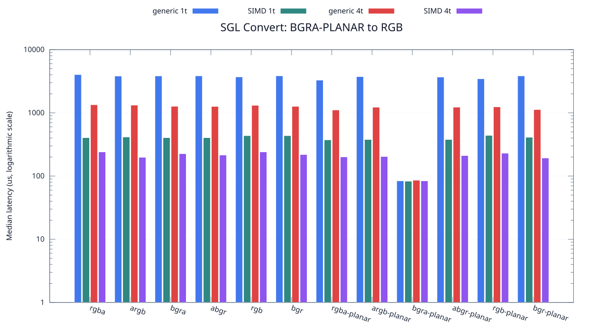
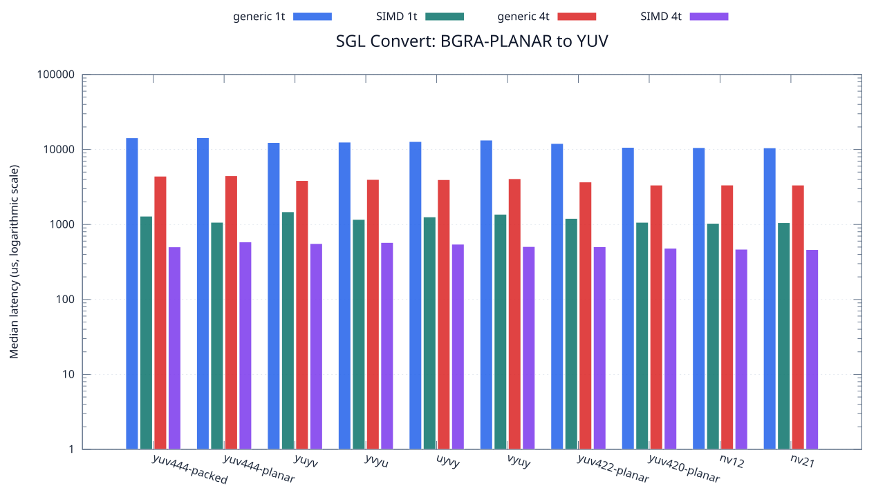

<!--
SPDX-License-Identifier: MIT

Copyright (c) 2025 Dylan Hong

This file is released under the MIT License.
For conditions of distribution and use, see the LICENSE file.
-->

Convert Benchmark: BGRA-PLANAR Source
=====================================

[Convert index](../README.md) | [Benchmark index](../../README.md) | [Main README](../../../README.md#operation-benchmarks)

Every supported RGB and YUV destination is measured from the
`bgra-planar` source format.

RGB Destinations
----------------

YUV Destinations
----------------

External Backend Coverage
-------------------------
| Library | Measured path | Coverage | Result relation |
| --- | --- | --- | --- |
| Cairo 1.18.4 | ARGB32 SOURCE copy | RGBA/ARGB/BGRA/ABGR identity, 1 thread | Byte-exact |
| NE10 v1.2.1 | Not available | No arbitrary FourCC/color-convert API | N/A |

Test Environment
----------------
| Environment | Value |
| --- | --- |
| Report generated | 2026-08-01T04:11:47+00:00 |
| OS | Ubuntu 24.04.4 LTS |
| Kernel | Linux 6.18.33.2-microsoft-standard-WSL2 (WSL2) |
| Runtime architecture | aarch64 |
| Target | Linux/aarch64 |
| CPU | ARM implementer 0x51, part 0x001 |
| Logical CPUs | 8 |
| Visible memory | 3.81 GiB |
| Execution | native |
| Input | resource/sample.png |
| Source revision | b815597 (dirty) |
| Chart generator | gnuplot 6.0 patchlevel 0 |

Build Configuration
-------------------
| Build option | Value |
| --- | --- |
| Toolchain | llvm |
| Compiler | Clang 18.1.3 |
| Compiler path | /usr/bin/clang |
| Build type | Release |
| C flags | `-O2 -DNDEBUG -std=gnu99 -Wall -Wextra -fno-vectorize -fno-slp-vectorize -fno-builtin-memcpy -fno-builtin-memset` |
| Compiler warnings | ON (-Wall, -Wextra) |
| Auto-vectorization | OFF (-fno-vectorize, -fno-slp-vectorize) |
| SIMD | ON (NEON) |
| Threading | ON (pthread) |
| Sanitizers | OFF |
| Stack protector | OFF |
| External comparison | ON (Cairo/NE10 where supported) |
| Warm-up calls | 3 |
| Measured calls | 10 |

Results
-------
| Case | Operation | Backend | Threads | Size | Median (us) | Average (us) | Min (us) | Max (us) | Pixels/s |
| --- | --- | --- | --- | --- | --- | --- | --- | --- | --- |
| 704 | bgra-planar-to-rgba | generic | 1 | 1280x720 | 4,034 | 4,066 | 4,018 | 4,183 | 228,458,106 |
| 705 | bgra-planar-to-rgba | generic | 4 | 1280x720 | 1,344 | 1,357 | 1,321 | 1,481 | 685,714,285 |
| 706 | bgra-planar-to-rgba | simd | 1 | 1280x720 | 405 | 420 | 405 | 460 | 2,275,555,555 |
| 707 | bgra-planar-to-rgba | simd | 4 | 1280x720 | 241 | 231 | 124 | 313 | 3,824,066,390 |
| 708 | bgra-planar-to-argb | generic | 1 | 1280x720 | 3,822 | 3,910 | 3,755 | 4,669 | 241,130,298 |
| 709 | bgra-planar-to-argb | generic | 4 | 1280x720 | 1,326 | 1,335 | 1,273 | 1,468 | 695,022,624 |
| 710 | bgra-planar-to-argb | simd | 1 | 1280x720 | 415 | 414 | 405 | 433 | 2,220,722,891 |
| 711 | bgra-planar-to-argb | simd | 4 | 1280x720 | 198 | 202 | 129 | 283 | 4,654,545,454 |
| 712 | bgra-planar-to-bgra | generic | 1 | 1280x720 | 3,839 | 3,839 | 3,804 | 3,888 | 240,062,516 |
| 713 | bgra-planar-to-bgra | generic | 4 | 1280x720 | 1,270 | 1,284 | 1,248 | 1,406 | 725,669,291 |
| 714 | bgra-planar-to-bgra | simd | 1 | 1280x720 | 405 | 411 | 405 | 432 | 2,275,555,555 |
| 715 | bgra-planar-to-bgra | simd | 4 | 1280x720 | 226 | 218 | 146 | 297 | 4,077,876,106 |
| 716 | bgra-planar-to-abgr | generic | 1 | 1280x720 | 3,851 | 4,000 | 3,692 | 4,422 | 239,314,463 |
| 717 | bgra-planar-to-abgr | generic | 4 | 1280x720 | 1,264 | 1,289 | 1,234 | 1,418 | 729,113,924 |
| 718 | bgra-planar-to-abgr | simd | 1 | 1280x720 | 405 | 432 | 405 | 554 | 2,275,555,555 |
| 719 | bgra-planar-to-abgr | simd | 4 | 1280x720 | 215 | 226 | 177 | 331 | 4,286,511,627 |
| 720 | bgra-planar-to-rgb | generic | 1 | 1280x720 | 3,709 | 3,770 | 3,689 | 3,938 | 248,476,678 |
| 721 | bgra-planar-to-rgb | generic | 4 | 1280x720 | 1,316 | 1,332 | 1,207 | 1,518 | 700,303,951 |
| 722 | bgra-planar-to-rgb | simd | 1 | 1280x720 | 436 | 450 | 436 | 541 | 2,113,761,467 |
| 723 | bgra-planar-to-rgb | simd | 4 | 1280x720 | 241 | 235 | 176 | 300 | 3,824,066,390 |
| 724 | bgra-planar-to-bgr | generic | 1 | 1280x720 | 3,853 | 3,953 | 3,644 | 4,294 | 239,190,241 |
| 725 | bgra-planar-to-bgr | generic | 4 | 1280x720 | 1,268 | 1,284 | 1,193 | 1,393 | 726,813,880 |
| 726 | bgra-planar-to-bgr | simd | 1 | 1280x720 | 436 | 451 | 436 | 544 | 2,113,761,467 |
| 727 | bgra-planar-to-bgr | simd | 4 | 1280x720 | 219 | 219 | 182 | 264 | 4,208,219,178 |
| 728 | bgra-planar-to-rgba-planar | generic | 1 | 1280x720 | 3,295 | 3,398 | 3,275 | 3,966 | 279,696,509 |
| 729 | bgra-planar-to-rgba-planar | generic | 4 | 1280x720 | 1,111 | 1,158 | 1,102 | 1,369 | 829,522,952 |
| 730 | bgra-planar-to-rgba-planar | simd | 1 | 1280x720 | 374 | 387 | 374 | 431 | 2,464,171,122 |
| 731 | bgra-planar-to-rgba-planar | simd | 4 | 1280x720 | 201 | 215 | 115 | 319 | 4,585,074,626 |
| 732 | bgra-planar-to-argb-planar | generic | 1 | 1280x720 | 3,747 | 3,917 | 3,639 | 4,580 | 245,956,765 |
| 733 | bgra-planar-to-argb-planar | generic | 4 | 1280x720 | 1,229 | 1,265 | 1,195 | 1,522 | 749,877,949 |
| 734 | bgra-planar-to-argb-planar | simd | 1 | 1280x720 | 379 | 388 | 379 | 431 | 2,431,662,269 |
| 735 | bgra-planar-to-argb-planar | simd | 4 | 1280x720 | 204 | 232 | 185 | 338 | 4,517,647,058 |
| 736 | bgra-planar-to-bgra-planar | generic | 1 | 1280x720 | 84 | 86 | 83 | 110 | 10,971,428,571 |
| 737 | bgra-planar-to-bgra-planar | generic | 4 | 1280x720 | 86 | 87 | 86 | 98 | 10,716,279,069 |
| 738 | bgra-planar-to-bgra-planar | simd | 1 | 1280x720 | 83 | 84 | 82 | 100 | 11,103,614,457 |
| 739 | bgra-planar-to-bgra-planar | simd | 4 | 1280x720 | 84 | 84 | 83 | 86 | 10,971,428,571 |
| 740 | bgra-planar-to-abgr-planar | generic | 1 | 1280x720 | 3,685 | 3,727 | 3,639 | 4,025 | 250,094,979 |
| 741 | bgra-planar-to-abgr-planar | generic | 4 | 1280x720 | 1,232 | 1,244 | 1,217 | 1,298 | 748,051,948 |
| 742 | bgra-planar-to-abgr-planar | simd | 1 | 1280x720 | 379 | 401 | 379 | 495 | 2,431,662,269 |
| 743 | bgra-planar-to-abgr-planar | simd | 4 | 1280x720 | 211 | 198 | 120 | 255 | 4,367,772,511 |
| 744 | bgra-planar-to-rgb-planar | generic | 1 | 1280x720 | 3,462 | 3,542 | 3,375 | 3,946 | 266,204,506 |
| 745 | bgra-planar-to-rgb-planar | generic | 4 | 1280x720 | 1,245 | 1,278 | 1,144 | 1,653 | 740,240,963 |
| 746 | bgra-planar-to-rgb-planar | simd | 1 | 1280x720 | 440 | 457 | 414 | 518 | 2,094,545,454 |
| 747 | bgra-planar-to-rgb-planar | simd | 4 | 1280x720 | 230 | 250 | 140 | 542 | 4,006,956,521 |
| 748 | bgra-planar-to-bgr-planar | generic | 1 | 1280x720 | 3,846 | 3,835 | 3,521 | 3,938 | 239,625,585 |
| 749 | bgra-planar-to-bgr-planar | generic | 4 | 1280x720 | 1,127 | 1,145 | 1,049 | 1,369 | 817,746,228 |
| 750 | bgra-planar-to-bgr-planar | simd | 1 | 1280x720 | 411 | 419 | 373 | 479 | 2,242,335,766 |
| 751 | bgra-planar-to-bgr-planar | simd | 4 | 1280x720 | 193 | 186 | 116 | 233 | 4,775,129,533 |
| 752 | bgra-planar-to-yuv444-packed | generic | 1 | 1280x720 | 14,340 | 14,331 | 14,100 | 14,591 | 64,267,782 |
| 753 | bgra-planar-to-yuv444-packed | generic | 4 | 1280x720 | 4,411 | 4,419 | 4,325 | 4,491 | 208,932,214 |
| 754 | bgra-planar-to-yuv444-packed | simd | 1 | 1280x720 | 1,292 | 1,295 | 1,279 | 1,334 | 713,312,693 |
| 755 | bgra-planar-to-yuv444-packed | simd | 4 | 1280x720 | 503 | 503 | 449 | 562 | 1,832,206,759 |
| 756 | bgra-planar-to-yuv444-planar | generic | 1 | 1280x720 | 14,394 | 14,405 | 14,107 | 14,863 | 64,026,677 |
| 757 | bgra-planar-to-yuv444-planar | generic | 4 | 1280x720 | 4,470 | 4,515 | 4,353 | 4,725 | 206,174,496 |
| 758 | bgra-planar-to-yuv444-planar | simd | 1 | 1280x720 | 1,070 | 1,078 | 1,058 | 1,161 | 861,308,411 |
| 759 | bgra-planar-to-yuv444-planar | simd | 4 | 1280x720 | 585 | 589 | 496 | 718 | 1,575,384,615 |
| 760 | bgra-planar-to-yuyv | generic | 1 | 1280x720 | 12,387 | 12,377 | 12,198 | 12,508 | 74,400,581 |
| 761 | bgra-planar-to-yuyv | generic | 4 | 1280x720 | 3,857 | 3,878 | 3,750 | 4,040 | 238,942,183 |
| 762 | bgra-planar-to-yuyv | simd | 1 | 1280x720 | 1,477 | 1,495 | 1,465 | 1,618 | 623,967,501 |
| 763 | bgra-planar-to-yuyv | simd | 4 | 1280x720 | 557 | 563 | 513 | 659 | 1,654,578,096 |
| 764 | bgra-planar-to-yvyu | generic | 1 | 1280x720 | 12,553 | 12,578 | 12,408 | 12,886 | 73,416,713 |
| 765 | bgra-planar-to-yvyu | generic | 4 | 1280x720 | 3,987 | 3,977 | 3,848 | 4,122 | 231,151,241 |
| 766 | bgra-planar-to-yvyu | simd | 1 | 1280x720 | 1,168 | 1,218 | 1,155 | 1,521 | 789,041,095 |
| 767 | bgra-planar-to-yvyu | simd | 4 | 1280x720 | 575 | 574 | 470 | 712 | 1,602,782,608 |
| 768 | bgra-planar-to-uyvy | generic | 1 | 1280x720 | 12,780 | 12,940 | 12,575 | 14,005 | 72,112,676 |
| 769 | bgra-planar-to-uyvy | generic | 4 | 1280x720 | 3,964 | 4,018 | 3,863 | 4,320 | 232,492,431 |
| 770 | bgra-planar-to-uyvy | simd | 1 | 1280x720 | 1,262 | 1,290 | 1,247 | 1,387 | 730,269,413 |
| 771 | bgra-planar-to-uyvy | simd | 4 | 1280x720 | 546 | 555 | 510 | 679 | 1,687,912,087 |
| 772 | bgra-planar-to-vyuy | generic | 1 | 1280x720 | 13,357 | 13,359 | 13,090 | 13,629 | 68,997,529 |
| 773 | bgra-planar-to-vyuy | generic | 4 | 1280x720 | 4,082 | 4,096 | 3,928 | 4,455 | 225,771,680 |
| 774 | bgra-planar-to-vyuy | simd | 1 | 1280x720 | 1,370 | 1,388 | 1,355 | 1,484 | 672,700,729 |
| 775 | bgra-planar-to-vyuy | simd | 4 | 1280x720 | 508 | 498 | 410 | 572 | 1,814,173,228 |
| 776 | bgra-planar-to-yuv422-planar | generic | 1 | 1280x720 | 12,043 | 12,055 | 11,847 | 12,295 | 76,525,782 |
| 777 | bgra-planar-to-yuv422-planar | generic | 4 | 1280x720 | 3,691 | 3,706 | 3,611 | 3,847 | 249,688,431 |
| 778 | bgra-planar-to-yuv422-planar | simd | 1 | 1280x720 | 1,205 | 1,215 | 1,158 | 1,330 | 764,813,278 |
| 779 | bgra-planar-to-yuv422-planar | simd | 4 | 1280x720 | 505 | 517 | 497 | 582 | 1,824,950,495 |
| 780 | bgra-planar-to-yuv420-planar | generic | 1 | 1280x720 | 10,683 | 10,692 | 10,478 | 11,048 | 86,267,902 |
| 781 | bgra-planar-to-yuv420-planar | generic | 4 | 1280x720 | 3,356 | 3,398 | 3,248 | 3,571 | 274,612,634 |
| 782 | bgra-planar-to-yuv420-planar | simd | 1 | 1280x720 | 1,069 | 1,105 | 1,052 | 1,237 | 862,114,125 |
| 783 | bgra-planar-to-yuv420-planar | simd | 4 | 1280x720 | 482 | 494 | 427 | 603 | 1,912,033,195 |
| 784 | bgra-planar-to-nv12 | generic | 1 | 1280x720 | 10,609 | 10,662 | 10,463 | 10,920 | 86,869,638 |
| 785 | bgra-planar-to-nv12 | generic | 4 | 1280x720 | 3,360 | 3,377 | 3,219 | 3,537 | 274,285,714 |
| 786 | bgra-planar-to-nv12 | simd | 1 | 1280x720 | 1,036 | 1,052 | 1,028 | 1,186 | 889,575,289 |
| 787 | bgra-planar-to-nv12 | simd | 4 | 1280x720 | 468 | 474 | 422 | 533 | 1,969,230,769 |
| 788 | bgra-planar-to-nv21 | generic | 1 | 1280x720 | 10,526 | 10,527 | 10,429 | 10,681 | 87,554,626 |
| 789 | bgra-planar-to-nv21 | generic | 4 | 1280x720 | 3,356 | 3,370 | 3,220 | 3,613 | 274,612,634 |
| 790 | bgra-planar-to-nv21 | simd | 1 | 1280x720 | 1,058 | 1,094 | 1,044 | 1,252 | 871,077,504 |
| 791 | bgra-planar-to-nv21 | simd | 4 | 1280x720 | 463 | 470 | 411 | 600 | 1,990,496,760 |

Results depend on the input, CPU frequency policy, scheduler load, compiler,
and build options. Refresh them on the target machine before comparison.
