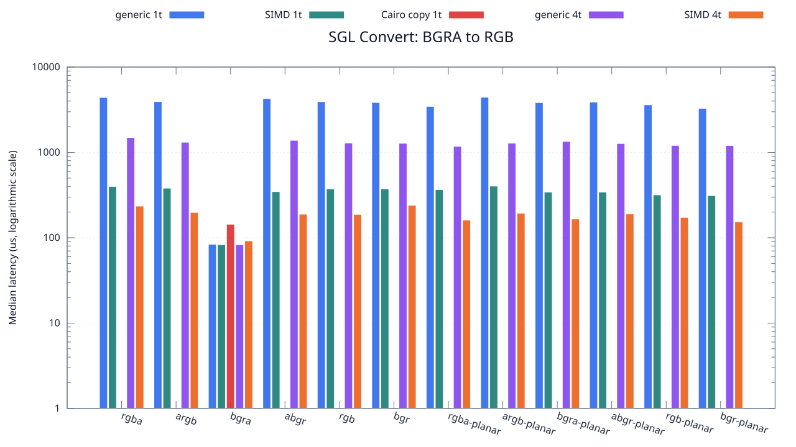
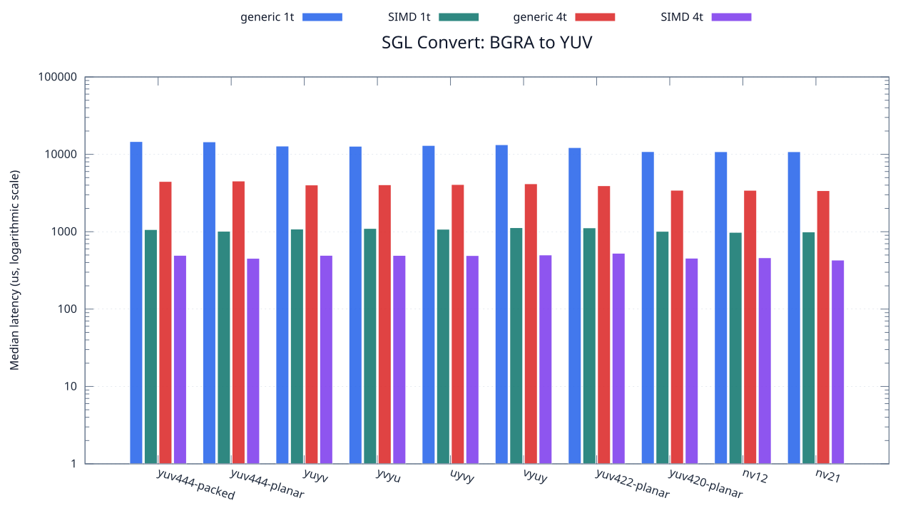

<!--
SPDX-License-Identifier: MIT

Copyright (c) 2025 Dylan Hong

This file is released under the MIT License.
For conditions of distribution and use, see the LICENSE file.
-->

Convert Benchmark: BGRA Source
==============================

[Convert index](../README.md) | [Benchmark index](../../README.md) | [Main README](../../../README.md#operation-benchmarks)

Every supported RGB and YUV destination is measured from the
`bgra` source format.

RGB Destinations
----------------

YUV Destinations
----------------

External Backend Coverage
-------------------------
| Library | Measured path | Coverage | Result relation |
| --- | --- | --- | --- |
| Cairo 1.18.4 | ARGB32 SOURCE copy | RGBA/ARGB/BGRA/ABGR identity, 1 thread | Byte-exact |
| NE10 v1.2.1 | Not available | No arbitrary FourCC/color-convert API | N/A |

Test Environment
----------------
| Environment | Value |
| --- | --- |
| Report generated | 2026-08-01T04:11:47+00:00 |
| OS | Ubuntu 24.04.4 LTS |
| Kernel | Linux 6.18.33.2-microsoft-standard-WSL2 (WSL2) |
| Runtime architecture | aarch64 |
| Target | Linux/aarch64 |
| CPU | ARM implementer 0x51, part 0x001 |
| Logical CPUs | 8 |
| Visible memory | 3.81 GiB |
| Execution | native |
| Input | resource/sample.png |
| Source revision | b815597 (dirty) |
| Chart generator | gnuplot 6.0 patchlevel 0 |

Build Configuration
-------------------
| Build option | Value |
| --- | --- |
| Toolchain | llvm |
| Compiler | Clang 18.1.3 |
| Compiler path | /usr/bin/clang |
| Build type | Release |
| C flags | `-O2 -DNDEBUG -std=gnu99 -Wall -Wextra -fno-vectorize -fno-slp-vectorize -fno-builtin-memcpy -fno-builtin-memset` |
| Compiler warnings | ON (-Wall, -Wextra) |
| Auto-vectorization | OFF (-fno-vectorize, -fno-slp-vectorize) |
| SIMD | ON (NEON) |
| Threading | ON (pthread) |
| Sanitizers | OFF |
| Stack protector | OFF |
| External comparison | ON (Cairo/NE10 where supported) |
| Warm-up calls | 3 |
| Measured calls | 10 |

Results
-------
| Case | Operation | Backend | Threads | Size | Median (us) | Average (us) | Min (us) | Max (us) | Pixels/s |
| --- | --- | --- | --- | --- | --- | --- | --- | --- | --- |
| 176 | bgra-to-rgba | generic | 1 | 1280x720 | 4,407 | 4,622 | 4,267 | 5,116 | 209,121,851 |
| 177 | bgra-to-rgba | generic | 4 | 1280x720 | 1,493 | 1,513 | 1,416 | 1,666 | 617,280,643 |
| 178 | bgra-to-rgba | simd | 1 | 1280x720 | 399 | 409 | 375 | 488 | 2,309,774,436 |
| 179 | bgra-to-rgba | simd | 4 | 1280x720 | 235 | 228 | 147 | 290 | 3,921,702,127 |
| 180 | bgra-to-argb | generic | 1 | 1280x720 | 3,943 | 4,185 | 3,837 | 4,934 | 233,730,661 |
| 181 | bgra-to-argb | generic | 4 | 1280x720 | 1,316 | 1,326 | 1,265 | 1,388 | 700,303,951 |
| 182 | bgra-to-argb | simd | 1 | 1280x720 | 381 | 391 | 375 | 477 | 2,418,897,637 |
| 183 | bgra-to-argb | simd | 4 | 1280x720 | 198 | 198 | 162 | 246 | 4,654,545,454 |
| 184 | bgra-to-bgra | generic | 1 | 1280x720 | 84 | 85 | 83 | 96 | 10,971,428,571 |
| 185 | bgra-to-bgra | generic | 4 | 1280x720 | 83 | 87 | 82 | 126 | 11,103,614,457 |
| 186 | bgra-to-bgra | simd | 1 | 1280x720 | 83 | 83 | 82 | 85 | 11,103,614,457 |
| 187 | bgra-to-bgra | simd | 4 | 1280x720 | 92 | 96 | 88 | 114 | 10,017,391,304 |
| 188 | bgra-to-abgr | generic | 1 | 1280x720 | 4,273 | 4,224 | 3,794 | 4,509 | 215,679,850 |
| 189 | bgra-to-abgr | generic | 4 | 1280x720 | 1,383 | 1,366 | 1,221 | 1,515 | 666,377,440 |
| 190 | bgra-to-abgr | simd | 1 | 1280x720 | 347 | 357 | 345 | 392 | 2,655,907,780 |
| 191 | bgra-to-abgr | simd | 4 | 1280x720 | 189 | 187 | 118 | 262 | 4,876,190,476 |
| 192 | bgra-to-rgb | generic | 1 | 1280x720 | 3,930 | 4,097 | 3,765 | 4,639 | 234,503,816 |
| 193 | bgra-to-rgb | generic | 4 | 1280x720 | 1,287 | 1,317 | 1,229 | 1,455 | 716,083,916 |
| 194 | bgra-to-rgb | simd | 1 | 1280x720 | 374 | 394 | 373 | 526 | 2,464,171,122 |
| 195 | bgra-to-rgb | simd | 4 | 1280x720 | 188 | 195 | 139 | 260 | 4,902,127,659 |
| 196 | bgra-to-bgr | generic | 1 | 1280x720 | 3,848 | 3,866 | 3,772 | 3,986 | 239,501,039 |
| 197 | bgra-to-bgr | generic | 4 | 1280x720 | 1,279 | 1,278 | 1,230 | 1,361 | 720,562,939 |
| 198 | bgra-to-bgr | simd | 1 | 1280x720 | 374 | 380 | 374 | 402 | 2,464,171,122 |
| 199 | bgra-to-bgr | simd | 4 | 1280x720 | 240 | 236 | 139 | 330 | 3,840,000,000 |
| 200 | bgra-to-rgba-planar | generic | 1 | 1280x720 | 3,462 | 3,491 | 3,377 | 3,635 | 266,204,506 |
| 201 | bgra-to-rgba-planar | generic | 4 | 1280x720 | 1,178 | 1,228 | 1,144 | 1,624 | 782,342,954 |
| 202 | bgra-to-rgba-planar | simd | 1 | 1280x720 | 366 | 371 | 365 | 395 | 2,518,032,786 |
| 203 | bgra-to-rgba-planar | simd | 4 | 1280x720 | 161 | 161 | 97 | 290 | 5,724,223,602 |
| 204 | bgra-to-argb-planar | generic | 1 | 1280x720 | 4,430 | 4,456 | 4,350 | 4,619 | 208,036,117 |
| 205 | bgra-to-argb-planar | generic | 4 | 1280x720 | 1,283 | 1,307 | 1,243 | 1,490 | 718,316,445 |
| 206 | bgra-to-argb-planar | simd | 1 | 1280x720 | 403 | 409 | 402 | 441 | 2,286,848,635 |
| 207 | bgra-to-argb-planar | simd | 4 | 1280x720 | 194 | 192 | 118 | 326 | 4,750,515,463 |
| 208 | bgra-to-bgra-planar | generic | 1 | 1280x720 | 3,832 | 3,859 | 3,765 | 4,120 | 240,501,043 |
| 209 | bgra-to-bgra-planar | generic | 4 | 1280x720 | 1,347 | 1,339 | 1,232 | 1,473 | 684,187,082 |
| 210 | bgra-to-bgra-planar | simd | 1 | 1280x720 | 343 | 353 | 342 | 424 | 2,686,880,466 |
| 211 | bgra-to-bgra-planar | simd | 4 | 1280x720 | 166 | 181 | 106 | 301 | 5,551,807,228 |
| 212 | bgra-to-abgr-planar | generic | 1 | 1280x720 | 3,885 | 4,003 | 3,762 | 4,547 | 237,220,077 |
| 213 | bgra-to-abgr-planar | generic | 4 | 1280x720 | 1,271 | 1,274 | 1,234 | 1,346 | 725,098,347 |
| 214 | bgra-to-abgr-planar | simd | 1 | 1280x720 | 343 | 369 | 342 | 464 | 2,686,880,466 |
| 215 | bgra-to-abgr-planar | simd | 4 | 1280x720 | 190 | 183 | 128 | 223 | 4,850,526,315 |
| 216 | bgra-to-rgb-planar | generic | 1 | 1280x720 | 3,610 | 3,617 | 3,515 | 3,759 | 255,290,858 |
| 217 | bgra-to-rgb-planar | generic | 4 | 1280x720 | 1,206 | 1,234 | 1,174 | 1,375 | 764,179,104 |
| 218 | bgra-to-rgb-planar | simd | 1 | 1280x720 | 318 | 335 | 311 | 430 | 2,898,113,207 |
| 219 | bgra-to-rgb-planar | simd | 4 | 1280x720 | 173 | 178 | 109 | 263 | 5,327,167,630 |
| 220 | bgra-to-bgr-planar | generic | 1 | 1280x720 | 3,276 | 3,327 | 3,257 | 3,540 | 281,318,681 |
| 221 | bgra-to-bgr-planar | generic | 4 | 1280x720 | 1,204 | 1,209 | 1,140 | 1,276 | 765,448,504 |
| 222 | bgra-to-bgr-planar | simd | 1 | 1280x720 | 312 | 324 | 311 | 404 | 2,953,846,153 |
| 223 | bgra-to-bgr-planar | simd | 4 | 1280x720 | 153 | 158 | 118 | 207 | 6,023,529,411 |
| 224 | bgra-to-yuv444-packed | generic | 1 | 1280x720 | 14,633 | 14,644 | 14,346 | 15,051 | 62,980,933 |
| 225 | bgra-to-yuv444-packed | generic | 4 | 1280x720 | 4,464 | 4,481 | 4,364 | 4,610 | 206,451,612 |
| 226 | bgra-to-yuv444-packed | simd | 1 | 1280x720 | 1,066 | 1,075 | 1,027 | 1,156 | 864,540,337 |
| 227 | bgra-to-yuv444-packed | simd | 4 | 1280x720 | 495 | 496 | 438 | 553 | 1,861,818,181 |
| 228 | bgra-to-yuv444-planar | generic | 1 | 1280x720 | 14,501 | 14,549 | 14,411 | 14,864 | 63,554,237 |
| 229 | bgra-to-yuv444-planar | generic | 4 | 1280x720 | 4,521 | 4,683 | 4,327 | 5,595 | 203,848,706 |
| 230 | bgra-to-yuv444-planar | simd | 1 | 1280x720 | 1,014 | 1,039 | 996 | 1,188 | 908,875,739 |
| 231 | bgra-to-yuv444-planar | simd | 4 | 1280x720 | 453 | 468 | 429 | 594 | 2,034,437,086 |
| 232 | bgra-to-yuyv | generic | 1 | 1280x720 | 12,794 | 12,822 | 12,599 | 13,170 | 72,033,765 |
| 233 | bgra-to-yuyv | generic | 4 | 1280x720 | 4,018 | 4,006 | 3,928 | 4,149 | 229,367,844 |
| 234 | bgra-to-yuyv | simd | 1 | 1280x720 | 1,082 | 1,093 | 1,062 | 1,213 | 851,756,007 |
| 235 | bgra-to-yuyv | simd | 4 | 1280x720 | 495 | 511 | 468 | 608 | 1,861,818,181 |
| 236 | bgra-to-yvyu | generic | 1 | 1280x720 | 12,725 | 12,728 | 12,559 | 12,990 | 72,424,361 |
| 237 | bgra-to-yvyu | generic | 4 | 1280x720 | 4,043 | 4,122 | 3,772 | 4,583 | 227,949,542 |
| 238 | bgra-to-yvyu | simd | 1 | 1280x720 | 1,102 | 1,110 | 1,092 | 1,167 | 836,297,640 |
| 239 | bgra-to-yvyu | simd | 4 | 1280x720 | 494 | 494 | 458 | 541 | 1,865,587,044 |
| 240 | bgra-to-uyvy | generic | 1 | 1280x720 | 13,021 | 13,010 | 12,826 | 13,247 | 70,777,974 |
| 241 | bgra-to-uyvy | generic | 4 | 1280x720 | 4,076 | 4,129 | 3,989 | 4,420 | 226,104,023 |
| 242 | bgra-to-uyvy | simd | 1 | 1280x720 | 1,077 | 1,094 | 1,062 | 1,189 | 855,710,306 |
| 243 | bgra-to-uyvy | simd | 4 | 1280x720 | 492 | 488 | 344 | 578 | 1,873,170,731 |
| 244 | bgra-to-vyuy | generic | 1 | 1280x720 | 13,319 | 13,369 | 13,192 | 13,723 | 69,194,383 |
| 245 | bgra-to-vyuy | generic | 4 | 1280x720 | 4,166 | 4,183 | 4,085 | 4,334 | 221,219,395 |
| 246 | bgra-to-vyuy | simd | 1 | 1280x720 | 1,128 | 1,135 | 1,092 | 1,195 | 817,021,276 |
| 247 | bgra-to-vyuy | simd | 4 | 1280x720 | 501 | 504 | 449 | 561 | 1,839,520,958 |
| 248 | bgra-to-yuv422-planar | generic | 1 | 1280x720 | 12,227 | 12,238 | 12,132 | 12,369 | 75,374,171 |
| 249 | bgra-to-yuv422-planar | generic | 4 | 1280x720 | 3,930 | 3,994 | 3,755 | 4,385 | 234,503,816 |
| 250 | bgra-to-yuv422-planar | simd | 1 | 1280x720 | 1,122 | 1,137 | 1,093 | 1,219 | 821,390,374 |
| 251 | bgra-to-yuv422-planar | simd | 4 | 1280x720 | 527 | 536 | 474 | 612 | 1,748,766,603 |
| 252 | bgra-to-yuv420-planar | generic | 1 | 1280x720 | 10,848 | 10,968 | 10,665 | 12,101 | 84,955,752 |
| 253 | bgra-to-yuv420-planar | generic | 4 | 1280x720 | 3,436 | 3,491 | 3,331 | 4,114 | 268,218,859 |
| 254 | bgra-to-yuv420-planar | simd | 1 | 1280x720 | 1,012 | 1,057 | 990 | 1,200 | 910,671,936 |
| 255 | bgra-to-yuv420-planar | simd | 4 | 1280x720 | 455 | 457 | 403 | 525 | 2,025,494,505 |
| 256 | bgra-to-nv12 | generic | 1 | 1280x720 | 10,821 | 10,875 | 10,675 | 11,427 | 85,167,729 |
| 257 | bgra-to-nv12 | generic | 4 | 1280x720 | 3,430 | 3,435 | 3,300 | 3,623 | 268,688,046 |
| 258 | bgra-to-nv12 | simd | 1 | 1280x720 | 981 | 999 | 968 | 1,112 | 939,449,541 |
| 259 | bgra-to-nv12 | simd | 4 | 1280x720 | 461 | 521 | 427 | 939 | 1,999,132,321 |
| 260 | bgra-to-nv21 | generic | 1 | 1280x720 | 10,815 | 10,931 | 10,702 | 11,368 | 85,214,979 |
| 261 | bgra-to-nv21 | generic | 4 | 1280x720 | 3,396 | 3,466 | 3,313 | 3,888 | 271,378,091 |
| 262 | bgra-to-nv21 | simd | 1 | 1280x720 | 993 | 1,014 | 982 | 1,083 | 928,096,676 |
| 263 | bgra-to-nv21 | simd | 4 | 1280x720 | 430 | 442 | 400 | 526 | 2,143,255,813 |
| 1938 | bgra-to-bgra | cairo-copy | 1 | 1280x720 | 144 | 146 | 125 | 171 | 6,400,000,000 |

Results depend on the input, CPU frequency policy, scheduler load, compiler,
and build options. Refresh them on the target machine before comparison.
