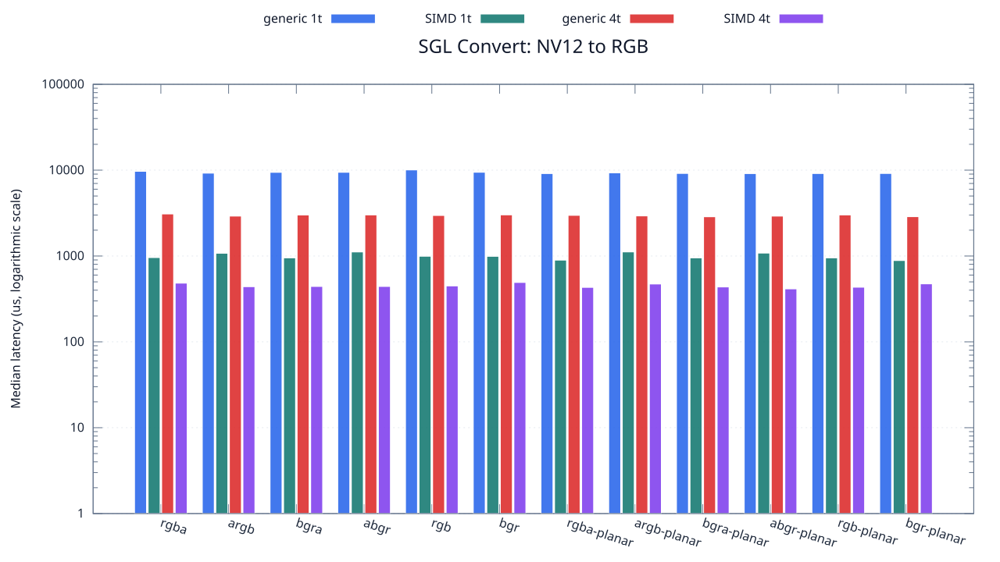
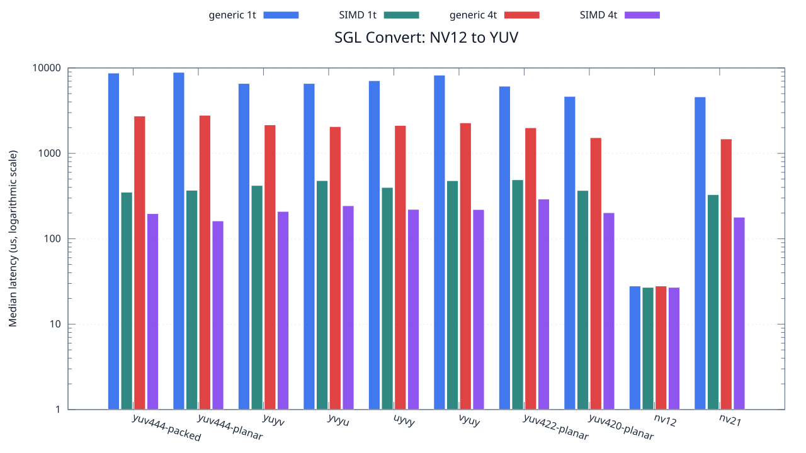

<!--
SPDX-License-Identifier: MIT

Copyright (c) 2025 Dylan Hong

This file is released under the MIT License.
For conditions of distribution and use, see the LICENSE file.
-->

Convert Benchmark: NV12 Source
==============================

[Convert index](../README.md) | [Benchmark index](../../README.md) | [Main README](../../../README.md#operation-benchmarks)

Every supported RGB and YUV destination is measured from the
`nv12` source format.

RGB Destinations
----------------

YUV Destinations
----------------

External Backend Coverage
-------------------------
| Library | Measured path | Coverage | Result relation |
| --- | --- | --- | --- |
| Cairo 1.18.4 | ARGB32 SOURCE copy | RGBA/ARGB/BGRA/ABGR identity, 1 thread | Byte-exact |
| NE10 v1.2.1 | Not available | No arbitrary FourCC/color-convert API | N/A |

Test Environment
----------------
| Environment | Value |
| --- | --- |
| Report generated | 2026-08-01T04:11:47+00:00 |
| OS | Ubuntu 24.04.4 LTS |
| Kernel | Linux 6.18.33.2-microsoft-standard-WSL2 (WSL2) |
| Runtime architecture | aarch64 |
| Target | Linux/aarch64 |
| CPU | ARM implementer 0x51, part 0x001 |
| Logical CPUs | 8 |
| Visible memory | 3.81 GiB |
| Execution | native |
| Input | resource/sample.png |
| Source revision | b815597 (dirty) |
| Chart generator | gnuplot 6.0 patchlevel 0 |

Build Configuration
-------------------
| Build option | Value |
| --- | --- |
| Toolchain | llvm |
| Compiler | Clang 18.1.3 |
| Compiler path | /usr/bin/clang |
| Build type | Release |
| C flags | `-O2 -DNDEBUG -std=gnu99 -Wall -Wextra -fno-vectorize -fno-slp-vectorize -fno-builtin-memcpy -fno-builtin-memset` |
| Compiler warnings | ON (-Wall, -Wextra) |
| Auto-vectorization | OFF (-fno-vectorize, -fno-slp-vectorize) |
| SIMD | ON (NEON) |
| Threading | ON (pthread) |
| Sanitizers | OFF |
| Stack protector | OFF |
| External comparison | ON (Cairo/NE10 where supported) |
| Warm-up calls | 3 |
| Measured calls | 10 |

Results
-------
| Case | Operation | Backend | Threads | Size | Median (us) | Average (us) | Min (us) | Max (us) | Pixels/s |
| --- | --- | --- | --- | --- | --- | --- | --- | --- | --- |
| 1760 | nv12-to-rgba | generic | 1 | 1280x720 | 9,692 | 9,850 | 9,547 | 10,894 | 95,088,732 |
| 1761 | nv12-to-rgba | generic | 4 | 1280x720 | 3,088 | 3,109 | 2,993 | 3,425 | 298,445,595 |
| 1762 | nv12-to-rgba | simd | 1 | 1280x720 | 959 | 976 | 938 | 1,044 | 961,001,042 |
| 1763 | nv12-to-rgba | simd | 4 | 1280x720 | 483 | 484 | 389 | 594 | 1,908,074,534 |
| 1764 | nv12-to-argb | generic | 1 | 1280x720 | 9,228 | 9,214 | 9,050 | 9,360 | 99,869,960 |
| 1765 | nv12-to-argb | generic | 4 | 1280x720 | 2,917 | 3,324 | 2,827 | 6,641 | 315,941,035 |
| 1766 | nv12-to-argb | simd | 1 | 1280x720 | 1,076 | 1,055 | 939 | 1,150 | 856,505,576 |
| 1767 | nv12-to-argb | simd | 4 | 1280x720 | 439 | 441 | 364 | 504 | 2,099,316,628 |
| 1768 | nv12-to-bgra | generic | 1 | 1280x720 | 9,427 | 9,484 | 9,313 | 9,824 | 97,761,748 |
| 1769 | nv12-to-bgra | generic | 4 | 1280x720 | 3,003 | 3,022 | 2,959 | 3,107 | 306,893,106 |
| 1770 | nv12-to-bgra | simd | 1 | 1280x720 | 951 | 985 | 938 | 1,169 | 969,085,173 |
| 1771 | nv12-to-bgra | simd | 4 | 1280x720 | 442 | 444 | 400 | 477 | 2,085,067,873 |
| 1772 | nv12-to-abgr | generic | 1 | 1280x720 | 9,439 | 9,476 | 9,391 | 9,824 | 97,637,461 |
| 1773 | nv12-to-abgr | generic | 4 | 1280x720 | 3,009 | 2,987 | 2,912 | 3,049 | 306,281,156 |
| 1774 | nv12-to-abgr | simd | 1 | 1280x720 | 1,115 | 1,125 | 1,102 | 1,215 | 826,547,085 |
| 1775 | nv12-to-abgr | simd | 4 | 1280x720 | 442 | 440 | 338 | 519 | 2,085,067,873 |
| 1776 | nv12-to-rgb | generic | 1 | 1280x720 | 10,061 | 11,700 | 9,341 | 17,096 | 91,601,232 |
| 1777 | nv12-to-rgb | generic | 4 | 1280x720 | 2,965 | 2,993 | 2,872 | 3,270 | 310,826,306 |
| 1778 | nv12-to-rgb | simd | 1 | 1280x720 | 993 | 1,014 | 969 | 1,132 | 928,096,676 |
| 1779 | nv12-to-rgb | simd | 4 | 1280x720 | 448 | 447 | 391 | 571 | 2,057,142,857 |
| 1780 | nv12-to-bgr | generic | 1 | 1280x720 | 9,449 | 9,496 | 9,270 | 10,334 | 97,534,130 |
| 1781 | nv12-to-bgr | generic | 4 | 1280x720 | 3,013 | 3,018 | 2,929 | 3,117 | 305,874,543 |
| 1782 | nv12-to-bgr | simd | 1 | 1280x720 | 991 | 1,038 | 969 | 1,140 | 929,969,727 |
| 1783 | nv12-to-bgr | simd | 4 | 1280x720 | 492 | 484 | 378 | 555 | 1,873,170,731 |
| 1784 | nv12-to-rgba-planar | generic | 1 | 1280x720 | 9,123 | 9,169 | 9,022 | 9,411 | 101,019,401 |
| 1785 | nv12-to-rgba-planar | generic | 4 | 1280x720 | 2,975 | 2,957 | 2,869 | 3,043 | 309,781,512 |
| 1786 | nv12-to-rgba-planar | simd | 1 | 1280x720 | 895 | 925 | 876 | 1,049 | 1,029,720,670 |
| 1787 | nv12-to-rgba-planar | simd | 4 | 1280x720 | 431 | 444 | 387 | 531 | 2,138,283,062 |
| 1788 | nv12-to-argb-planar | generic | 1 | 1280x720 | 9,301 | 9,684 | 9,033 | 11,097 | 99,086,119 |
| 1789 | nv12-to-argb-planar | generic | 4 | 1280x720 | 2,931 | 2,935 | 2,847 | 3,030 | 314,431,934 |
| 1790 | nv12-to-argb-planar | simd | 1 | 1280x720 | 1,116 | 1,125 | 1,100 | 1,223 | 825,806,451 |
| 1791 | nv12-to-argb-planar | simd | 4 | 1280x720 | 472 | 482 | 417 | 557 | 1,952,542,372 |
| 1792 | nv12-to-bgra-planar | generic | 1 | 1280x720 | 9,155 | 9,212 | 9,026 | 9,642 | 100,666,302 |
| 1793 | nv12-to-bgra-planar | generic | 4 | 1280x720 | 2,865 | 2,884 | 2,772 | 3,015 | 321,675,392 |
| 1794 | nv12-to-bgra-planar | simd | 1 | 1280x720 | 951 | 967 | 938 | 1,040 | 969,085,173 |
| 1795 | nv12-to-bgra-planar | simd | 4 | 1280x720 | 436 | 477 | 412 | 637 | 2,113,761,467 |
| 1796 | nv12-to-abgr-planar | generic | 1 | 1280x720 | 9,116 | 9,139 | 9,044 | 9,355 | 101,096,972 |
| 1797 | nv12-to-abgr-planar | generic | 4 | 1280x720 | 2,916 | 2,897 | 2,787 | 3,072 | 316,049,382 |
| 1798 | nv12-to-abgr-planar | simd | 1 | 1280x720 | 1,081 | 1,083 | 1,066 | 1,129 | 852,543,940 |
| 1799 | nv12-to-abgr-planar | simd | 4 | 1280x720 | 414 | 434 | 341 | 567 | 2,226,086,956 |
| 1800 | nv12-to-rgb-planar | generic | 1 | 1280x720 | 9,133 | 9,190 | 9,041 | 9,461 | 100,908,792 |
| 1801 | nv12-to-rgb-planar | generic | 4 | 1280x720 | 3,008 | 3,044 | 2,827 | 3,448 | 306,382,978 |
| 1802 | nv12-to-rgb-planar | simd | 1 | 1280x720 | 951 | 981 | 907 | 1,107 | 969,085,173 |
| 1803 | nv12-to-rgb-planar | simd | 4 | 1280x720 | 433 | 449 | 412 | 518 | 2,128,406,466 |
| 1804 | nv12-to-bgr-planar | generic | 1 | 1280x720 | 9,147 | 9,244 | 9,048 | 9,768 | 100,754,345 |
| 1805 | nv12-to-bgr-planar | generic | 4 | 1280x720 | 2,872 | 2,878 | 2,753 | 2,959 | 320,891,364 |
| 1806 | nv12-to-bgr-planar | simd | 1 | 1280x720 | 886 | 925 | 876 | 1,043 | 1,040,180,586 |
| 1807 | nv12-to-bgr-planar | simd | 4 | 1280x720 | 474 | 459 | 390 | 532 | 1,944,303,797 |
| 1808 | nv12-to-yuv444-packed | generic | 1 | 1280x720 | 8,720 | 8,953 | 8,557 | 10,098 | 105,688,073 |
| 1809 | nv12-to-yuv444-packed | generic | 4 | 1280x720 | 2,739 | 2,767 | 2,636 | 2,962 | 336,473,165 |
| 1810 | nv12-to-yuv444-packed | simd | 1 | 1280x720 | 351 | 365 | 345 | 421 | 2,625,641,025 |
| 1811 | nv12-to-yuv444-packed | simd | 4 | 1280x720 | 197 | 206 | 126 | 289 | 4,678,172,588 |
| 1812 | nv12-to-yuv444-planar | generic | 1 | 1280x720 | 8,896 | 9,131 | 8,625 | 10,074 | 103,597,122 |
| 1813 | nv12-to-yuv444-planar | generic | 4 | 1280x720 | 2,795 | 2,806 | 2,639 | 2,937 | 329,731,663 |
| 1814 | nv12-to-yuv444-planar | simd | 1 | 1280x720 | 370 | 372 | 369 | 382 | 2,490,810,810 |
| 1815 | nv12-to-yuv444-planar | simd | 4 | 1280x720 | 162 | 153 | 118 | 188 | 5,688,888,888 |
| 1816 | nv12-to-yuyv | generic | 1 | 1280x720 | 6,589 | 6,653 | 6,540 | 6,928 | 139,869,479 |
| 1817 | nv12-to-yuyv | generic | 4 | 1280x720 | 2,157 | 2,149 | 2,028 | 2,262 | 427,260,083 |
| 1818 | nv12-to-yuyv | simd | 1 | 1280x720 | 421 | 425 | 398 | 483 | 2,189,073,634 |
| 1819 | nv12-to-yuyv | simd | 4 | 1280x720 | 209 | 206 | 149 | 246 | 4,409,569,377 |
| 1820 | nv12-to-yvyu | generic | 1 | 1280x720 | 6,586 | 6,710 | 6,287 | 7,644 | 139,933,191 |
| 1821 | nv12-to-yvyu | generic | 4 | 1280x720 | 2,058 | 2,137 | 1,980 | 2,601 | 447,813,411 |
| 1822 | nv12-to-yvyu | simd | 1 | 1280x720 | 480 | 487 | 479 | 508 | 1,920,000,000 |
| 1823 | nv12-to-yvyu | simd | 4 | 1280x720 | 244 | 240 | 152 | 313 | 3,777,049,180 |
| 1824 | nv12-to-uyvy | generic | 1 | 1280x720 | 7,101 | 7,229 | 6,698 | 7,862 | 129,784,537 |
| 1825 | nv12-to-uyvy | generic | 4 | 1280x720 | 2,124 | 2,133 | 2,027 | 2,254 | 433,898,305 |
| 1826 | nv12-to-uyvy | simd | 1 | 1280x720 | 399 | 414 | 398 | 475 | 2,309,774,436 |
| 1827 | nv12-to-uyvy | simd | 4 | 1280x720 | 221 | 222 | 181 | 264 | 4,170,135,746 |
| 1828 | nv12-to-vyuy | generic | 1 | 1280x720 | 8,241 | 8,290 | 8,149 | 8,616 | 111,831,088 |
| 1829 | nv12-to-vyuy | generic | 4 | 1280x720 | 2,279 | 2,337 | 2,145 | 2,836 | 404,387,889 |
| 1830 | nv12-to-vyuy | simd | 1 | 1280x720 | 479 | 488 | 479 | 538 | 1,924,008,350 |
| 1831 | nv12-to-vyuy | simd | 4 | 1280x720 | 220 | 215 | 152 | 260 | 4,189,090,909 |
| 1832 | nv12-to-yuv422-planar | generic | 1 | 1280x720 | 6,119 | 6,172 | 6,027 | 6,691 | 150,612,845 |
| 1833 | nv12-to-yuv422-planar | generic | 4 | 1280x720 | 1,995 | 1,998 | 1,933 | 2,094 | 461,954,887 |
| 1834 | nv12-to-yuv422-planar | simd | 1 | 1280x720 | 491 | 514 | 481 | 665 | 1,876,985,743 |
| 1835 | nv12-to-yuv422-planar | simd | 4 | 1280x720 | 292 | 300 | 240 | 367 | 3,156,164,383 |
| 1836 | nv12-to-yuv420-planar | generic | 1 | 1280x720 | 4,646 | 4,625 | 4,508 | 4,712 | 198,364,184 |
| 1837 | nv12-to-yuv420-planar | generic | 4 | 1280x720 | 1,527 | 1,541 | 1,451 | 1,693 | 603,536,345 |
| 1838 | nv12-to-yuv420-planar | simd | 1 | 1280x720 | 368 | 377 | 367 | 435 | 2,504,347,826 |
| 1839 | nv12-to-yuv420-planar | simd | 4 | 1280x720 | 202 | 223 | 120 | 377 | 4,562,376,237 |
| 1840 | nv12-to-nv12 | generic | 1 | 1280x720 | 28 | 29 | 28 | 34 | 32,914,285,714 |
| 1841 | nv12-to-nv12 | generic | 4 | 1280x720 | 28 | 27 | 27 | 28 | 32,914,285,714 |
| 1842 | nv12-to-nv12 | simd | 1 | 1280x720 | 27 | 27 | 27 | 28 | 34,133,333,333 |
| 1843 | nv12-to-nv12 | simd | 4 | 1280x720 | 27 | 27 | 27 | 28 | 34,133,333,333 |
| 1844 | nv12-to-nv21 | generic | 1 | 1280x720 | 4,592 | 4,730 | 4,392 | 5,204 | 200,696,864 |
| 1845 | nv12-to-nv21 | generic | 4 | 1280x720 | 1,476 | 1,485 | 1,415 | 1,546 | 624,390,243 |
| 1846 | nv12-to-nv21 | simd | 1 | 1280x720 | 329 | 333 | 328 | 354 | 2,801,215,805 |
| 1847 | nv12-to-nv21 | simd | 4 | 1280x720 | 179 | 165 | 103 | 194 | 5,148,603,351 |

Results depend on the input, CPU frequency policy, scheduler load, compiler,
and build options. Refresh them on the target machine before comparison.
