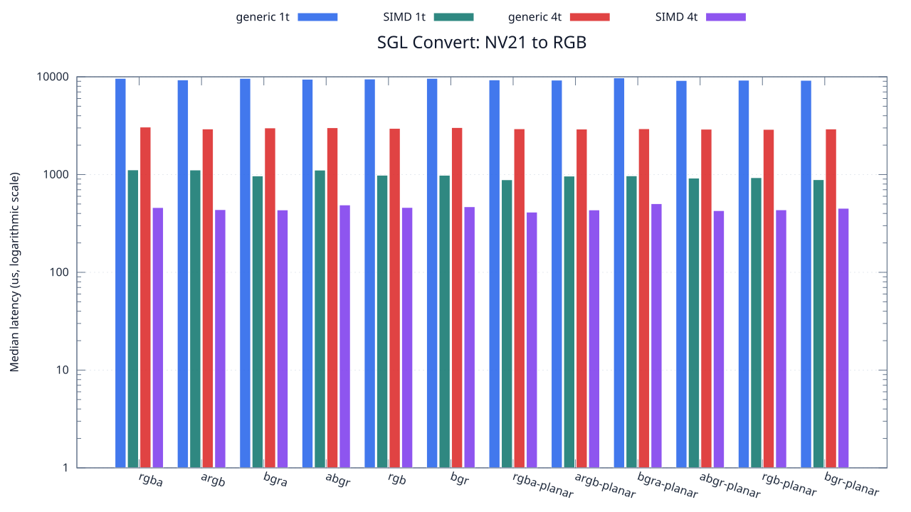
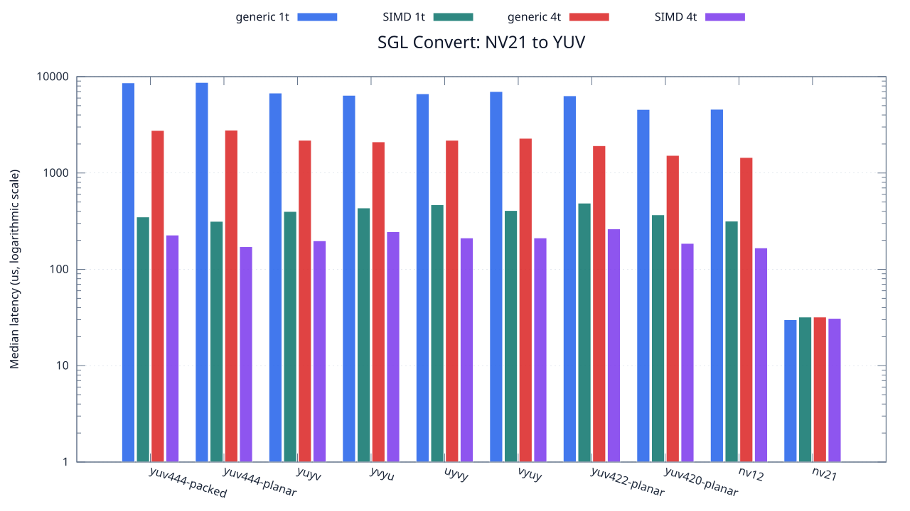

<!--
SPDX-License-Identifier: MIT

Copyright (c) 2025 Dylan Hong

This file is released under the MIT License.
For conditions of distribution and use, see the LICENSE file.
-->

Convert Benchmark: NV21 Source
==============================

[Convert index](../README.md) | [Benchmark index](../../README.md) | [Main README](../../../README.md#operation-benchmarks)

Every supported RGB and YUV destination is measured from the
`nv21` source format.

RGB Destinations
----------------

YUV Destinations
----------------

External Backend Coverage
-------------------------
| Library | Measured path | Coverage | Result relation |
| --- | --- | --- | --- |
| Cairo 1.18.4 | ARGB32 SOURCE copy | RGBA/ARGB/BGRA/ABGR identity, 1 thread | Byte-exact |
| NE10 v1.2.1 | Not available | No arbitrary FourCC/color-convert API | N/A |

Test Environment
----------------
| Environment | Value |
| --- | --- |
| Report generated | 2026-08-01T04:11:47+00:00 |
| OS | Ubuntu 24.04.4 LTS |
| Kernel | Linux 6.18.33.2-microsoft-standard-WSL2 (WSL2) |
| Runtime architecture | aarch64 |
| Target | Linux/aarch64 |
| CPU | ARM implementer 0x51, part 0x001 |
| Logical CPUs | 8 |
| Visible memory | 3.81 GiB |
| Execution | native |
| Input | resource/sample.png |
| Source revision | b815597 (dirty) |
| Chart generator | gnuplot 6.0 patchlevel 0 |

Build Configuration
-------------------
| Build option | Value |
| --- | --- |
| Toolchain | llvm |
| Compiler | Clang 18.1.3 |
| Compiler path | /usr/bin/clang |
| Build type | Release |
| C flags | `-O2 -DNDEBUG -std=gnu99 -Wall -Wextra -fno-vectorize -fno-slp-vectorize -fno-builtin-memcpy -fno-builtin-memset` |
| Compiler warnings | ON (-Wall, -Wextra) |
| Auto-vectorization | OFF (-fno-vectorize, -fno-slp-vectorize) |
| SIMD | ON (NEON) |
| Threading | ON (pthread) |
| Sanitizers | OFF |
| Stack protector | OFF |
| External comparison | ON (Cairo/NE10 where supported) |
| Warm-up calls | 3 |
| Measured calls | 10 |

Results
-------
| Case | Operation | Backend | Threads | Size | Median (us) | Average (us) | Min (us) | Max (us) | Pixels/s |
| --- | --- | --- | --- | --- | --- | --- | --- | --- | --- |
| 1848 | nv21-to-rgba | generic | 1 | 1280x720 | 9,636 | 9,728 | 9,540 | 10,160 | 95,641,344 |
| 1849 | nv21-to-rgba | generic | 4 | 1280x720 | 3,063 | 3,086 | 2,917 | 3,321 | 300,881,488 |
| 1850 | nv21-to-rgba | simd | 1 | 1280x720 | 1,117 | 1,128 | 1,101 | 1,255 | 825,067,144 |
| 1851 | nv21-to-rgba | simd | 4 | 1280x720 | 460 | 469 | 380 | 610 | 2,003,478,260 |
| 1852 | nv21-to-argb | generic | 1 | 1280x720 | 9,301 | 9,293 | 9,090 | 9,532 | 99,086,119 |
| 1853 | nv21-to-argb | generic | 4 | 1280x720 | 2,929 | 2,955 | 2,831 | 3,215 | 314,646,637 |
| 1854 | nv21-to-argb | simd | 1 | 1280x720 | 1,114 | 1,116 | 1,101 | 1,141 | 827,289,048 |
| 1855 | nv21-to-argb | simd | 4 | 1280x720 | 438 | 460 | 362 | 609 | 2,104,109,589 |
| 1856 | nv21-to-bgra | generic | 1 | 1280x720 | 9,636 | 9,567 | 9,294 | 9,790 | 95,641,344 |
| 1857 | nv21-to-bgra | generic | 4 | 1280x720 | 3,000 | 3,003 | 2,865 | 3,151 | 307,200,000 |
| 1858 | nv21-to-bgra | simd | 1 | 1280x720 | 969 | 989 | 948 | 1,101 | 951,083,591 |
| 1859 | nv21-to-bgra | simd | 4 | 1280x720 | 435 | 437 | 382 | 480 | 2,118,620,689 |
| 1860 | nv21-to-abgr | generic | 1 | 1280x720 | 9,446 | 9,432 | 9,276 | 9,668 | 97,565,106 |
| 1861 | nv21-to-abgr | generic | 4 | 1280x720 | 3,015 | 3,012 | 2,837 | 3,173 | 305,671,641 |
| 1862 | nv21-to-abgr | simd | 1 | 1280x720 | 1,111 | 1,091 | 948 | 1,135 | 829,522,952 |
| 1863 | nv21-to-abgr | simd | 4 | 1280x720 | 489 | 485 | 430 | 547 | 1,884,662,576 |
| 1864 | nv21-to-rgb | generic | 1 | 1280x720 | 9,495 | 9,586 | 9,323 | 10,120 | 97,061,611 |
| 1865 | nv21-to-rgb | generic | 4 | 1280x720 | 2,968 | 2,990 | 2,825 | 3,182 | 310,512,129 |
| 1866 | nv21-to-rgb | simd | 1 | 1280x720 | 985 | 1,036 | 969 | 1,202 | 935,634,517 |
| 1867 | nv21-to-rgb | simd | 4 | 1280x720 | 461 | 445 | 358 | 487 | 1,999,132,321 |
| 1868 | nv21-to-bgr | generic | 1 | 1280x720 | 9,640 | 9,805 | 9,360 | 11,007 | 95,601,659 |
| 1869 | nv21-to-bgr | generic | 4 | 1280x720 | 3,026 | 3,037 | 2,870 | 3,165 | 304,560,475 |
| 1870 | nv21-to-bgr | simd | 1 | 1280x720 | 984 | 1,009 | 970 | 1,147 | 936,585,365 |
| 1871 | nv21-to-bgr | simd | 4 | 1280x720 | 469 | 497 | 433 | 660 | 1,965,031,982 |
| 1872 | nv21-to-rgba-planar | generic | 1 | 1280x720 | 9,300 | 9,365 | 9,046 | 10,153 | 99,096,774 |
| 1873 | nv21-to-rgba-planar | generic | 4 | 1280x720 | 2,940 | 2,928 | 2,820 | 3,046 | 313,469,387 |
| 1874 | nv21-to-rgba-planar | simd | 1 | 1280x720 | 885 | 912 | 875 | 1,051 | 1,041,355,932 |
| 1875 | nv21-to-rgba-planar | simd | 4 | 1280x720 | 413 | 539 | 379 | 1,589 | 2,231,476,997 |
| 1876 | nv21-to-argb-planar | generic | 1 | 1280x720 | 9,250 | 9,257 | 9,043 | 9,684 | 99,632,432 |
| 1877 | nv21-to-argb-planar | generic | 4 | 1280x720 | 2,920 | 2,891 | 2,757 | 2,960 | 315,616,438 |
| 1878 | nv21-to-argb-planar | simd | 1 | 1280x720 | 965 | 1,027 | 948 | 1,297 | 955,025,906 |
| 1879 | nv21-to-argb-planar | simd | 4 | 1280x720 | 435 | 461 | 421 | 578 | 2,118,620,689 |
| 1880 | nv21-to-bgra-planar | generic | 1 | 1280x720 | 9,752 | 9,916 | 9,086 | 11,285 | 94,503,691 |
| 1881 | nv21-to-bgra-planar | generic | 4 | 1280x720 | 2,944 | 2,942 | 2,735 | 3,099 | 313,043,478 |
| 1882 | nv21-to-bgra-planar | simd | 1 | 1280x720 | 971 | 985 | 938 | 1,069 | 949,124,613 |
| 1883 | nv21-to-bgra-planar | simd | 4 | 1280x720 | 504 | 492 | 433 | 526 | 1,828,571,428 |
| 1884 | nv21-to-abgr-planar | generic | 1 | 1280x720 | 9,166 | 9,266 | 9,054 | 9,711 | 100,545,494 |
| 1885 | nv21-to-abgr-planar | generic | 4 | 1280x720 | 2,913 | 2,935 | 2,865 | 3,127 | 316,374,871 |
| 1886 | nv21-to-abgr-planar | simd | 1 | 1280x720 | 920 | 963 | 907 | 1,064 | 1,001,739,130 |
| 1887 | nv21-to-abgr-planar | simd | 4 | 1280x720 | 428 | 435 | 393 | 480 | 2,153,271,028 |
| 1888 | nv21-to-rgb-planar | generic | 1 | 1280x720 | 9,236 | 9,251 | 9,025 | 9,618 | 99,783,456 |
| 1889 | nv21-to-rgb-planar | generic | 4 | 1280x720 | 2,899 | 2,961 | 2,849 | 3,267 | 317,902,725 |
| 1890 | nv21-to-rgb-planar | simd | 1 | 1280x720 | 930 | 940 | 906 | 1,020 | 990,967,741 |
| 1891 | nv21-to-rgb-planar | simd | 4 | 1280x720 | 436 | 458 | 404 | 576 | 2,113,761,467 |
| 1892 | nv21-to-bgr-planar | generic | 1 | 1280x720 | 9,202 | 9,223 | 9,055 | 9,515 | 100,152,140 |
| 1893 | nv21-to-bgr-planar | generic | 4 | 1280x720 | 2,928 | 2,958 | 2,831 | 3,232 | 314,754,098 |
| 1894 | nv21-to-bgr-planar | simd | 1 | 1280x720 | 887 | 902 | 876 | 976 | 1,039,007,891 |
| 1895 | nv21-to-bgr-planar | simd | 4 | 1280x720 | 452 | 453 | 401 | 512 | 2,038,938,053 |
| 1896 | nv21-to-yuv444-packed | generic | 1 | 1280x720 | 8,625 | 8,660 | 8,533 | 8,925 | 106,852,173 |
| 1897 | nv21-to-yuv444-packed | generic | 4 | 1280x720 | 2,769 | 2,778 | 2,617 | 2,992 | 332,827,735 |
| 1898 | nv21-to-yuv444-packed | simd | 1 | 1280x720 | 350 | 353 | 346 | 364 | 2,633,142,857 |
| 1899 | nv21-to-yuv444-packed | simd | 4 | 1280x720 | 227 | 239 | 166 | 356 | 4,059,911,894 |
| 1900 | nv21-to-yuv444-planar | generic | 1 | 1280x720 | 8,707 | 8,699 | 8,547 | 8,831 | 105,845,871 |
| 1901 | nv21-to-yuv444-planar | generic | 4 | 1280x720 | 2,789 | 2,852 | 2,674 | 3,450 | 330,441,018 |
| 1902 | nv21-to-yuv444-planar | simd | 1 | 1280x720 | 315 | 326 | 314 | 356 | 2,925,714,285 |
| 1903 | nv21-to-yuv444-planar | simd | 4 | 1280x720 | 172 | 165 | 103 | 240 | 5,358,139,534 |
| 1904 | nv21-to-yuyv | generic | 1 | 1280x720 | 6,764 | 6,768 | 6,523 | 7,119 | 136,250,739 |
| 1905 | nv21-to-yuyv | generic | 4 | 1280x720 | 2,191 | 2,189 | 2,066 | 2,330 | 420,629,849 |
| 1906 | nv21-to-yuyv | simd | 1 | 1280x720 | 399 | 402 | 398 | 419 | 2,309,774,436 |
| 1907 | nv21-to-yuyv | simd | 4 | 1280x720 | 198 | 195 | 122 | 273 | 4,654,545,454 |
| 1908 | nv21-to-yvyu | generic | 1 | 1280x720 | 6,406 | 6,427 | 6,275 | 6,752 | 143,865,126 |
| 1909 | nv21-to-yvyu | generic | 4 | 1280x720 | 2,105 | 2,106 | 1,977 | 2,270 | 437,814,726 |
| 1910 | nv21-to-yvyu | simd | 1 | 1280x720 | 434 | 456 | 408 | 564 | 2,123,502,304 |
| 1911 | nv21-to-yvyu | simd | 4 | 1280x720 | 246 | 249 | 174 | 339 | 3,746,341,463 |
| 1912 | nv21-to-uyvy | generic | 1 | 1280x720 | 6,643 | 6,704 | 6,537 | 7,113 | 138,732,500 |
| 1913 | nv21-to-uyvy | generic | 4 | 1280x720 | 2,189 | 2,201 | 2,143 | 2,319 | 421,014,161 |
| 1914 | nv21-to-uyvy | simd | 1 | 1280x720 | 469 | 504 | 467 | 612 | 1,965,031,982 |
| 1915 | nv21-to-uyvy | simd | 4 | 1280x720 | 212 | 206 | 148 | 261 | 4,347,169,811 |
| 1916 | nv21-to-vyuy | generic | 1 | 1280x720 | 7,012 | 7,026 | 6,894 | 7,248 | 131,431,831 |
| 1917 | nv21-to-vyuy | generic | 4 | 1280x720 | 2,292 | 2,347 | 2,164 | 2,634 | 402,094,240 |
| 1918 | nv21-to-vyuy | simd | 1 | 1280x720 | 408 | 414 | 408 | 443 | 2,258,823,529 |
| 1919 | nv21-to-vyuy | simd | 4 | 1280x720 | 212 | 210 | 125 | 311 | 4,347,169,811 |
| 1920 | nv21-to-yuv422-planar | generic | 1 | 1280x720 | 6,335 | 6,444 | 6,033 | 7,084 | 145,477,505 |
| 1921 | nv21-to-yuv422-planar | generic | 4 | 1280x720 | 1,920 | 1,989 | 1,893 | 2,309 | 480,000,000 |
| 1922 | nv21-to-yuv422-planar | simd | 1 | 1280x720 | 487 | 504 | 481 | 570 | 1,892,402,464 |
| 1923 | nv21-to-yuv422-planar | simd | 4 | 1280x720 | 263 | 262 | 203 | 352 | 3,504,182,509 |
| 1924 | nv21-to-yuv420-planar | generic | 1 | 1280x720 | 4,570 | 4,612 | 4,487 | 5,115 | 201,663,019 |
| 1925 | nv21-to-yuv420-planar | generic | 4 | 1280x720 | 1,523 | 1,529 | 1,470 | 1,596 | 605,121,470 |
| 1926 | nv21-to-yuv420-planar | simd | 1 | 1280x720 | 368 | 371 | 367 | 391 | 2,504,347,826 |
| 1927 | nv21-to-yuv420-planar | simd | 4 | 1280x720 | 186 | 180 | 122 | 200 | 4,954,838,709 |
| 1928 | nv21-to-nv12 | generic | 1 | 1280x720 | 4,591 | 4,783 | 4,439 | 5,278 | 200,740,579 |
| 1929 | nv21-to-nv12 | generic | 4 | 1280x720 | 1,450 | 1,479 | 1,427 | 1,628 | 635,586,206 |
| 1930 | nv21-to-nv12 | simd | 1 | 1280x720 | 317 | 330 | 316 | 417 | 2,907,255,520 |
| 1931 | nv21-to-nv12 | simd | 4 | 1280x720 | 167 | 169 | 104 | 289 | 5,518,562,874 |
| 1932 | nv21-to-nv21 | generic | 1 | 1280x720 | 30 | 31 | 27 | 51 | 30,720,000,000 |
| 1933 | nv21-to-nv21 | generic | 4 | 1280x720 | 32 | 32 | 31 | 33 | 28,800,000,000 |
| 1934 | nv21-to-nv21 | simd | 1 | 1280x720 | 32 | 33 | 31 | 45 | 28,800,000,000 |
| 1935 | nv21-to-nv21 | simd | 4 | 1280x720 | 31 | 29 | 26 | 32 | 29,729,032,258 |

Results depend on the input, CPU frequency policy, scheduler load, compiler,
and build options. Refresh them on the target machine before comparison.
