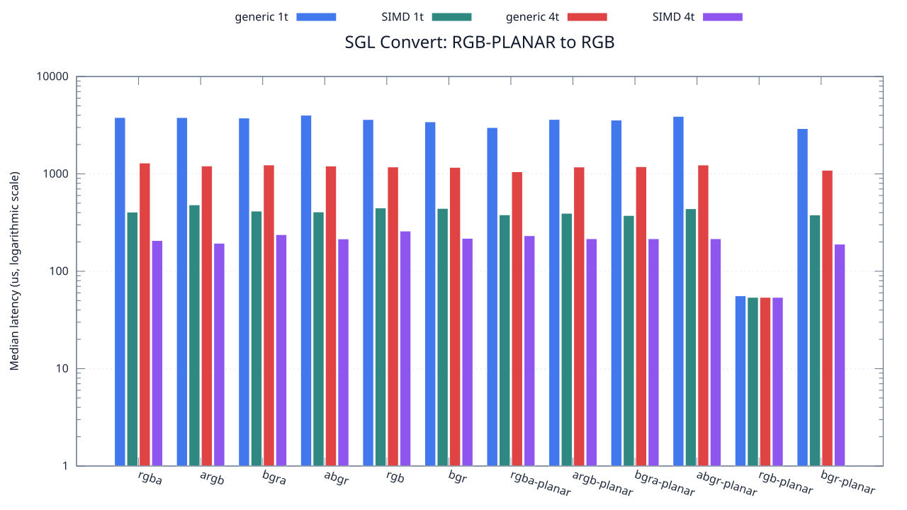
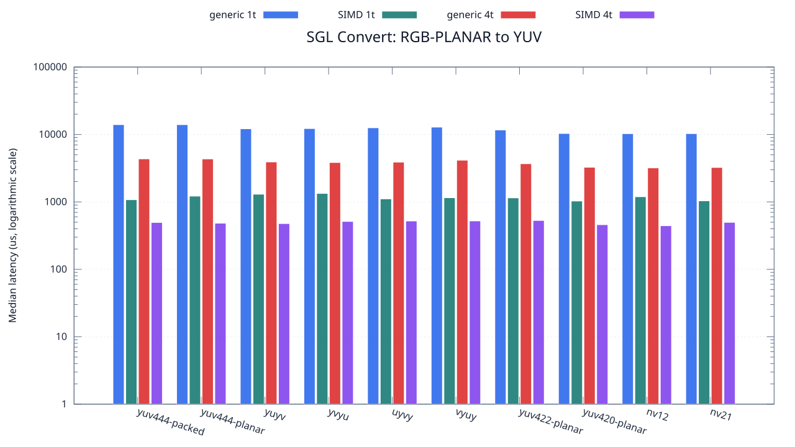

<!--
SPDX-License-Identifier: MIT

Copyright (c) 2025 Dylan Hong

This file is released under the MIT License.
For conditions of distribution and use, see the LICENSE file.
-->

Convert Benchmark: RGB-PLANAR Source
====================================

[Convert index](../README.md) | [Benchmark index](../../README.md) | [Main README](../../../README.md#operation-benchmarks)

Every supported RGB and YUV destination is measured from the
`rgb-planar` source format.

RGB Destinations
----------------

YUV Destinations
----------------

External Backend Coverage
-------------------------
| Library | Measured path | Coverage | Result relation |
| --- | --- | --- | --- |
| Cairo 1.18.4 | ARGB32 SOURCE copy | RGBA/ARGB/BGRA/ABGR identity, 1 thread | Byte-exact |
| NE10 v1.2.1 | Not available | No arbitrary FourCC/color-convert API | N/A |

Test Environment
----------------
| Environment | Value |
| --- | --- |
| Report generated | 2026-08-01T04:11:47+00:00 |
| OS | Ubuntu 24.04.4 LTS |
| Kernel | Linux 6.18.33.2-microsoft-standard-WSL2 (WSL2) |
| Runtime architecture | aarch64 |
| Target | Linux/aarch64 |
| CPU | ARM implementer 0x51, part 0x001 |
| Logical CPUs | 8 |
| Visible memory | 3.81 GiB |
| Execution | native |
| Input | resource/sample.png |
| Source revision | b815597 (dirty) |
| Chart generator | gnuplot 6.0 patchlevel 0 |

Build Configuration
-------------------
| Build option | Value |
| --- | --- |
| Toolchain | llvm |
| Compiler | Clang 18.1.3 |
| Compiler path | /usr/bin/clang |
| Build type | Release |
| C flags | `-O2 -DNDEBUG -std=gnu99 -Wall -Wextra -fno-vectorize -fno-slp-vectorize -fno-builtin-memcpy -fno-builtin-memset` |
| Compiler warnings | ON (-Wall, -Wextra) |
| Auto-vectorization | OFF (-fno-vectorize, -fno-slp-vectorize) |
| SIMD | ON (NEON) |
| Threading | ON (pthread) |
| Sanitizers | OFF |
| Stack protector | OFF |
| External comparison | ON (Cairo/NE10 where supported) |
| Warm-up calls | 3 |
| Measured calls | 10 |

Results
-------
| Case | Operation | Backend | Threads | Size | Median (us) | Average (us) | Min (us) | Max (us) | Pixels/s |
| --- | --- | --- | --- | --- | --- | --- | --- | --- | --- |
| 880 | rgb-planar-to-rgba | generic | 1 | 1280x720 | 3,794 | 3,847 | 3,766 | 4,006 | 242,909,857 |
| 881 | rgb-planar-to-rgba | generic | 4 | 1280x720 | 1,294 | 1,342 | 1,253 | 1,609 | 712,210,200 |
| 882 | rgb-planar-to-rgba | simd | 1 | 1280x720 | 405 | 425 | 404 | 515 | 2,275,555,555 |
| 883 | rgb-planar-to-rgba | simd | 4 | 1280x720 | 207 | 205 | 125 | 266 | 4,452,173,913 |
| 884 | rgb-planar-to-argb | generic | 1 | 1280x720 | 3,790 | 3,775 | 3,451 | 4,073 | 243,166,226 |
| 885 | rgb-planar-to-argb | generic | 4 | 1280x720 | 1,207 | 1,227 | 1,166 | 1,358 | 763,545,981 |
| 886 | rgb-planar-to-argb | simd | 1 | 1280x720 | 481 | 484 | 475 | 515 | 1,916,008,316 |
| 887 | rgb-planar-to-argb | simd | 4 | 1280x720 | 194 | 195 | 151 | 232 | 4,750,515,463 |
| 888 | rgb-planar-to-bgra | generic | 1 | 1280x720 | 3,748 | 3,788 | 3,520 | 4,155 | 245,891,141 |
| 889 | rgb-planar-to-bgra | generic | 4 | 1280x720 | 1,236 | 1,235 | 1,196 | 1,282 | 745,631,067 |
| 890 | rgb-planar-to-bgra | simd | 1 | 1280x720 | 415 | 424 | 404 | 495 | 2,220,722,891 |
| 891 | rgb-planar-to-bgra | simd | 4 | 1280x720 | 238 | 238 | 150 | 325 | 3,872,268,907 |
| 892 | rgb-planar-to-abgr | generic | 1 | 1280x720 | 4,007 | 4,026 | 3,439 | 5,304 | 229,997,504 |
| 893 | rgb-planar-to-abgr | generic | 4 | 1280x720 | 1,205 | 1,219 | 1,093 | 1,406 | 764,813,278 |
| 894 | rgb-planar-to-abgr | simd | 1 | 1280x720 | 407 | 418 | 405 | 466 | 2,264,373,464 |
| 895 | rgb-planar-to-abgr | simd | 4 | 1280x720 | 215 | 211 | 124 | 341 | 4,286,511,627 |
| 896 | rgb-planar-to-rgb | generic | 1 | 1280x720 | 3,618 | 3,717 | 3,396 | 4,159 | 254,726,368 |
| 897 | rgb-planar-to-rgb | generic | 4 | 1280x720 | 1,179 | 1,191 | 1,123 | 1,315 | 781,679,389 |
| 898 | rgb-planar-to-rgb | simd | 1 | 1280x720 | 447 | 459 | 436 | 527 | 2,061,744,966 |
| 899 | rgb-planar-to-rgb | simd | 4 | 1280x720 | 259 | 287 | 163 | 519 | 3,558,301,158 |
| 900 | rgb-planar-to-bgr | generic | 1 | 1280x720 | 3,426 | 3,547 | 3,291 | 3,882 | 269,001,751 |
| 901 | rgb-planar-to-bgr | generic | 4 | 1280x720 | 1,167 | 1,178 | 1,086 | 1,379 | 789,717,223 |
| 902 | rgb-planar-to-bgr | simd | 1 | 1280x720 | 442 | 443 | 435 | 461 | 2,085,067,873 |
| 903 | rgb-planar-to-bgr | simd | 4 | 1280x720 | 218 | 214 | 149 | 257 | 4,227,522,935 |
| 904 | rgb-planar-to-rgba-planar | generic | 1 | 1280x720 | 2,993 | 3,034 | 2,971 | 3,381 | 307,918,476 |
| 905 | rgb-planar-to-rgba-planar | generic | 4 | 1280x720 | 1,052 | 1,068 | 1,014 | 1,256 | 876,045,627 |
| 906 | rgb-planar-to-rgba-planar | simd | 1 | 1280x720 | 380 | 390 | 373 | 474 | 2,425,263,157 |
| 907 | rgb-planar-to-rgba-planar | simd | 4 | 1280x720 | 232 | 237 | 183 | 333 | 3,972,413,793 |
| 908 | rgb-planar-to-argb-planar | generic | 1 | 1280x720 | 3,625 | 3,684 | 3,348 | 4,171 | 254,234,482 |
| 909 | rgb-planar-to-argb-planar | generic | 4 | 1280x720 | 1,178 | 1,227 | 1,149 | 1,423 | 782,342,954 |
| 910 | rgb-planar-to-argb-planar | simd | 1 | 1280x720 | 394 | 402 | 373 | 450 | 2,339,086,294 |
| 911 | rgb-planar-to-argb-planar | simd | 4 | 1280x720 | 216 | 230 | 187 | 284 | 4,266,666,666 |
| 912 | rgb-planar-to-bgra-planar | generic | 1 | 1280x720 | 3,569 | 3,648 | 3,415 | 4,054 | 258,223,592 |
| 913 | rgb-planar-to-bgra-planar | generic | 4 | 1280x720 | 1,186 | 1,227 | 1,119 | 1,597 | 777,065,767 |
| 914 | rgb-planar-to-bgra-planar | simd | 1 | 1280x720 | 374 | 385 | 373 | 468 | 2,464,171,122 |
| 915 | rgb-planar-to-bgra-planar | simd | 4 | 1280x720 | 216 | 203 | 140 | 255 | 4,266,666,666 |
| 916 | rgb-planar-to-abgr-planar | generic | 1 | 1280x720 | 3,898 | 3,808 | 3,367 | 4,233 | 236,428,937 |
| 917 | rgb-planar-to-abgr-planar | generic | 4 | 1280x720 | 1,234 | 1,239 | 1,171 | 1,338 | 746,839,546 |
| 918 | rgb-planar-to-abgr-planar | simd | 1 | 1280x720 | 439 | 428 | 374 | 499 | 2,099,316,628 |
| 919 | rgb-planar-to-abgr-planar | simd | 4 | 1280x720 | 216 | 213 | 139 | 295 | 4,266,666,666 |
| 920 | rgb-planar-to-rgb-planar | generic | 1 | 1280x720 | 56 | 56 | 55 | 58 | 16,457,142,857 |
| 921 | rgb-planar-to-rgb-planar | generic | 4 | 1280x720 | 54 | 54 | 53 | 55 | 17,066,666,666 |
| 922 | rgb-planar-to-rgb-planar | simd | 1 | 1280x720 | 54 | 54 | 53 | 65 | 17,066,666,666 |
| 923 | rgb-planar-to-rgb-planar | simd | 4 | 1280x720 | 54 | 53 | 53 | 54 | 17,066,666,666 |
| 924 | rgb-planar-to-bgr-planar | generic | 1 | 1280x720 | 2,919 | 2,922 | 2,836 | 3,016 | 315,724,563 |
| 925 | rgb-planar-to-bgr-planar | generic | 4 | 1280x720 | 1,090 | 1,089 | 1,005 | 1,225 | 845,504,587 |
| 926 | rgb-planar-to-bgr-planar | simd | 1 | 1280x720 | 379 | 401 | 373 | 465 | 2,431,662,269 |
| 927 | rgb-planar-to-bgr-planar | simd | 4 | 1280x720 | 190 | 192 | 130 | 293 | 4,850,526,315 |
| 928 | rgb-planar-to-yuv444-packed | generic | 1 | 1280x720 | 13,993 | 14,067 | 13,846 | 14,818 | 65,861,502 |
| 929 | rgb-planar-to-yuv444-packed | generic | 4 | 1280x720 | 4,345 | 4,351 | 4,191 | 4,537 | 212,105,868 |
| 930 | rgb-planar-to-yuv444-packed | simd | 1 | 1280x720 | 1,077 | 1,110 | 1,058 | 1,263 | 855,710,306 |
| 931 | rgb-planar-to-yuv444-packed | simd | 4 | 1280x720 | 495 | 548 | 468 | 736 | 1,861,818,181 |
| 932 | rgb-planar-to-yuv444-planar | generic | 1 | 1280x720 | 13,981 | 14,042 | 13,845 | 14,221 | 65,918,031 |
| 933 | rgb-planar-to-yuv444-planar | generic | 4 | 1280x720 | 4,337 | 4,343 | 4,273 | 4,457 | 212,497,117 |
| 934 | rgb-planar-to-yuv444-planar | simd | 1 | 1280x720 | 1,218 | 1,233 | 1,205 | 1,337 | 756,650,246 |
| 935 | rgb-planar-to-yuv444-planar | simd | 4 | 1280x720 | 483 | 492 | 450 | 560 | 1,908,074,534 |
| 936 | rgb-planar-to-yuyv | generic | 1 | 1280x720 | 12,143 | 12,172 | 11,970 | 12,330 | 75,895,577 |
| 937 | rgb-planar-to-yuyv | generic | 4 | 1280x720 | 3,912 | 3,903 | 3,751 | 4,091 | 235,582,822 |
| 938 | rgb-planar-to-yuyv | simd | 1 | 1280x720 | 1,300 | 1,315 | 1,293 | 1,381 | 708,923,076 |
| 939 | rgb-planar-to-yuyv | simd | 4 | 1280x720 | 477 | 496 | 423 | 690 | 1,932,075,471 |
| 940 | rgb-planar-to-yvyu | generic | 1 | 1280x720 | 12,236 | 12,420 | 12,103 | 13,389 | 75,318,731 |
| 941 | rgb-planar-to-yvyu | generic | 4 | 1280x720 | 3,839 | 3,964 | 3,670 | 4,623 | 240,062,516 |
| 942 | rgb-planar-to-yvyu | simd | 1 | 1280x720 | 1,335 | 1,345 | 1,319 | 1,451 | 690,337,078 |
| 943 | rgb-planar-to-yvyu | simd | 4 | 1280x720 | 513 | 521 | 432 | 617 | 1,796,491,228 |
| 944 | rgb-planar-to-uyvy | generic | 1 | 1280x720 | 12,566 | 12,577 | 12,401 | 13,012 | 73,340,760 |
| 945 | rgb-planar-to-uyvy | generic | 4 | 1280x720 | 3,887 | 3,985 | 3,719 | 4,673 | 237,098,019 |
| 946 | rgb-planar-to-uyvy | simd | 1 | 1280x720 | 1,108 | 1,155 | 1,092 | 1,385 | 831,768,953 |
| 947 | rgb-planar-to-uyvy | simd | 4 | 1280x720 | 521 | 561 | 490 | 841 | 1,768,905,950 |
| 948 | rgb-planar-to-vyuy | generic | 1 | 1280x720 | 12,848 | 12,920 | 12,685 | 13,276 | 71,731,008 |
| 949 | rgb-planar-to-vyuy | generic | 4 | 1280x720 | 4,154 | 4,112 | 3,839 | 4,379 | 221,858,449 |
| 950 | rgb-planar-to-vyuy | simd | 1 | 1280x720 | 1,152 | 1,172 | 1,136 | 1,263 | 800,000,000 |
| 951 | rgb-planar-to-vyuy | simd | 4 | 1280x720 | 522 | 520 | 490 | 560 | 1,765,517,241 |
| 952 | rgb-planar-to-yuv422-planar | generic | 1 | 1280x720 | 11,663 | 11,708 | 11,584 | 11,993 | 79,019,120 |
| 953 | rgb-planar-to-yuv422-planar | generic | 4 | 1280x720 | 3,683 | 3,712 | 3,547 | 3,856 | 250,230,790 |
| 954 | rgb-planar-to-yuv422-planar | simd | 1 | 1280x720 | 1,147 | 1,159 | 1,124 | 1,293 | 803,487,358 |
| 955 | rgb-planar-to-yuv422-planar | simd | 4 | 1280x720 | 530 | 539 | 457 | 643 | 1,738,867,924 |
| 956 | rgb-planar-to-yuv420-planar | generic | 1 | 1280x720 | 10,342 | 10,379 | 10,187 | 10,651 | 89,112,357 |
| 957 | rgb-planar-to-yuv420-planar | generic | 4 | 1280x720 | 3,264 | 3,287 | 3,144 | 3,524 | 282,352,941 |
| 958 | rgb-planar-to-yuv420-planar | simd | 1 | 1280x720 | 1,030 | 1,057 | 1,022 | 1,235 | 894,757,281 |
| 959 | rgb-planar-to-yuv420-planar | simd | 4 | 1280x720 | 459 | 462 | 414 | 523 | 2,007,843,137 |
| 960 | rgb-planar-to-nv12 | generic | 1 | 1280x720 | 10,287 | 10,329 | 10,186 | 10,634 | 89,588,801 |
| 961 | rgb-planar-to-nv12 | generic | 4 | 1280x720 | 3,192 | 3,244 | 3,156 | 3,542 | 288,721,804 |
| 962 | rgb-planar-to-nv12 | simd | 1 | 1280x720 | 1,193 | 1,177 | 999 | 1,274 | 772,506,286 |
| 963 | rgb-planar-to-nv12 | simd | 4 | 1280x720 | 443 | 447 | 384 | 573 | 2,080,361,173 |
| 964 | rgb-planar-to-nv21 | generic | 1 | 1280x720 | 10,297 | 10,442 | 10,161 | 10,950 | 89,501,796 |
| 965 | rgb-planar-to-nv21 | generic | 4 | 1280x720 | 3,240 | 3,252 | 3,117 | 3,427 | 284,444,444 |
| 966 | rgb-planar-to-nv21 | simd | 1 | 1280x720 | 1,036 | 1,053 | 1,014 | 1,109 | 889,575,289 |
| 967 | rgb-planar-to-nv21 | simd | 4 | 1280x720 | 497 | 527 | 436 | 699 | 1,854,325,955 |

Results depend on the input, CPU frequency policy, scheduler load, compiler,
and build options. Refresh them on the target machine before comparison.
