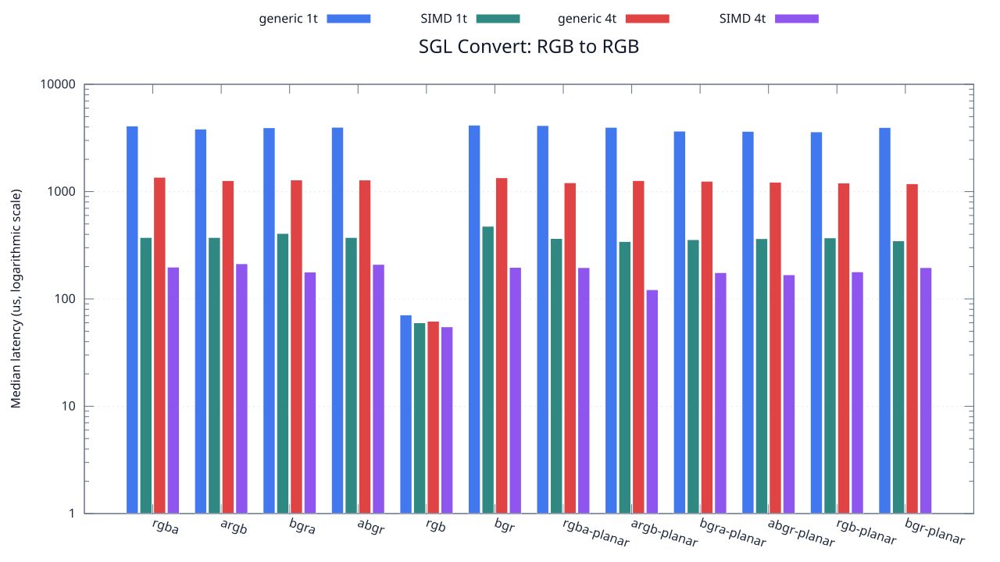
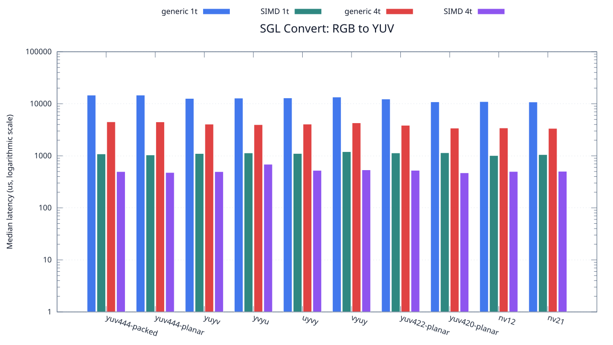

<!--
SPDX-License-Identifier: MIT

Copyright (c) 2025 Dylan Hong

This file is released under the MIT License.
For conditions of distribution and use, see the LICENSE file.
-->

Convert Benchmark: RGB Source
=============================

[Convert index](../README.md) | [Benchmark index](../../README.md) | [Main README](../../../README.md#operation-benchmarks)

Every supported RGB and YUV destination is measured from the
`rgb` source format.

RGB Destinations
----------------

YUV Destinations
----------------

External Backend Coverage
-------------------------
| Library | Measured path | Coverage | Result relation |
| --- | --- | --- | --- |
| Cairo 1.18.4 | ARGB32 SOURCE copy | RGBA/ARGB/BGRA/ABGR identity, 1 thread | Byte-exact |
| NE10 v1.2.1 | Not available | No arbitrary FourCC/color-convert API | N/A |

Test Environment
----------------
| Environment | Value |
| --- | --- |
| Report generated | 2026-08-01T04:11:47+00:00 |
| OS | Ubuntu 24.04.4 LTS |
| Kernel | Linux 6.18.33.2-microsoft-standard-WSL2 (WSL2) |
| Runtime architecture | aarch64 |
| Target | Linux/aarch64 |
| CPU | ARM implementer 0x51, part 0x001 |
| Logical CPUs | 8 |
| Visible memory | 3.81 GiB |
| Execution | native |
| Input | resource/sample.png |
| Source revision | b815597 (dirty) |
| Chart generator | gnuplot 6.0 patchlevel 0 |

Build Configuration
-------------------
| Build option | Value |
| --- | --- |
| Toolchain | llvm |
| Compiler | Clang 18.1.3 |
| Compiler path | /usr/bin/clang |
| Build type | Release |
| C flags | `-O2 -DNDEBUG -std=gnu99 -Wall -Wextra -fno-vectorize -fno-slp-vectorize -fno-builtin-memcpy -fno-builtin-memset` |
| Compiler warnings | ON (-Wall, -Wextra) |
| Auto-vectorization | OFF (-fno-vectorize, -fno-slp-vectorize) |
| SIMD | ON (NEON) |
| Threading | ON (pthread) |
| Sanitizers | OFF |
| Stack protector | OFF |
| External comparison | ON (Cairo/NE10 where supported) |
| Warm-up calls | 3 |
| Measured calls | 10 |

Results
-------
| Case | Operation | Backend | Threads | Size | Median (us) | Average (us) | Min (us) | Max (us) | Pixels/s |
| --- | --- | --- | --- | --- | --- | --- | --- | --- | --- |
| 352 | rgb-to-rgba | generic | 1 | 1280x720 | 4,092 | 4,108 | 4,012 | 4,220 | 225,219,941 |
| 353 | rgb-to-rgba | generic | 4 | 1280x720 | 1,361 | 1,367 | 1,300 | 1,483 | 677,149,155 |
| 354 | rgb-to-rgba | simd | 1 | 1280x720 | 374 | 383 | 373 | 438 | 2,464,171,122 |
| 355 | rgb-to-rgba | simd | 4 | 1280x720 | 198 | 199 | 115 | 289 | 4,654,545,454 |
| 356 | rgb-to-argb | generic | 1 | 1280x720 | 3,831 | 3,881 | 3,758 | 4,086 | 240,563,821 |
| 357 | rgb-to-argb | generic | 4 | 1280x720 | 1,267 | 1,282 | 1,225 | 1,406 | 727,387,529 |
| 358 | rgb-to-argb | simd | 1 | 1280x720 | 374 | 379 | 373 | 397 | 2,464,171,122 |
| 359 | rgb-to-argb | simd | 4 | 1280x720 | 213 | 232 | 140 | 326 | 4,326,760,563 |
| 360 | rgb-to-bgra | generic | 1 | 1280x720 | 3,940 | 4,012 | 3,829 | 4,663 | 233,908,629 |
| 361 | rgb-to-bgra | generic | 4 | 1280x720 | 1,285 | 1,323 | 1,240 | 1,613 | 717,198,443 |
| 362 | rgb-to-bgra | simd | 1 | 1280x720 | 408 | 424 | 374 | 574 | 2,258,823,529 |
| 363 | rgb-to-bgra | simd | 4 | 1280x720 | 178 | 172 | 115 | 223 | 5,177,528,089 |
| 364 | rgb-to-abgr | generic | 1 | 1280x720 | 3,982 | 4,076 | 3,769 | 4,504 | 231,441,486 |
| 365 | rgb-to-abgr | generic | 4 | 1280x720 | 1,284 | 1,297 | 1,235 | 1,381 | 717,757,009 |
| 366 | rgb-to-abgr | simd | 1 | 1280x720 | 374 | 392 | 373 | 448 | 2,464,171,122 |
| 367 | rgb-to-abgr | simd | 4 | 1280x720 | 210 | 212 | 115 | 310 | 4,388,571,428 |
| 368 | rgb-to-rgb | generic | 1 | 1280x720 | 71 | 77 | 62 | 118 | 12,980,281,690 |
| 369 | rgb-to-rgb | generic | 4 | 1280x720 | 62 | 64 | 60 | 71 | 14,864,516,129 |
| 370 | rgb-to-rgb | simd | 1 | 1280x720 | 60 | 61 | 56 | 67 | 15,360,000,000 |
| 371 | rgb-to-rgb | simd | 4 | 1280x720 | 55 | 55 | 55 | 55 | 16,756,363,636 |
| 372 | rgb-to-bgr | generic | 1 | 1280x720 | 4,167 | 4,309 | 4,020 | 4,824 | 221,166,306 |
| 373 | rgb-to-bgr | generic | 4 | 1280x720 | 1,348 | 1,363 | 1,234 | 1,478 | 683,679,525 |
| 374 | rgb-to-bgr | simd | 1 | 1280x720 | 476 | 490 | 475 | 541 | 1,936,134,453 |
| 375 | rgb-to-bgr | simd | 4 | 1280x720 | 197 | 200 | 152 | 246 | 4,678,172,588 |
| 376 | rgb-to-rgba-planar | generic | 1 | 1280x720 | 4,132 | 4,001 | 3,519 | 4,489 | 223,039,690 |
| 377 | rgb-to-rgba-planar | generic | 4 | 1280x720 | 1,211 | 1,291 | 1,175 | 1,823 | 761,023,947 |
| 378 | rgb-to-rgba-planar | simd | 1 | 1280x720 | 366 | 364 | 342 | 408 | 2,518,032,786 |
| 379 | rgb-to-rgba-planar | simd | 4 | 1280x720 | 196 | 184 | 105 | 265 | 4,702,040,816 |
| 380 | rgb-to-argb-planar | generic | 1 | 1280x720 | 3,974 | 3,987 | 3,622 | 4,311 | 231,907,398 |
| 381 | rgb-to-argb-planar | generic | 4 | 1280x720 | 1,268 | 1,257 | 1,215 | 1,281 | 726,813,880 |
| 382 | rgb-to-argb-planar | simd | 1 | 1280x720 | 343 | 353 | 342 | 397 | 2,686,880,466 |
| 383 | rgb-to-argb-planar | simd | 4 | 1280x720 | 122 | 136 | 105 | 174 | 7,554,098,360 |
| 384 | rgb-to-bgra-planar | generic | 1 | 1280x720 | 3,663 | 3,696 | 3,638 | 3,823 | 251,597,051 |
| 385 | rgb-to-bgra-planar | generic | 4 | 1280x720 | 1,250 | 1,282 | 1,215 | 1,406 | 737,280,000 |
| 386 | rgb-to-bgra-planar | simd | 1 | 1280x720 | 357 | 390 | 343 | 495 | 2,581,512,605 |
| 387 | rgb-to-bgra-planar | simd | 4 | 1280x720 | 176 | 182 | 129 | 238 | 5,236,363,636 |
| 388 | rgb-to-abgr-planar | generic | 1 | 1280x720 | 3,645 | 3,683 | 3,610 | 3,997 | 252,839,506 |
| 389 | rgb-to-abgr-planar | generic | 4 | 1280x720 | 1,225 | 1,237 | 1,178 | 1,339 | 752,326,530 |
| 390 | rgb-to-abgr-planar | simd | 1 | 1280x720 | 365 | 369 | 342 | 444 | 2,524,931,506 |
| 391 | rgb-to-abgr-planar | simd | 4 | 1280x720 | 168 | 157 | 106 | 202 | 5,485,714,285 |
| 392 | rgb-to-rgb-planar | generic | 1 | 1280x720 | 3,607 | 3,673 | 3,512 | 4,111 | 255,503,188 |
| 393 | rgb-to-rgb-planar | generic | 4 | 1280x720 | 1,204 | 1,211 | 1,175 | 1,293 | 765,448,504 |
| 394 | rgb-to-rgb-planar | simd | 1 | 1280x720 | 371 | 408 | 342 | 647 | 2,484,097,035 |
| 395 | rgb-to-rgb-planar | simd | 4 | 1280x720 | 179 | 173 | 114 | 215 | 5,148,603,351 |
| 396 | rgb-to-bgr-planar | generic | 1 | 1280x720 | 3,962 | 3,906 | 3,517 | 4,280 | 232,609,793 |
| 397 | rgb-to-bgr-planar | generic | 4 | 1280x720 | 1,185 | 1,211 | 1,147 | 1,407 | 777,721,518 |
| 398 | rgb-to-bgr-planar | simd | 1 | 1280x720 | 348 | 366 | 342 | 444 | 2,648,275,862 |
| 399 | rgb-to-bgr-planar | simd | 4 | 1280x720 | 196 | 196 | 120 | 281 | 4,702,040,816 |
| 400 | rgb-to-yuv444-packed | generic | 1 | 1280x720 | 14,648 | 14,698 | 14,423 | 15,417 | 62,916,439 |
| 401 | rgb-to-yuv444-packed | generic | 4 | 1280x720 | 4,502 | 4,516 | 4,376 | 4,761 | 204,709,018 |
| 402 | rgb-to-yuv444-packed | simd | 1 | 1280x720 | 1,087 | 1,095 | 1,058 | 1,159 | 847,838,086 |
| 403 | rgb-to-yuv444-packed | simd | 4 | 1280x720 | 498 | 511 | 464 | 609 | 1,850,602,409 |
| 404 | rgb-to-yuv444-planar | generic | 1 | 1280x720 | 14,658 | 14,754 | 14,385 | 15,497 | 62,873,516 |
| 405 | rgb-to-yuv444-planar | generic | 4 | 1280x720 | 4,486 | 4,484 | 4,414 | 4,601 | 205,439,144 |
| 406 | rgb-to-yuv444-planar | simd | 1 | 1280x720 | 1,038 | 1,057 | 1,027 | 1,146 | 887,861,271 |
| 407 | rgb-to-yuv444-planar | simd | 4 | 1280x720 | 478 | 480 | 451 | 505 | 1,928,033,472 |
| 408 | rgb-to-yuyv | generic | 1 | 1280x720 | 12,658 | 12,793 | 12,493 | 13,545 | 72,807,710 |
| 409 | rgb-to-yuyv | generic | 4 | 1280x720 | 4,060 | 4,058 | 3,837 | 4,246 | 226,995,073 |
| 410 | rgb-to-yuyv | simd | 1 | 1280x720 | 1,106 | 1,114 | 1,092 | 1,189 | 833,273,056 |
| 411 | rgb-to-yuyv | simd | 4 | 1280x720 | 497 | 514 | 435 | 643 | 1,854,325,955 |
| 412 | rgb-to-yvyu | generic | 1 | 1280x720 | 12,840 | 12,870 | 12,615 | 13,166 | 71,775,700 |
| 413 | rgb-to-yvyu | generic | 4 | 1280x720 | 3,972 | 3,973 | 3,798 | 4,173 | 232,024,169 |
| 414 | rgb-to-yvyu | simd | 1 | 1280x720 | 1,136 | 1,224 | 1,123 | 1,410 | 811,267,605 |
| 415 | rgb-to-yvyu | simd | 4 | 1280x720 | 688 | 665 | 487 | 813 | 1,339,534,883 |
| 416 | rgb-to-uyvy | generic | 1 | 1280x720 | 12,957 | 13,012 | 12,831 | 13,373 | 71,127,575 |
| 417 | rgb-to-uyvy | generic | 4 | 1280x720 | 4,067 | 4,088 | 3,973 | 4,267 | 226,604,376 |
| 418 | rgb-to-uyvy | simd | 1 | 1280x720 | 1,108 | 1,133 | 1,093 | 1,215 | 831,768,953 |
| 419 | rgb-to-uyvy | simd | 4 | 1280x720 | 525 | 525 | 422 | 619 | 1,755,428,571 |
| 420 | rgb-to-vyuy | generic | 1 | 1280x720 | 13,456 | 13,436 | 13,167 | 13,652 | 68,489,892 |
| 421 | rgb-to-vyuy | generic | 4 | 1280x720 | 4,299 | 4,563 | 4,000 | 5,661 | 214,375,436 |
| 422 | rgb-to-vyuy | simd | 1 | 1280x720 | 1,201 | 1,224 | 1,130 | 1,338 | 767,360,532 |
| 423 | rgb-to-vyuy | simd | 4 | 1280x720 | 537 | 532 | 438 | 595 | 1,716,201,117 |
| 424 | rgb-to-yuv422-planar | generic | 1 | 1280x720 | 12,339 | 12,379 | 12,074 | 12,942 | 74,690,007 |
| 425 | rgb-to-yuv422-planar | generic | 4 | 1280x720 | 3,856 | 3,929 | 3,732 | 4,442 | 239,004,149 |
| 426 | rgb-to-yuv422-planar | simd | 1 | 1280x720 | 1,136 | 1,146 | 1,124 | 1,214 | 811,267,605 |
| 427 | rgb-to-yuv422-planar | simd | 4 | 1280x720 | 526 | 540 | 495 | 637 | 1,752,091,254 |
| 428 | rgb-to-yuv420-planar | generic | 1 | 1280x720 | 10,889 | 10,882 | 10,791 | 10,966 | 84,635,871 |
| 429 | rgb-to-yuv420-planar | generic | 4 | 1280x720 | 3,403 | 3,507 | 3,296 | 4,264 | 270,819,864 |
| 430 | rgb-to-yuv420-planar | simd | 1 | 1280x720 | 1,145 | 1,138 | 1,022 | 1,267 | 804,890,829 |
| 431 | rgb-to-yuv420-planar | simd | 4 | 1280x720 | 471 | 484 | 429 | 572 | 1,956,687,898 |
| 432 | rgb-to-nv12 | generic | 1 | 1280x720 | 11,013 | 12,019 | 10,744 | 17,967 | 83,682,920 |
| 433 | rgb-to-nv12 | generic | 4 | 1280x720 | 3,431 | 3,433 | 3,322 | 3,576 | 268,609,734 |
| 434 | rgb-to-nv12 | simd | 1 | 1280x720 | 1,012 | 1,011 | 1,004 | 1,026 | 910,671,936 |
| 435 | rgb-to-nv12 | simd | 4 | 1280x720 | 500 | 493 | 380 | 557 | 1,843,200,000 |
| 436 | rgb-to-nv21 | generic | 1 | 1280x720 | 10,829 | 10,930 | 10,714 | 11,438 | 85,104,811 |
| 437 | rgb-to-nv21 | generic | 4 | 1280x720 | 3,364 | 3,452 | 3,292 | 4,116 | 273,959,571 |
| 438 | rgb-to-nv21 | simd | 1 | 1280x720 | 1,055 | 1,093 | 1,013 | 1,279 | 873,554,502 |
| 439 | rgb-to-nv21 | simd | 4 | 1280x720 | 504 | 503 | 411 | 664 | 1,828,571,428 |

Results depend on the input, CPU frequency policy, scheduler load, compiler,
and build options. Refresh them on the target machine before comparison.
