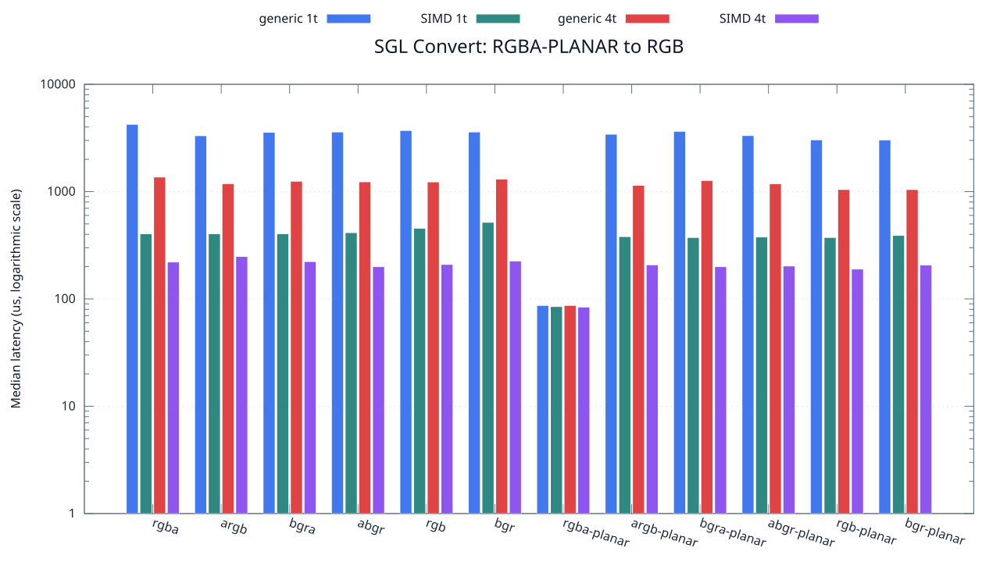
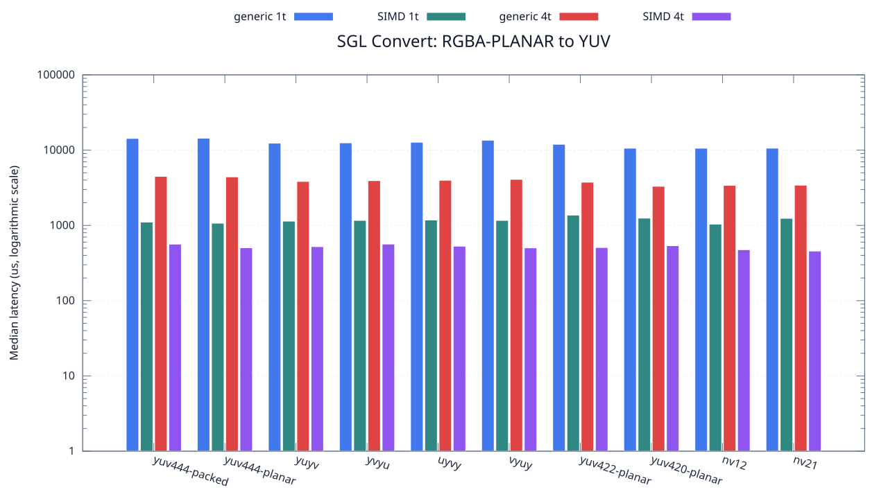

<!--
SPDX-License-Identifier: MIT

Copyright (c) 2025 Dylan Hong

This file is released under the MIT License.
For conditions of distribution and use, see the LICENSE file.
-->

Convert Benchmark: RGBA-PLANAR Source
=====================================

[Convert index](../README.md) | [Benchmark index](../../README.md) | [Main README](../../../README.md#operation-benchmarks)

Every supported RGB and YUV destination is measured from the
`rgba-planar` source format.

RGB Destinations
----------------

YUV Destinations
----------------

External Backend Coverage
-------------------------
| Library | Measured path | Coverage | Result relation |
| --- | --- | --- | --- |
| Cairo 1.18.4 | ARGB32 SOURCE copy | RGBA/ARGB/BGRA/ABGR identity, 1 thread | Byte-exact |
| NE10 v1.2.1 | Not available | No arbitrary FourCC/color-convert API | N/A |

Test Environment
----------------
| Environment | Value |
| --- | --- |
| Report generated | 2026-08-01T04:11:47+00:00 |
| OS | Ubuntu 24.04.4 LTS |
| Kernel | Linux 6.18.33.2-microsoft-standard-WSL2 (WSL2) |
| Runtime architecture | aarch64 |
| Target | Linux/aarch64 |
| CPU | ARM implementer 0x51, part 0x001 |
| Logical CPUs | 8 |
| Visible memory | 3.81 GiB |
| Execution | native |
| Input | resource/sample.png |
| Source revision | b815597 (dirty) |
| Chart generator | gnuplot 6.0 patchlevel 0 |

Build Configuration
-------------------
| Build option | Value |
| --- | --- |
| Toolchain | llvm |
| Compiler | Clang 18.1.3 |
| Compiler path | /usr/bin/clang |
| Build type | Release |
| C flags | `-O2 -DNDEBUG -std=gnu99 -Wall -Wextra -fno-vectorize -fno-slp-vectorize -fno-builtin-memcpy -fno-builtin-memset` |
| Compiler warnings | ON (-Wall, -Wextra) |
| Auto-vectorization | OFF (-fno-vectorize, -fno-slp-vectorize) |
| SIMD | ON (NEON) |
| Threading | ON (pthread) |
| Sanitizers | OFF |
| Stack protector | OFF |
| External comparison | ON (Cairo/NE10 where supported) |
| Warm-up calls | 3 |
| Measured calls | 10 |

Results
-------
| Case | Operation | Backend | Threads | Size | Median (us) | Average (us) | Min (us) | Max (us) | Pixels/s |
| --- | --- | --- | --- | --- | --- | --- | --- | --- | --- |
| 528 | rgba-planar-to-rgba | generic | 1 | 1280x720 | 4,241 | 4,334 | 4,112 | 4,869 | 217,307,238 |
| 529 | rgba-planar-to-rgba | generic | 4 | 1280x720 | 1,369 | 1,431 | 1,294 | 1,705 | 673,192,111 |
| 530 | rgba-planar-to-rgba | simd | 1 | 1280x720 | 405 | 418 | 405 | 513 | 2,275,555,555 |
| 531 | rgba-planar-to-rgba | simd | 4 | 1280x720 | 221 | 220 | 123 | 299 | 4,170,135,746 |
| 532 | rgba-planar-to-argb | generic | 1 | 1280x720 | 3,320 | 3,366 | 3,284 | 3,506 | 277,590,361 |
| 533 | rgba-planar-to-argb | generic | 4 | 1280x720 | 1,187 | 1,222 | 1,129 | 1,348 | 776,411,120 |
| 534 | rgba-planar-to-argb | simd | 1 | 1280x720 | 405 | 415 | 405 | 499 | 2,275,555,555 |
| 535 | rgba-planar-to-argb | simd | 4 | 1280x720 | 249 | 237 | 150 | 321 | 3,701,204,819 |
| 536 | rgba-planar-to-bgra | generic | 1 | 1280x720 | 3,574 | 3,600 | 3,513 | 3,805 | 257,862,339 |
| 537 | rgba-planar-to-bgra | generic | 4 | 1280x720 | 1,250 | 1,254 | 1,134 | 1,359 | 737,280,000 |
| 538 | rgba-planar-to-bgra | simd | 1 | 1280x720 | 405 | 419 | 405 | 484 | 2,275,555,555 |
| 539 | rgba-planar-to-bgra | simd | 4 | 1280x720 | 223 | 218 | 150 | 310 | 4,132,735,426 |
| 540 | rgba-planar-to-abgr | generic | 1 | 1280x720 | 3,599 | 3,691 | 3,514 | 4,137 | 256,071,130 |
| 541 | rgba-planar-to-abgr | generic | 4 | 1280x720 | 1,235 | 1,261 | 1,166 | 1,440 | 746,234,817 |
| 542 | rgba-planar-to-abgr | simd | 1 | 1280x720 | 415 | 451 | 405 | 670 | 2,220,722,891 |
| 543 | rgba-planar-to-abgr | simd | 4 | 1280x720 | 200 | 200 | 123 | 242 | 4,608,000,000 |
| 544 | rgba-planar-to-rgb | generic | 1 | 1280x720 | 3,714 | 4,133 | 3,516 | 7,684 | 248,142,164 |
| 545 | rgba-planar-to-rgb | generic | 4 | 1280x720 | 1,232 | 1,244 | 1,146 | 1,352 | 748,051,948 |
| 546 | rgba-planar-to-rgb | simd | 1 | 1280x720 | 456 | 465 | 436 | 529 | 2,021,052,631 |
| 547 | rgba-planar-to-rgb | simd | 4 | 1280x720 | 210 | 221 | 193 | 291 | 4,388,571,428 |
| 548 | rgba-planar-to-bgr | generic | 1 | 1280x720 | 3,596 | 3,684 | 3,512 | 4,180 | 256,284,760 |
| 549 | rgba-planar-to-bgr | generic | 4 | 1280x720 | 1,309 | 1,298 | 1,220 | 1,364 | 704,048,892 |
| 550 | rgba-planar-to-bgr | simd | 1 | 1280x720 | 518 | 537 | 511 | 636 | 1,779,150,579 |
| 551 | rgba-planar-to-bgr | simd | 4 | 1280x720 | 226 | 230 | 142 | 310 | 4,077,876,106 |
| 552 | rgba-planar-to-rgba-planar | generic | 1 | 1280x720 | 87 | 88 | 83 | 99 | 10,593,103,448 |
| 553 | rgba-planar-to-rgba-planar | generic | 4 | 1280x720 | 87 | 86 | 83 | 88 | 10,593,103,448 |
| 554 | rgba-planar-to-rgba-planar | simd | 1 | 1280x720 | 85 | 86 | 83 | 101 | 10,842,352,941 |
| 555 | rgba-planar-to-rgba-planar | simd | 4 | 1280x720 | 84 | 85 | 83 | 91 | 10,971,428,571 |
| 556 | rgba-planar-to-argb-planar | generic | 1 | 1280x720 | 3,428 | 3,517 | 3,273 | 3,964 | 268,844,807 |
| 557 | rgba-planar-to-argb-planar | generic | 4 | 1280x720 | 1,146 | 1,155 | 1,086 | 1,242 | 804,188,481 |
| 558 | rgba-planar-to-argb-planar | simd | 1 | 1280x720 | 381 | 392 | 373 | 466 | 2,418,897,637 |
| 559 | rgba-planar-to-argb-planar | simd | 4 | 1280x720 | 208 | 209 | 115 | 371 | 4,430,769,230 |
| 560 | rgba-planar-to-bgra-planar | generic | 1 | 1280x720 | 3,649 | 3,720 | 3,515 | 4,136 | 252,562,345 |
| 561 | rgba-planar-to-bgra-planar | generic | 4 | 1280x720 | 1,270 | 1,331 | 1,179 | 1,949 | 725,669,291 |
| 562 | rgba-planar-to-bgra-planar | simd | 1 | 1280x720 | 374 | 384 | 373 | 449 | 2,464,171,122 |
| 563 | rgba-planar-to-bgra-planar | simd | 4 | 1280x720 | 200 | 191 | 115 | 405 | 4,608,000,000 |
| 564 | rgba-planar-to-abgr-planar | generic | 1 | 1280x720 | 3,331 | 3,333 | 3,275 | 3,496 | 276,673,671 |
| 565 | rgba-planar-to-abgr-planar | generic | 4 | 1280x720 | 1,184 | 1,190 | 1,096 | 1,299 | 778,378,378 |
| 566 | rgba-planar-to-abgr-planar | simd | 1 | 1280x720 | 378 | 383 | 374 | 407 | 2,438,095,238 |
| 567 | rgba-planar-to-abgr-planar | simd | 4 | 1280x720 | 203 | 197 | 115 | 293 | 4,539,901,477 |
| 568 | rgba-planar-to-rgb-planar | generic | 1 | 1280x720 | 3,039 | 3,069 | 3,013 | 3,233 | 303,257,650 |
| 569 | rgba-planar-to-rgb-planar | generic | 4 | 1280x720 | 1,047 | 1,080 | 1,006 | 1,353 | 880,229,226 |
| 570 | rgba-planar-to-rgb-planar | simd | 1 | 1280x720 | 374 | 381 | 373 | 427 | 2,464,171,122 |
| 571 | rgba-planar-to-rgb-planar | simd | 4 | 1280x720 | 190 | 191 | 159 | 234 | 4,850,526,315 |
| 572 | rgba-planar-to-bgr-planar | generic | 1 | 1280x720 | 3,033 | 3,108 | 3,007 | 3,571 | 303,857,566 |
| 573 | rgba-planar-to-bgr-planar | generic | 4 | 1280x720 | 1,047 | 1,062 | 994 | 1,157 | 880,229,226 |
| 574 | rgba-planar-to-bgr-planar | simd | 1 | 1280x720 | 391 | 400 | 374 | 439 | 2,357,033,248 |
| 575 | rgba-planar-to-bgr-planar | simd | 4 | 1280x720 | 207 | 210 | 125 | 308 | 4,452,173,913 |
| 576 | rgba-planar-to-yuv444-packed | generic | 1 | 1280x720 | 14,297 | 14,364 | 14,093 | 14,708 | 64,461,075 |
| 577 | rgba-planar-to-yuv444-packed | generic | 4 | 1280x720 | 4,475 | 4,518 | 4,257 | 4,923 | 205,944,134 |
| 578 | rgba-planar-to-yuv444-packed | simd | 1 | 1280x720 | 1,106 | 1,111 | 1,089 | 1,139 | 833,273,056 |
| 579 | rgba-planar-to-yuv444-packed | simd | 4 | 1280x720 | 564 | 587 | 450 | 792 | 1,634,042,553 |
| 580 | rgba-planar-to-yuv444-planar | generic | 1 | 1280x720 | 14,398 | 14,508 | 14,114 | 15,147 | 64,008,890 |
| 581 | rgba-planar-to-yuv444-planar | generic | 4 | 1280x720 | 4,410 | 4,430 | 4,366 | 4,651 | 208,979,591 |
| 582 | rgba-planar-to-yuv444-planar | simd | 1 | 1280x720 | 1,070 | 1,080 | 1,058 | 1,164 | 861,308,411 |
| 583 | rgba-planar-to-yuv444-planar | simd | 4 | 1280x720 | 504 | 514 | 456 | 592 | 1,828,571,428 |
| 584 | rgba-planar-to-yuyv | generic | 1 | 1280x720 | 12,374 | 12,450 | 12,219 | 13,078 | 74,478,745 |
| 585 | rgba-planar-to-yuyv | generic | 4 | 1280x720 | 3,835 | 3,900 | 3,789 | 4,302 | 240,312,907 |
| 586 | rgba-planar-to-yuyv | simd | 1 | 1280x720 | 1,138 | 1,152 | 1,124 | 1,243 | 809,841,827 |
| 587 | rgba-planar-to-yuyv | simd | 4 | 1280x720 | 522 | 510 | 429 | 572 | 1,765,517,241 |
| 588 | rgba-planar-to-yvyu | generic | 1 | 1280x720 | 12,493 | 12,506 | 12,320 | 12,795 | 73,769,310 |
| 589 | rgba-planar-to-yvyu | generic | 4 | 1280x720 | 3,929 | 3,928 | 3,829 | 4,023 | 234,563,502 |
| 590 | rgba-planar-to-yvyu | simd | 1 | 1280x720 | 1,165 | 1,169 | 1,155 | 1,200 | 791,072,961 |
| 591 | rgba-planar-to-yvyu | simd | 4 | 1280x720 | 565 | 599 | 487 | 870 | 1,631,150,442 |
| 592 | rgba-planar-to-uyvy | generic | 1 | 1280x720 | 12,731 | 12,841 | 12,531 | 13,361 | 72,390,228 |
| 593 | rgba-planar-to-uyvy | generic | 4 | 1280x720 | 3,975 | 4,021 | 3,893 | 4,358 | 231,849,056 |
| 594 | rgba-planar-to-uyvy | simd | 1 | 1280x720 | 1,178 | 1,233 | 1,132 | 1,436 | 782,342,954 |
| 595 | rgba-planar-to-uyvy | simd | 4 | 1280x720 | 529 | 529 | 457 | 596 | 1,742,155,009 |
| 596 | rgba-planar-to-vyuy | generic | 1 | 1280x720 | 13,530 | 13,898 | 13,067 | 15,237 | 68,115,299 |
| 597 | rgba-planar-to-vyuy | generic | 4 | 1280x720 | 4,088 | 4,138 | 4,007 | 4,636 | 225,440,313 |
| 598 | rgba-planar-to-vyuy | simd | 1 | 1280x720 | 1,165 | 1,217 | 1,154 | 1,456 | 791,072,961 |
| 599 | rgba-planar-to-vyuy | simd | 4 | 1280x720 | 503 | 504 | 478 | 525 | 1,832,206,759 |
| 600 | rgba-planar-to-yuv422-planar | generic | 1 | 1280x720 | 11,955 | 12,055 | 11,858 | 12,673 | 77,089,084 |
| 601 | rgba-planar-to-yuv422-planar | generic | 4 | 1280x720 | 3,748 | 3,783 | 3,675 | 4,096 | 245,891,141 |
| 602 | rgba-planar-to-yuv422-planar | simd | 1 | 1280x720 | 1,368 | 1,388 | 1,356 | 1,553 | 673,684,210 |
| 603 | rgba-planar-to-yuv422-planar | simd | 4 | 1280x720 | 508 | 508 | 449 | 614 | 1,814,173,228 |
| 604 | rgba-planar-to-yuv420-planar | generic | 1 | 1280x720 | 10,605 | 10,593 | 10,510 | 10,662 | 86,902,404 |
| 605 | rgba-planar-to-yuv420-planar | generic | 4 | 1280x720 | 3,307 | 3,367 | 3,227 | 3,851 | 278,681,584 |
| 606 | rgba-planar-to-yuv420-planar | simd | 1 | 1280x720 | 1,248 | 1,303 | 1,235 | 1,729 | 738,461,538 |
| 607 | rgba-planar-to-yuv420-planar | simd | 4 | 1280x720 | 537 | 539 | 381 | 784 | 1,716,201,117 |
| 608 | rgba-planar-to-nv12 | generic | 1 | 1280x720 | 10,605 | 10,632 | 10,412 | 10,981 | 86,902,404 |
| 609 | rgba-planar-to-nv12 | generic | 4 | 1280x720 | 3,401 | 3,396 | 3,231 | 3,611 | 270,979,123 |
| 610 | rgba-planar-to-nv12 | simd | 1 | 1280x720 | 1,039 | 1,050 | 1,028 | 1,128 | 887,006,737 |
| 611 | rgba-planar-to-nv12 | simd | 4 | 1280x720 | 475 | 488 | 417 | 672 | 1,940,210,526 |
| 612 | rgba-planar-to-nv21 | generic | 1 | 1280x720 | 10,609 | 10,806 | 10,425 | 12,135 | 86,869,638 |
| 613 | rgba-planar-to-nv21 | generic | 4 | 1280x720 | 3,421 | 3,384 | 3,208 | 3,590 | 269,394,913 |
| 614 | rgba-planar-to-nv21 | simd | 1 | 1280x720 | 1,240 | 1,259 | 1,226 | 1,337 | 743,225,806 |
| 615 | rgba-planar-to-nv21 | simd | 4 | 1280x720 | 456 | 454 | 378 | 534 | 2,021,052,631 |

Results depend on the input, CPU frequency policy, scheduler load, compiler,
and build options. Refresh them on the target machine before comparison.
