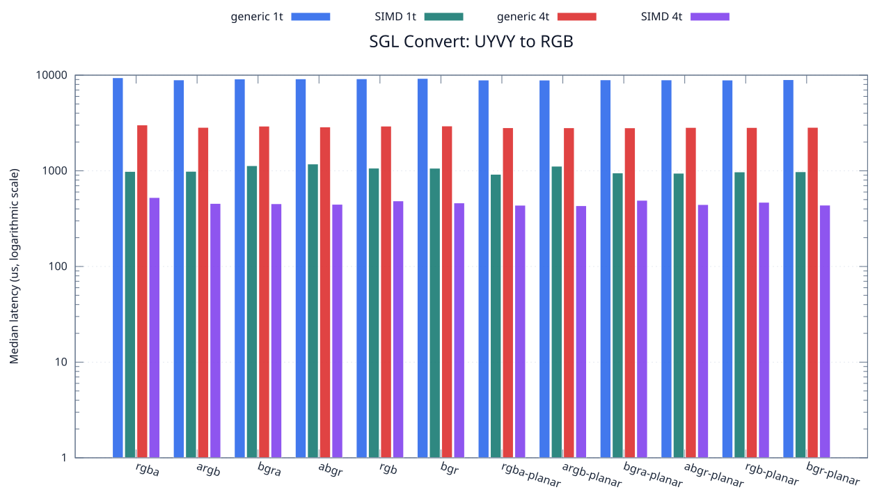
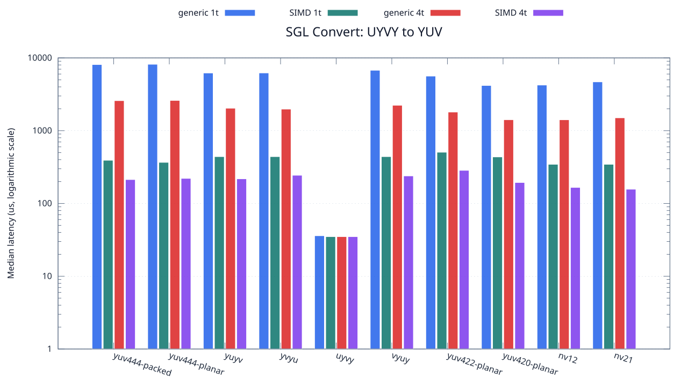

<!--
SPDX-License-Identifier: MIT

Copyright (c) 2025 Dylan Hong

This file is released under the MIT License.
For conditions of distribution and use, see the LICENSE file.
-->

Convert Benchmark: UYVY Source
==============================

[Convert index](../README.md) | [Benchmark index](../../README.md) | [Main README](../../../README.md#operation-benchmarks)

Every supported RGB and YUV destination is measured from the
`uyvy` source format.

RGB Destinations
----------------

YUV Destinations
----------------

External Backend Coverage
-------------------------
| Library | Measured path | Coverage | Result relation |
| --- | --- | --- | --- |
| Cairo 1.18.4 | ARGB32 SOURCE copy | RGBA/ARGB/BGRA/ABGR identity, 1 thread | Byte-exact |
| NE10 v1.2.1 | Not available | No arbitrary FourCC/color-convert API | N/A |

Test Environment
----------------
| Environment | Value |
| --- | --- |
| Report generated | 2026-08-01T04:11:47+00:00 |
| OS | Ubuntu 24.04.4 LTS |
| Kernel | Linux 6.18.33.2-microsoft-standard-WSL2 (WSL2) |
| Runtime architecture | aarch64 |
| Target | Linux/aarch64 |
| CPU | ARM implementer 0x51, part 0x001 |
| Logical CPUs | 8 |
| Visible memory | 3.81 GiB |
| Execution | native |
| Input | resource/sample.png |
| Source revision | b815597 (dirty) |
| Chart generator | gnuplot 6.0 patchlevel 0 |

Build Configuration
-------------------
| Build option | Value |
| --- | --- |
| Toolchain | llvm |
| Compiler | Clang 18.1.3 |
| Compiler path | /usr/bin/clang |
| Build type | Release |
| C flags | `-O2 -DNDEBUG -std=gnu99 -Wall -Wextra -fno-vectorize -fno-slp-vectorize -fno-builtin-memcpy -fno-builtin-memset` |
| Compiler warnings | ON (-Wall, -Wextra) |
| Auto-vectorization | OFF (-fno-vectorize, -fno-slp-vectorize) |
| SIMD | ON (NEON) |
| Threading | ON (pthread) |
| Sanitizers | OFF |
| Stack protector | OFF |
| External comparison | ON (Cairo/NE10 where supported) |
| Warm-up calls | 3 |
| Measured calls | 10 |

Results
-------
| Case | Operation | Backend | Threads | Size | Median (us) | Average (us) | Min (us) | Max (us) | Pixels/s |
| --- | --- | --- | --- | --- | --- | --- | --- | --- | --- |
| 1408 | uyvy-to-rgba | generic | 1 | 1280x720 | 9,401 | 9,421 | 9,336 | 9,575 | 98,032,124 |
| 1409 | uyvy-to-rgba | generic | 4 | 1280x720 | 3,016 | 3,014 | 2,902 | 3,103 | 305,570,291 |
| 1410 | uyvy-to-rgba | simd | 1 | 1280x720 | 985 | 1,019 | 969 | 1,240 | 935,634,517 |
| 1411 | uyvy-to-rgba | simd | 4 | 1280x720 | 526 | 514 | 440 | 582 | 1,752,091,254 |
| 1412 | uyvy-to-argb | generic | 1 | 1280x720 | 8,923 | 8,991 | 8,815 | 9,311 | 103,283,648 |
| 1413 | uyvy-to-argb | generic | 4 | 1280x720 | 2,845 | 2,855 | 2,807 | 2,944 | 323,936,731 |
| 1414 | uyvy-to-argb | simd | 1 | 1280x720 | 988 | 1,005 | 969 | 1,122 | 932,793,522 |
| 1415 | uyvy-to-argb | simd | 4 | 1280x720 | 456 | 452 | 392 | 486 | 2,021,052,631 |
| 1416 | uyvy-to-bgra | generic | 1 | 1280x720 | 9,125 | 9,138 | 9,053 | 9,297 | 100,997,260 |
| 1417 | uyvy-to-bgra | generic | 4 | 1280x720 | 2,932 | 2,947 | 2,779 | 3,154 | 314,324,693 |
| 1418 | uyvy-to-bgra | simd | 1 | 1280x720 | 1,132 | 1,104 | 969 | 1,206 | 814,134,275 |
| 1419 | uyvy-to-bgra | simd | 4 | 1280x720 | 453 | 457 | 415 | 522 | 2,034,437,086 |
| 1420 | uyvy-to-abgr | generic | 1 | 1280x720 | 9,151 | 9,284 | 9,052 | 10,600 | 100,710,304 |
| 1421 | uyvy-to-abgr | generic | 4 | 1280x720 | 2,876 | 2,985 | 2,776 | 3,664 | 320,445,062 |
| 1422 | uyvy-to-abgr | simd | 1 | 1280x720 | 1,179 | 1,156 | 1,009 | 1,342 | 781,679,389 |
| 1423 | uyvy-to-abgr | simd | 4 | 1280x720 | 447 | 459 | 421 | 504 | 2,061,744,966 |
| 1424 | uyvy-to-rgb | generic | 1 | 1280x720 | 9,167 | 9,215 | 9,039 | 9,528 | 100,534,526 |
| 1425 | uyvy-to-rgb | generic | 4 | 1280x720 | 2,933 | 3,026 | 2,879 | 3,519 | 314,217,524 |
| 1426 | uyvy-to-rgb | simd | 1 | 1280x720 | 1,067 | 1,077 | 1,031 | 1,208 | 863,730,084 |
| 1427 | uyvy-to-rgb | simd | 4 | 1280x720 | 485 | 489 | 417 | 595 | 1,900,206,185 |
| 1428 | uyvy-to-bgr | generic | 1 | 1280x720 | 9,243 | 9,330 | 9,144 | 9,820 | 99,707,887 |
| 1429 | uyvy-to-bgr | generic | 4 | 1280x720 | 2,944 | 3,075 | 2,913 | 3,810 | 313,043,478 |
| 1430 | uyvy-to-bgr | simd | 1 | 1280x720 | 1,065 | 1,068 | 1,030 | 1,141 | 865,352,112 |
| 1431 | uyvy-to-bgr | simd | 4 | 1280x720 | 462 | 467 | 433 | 527 | 1,994,805,194 |
| 1432 | uyvy-to-rgba-planar | generic | 1 | 1280x720 | 8,893 | 8,995 | 8,790 | 9,525 | 103,632,070 |
| 1433 | uyvy-to-rgba-planar | generic | 4 | 1280x720 | 2,822 | 2,877 | 2,766 | 3,166 | 326,576,895 |
| 1434 | uyvy-to-rgba-planar | simd | 1 | 1280x720 | 920 | 935 | 907 | 1,017 | 1,001,739,130 |
| 1435 | uyvy-to-rgba-planar | simd | 4 | 1280x720 | 437 | 444 | 407 | 478 | 2,108,924,485 |
| 1436 | uyvy-to-argb-planar | generic | 1 | 1280x720 | 8,883 | 8,942 | 8,789 | 9,419 | 103,748,733 |
| 1437 | uyvy-to-argb-planar | generic | 4 | 1280x720 | 2,818 | 2,870 | 2,700 | 3,228 | 327,040,454 |
| 1438 | uyvy-to-argb-planar | simd | 1 | 1280x720 | 1,118 | 1,134 | 1,101 | 1,238 | 824,329,159 |
| 1439 | uyvy-to-argb-planar | simd | 4 | 1280x720 | 432 | 460 | 409 | 618 | 2,133,333,333 |
| 1440 | uyvy-to-bgra-planar | generic | 1 | 1280x720 | 8,935 | 8,965 | 8,831 | 9,204 | 103,144,935 |
| 1441 | uyvy-to-bgra-planar | generic | 4 | 1280x720 | 2,814 | 2,815 | 2,734 | 2,896 | 327,505,330 |
| 1442 | uyvy-to-bgra-planar | simd | 1 | 1280x720 | 950 | 988 | 939 | 1,206 | 970,105,263 |
| 1443 | uyvy-to-bgra-planar | simd | 4 | 1280x720 | 492 | 500 | 335 | 663 | 1,873,170,731 |
| 1444 | uyvy-to-abgr-planar | generic | 1 | 1280x720 | 8,922 | 8,994 | 8,801 | 9,462 | 103,295,225 |
| 1445 | uyvy-to-abgr-planar | generic | 4 | 1280x720 | 2,839 | 2,859 | 2,817 | 2,963 | 324,621,345 |
| 1446 | uyvy-to-abgr-planar | simd | 1 | 1280x720 | 944 | 955 | 938 | 1,030 | 976,271,186 |
| 1447 | uyvy-to-abgr-planar | simd | 4 | 1280x720 | 444 | 454 | 406 | 538 | 2,075,675,675 |
| 1448 | uyvy-to-rgb-planar | generic | 1 | 1280x720 | 8,894 | 8,971 | 8,819 | 9,262 | 103,620,418 |
| 1449 | uyvy-to-rgb-planar | generic | 4 | 1280x720 | 2,836 | 2,830 | 2,725 | 2,892 | 324,964,739 |
| 1450 | uyvy-to-rgb-planar | simd | 1 | 1280x720 | 974 | 988 | 969 | 1,067 | 946,201,232 |
| 1451 | uyvy-to-rgb-planar | simd | 4 | 1280x720 | 469 | 482 | 411 | 673 | 1,965,031,982 |
| 1452 | uyvy-to-bgr-planar | generic | 1 | 1280x720 | 8,969 | 9,059 | 8,787 | 9,579 | 102,753,930 |
| 1453 | uyvy-to-bgr-planar | generic | 4 | 1280x720 | 2,846 | 2,837 | 2,699 | 3,098 | 323,822,909 |
| 1454 | uyvy-to-bgr-planar | simd | 1 | 1280x720 | 978 | 994 | 968 | 1,141 | 942,331,288 |
| 1455 | uyvy-to-bgr-planar | simd | 4 | 1280x720 | 438 | 462 | 399 | 603 | 2,104,109,589 |
| 1456 | uyvy-to-yuv444-packed | generic | 1 | 1280x720 | 8,102 | 8,114 | 8,041 | 8,251 | 113,749,691 |
| 1457 | uyvy-to-yuv444-packed | generic | 4 | 1280x720 | 2,586 | 2,609 | 2,464 | 2,827 | 356,380,510 |
| 1458 | uyvy-to-yuv444-packed | simd | 1 | 1280x720 | 392 | 418 | 378 | 581 | 2,351,020,408 |
| 1459 | uyvy-to-yuv444-packed | simd | 4 | 1280x720 | 213 | 206 | 115 | 299 | 4,326,760,563 |
| 1460 | uyvy-to-yuv444-planar | generic | 1 | 1280x720 | 8,173 | 8,188 | 8,062 | 8,422 | 112,761,531 |
| 1461 | uyvy-to-yuv444-planar | generic | 4 | 1280x720 | 2,603 | 2,644 | 2,490 | 3,083 | 354,053,015 |
| 1462 | uyvy-to-yuv444-planar | simd | 1 | 1280x720 | 367 | 369 | 346 | 417 | 2,511,171,662 |
| 1463 | uyvy-to-yuv444-planar | simd | 4 | 1280x720 | 221 | 237 | 134 | 371 | 4,170,135,746 |
| 1464 | uyvy-to-yuyv | generic | 1 | 1280x720 | 6,204 | 6,364 | 6,158 | 7,268 | 148,549,323 |
| 1465 | uyvy-to-yuyv | generic | 4 | 1280x720 | 2,034 | 2,025 | 1,894 | 2,101 | 453,097,345 |
| 1466 | uyvy-to-yuyv | simd | 1 | 1280x720 | 440 | 443 | 440 | 451 | 2,094,545,454 |
| 1467 | uyvy-to-yuyv | simd | 4 | 1280x720 | 218 | 213 | 147 | 244 | 4,227,522,935 |
| 1468 | uyvy-to-yvyu | generic | 1 | 1280x720 | 6,214 | 6,359 | 6,027 | 7,193 | 148,310,267 |
| 1469 | uyvy-to-yvyu | generic | 4 | 1280x720 | 1,978 | 1,999 | 1,922 | 2,184 | 465,925,176 |
| 1470 | uyvy-to-yvyu | simd | 1 | 1280x720 | 440 | 445 | 439 | 474 | 2,094,545,454 |
| 1471 | uyvy-to-yvyu | simd | 4 | 1280x720 | 244 | 261 | 211 | 443 | 3,777,049,180 |
| 1472 | uyvy-to-uyvy | generic | 1 | 1280x720 | 36 | 36 | 35 | 37 | 25,600,000,000 |
| 1473 | uyvy-to-uyvy | generic | 4 | 1280x720 | 35 | 35 | 35 | 36 | 26,331,428,571 |
| 1474 | uyvy-to-uyvy | simd | 1 | 1280x720 | 35 | 36 | 35 | 46 | 26,331,428,571 |
| 1475 | uyvy-to-uyvy | simd | 4 | 1280x720 | 35 | 35 | 34 | 36 | 26,331,428,571 |
| 1476 | uyvy-to-vyuy | generic | 1 | 1280x720 | 6,759 | 6,866 | 6,647 | 7,891 | 136,351,531 |
| 1477 | uyvy-to-vyuy | generic | 4 | 1280x720 | 2,234 | 2,217 | 2,090 | 2,413 | 412,533,572 |
| 1478 | uyvy-to-vyuy | simd | 1 | 1280x720 | 440 | 444 | 439 | 464 | 2,094,545,454 |
| 1479 | uyvy-to-vyuy | simd | 4 | 1280x720 | 239 | 233 | 163 | 273 | 3,856,066,945 |
| 1480 | uyvy-to-yuv422-planar | generic | 1 | 1280x720 | 5,624 | 5,664 | 5,519 | 5,920 | 163,869,132 |
| 1481 | uyvy-to-yuv422-planar | generic | 4 | 1280x720 | 1,804 | 1,893 | 1,753 | 2,463 | 510,864,745 |
| 1482 | uyvy-to-yuv422-planar | simd | 1 | 1280x720 | 506 | 508 | 502 | 525 | 1,821,343,873 |
| 1483 | uyvy-to-yuv422-planar | simd | 4 | 1280x720 | 285 | 277 | 152 | 372 | 3,233,684,210 |
| 1484 | uyvy-to-yuv420-planar | generic | 1 | 1280x720 | 4,178 | 4,234 | 4,150 | 4,467 | 220,584,011 |
| 1485 | uyvy-to-yuv420-planar | generic | 4 | 1280x720 | 1,414 | 1,419 | 1,350 | 1,510 | 651,768,033 |
| 1486 | uyvy-to-yuv420-planar | simd | 1 | 1280x720 | 436 | 431 | 391 | 471 | 2,113,761,467 |
| 1487 | uyvy-to-yuv420-planar | simd | 4 | 1280x720 | 194 | 214 | 125 | 294 | 4,750,515,463 |
| 1488 | uyvy-to-nv12 | generic | 1 | 1280x720 | 4,237 | 4,398 | 4,146 | 4,895 | 217,512,390 |
| 1489 | uyvy-to-nv12 | generic | 4 | 1280x720 | 1,412 | 1,411 | 1,359 | 1,478 | 652,691,218 |
| 1490 | uyvy-to-nv12 | simd | 1 | 1280x720 | 345 | 353 | 344 | 384 | 2,671,304,347 |
| 1491 | uyvy-to-nv12 | simd | 4 | 1280x720 | 166 | 175 | 108 | 340 | 5,551,807,228 |
| 1492 | uyvy-to-nv21 | generic | 1 | 1280x720 | 4,686 | 4,597 | 4,143 | 4,998 | 196,670,934 |
| 1493 | uyvy-to-nv21 | generic | 4 | 1280x720 | 1,502 | 1,511 | 1,443 | 1,684 | 613,581,890 |
| 1494 | uyvy-to-nv21 | simd | 1 | 1280x720 | 345 | 348 | 344 | 357 | 2,671,304,347 |
| 1495 | uyvy-to-nv21 | simd | 4 | 1280x720 | 157 | 155 | 107 | 206 | 5,870,063,694 |

Results depend on the input, CPU frequency policy, scheduler load, compiler,
and build options. Refresh them on the target machine before comparison.
