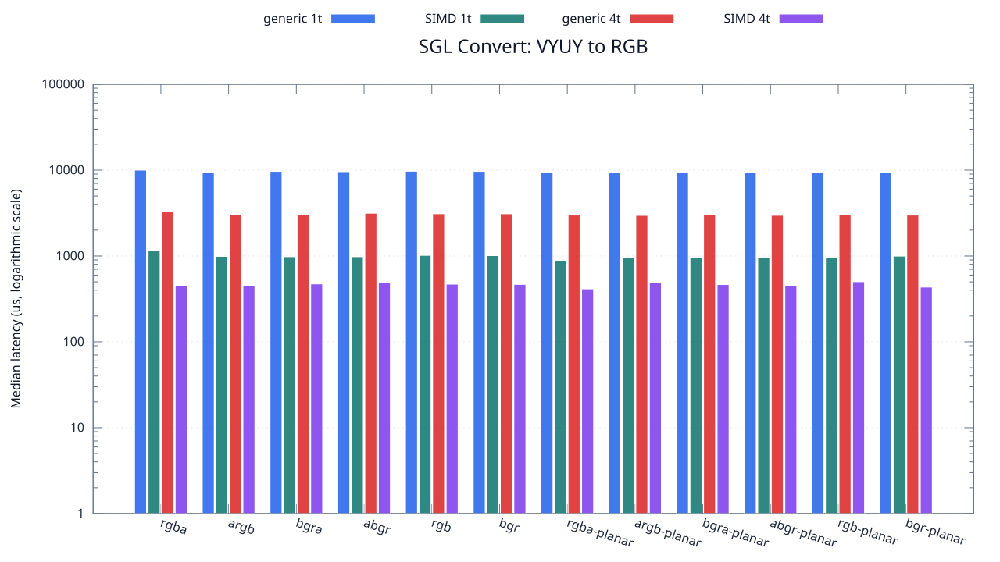
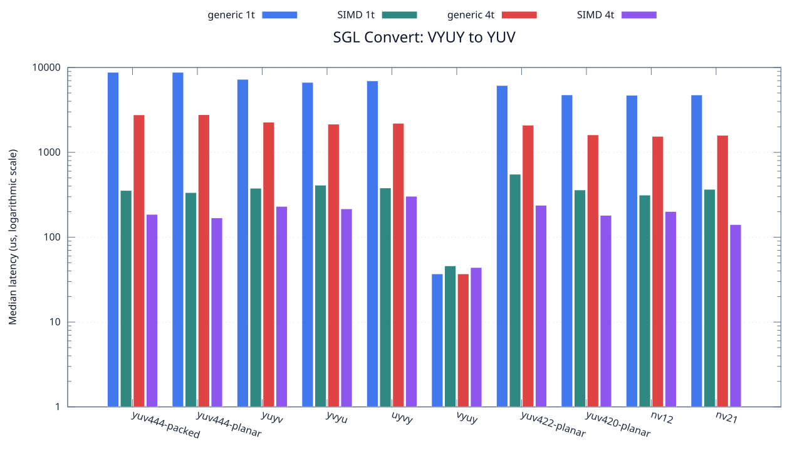

<!--
SPDX-License-Identifier: MIT

Copyright (c) 2025 Dylan Hong

This file is released under the MIT License.
For conditions of distribution and use, see the LICENSE file.
-->

Convert Benchmark: VYUY Source
==============================

[Convert index](../README.md) | [Benchmark index](../../README.md) | [Main README](../../../README.md#operation-benchmarks)

Every supported RGB and YUV destination is measured from the
`vyuy` source format.

RGB Destinations
----------------

YUV Destinations
----------------

External Backend Coverage
-------------------------
| Library | Measured path | Coverage | Result relation |
| --- | --- | --- | --- |
| Cairo 1.18.4 | ARGB32 SOURCE copy | RGBA/ARGB/BGRA/ABGR identity, 1 thread | Byte-exact |
| NE10 v1.2.1 | Not available | No arbitrary FourCC/color-convert API | N/A |

Test Environment
----------------
| Environment | Value |
| --- | --- |
| Report generated | 2026-08-01T04:11:47+00:00 |
| OS | Ubuntu 24.04.4 LTS |
| Kernel | Linux 6.18.33.2-microsoft-standard-WSL2 (WSL2) |
| Runtime architecture | aarch64 |
| Target | Linux/aarch64 |
| CPU | ARM implementer 0x51, part 0x001 |
| Logical CPUs | 8 |
| Visible memory | 3.81 GiB |
| Execution | native |
| Input | resource/sample.png |
| Source revision | b815597 (dirty) |
| Chart generator | gnuplot 6.0 patchlevel 0 |

Build Configuration
-------------------
| Build option | Value |
| --- | --- |
| Toolchain | llvm |
| Compiler | Clang 18.1.3 |
| Compiler path | /usr/bin/clang |
| Build type | Release |
| C flags | `-O2 -DNDEBUG -std=gnu99 -Wall -Wextra -fno-vectorize -fno-slp-vectorize -fno-builtin-memcpy -fno-builtin-memset` |
| Compiler warnings | ON (-Wall, -Wextra) |
| Auto-vectorization | OFF (-fno-vectorize, -fno-slp-vectorize) |
| SIMD | ON (NEON) |
| Threading | ON (pthread) |
| Sanitizers | OFF |
| Stack protector | OFF |
| External comparison | ON (Cairo/NE10 where supported) |
| Warm-up calls | 3 |
| Measured calls | 10 |

Results
-------
| Case | Operation | Backend | Threads | Size | Median (us) | Average (us) | Min (us) | Max (us) | Pixels/s |
| --- | --- | --- | --- | --- | --- | --- | --- | --- | --- |
| 1496 | vyuy-to-rgba | generic | 1 | 1280x720 | 10,001 | 9,966 | 9,807 | 10,079 | 92,150,784 |
| 1497 | vyuy-to-rgba | generic | 4 | 1280x720 | 3,312 | 3,383 | 3,103 | 3,793 | 278,260,869 |
| 1498 | vyuy-to-rgba | simd | 1 | 1280x720 | 1,146 | 1,140 | 993 | 1,269 | 804,188,481 |
| 1499 | vyuy-to-rgba | simd | 4 | 1280x720 | 447 | 459 | 422 | 537 | 2,061,744,966 |
| 1500 | vyuy-to-argb | generic | 1 | 1280x720 | 9,490 | 9,456 | 9,303 | 9,595 | 97,112,750 |
| 1501 | vyuy-to-argb | generic | 4 | 1280x720 | 3,056 | 3,055 | 2,988 | 3,133 | 301,570,680 |
| 1502 | vyuy-to-argb | simd | 1 | 1280x720 | 989 | 1,016 | 969 | 1,188 | 931,850,353 |
| 1503 | vyuy-to-argb | simd | 4 | 1280x720 | 456 | 448 | 382 | 497 | 2,021,052,631 |
| 1504 | vyuy-to-bgra | generic | 1 | 1280x720 | 9,673 | 9,699 | 9,593 | 9,873 | 95,275,509 |
| 1505 | vyuy-to-bgra | generic | 4 | 1280x720 | 3,013 | 3,025 | 2,932 | 3,139 | 305,874,543 |
| 1506 | vyuy-to-bgra | simd | 1 | 1280x720 | 981 | 1,000 | 969 | 1,096 | 939,449,541 |
| 1507 | vyuy-to-bgra | simd | 4 | 1280x720 | 473 | 479 | 425 | 549 | 1,948,414,376 |
| 1508 | vyuy-to-abgr | generic | 1 | 1280x720 | 9,600 | 9,625 | 9,536 | 9,767 | 96,000,000 |
| 1509 | vyuy-to-abgr | generic | 4 | 1280x720 | 3,148 | 3,170 | 3,004 | 3,442 | 292,757,306 |
| 1510 | vyuy-to-abgr | simd | 1 | 1280x720 | 981 | 993 | 969 | 1,108 | 939,449,541 |
| 1511 | vyuy-to-abgr | simd | 4 | 1280x720 | 495 | 496 | 426 | 549 | 1,861,818,181 |
| 1512 | vyuy-to-rgb | generic | 1 | 1280x720 | 9,713 | 9,775 | 9,576 | 10,046 | 94,883,146 |
| 1513 | vyuy-to-rgb | generic | 4 | 1280x720 | 3,103 | 3,099 | 2,920 | 3,244 | 297,002,900 |
| 1514 | vyuy-to-rgb | simd | 1 | 1280x720 | 1,017 | 1,036 | 1,000 | 1,139 | 906,194,690 |
| 1515 | vyuy-to-rgb | simd | 4 | 1280x720 | 470 | 474 | 428 | 572 | 1,960,851,063 |
| 1516 | vyuy-to-bgr | generic | 1 | 1280x720 | 9,676 | 9,707 | 9,550 | 10,239 | 95,245,969 |
| 1517 | vyuy-to-bgr | generic | 4 | 1280x720 | 3,101 | 3,095 | 2,984 | 3,210 | 297,194,453 |
| 1518 | vyuy-to-bgr | simd | 1 | 1280x720 | 1,010 | 1,022 | 1,000 | 1,121 | 912,475,247 |
| 1519 | vyuy-to-bgr | simd | 4 | 1280x720 | 467 | 497 | 437 | 603 | 1,973,447,537 |
| 1520 | vyuy-to-rgba-planar | generic | 1 | 1280x720 | 9,449 | 9,494 | 9,315 | 9,734 | 97,534,130 |
| 1521 | vyuy-to-rgba-planar | generic | 4 | 1280x720 | 2,997 | 3,022 | 2,931 | 3,302 | 307,507,507 |
| 1522 | vyuy-to-rgba-planar | simd | 1 | 1280x720 | 887 | 895 | 876 | 978 | 1,039,007,891 |
| 1523 | vyuy-to-rgba-planar | simd | 4 | 1280x720 | 414 | 420 | 386 | 457 | 2,226,086,956 |
| 1524 | vyuy-to-argb-planar | generic | 1 | 1280x720 | 9,436 | 9,528 | 9,292 | 10,264 | 97,668,503 |
| 1525 | vyuy-to-argb-planar | generic | 4 | 1280x720 | 2,969 | 2,966 | 2,834 | 3,078 | 310,407,544 |
| 1526 | vyuy-to-argb-planar | simd | 1 | 1280x720 | 949 | 959 | 938 | 1,024 | 971,127,502 |
| 1527 | vyuy-to-argb-planar | simd | 4 | 1280x720 | 489 | 480 | 406 | 561 | 1,884,662,576 |
| 1528 | vyuy-to-bgra-planar | generic | 1 | 1280x720 | 9,431 | 9,491 | 9,306 | 10,179 | 97,720,284 |
| 1529 | vyuy-to-bgra-planar | generic | 4 | 1280x720 | 3,031 | 3,038 | 2,879 | 3,219 | 304,058,066 |
| 1530 | vyuy-to-bgra-planar | simd | 1 | 1280x720 | 958 | 965 | 938 | 1,035 | 962,004,175 |
| 1531 | vyuy-to-bgra-planar | simd | 4 | 1280x720 | 465 | 463 | 417 | 540 | 1,981,935,483 |
| 1532 | vyuy-to-abgr-planar | generic | 1 | 1280x720 | 9,474 | 9,503 | 9,317 | 9,689 | 97,276,757 |
| 1533 | vyuy-to-abgr-planar | generic | 4 | 1280x720 | 2,977 | 2,996 | 2,852 | 3,373 | 309,573,396 |
| 1534 | vyuy-to-abgr-planar | simd | 1 | 1280x720 | 949 | 947 | 938 | 973 | 971,127,502 |
| 1535 | vyuy-to-abgr-planar | simd | 4 | 1280x720 | 455 | 456 | 382 | 560 | 2,025,494,505 |
| 1536 | vyuy-to-rgb-planar | generic | 1 | 1280x720 | 9,354 | 9,441 | 9,301 | 9,800 | 98,524,695 |
| 1537 | vyuy-to-rgb-planar | generic | 4 | 1280x720 | 3,015 | 2,978 | 2,832 | 3,043 | 305,671,641 |
| 1538 | vyuy-to-rgb-planar | simd | 1 | 1280x720 | 949 | 961 | 937 | 1,080 | 971,127,502 |
| 1539 | vyuy-to-rgb-planar | simd | 4 | 1280x720 | 502 | 515 | 357 | 665 | 1,835,856,573 |
| 1540 | vyuy-to-bgr-planar | generic | 1 | 1280x720 | 9,485 | 9,576 | 9,349 | 9,934 | 97,163,943 |
| 1541 | vyuy-to-bgr-planar | generic | 4 | 1280x720 | 2,994 | 3,012 | 2,865 | 3,273 | 307,815,631 |
| 1542 | vyuy-to-bgr-planar | simd | 1 | 1280x720 | 997 | 1,012 | 937 | 1,125 | 924,373,119 |
| 1543 | vyuy-to-bgr-planar | simd | 4 | 1280x720 | 434 | 447 | 408 | 542 | 2,123,502,304 |
| 1544 | vyuy-to-yuv444-packed | generic | 1 | 1280x720 | 8,788 | 9,029 | 8,589 | 10,230 | 104,870,277 |
| 1545 | vyuy-to-yuv444-packed | generic | 4 | 1280x720 | 2,769 | 2,734 | 2,598 | 2,873 | 332,827,735 |
| 1546 | vyuy-to-yuv444-packed | simd | 1 | 1280x720 | 356 | 363 | 346 | 405 | 2,588,764,044 |
| 1547 | vyuy-to-yuv444-packed | simd | 4 | 1280x720 | 186 | 171 | 107 | 215 | 4,954,838,709 |
| 1548 | vyuy-to-yuv444-planar | generic | 1 | 1280x720 | 8,784 | 9,101 | 8,609 | 10,130 | 104,918,032 |
| 1549 | vyuy-to-yuv444-planar | generic | 4 | 1280x720 | 2,781 | 2,790 | 2,620 | 2,998 | 331,391,585 |
| 1550 | vyuy-to-yuv444-planar | simd | 1 | 1280x720 | 336 | 337 | 315 | 374 | 2,742,857,142 |
| 1551 | vyuy-to-yuv444-planar | simd | 4 | 1280x720 | 169 | 171 | 122 | 222 | 5,453,254,437 |
| 1552 | vyuy-to-yuyv | generic | 1 | 1280x720 | 7,264 | 7,237 | 6,754 | 7,788 | 126,872,246 |
| 1553 | vyuy-to-yuyv | generic | 4 | 1280x720 | 2,271 | 2,277 | 2,207 | 2,376 | 405,812,417 |
| 1554 | vyuy-to-yuyv | simd | 1 | 1280x720 | 378 | 383 | 377 | 412 | 2,438,095,238 |
| 1555 | vyuy-to-yuyv | simd | 4 | 1280x720 | 231 | 209 | 116 | 292 | 3,989,610,389 |
| 1556 | vyuy-to-yvyu | generic | 1 | 1280x720 | 6,684 | 6,775 | 6,537 | 7,560 | 137,881,508 |
| 1557 | vyuy-to-yvyu | generic | 4 | 1280x720 | 2,152 | 2,218 | 2,044 | 2,902 | 428,252,788 |
| 1558 | vyuy-to-yvyu | simd | 1 | 1280x720 | 411 | 416 | 410 | 433 | 2,242,335,766 |
| 1559 | vyuy-to-yvyu | simd | 4 | 1280x720 | 216 | 208 | 131 | 319 | 4,266,666,666 |
| 1560 | vyuy-to-uyvy | generic | 1 | 1280x720 | 6,972 | 7,004 | 6,799 | 7,468 | 132,185,886 |
| 1561 | vyuy-to-uyvy | generic | 4 | 1280x720 | 2,202 | 2,233 | 2,120 | 2,522 | 418,528,610 |
| 1562 | vyuy-to-uyvy | simd | 1 | 1280x720 | 381 | 398 | 378 | 490 | 2,418,897,637 |
| 1563 | vyuy-to-uyvy | simd | 4 | 1280x720 | 304 | 299 | 163 | 463 | 3,031,578,947 |
| 1564 | vyuy-to-vyuy | generic | 1 | 1280x720 | 37 | 38 | 37 | 43 | 24,908,108,108 |
| 1565 | vyuy-to-vyuy | generic | 4 | 1280x720 | 37 | 37 | 37 | 38 | 24,908,108,108 |
| 1566 | vyuy-to-vyuy | simd | 1 | 1280x720 | 46 | 47 | 38 | 62 | 20,034,782,608 |
| 1567 | vyuy-to-vyuy | simd | 4 | 1280x720 | 44 | 42 | 38 | 45 | 20,945,454,545 |
| 1568 | vyuy-to-yuv422-planar | generic | 1 | 1280x720 | 6,144 | 6,332 | 6,062 | 7,124 | 150,000,000 |
| 1569 | vyuy-to-yuv422-planar | generic | 4 | 1280x720 | 2,094 | 2,391 | 1,956 | 4,563 | 440,114,613 |
| 1570 | vyuy-to-yuv422-planar | simd | 1 | 1280x720 | 553 | 557 | 553 | 566 | 1,666,546,112 |
| 1571 | vyuy-to-yuv422-planar | simd | 4 | 1280x720 | 238 | 235 | 144 | 296 | 3,872,268,907 |
| 1572 | vyuy-to-yuv420-planar | generic | 1 | 1280x720 | 4,763 | 4,931 | 4,671 | 5,544 | 193,491,496 |
| 1573 | vyuy-to-yuv420-planar | generic | 4 | 1280x720 | 1,609 | 1,629 | 1,539 | 1,840 | 572,778,123 |
| 1574 | vyuy-to-yuv420-planar | simd | 1 | 1280x720 | 361 | 376 | 360 | 443 | 2,552,908,587 |
| 1575 | vyuy-to-yuv420-planar | simd | 4 | 1280x720 | 181 | 181 | 124 | 250 | 5,091,712,707 |
| 1576 | vyuy-to-nv12 | generic | 1 | 1280x720 | 4,716 | 4,778 | 4,669 | 5,001 | 195,419,847 |
| 1577 | vyuy-to-nv12 | generic | 4 | 1280x720 | 1,545 | 1,549 | 1,490 | 1,624 | 596,504,854 |
| 1578 | vyuy-to-nv12 | simd | 1 | 1280x720 | 314 | 339 | 313 | 465 | 2,935,031,847 |
| 1579 | vyuy-to-nv12 | simd | 4 | 1280x720 | 201 | 211 | 168 | 255 | 4,585,074,626 |
| 1580 | vyuy-to-nv21 | generic | 1 | 1280x720 | 4,751 | 4,898 | 4,641 | 5,342 | 193,980,214 |
| 1581 | vyuy-to-nv21 | generic | 4 | 1280x720 | 1,591 | 1,598 | 1,520 | 1,741 | 579,258,328 |
| 1582 | vyuy-to-nv21 | simd | 1 | 1280x720 | 367 | 358 | 314 | 415 | 2,511,171,662 |
| 1583 | vyuy-to-nv21 | simd | 4 | 1280x720 | 141 | 143 | 108 | 191 | 6,536,170,212 |

Results depend on the input, CPU frequency policy, scheduler load, compiler,
and build options. Refresh them on the target machine before comparison.
