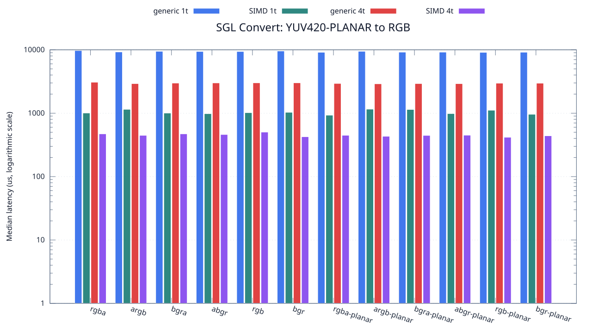
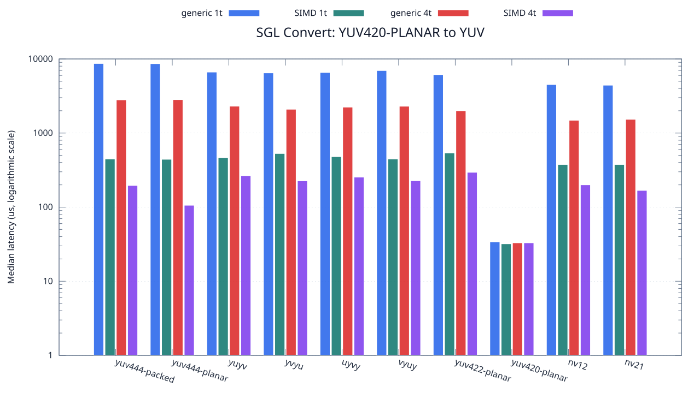

<!--
SPDX-License-Identifier: MIT

Copyright (c) 2025 Dylan Hong

This file is released under the MIT License.
For conditions of distribution and use, see the LICENSE file.
-->

Convert Benchmark: YUV420-PLANAR Source
=======================================

[Convert index](../README.md) | [Benchmark index](../../README.md) | [Main README](../../../README.md#operation-benchmarks)

Every supported RGB and YUV destination is measured from the
`yuv420-planar` source format.

RGB Destinations
----------------

YUV Destinations
----------------

External Backend Coverage
-------------------------
| Library | Measured path | Coverage | Result relation |
| --- | --- | --- | --- |
| Cairo 1.18.4 | ARGB32 SOURCE copy | RGBA/ARGB/BGRA/ABGR identity, 1 thread | Byte-exact |
| NE10 v1.2.1 | Not available | No arbitrary FourCC/color-convert API | N/A |

Test Environment
----------------
| Environment | Value |
| --- | --- |
| Report generated | 2026-08-01T04:11:47+00:00 |
| OS | Ubuntu 24.04.4 LTS |
| Kernel | Linux 6.18.33.2-microsoft-standard-WSL2 (WSL2) |
| Runtime architecture | aarch64 |
| Target | Linux/aarch64 |
| CPU | ARM implementer 0x51, part 0x001 |
| Logical CPUs | 8 |
| Visible memory | 3.81 GiB |
| Execution | native |
| Input | resource/sample.png |
| Source revision | b815597 (dirty) |
| Chart generator | gnuplot 6.0 patchlevel 0 |

Build Configuration
-------------------
| Build option | Value |
| --- | --- |
| Toolchain | llvm |
| Compiler | Clang 18.1.3 |
| Compiler path | /usr/bin/clang |
| Build type | Release |
| C flags | `-O2 -DNDEBUG -std=gnu99 -Wall -Wextra -fno-vectorize -fno-slp-vectorize -fno-builtin-memcpy -fno-builtin-memset` |
| Compiler warnings | ON (-Wall, -Wextra) |
| Auto-vectorization | OFF (-fno-vectorize, -fno-slp-vectorize) |
| SIMD | ON (NEON) |
| Threading | ON (pthread) |
| Sanitizers | OFF |
| Stack protector | OFF |
| External comparison | ON (Cairo/NE10 where supported) |
| Warm-up calls | 3 |
| Measured calls | 10 |

Results
-------
| Case | Operation | Backend | Threads | Size | Median (us) | Average (us) | Min (us) | Max (us) | Pixels/s |
| --- | --- | --- | --- | --- | --- | --- | --- | --- | --- |
| 1672 | yuv420-planar-to-rgba | generic | 1 | 1280x720 | 9,726 | 9,865 | 9,568 | 10,685 | 94,756,323 |
| 1673 | yuv420-planar-to-rgba | generic | 4 | 1280x720 | 3,080 | 3,078 | 2,921 | 3,208 | 299,220,779 |
| 1674 | yuv420-planar-to-rgba | simd | 1 | 1280x720 | 1,007 | 1,035 | 969 | 1,177 | 915,193,644 |
| 1675 | yuv420-planar-to-rgba | simd | 4 | 1280x720 | 472 | 470 | 416 | 540 | 1,952,542,372 |
| 1676 | yuv420-planar-to-argb | generic | 1 | 1280x720 | 9,249 | 9,297 | 9,071 | 9,653 | 99,643,204 |
| 1677 | yuv420-planar-to-argb | generic | 4 | 1280x720 | 2,928 | 2,914 | 2,822 | 2,999 | 314,754,098 |
| 1678 | yuv420-planar-to-argb | simd | 1 | 1280x720 | 1,150 | 1,163 | 1,138 | 1,239 | 801,391,304 |
| 1679 | yuv420-planar-to-argb | simd | 4 | 1280x720 | 447 | 470 | 431 | 588 | 2,061,744,966 |
| 1680 | yuv420-planar-to-bgra | generic | 1 | 1280x720 | 9,468 | 9,490 | 9,293 | 9,742 | 97,338,403 |
| 1681 | yuv420-planar-to-bgra | generic | 4 | 1280x720 | 2,986 | 2,997 | 2,851 | 3,157 | 308,640,321 |
| 1682 | yuv420-planar-to-bgra | simd | 1 | 1280x720 | 1,005 | 1,023 | 969 | 1,092 | 917,014,925 |
| 1683 | yuv420-planar-to-bgra | simd | 4 | 1280x720 | 472 | 463 | 403 | 542 | 1,952,542,372 |
| 1684 | yuv420-planar-to-abgr | generic | 1 | 1280x720 | 9,413 | 9,449 | 9,271 | 9,789 | 97,907,149 |
| 1685 | yuv420-planar-to-abgr | generic | 4 | 1280x720 | 3,003 | 3,057 | 2,945 | 3,409 | 306,893,106 |
| 1686 | yuv420-planar-to-abgr | simd | 1 | 1280x720 | 982 | 997 | 972 | 1,141 | 938,492,871 |
| 1687 | yuv420-planar-to-abgr | simd | 4 | 1280x720 | 461 | 449 | 340 | 523 | 1,999,132,321 |
| 1688 | yuv420-planar-to-rgb | generic | 1 | 1280x720 | 9,406 | 9,467 | 9,271 | 9,892 | 97,980,012 |
| 1689 | yuv420-planar-to-rgb | generic | 4 | 1280x720 | 3,012 | 3,032 | 2,923 | 3,296 | 305,976,095 |
| 1690 | yuv420-planar-to-rgb | simd | 1 | 1280x720 | 1,019 | 1,032 | 1,000 | 1,118 | 904,416,094 |
| 1691 | yuv420-planar-to-rgb | simd | 4 | 1280x720 | 503 | 520 | 446 | 725 | 1,832,206,759 |
| 1692 | yuv420-planar-to-bgr | generic | 1 | 1280x720 | 9,571 | 9,650 | 9,293 | 10,400 | 96,290,878 |
| 1693 | yuv420-planar-to-bgr | generic | 4 | 1280x720 | 3,014 | 3,051 | 2,918 | 3,403 | 305,773,059 |
| 1694 | yuv420-planar-to-bgr | simd | 1 | 1280x720 | 1,032 | 1,068 | 1,000 | 1,232 | 893,023,255 |
| 1695 | yuv420-planar-to-bgr | simd | 4 | 1280x720 | 425 | 440 | 373 | 580 | 2,168,470,588 |
| 1696 | yuv420-planar-to-rgba-planar | generic | 1 | 1280x720 | 9,132 | 9,166 | 9,031 | 9,612 | 100,919,842 |
| 1697 | yuv420-planar-to-rgba-planar | generic | 4 | 1280x720 | 2,944 | 2,974 | 2,805 | 3,208 | 313,043,478 |
| 1698 | yuv420-planar-to-rgba-planar | simd | 1 | 1280x720 | 930 | 973 | 907 | 1,225 | 990,967,741 |
| 1699 | yuv420-planar-to-rgba-planar | simd | 4 | 1280x720 | 448 | 468 | 396 | 653 | 2,057,142,857 |
| 1700 | yuv420-planar-to-argb-planar | generic | 1 | 1280x720 | 9,466 | 9,901 | 9,117 | 11,709 | 97,358,968 |
| 1701 | yuv420-planar-to-argb-planar | generic | 4 | 1280x720 | 2,908 | 2,903 | 2,765 | 3,066 | 316,918,844 |
| 1702 | yuv420-planar-to-argb-planar | simd | 1 | 1280x720 | 1,158 | 1,182 | 1,151 | 1,290 | 795,854,922 |
| 1703 | yuv420-planar-to-argb-planar | simd | 4 | 1280x720 | 432 | 440 | 344 | 546 | 2,133,333,333 |
| 1704 | yuv420-planar-to-bgra-planar | generic | 1 | 1280x720 | 9,187 | 9,305 | 9,072 | 9,949 | 100,315,663 |
| 1705 | yuv420-planar-to-bgra-planar | generic | 4 | 1280x720 | 2,931 | 2,917 | 2,745 | 3,012 | 314,431,934 |
| 1706 | yuv420-planar-to-bgra-planar | simd | 1 | 1280x720 | 1,144 | 1,112 | 969 | 1,167 | 805,594,405 |
| 1707 | yuv420-planar-to-bgra-planar | simd | 4 | 1280x720 | 446 | 445 | 380 | 515 | 2,066,367,713 |
| 1708 | yuv420-planar-to-abgr-planar | generic | 1 | 1280x720 | 9,187 | 9,249 | 9,023 | 9,572 | 100,315,663 |
| 1709 | yuv420-planar-to-abgr-planar | generic | 4 | 1280x720 | 2,924 | 2,900 | 2,793 | 2,947 | 315,184,678 |
| 1710 | yuv420-planar-to-abgr-planar | simd | 1 | 1280x720 | 985 | 999 | 970 | 1,156 | 935,634,517 |
| 1711 | yuv420-planar-to-abgr-planar | simd | 4 | 1280x720 | 450 | 457 | 374 | 526 | 2,048,000,000 |
| 1712 | yuv420-planar-to-rgb-planar | generic | 1 | 1280x720 | 9,107 | 9,131 | 9,054 | 9,300 | 101,196,881 |
| 1713 | yuv420-planar-to-rgb-planar | generic | 4 | 1280x720 | 2,974 | 3,000 | 2,739 | 3,550 | 309,885,675 |
| 1714 | yuv420-planar-to-rgb-planar | simd | 1 | 1280x720 | 1,113 | 1,104 | 949 | 1,269 | 828,032,345 |
| 1715 | yuv420-planar-to-rgb-planar | simd | 4 | 1280x720 | 417 | 424 | 342 | 495 | 2,210,071,942 |
| 1716 | yuv420-planar-to-bgr-planar | generic | 1 | 1280x720 | 9,158 | 9,192 | 9,035 | 9,682 | 100,633,326 |
| 1717 | yuv420-planar-to-bgr-planar | generic | 4 | 1280x720 | 2,973 | 2,969 | 2,842 | 3,137 | 309,989,909 |
| 1718 | yuv420-planar-to-bgr-planar | simd | 1 | 1280x720 | 961 | 1,013 | 937 | 1,464 | 959,001,040 |
| 1719 | yuv420-planar-to-bgr-planar | simd | 4 | 1280x720 | 440 | 448 | 385 | 538 | 2,094,545,454 |
| 1720 | yuv420-planar-to-yuv444-packed | generic | 1 | 1280x720 | 8,677 | 8,740 | 8,534 | 9,218 | 106,211,824 |
| 1721 | yuv420-planar-to-yuv444-packed | generic | 4 | 1280x720 | 2,805 | 2,822 | 2,707 | 2,981 | 328,556,149 |
| 1722 | yuv420-planar-to-yuv444-packed | simd | 1 | 1280x720 | 447 | 457 | 443 | 538 | 2,061,744,966 |
| 1723 | yuv420-planar-to-yuv444-packed | simd | 4 | 1280x720 | 196 | 194 | 116 | 241 | 4,702,040,816 |
| 1724 | yuv420-planar-to-yuv444-planar | generic | 1 | 1280x720 | 8,632 | 8,709 | 8,541 | 8,988 | 106,765,523 |
| 1725 | yuv420-planar-to-yuv444-planar | generic | 4 | 1280x720 | 2,822 | 2,951 | 2,693 | 3,589 | 326,576,895 |
| 1726 | yuv420-planar-to-yuv444-planar | simd | 1 | 1280x720 | 442 | 451 | 407 | 527 | 2,085,067,873 |
| 1727 | yuv420-planar-to-yuv444-planar | simd | 4 | 1280x720 | 106 | 110 | 105 | 124 | 8,694,339,622 |
| 1728 | yuv420-planar-to-yuyv | generic | 1 | 1280x720 | 6,650 | 7,148 | 6,555 | 11,148 | 138,586,466 |
| 1729 | yuv420-planar-to-yuyv | generic | 4 | 1280x720 | 2,304 | 2,330 | 2,055 | 2,563 | 400,000,000 |
| 1730 | yuv420-planar-to-yuyv | simd | 1 | 1280x720 | 467 | 476 | 460 | 522 | 1,973,447,537 |
| 1731 | yuv420-planar-to-yuyv | simd | 4 | 1280x720 | 266 | 273 | 184 | 349 | 3,464,661,654 |
| 1732 | yuv420-planar-to-yvyu | generic | 1 | 1280x720 | 6,479 | 6,689 | 6,305 | 7,430 | 142,244,173 |
| 1733 | yuv420-planar-to-yvyu | generic | 4 | 1280x720 | 2,094 | 2,081 | 1,883 | 2,243 | 440,114,613 |
| 1734 | yuv420-planar-to-yvyu | simd | 1 | 1280x720 | 529 | 533 | 523 | 570 | 1,742,155,009 |
| 1735 | yuv420-planar-to-yvyu | simd | 4 | 1280x720 | 226 | 218 | 150 | 272 | 4,077,876,106 |
| 1736 | yuv420-planar-to-uyvy | generic | 1 | 1280x720 | 6,558 | 6,704 | 6,527 | 7,008 | 140,530,649 |
| 1737 | yuv420-planar-to-uyvy | generic | 4 | 1280x720 | 2,237 | 2,275 | 2,126 | 2,514 | 411,980,330 |
| 1738 | yuv420-planar-to-uyvy | simd | 1 | 1280x720 | 480 | 512 | 461 | 828 | 1,920,000,000 |
| 1739 | yuv420-planar-to-uyvy | simd | 4 | 1280x720 | 254 | 260 | 143 | 339 | 3,628,346,456 |
| 1740 | yuv420-planar-to-vyuy | generic | 1 | 1280x720 | 6,972 | 6,977 | 6,896 | 7,098 | 132,185,886 |
| 1741 | yuv420-planar-to-vyuy | generic | 4 | 1280x720 | 2,300 | 2,305 | 2,193 | 2,451 | 400,695,652 |
| 1742 | yuv420-planar-to-vyuy | simd | 1 | 1280x720 | 447 | 460 | 440 | 523 | 2,061,744,966 |
| 1743 | yuv420-planar-to-vyuy | simd | 4 | 1280x720 | 227 | 238 | 134 | 385 | 4,059,911,894 |
| 1744 | yuv420-planar-to-yuv422-planar | generic | 1 | 1280x720 | 6,139 | 6,145 | 6,029 | 6,440 | 150,122,169 |
| 1745 | yuv420-planar-to-yuv422-planar | generic | 4 | 1280x720 | 2,001 | 2,007 | 1,888 | 2,204 | 460,569,715 |
| 1746 | yuv420-planar-to-yuv422-planar | simd | 1 | 1280x720 | 539 | 549 | 539 | 608 | 1,709,833,024 |
| 1747 | yuv420-planar-to-yuv422-planar | simd | 4 | 1280x720 | 295 | 300 | 221 | 352 | 3,124,067,796 |
| 1748 | yuv420-planar-to-yuv420-planar | generic | 1 | 1280x720 | 34 | 34 | 32 | 43 | 27,105,882,352 |
| 1749 | yuv420-planar-to-yuv420-planar | generic | 4 | 1280x720 | 33 | 32 | 32 | 33 | 27,927,272,727 |
| 1750 | yuv420-planar-to-yuv420-planar | simd | 1 | 1280x720 | 32 | 32 | 32 | 32 | 28,800,000,000 |
| 1751 | yuv420-planar-to-yuv420-planar | simd | 4 | 1280x720 | 33 | 35 | 31 | 60 | 27,927,272,727 |
| 1752 | yuv420-planar-to-nv12 | generic | 1 | 1280x720 | 4,511 | 4,519 | 4,393 | 4,676 | 204,300,598 |
| 1753 | yuv420-planar-to-nv12 | generic | 4 | 1280x720 | 1,487 | 1,513 | 1,425 | 1,731 | 619,771,351 |
| 1754 | yuv420-planar-to-nv12 | simd | 1 | 1280x720 | 376 | 380 | 375 | 415 | 2,451,063,829 |
| 1755 | yuv420-planar-to-nv12 | simd | 4 | 1280x720 | 200 | 211 | 143 | 319 | 4,608,000,000 |
| 1756 | yuv420-planar-to-nv21 | generic | 1 | 1280x720 | 4,422 | 4,695 | 4,391 | 5,577 | 208,412,483 |
| 1757 | yuv420-planar-to-nv21 | generic | 4 | 1280x720 | 1,531 | 1,535 | 1,469 | 1,711 | 601,959,503 |
| 1758 | yuv420-planar-to-nv21 | simd | 1 | 1280x720 | 376 | 384 | 375 | 435 | 2,451,063,829 |
| 1759 | yuv420-planar-to-nv21 | simd | 4 | 1280x720 | 168 | 165 | 116 | 213 | 5,485,714,285 |

Results depend on the input, CPU frequency policy, scheduler load, compiler,
and build options. Refresh them on the target machine before comparison.
