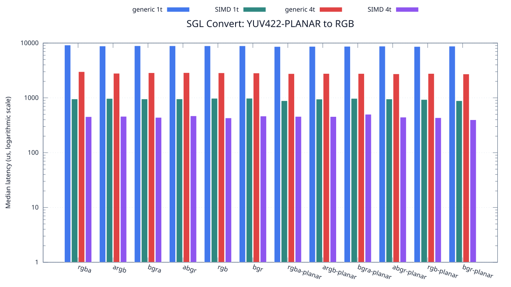
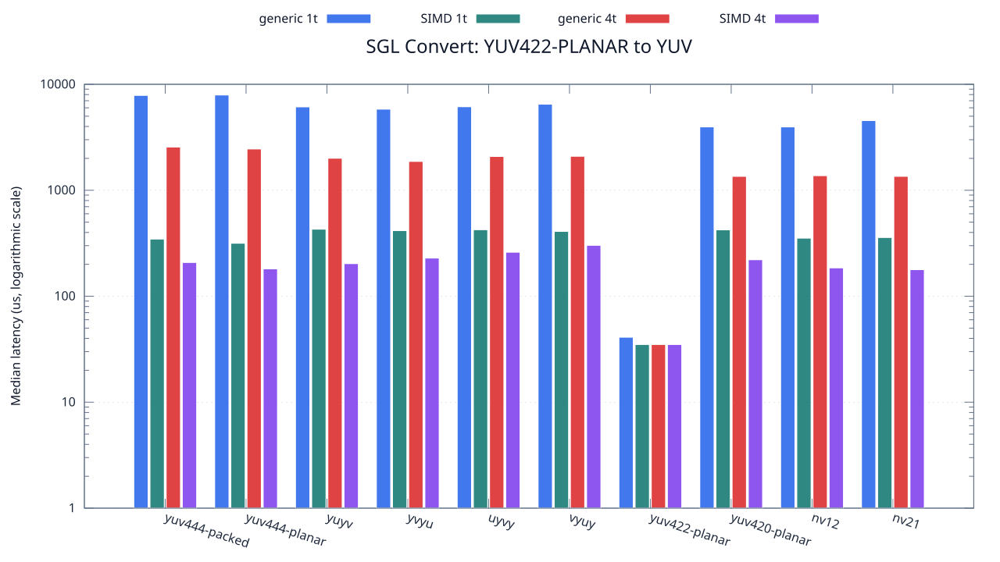

<!--
SPDX-License-Identifier: MIT

Copyright (c) 2025 Dylan Hong

This file is released under the MIT License.
For conditions of distribution and use, see the LICENSE file.
-->

Convert Benchmark: YUV422-PLANAR Source
=======================================

[Convert index](../README.md) | [Benchmark index](../../README.md) | [Main README](../../../README.md#operation-benchmarks)

Every supported RGB and YUV destination is measured from the
`yuv422-planar` source format.

RGB Destinations
----------------

YUV Destinations
----------------

External Backend Coverage
-------------------------
| Library | Measured path | Coverage | Result relation |
| --- | --- | --- | --- |
| Cairo 1.18.4 | ARGB32 SOURCE copy | RGBA/ARGB/BGRA/ABGR identity, 1 thread | Byte-exact |
| NE10 v1.2.1 | Not available | No arbitrary FourCC/color-convert API | N/A |

Test Environment
----------------
| Environment | Value |
| --- | --- |
| Report generated | 2026-08-01T04:11:47+00:00 |
| OS | Ubuntu 24.04.4 LTS |
| Kernel | Linux 6.18.33.2-microsoft-standard-WSL2 (WSL2) |
| Runtime architecture | aarch64 |
| Target | Linux/aarch64 |
| CPU | ARM implementer 0x51, part 0x001 |
| Logical CPUs | 8 |
| Visible memory | 3.81 GiB |
| Execution | native |
| Input | resource/sample.png |
| Source revision | b815597 (dirty) |
| Chart generator | gnuplot 6.0 patchlevel 0 |

Build Configuration
-------------------
| Build option | Value |
| --- | --- |
| Toolchain | llvm |
| Compiler | Clang 18.1.3 |
| Compiler path | /usr/bin/clang |
| Build type | Release |
| C flags | `-O2 -DNDEBUG -std=gnu99 -Wall -Wextra -fno-vectorize -fno-slp-vectorize -fno-builtin-memcpy -fno-builtin-memset` |
| Compiler warnings | ON (-Wall, -Wextra) |
| Auto-vectorization | OFF (-fno-vectorize, -fno-slp-vectorize) |
| SIMD | ON (NEON) |
| Threading | ON (pthread) |
| Sanitizers | OFF |
| Stack protector | OFF |
| External comparison | ON (Cairo/NE10 where supported) |
| Warm-up calls | 3 |
| Measured calls | 10 |

Results
-------
| Case | Operation | Backend | Threads | Size | Median (us) | Average (us) | Min (us) | Max (us) | Pixels/s |
| --- | --- | --- | --- | --- | --- | --- | --- | --- | --- |
| 1584 | yuv422-planar-to-rgba | generic | 1 | 1280x720 | 9,191 | 9,258 | 9,081 | 9,823 | 100,272,005 |
| 1585 | yuv422-planar-to-rgba | generic | 4 | 1280x720 | 3,003 | 2,991 | 2,749 | 3,188 | 306,893,106 |
| 1586 | yuv422-planar-to-rgba | simd | 1 | 1280x720 | 954 | 979 | 938 | 1,095 | 966,037,735 |
| 1587 | yuv422-planar-to-rgba | simd | 4 | 1280x720 | 453 | 458 | 393 | 519 | 2,034,437,086 |
| 1588 | yuv422-planar-to-argb | generic | 1 | 1280x720 | 8,813 | 9,027 | 8,538 | 10,316 | 104,572,790 |
| 1589 | yuv422-planar-to-argb | generic | 4 | 1280x720 | 2,804 | 2,838 | 2,693 | 3,057 | 328,673,323 |
| 1590 | yuv422-planar-to-argb | simd | 1 | 1280x720 | 972 | 1,002 | 943 | 1,119 | 948,148,148 |
| 1591 | yuv422-planar-to-argb | simd | 4 | 1280x720 | 459 | 448 | 389 | 506 | 2,007,843,137 |
| 1592 | yuv422-planar-to-bgra | generic | 1 | 1280x720 | 8,918 | 8,897 | 8,827 | 8,972 | 103,341,556 |
| 1593 | yuv422-planar-to-bgra | generic | 4 | 1280x720 | 2,868 | 2,948 | 2,785 | 3,305 | 321,338,912 |
| 1594 | yuv422-planar-to-bgra | simd | 1 | 1280x720 | 954 | 956 | 938 | 985 | 966,037,735 |
| 1595 | yuv422-planar-to-bgra | simd | 4 | 1280x720 | 439 | 436 | 391 | 452 | 2,099,316,628 |
| 1596 | yuv422-planar-to-abgr | generic | 1 | 1280x720 | 8,903 | 9,027 | 8,777 | 9,832 | 103,515,668 |
| 1597 | yuv422-planar-to-abgr | generic | 4 | 1280x720 | 2,881 | 2,934 | 2,787 | 3,207 | 319,888,927 |
| 1598 | yuv422-planar-to-abgr | simd | 1 | 1280x720 | 955 | 997 | 938 | 1,201 | 965,026,178 |
| 1599 | yuv422-planar-to-abgr | simd | 4 | 1280x720 | 469 | 460 | 380 | 540 | 1,965,031,982 |
| 1600 | yuv422-planar-to-rgb | generic | 1 | 1280x720 | 8,893 | 8,888 | 8,806 | 8,978 | 103,632,070 |
| 1601 | yuv422-planar-to-rgb | generic | 4 | 1280x720 | 2,859 | 2,853 | 2,707 | 2,979 | 322,350,472 |
| 1602 | yuv422-planar-to-rgb | simd | 1 | 1280x720 | 979 | 993 | 969 | 1,071 | 941,368,743 |
| 1603 | yuv422-planar-to-rgb | simd | 4 | 1280x720 | 430 | 441 | 363 | 572 | 2,143,255,813 |
| 1604 | yuv422-planar-to-bgr | generic | 1 | 1280x720 | 8,892 | 9,206 | 8,788 | 10,200 | 103,643,724 |
| 1605 | yuv422-planar-to-bgr | generic | 4 | 1280x720 | 2,837 | 3,049 | 2,714 | 4,981 | 324,850,193 |
| 1606 | yuv422-planar-to-bgr | simd | 1 | 1280x720 | 981 | 1,005 | 967 | 1,075 | 939,449,541 |
| 1607 | yuv422-planar-to-bgr | simd | 4 | 1280x720 | 465 | 458 | 400 | 507 | 1,981,935,483 |
| 1608 | yuv422-planar-to-rgba-planar | generic | 1 | 1280x720 | 8,626 | 8,772 | 8,550 | 9,704 | 106,839,786 |
| 1609 | yuv422-planar-to-rgba-planar | generic | 4 | 1280x720 | 2,765 | 2,780 | 2,680 | 2,906 | 333,309,222 |
| 1610 | yuv422-planar-to-rgba-planar | simd | 1 | 1280x720 | 886 | 897 | 876 | 986 | 1,040,180,586 |
| 1611 | yuv422-planar-to-rgba-planar | simd | 4 | 1280x720 | 457 | 466 | 388 | 544 | 2,016,630,196 |
| 1612 | yuv422-planar-to-argb-planar | generic | 1 | 1280x720 | 8,680 | 8,696 | 8,524 | 9,014 | 106,175,115 |
| 1613 | yuv422-planar-to-argb-planar | generic | 4 | 1280x720 | 2,778 | 2,839 | 2,696 | 3,298 | 331,749,460 |
| 1614 | yuv422-planar-to-argb-planar | simd | 1 | 1280x720 | 947 | 959 | 938 | 1,102 | 973,178,458 |
| 1615 | yuv422-planar-to-argb-planar | simd | 4 | 1280x720 | 455 | 462 | 402 | 517 | 2,025,494,505 |
| 1616 | yuv422-planar-to-bgra-planar | generic | 1 | 1280x720 | 8,703 | 8,728 | 8,586 | 9,065 | 105,894,519 |
| 1617 | yuv422-planar-to-bgra-planar | generic | 4 | 1280x720 | 2,774 | 2,800 | 2,641 | 3,029 | 332,227,829 |
| 1618 | yuv422-planar-to-bgra-planar | simd | 1 | 1280x720 | 974 | 1,028 | 938 | 1,222 | 946,201,232 |
| 1619 | yuv422-planar-to-bgra-planar | simd | 4 | 1280x720 | 501 | 512 | 419 | 690 | 1,839,520,958 |
| 1620 | yuv422-planar-to-abgr-planar | generic | 1 | 1280x720 | 8,769 | 8,873 | 8,543 | 9,277 | 105,097,502 |
| 1621 | yuv422-planar-to-abgr-planar | generic | 4 | 1280x720 | 2,739 | 2,802 | 2,601 | 3,170 | 336,473,165 |
| 1622 | yuv422-planar-to-abgr-planar | simd | 1 | 1280x720 | 951 | 964 | 938 | 1,035 | 969,085,173 |
| 1623 | yuv422-planar-to-abgr-planar | simd | 4 | 1280x720 | 444 | 451 | 406 | 491 | 2,075,675,675 |
| 1624 | yuv422-planar-to-rgb-planar | generic | 1 | 1280x720 | 8,635 | 8,718 | 8,553 | 9,215 | 106,728,430 |
| 1625 | yuv422-planar-to-rgb-planar | generic | 4 | 1280x720 | 2,777 | 2,781 | 2,664 | 2,855 | 331,868,923 |
| 1626 | yuv422-planar-to-rgb-planar | simd | 1 | 1280x720 | 931 | 949 | 907 | 1,049 | 989,903,329 |
| 1627 | yuv422-planar-to-rgb-planar | simd | 4 | 1280x720 | 434 | 448 | 408 | 541 | 2,123,502,304 |
| 1628 | yuv422-planar-to-bgr-planar | generic | 1 | 1280x720 | 8,767 | 8,904 | 8,572 | 10,055 | 105,121,478 |
| 1629 | yuv422-planar-to-bgr-planar | generic | 4 | 1280x720 | 2,723 | 2,837 | 2,667 | 3,215 | 338,450,238 |
| 1630 | yuv422-planar-to-bgr-planar | simd | 1 | 1280x720 | 886 | 886 | 876 | 912 | 1,040,180,586 |
| 1631 | yuv422-planar-to-bgr-planar | simd | 4 | 1280x720 | 398 | 406 | 371 | 453 | 2,315,577,889 |
| 1632 | yuv422-planar-to-yuv444-packed | generic | 1 | 1280x720 | 7,851 | 7,861 | 7,787 | 8,001 | 117,386,320 |
| 1633 | yuv422-planar-to-yuv444-packed | generic | 4 | 1280x720 | 2,556 | 2,571 | 2,437 | 2,769 | 360,563,380 |
| 1634 | yuv422-planar-to-yuv444-packed | simd | 1 | 1280x720 | 346 | 352 | 346 | 373 | 2,663,583,815 |
| 1635 | yuv422-planar-to-yuv444-packed | simd | 4 | 1280x720 | 208 | 225 | 113 | 545 | 4,430,769,230 |
| 1636 | yuv422-planar-to-yuv444-planar | generic | 1 | 1280x720 | 7,922 | 7,928 | 7,781 | 8,093 | 116,334,259 |
| 1637 | yuv422-planar-to-yuv444-planar | generic | 4 | 1280x720 | 2,452 | 2,493 | 2,344 | 2,715 | 375,856,443 |
| 1638 | yuv422-planar-to-yuv444-planar | simd | 1 | 1280x720 | 316 | 321 | 315 | 337 | 2,916,455,696 |
| 1639 | yuv422-planar-to-yuv444-planar | simd | 4 | 1280x720 | 181 | 180 | 98 | 267 | 5,091,712,707 |
| 1640 | yuv422-planar-to-yuyv | generic | 1 | 1280x720 | 6,119 | 6,132 | 6,024 | 6,366 | 150,612,845 |
| 1641 | yuv422-planar-to-yuyv | generic | 4 | 1280x720 | 2,005 | 2,023 | 1,883 | 2,344 | 459,650,872 |
| 1642 | yuv422-planar-to-yuyv | simd | 1 | 1280x720 | 429 | 459 | 424 | 657 | 2,148,251,748 |
| 1643 | yuv422-planar-to-yuyv | simd | 4 | 1280x720 | 203 | 202 | 139 | 260 | 4,539,901,477 |
| 1644 | yuv422-planar-to-yvyu | generic | 1 | 1280x720 | 5,825 | 5,853 | 5,779 | 6,012 | 158,214,592 |
| 1645 | yuv422-planar-to-yvyu | generic | 4 | 1280x720 | 1,871 | 1,884 | 1,820 | 1,973 | 492,570,817 |
| 1646 | yuv422-planar-to-yvyu | simd | 1 | 1280x720 | 416 | 428 | 414 | 498 | 2,215,384,615 |
| 1647 | yuv422-planar-to-yvyu | simd | 4 | 1280x720 | 229 | 205 | 127 | 265 | 4,024,454,148 |
| 1648 | yuv422-planar-to-uyvy | generic | 1 | 1280x720 | 6,142 | 6,146 | 6,033 | 6,409 | 150,048,844 |
| 1649 | yuv422-planar-to-uyvy | generic | 4 | 1280x720 | 2,083 | 2,090 | 1,879 | 2,365 | 442,438,790 |
| 1650 | yuv422-planar-to-uyvy | simd | 1 | 1280x720 | 424 | 445 | 424 | 615 | 2,173,584,905 |
| 1651 | yuv422-planar-to-uyvy | simd | 4 | 1280x720 | 260 | 254 | 158 | 392 | 3,544,615,384 |
| 1652 | yuv422-planar-to-vyuy | generic | 1 | 1280x720 | 6,487 | 6,525 | 6,395 | 6,884 | 142,068,752 |
| 1653 | yuv422-planar-to-vyuy | generic | 4 | 1280x720 | 2,091 | 2,106 | 2,025 | 2,266 | 440,746,054 |
| 1654 | yuv422-planar-to-vyuy | simd | 1 | 1280x720 | 409 | 415 | 408 | 442 | 2,253,300,733 |
| 1655 | yuv422-planar-to-vyuy | simd | 4 | 1280x720 | 302 | 286 | 184 | 361 | 3,051,655,629 |
| 1656 | yuv422-planar-to-yuv422-planar | generic | 1 | 1280x720 | 41 | 48 | 36 | 123 | 22,478,048,780 |
| 1657 | yuv422-planar-to-yuv422-planar | generic | 4 | 1280x720 | 35 | 35 | 35 | 36 | 26,331,428,571 |
| 1658 | yuv422-planar-to-yuv422-planar | simd | 1 | 1280x720 | 35 | 36 | 35 | 47 | 26,331,428,571 |
| 1659 | yuv422-planar-to-yuv422-planar | simd | 4 | 1280x720 | 35 | 35 | 35 | 36 | 26,331,428,571 |
| 1660 | yuv422-planar-to-yuv420-planar | generic | 1 | 1280x720 | 3,961 | 4,001 | 3,912 | 4,134 | 232,668,518 |
| 1661 | yuv422-planar-to-yuv420-planar | generic | 4 | 1280x720 | 1,352 | 1,382 | 1,254 | 1,521 | 681,656,804 |
| 1662 | yuv422-planar-to-yuv420-planar | simd | 1 | 1280x720 | 423 | 428 | 394 | 495 | 2,178,723,404 |
| 1663 | yuv422-planar-to-yuv420-planar | simd | 4 | 1280x720 | 221 | 202 | 121 | 278 | 4,170,135,746 |
| 1664 | yuv422-planar-to-nv12 | generic | 1 | 1280x720 | 3,960 | 3,980 | 3,922 | 4,108 | 232,727,272 |
| 1665 | yuv422-planar-to-nv12 | generic | 4 | 1280x720 | 1,372 | 1,438 | 1,351 | 1,952 | 671,720,116 |
| 1666 | yuv422-planar-to-nv12 | simd | 1 | 1280x720 | 353 | 365 | 344 | 421 | 2,610,764,872 |
| 1667 | yuv422-planar-to-nv12 | simd | 4 | 1280x720 | 185 | 199 | 108 | 322 | 4,981,621,621 |
| 1668 | yuv422-planar-to-nv21 | generic | 1 | 1280x720 | 4,544 | 4,341 | 3,914 | 4,623 | 202,816,901 |
| 1669 | yuv422-planar-to-nv21 | generic | 4 | 1280x720 | 1,353 | 1,361 | 1,301 | 1,444 | 681,152,993 |
| 1670 | yuv422-planar-to-nv21 | simd | 1 | 1280x720 | 358 | 366 | 344 | 420 | 2,574,301,675 |
| 1671 | yuv422-planar-to-nv21 | simd | 4 | 1280x720 | 178 | 186 | 107 | 364 | 5,177,528,089 |

Results depend on the input, CPU frequency policy, scheduler load, compiler,
and build options. Refresh them on the target machine before comparison.
