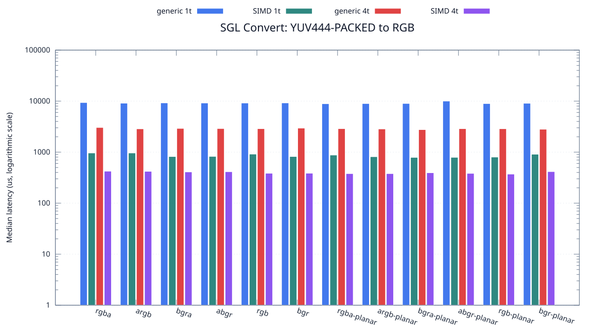
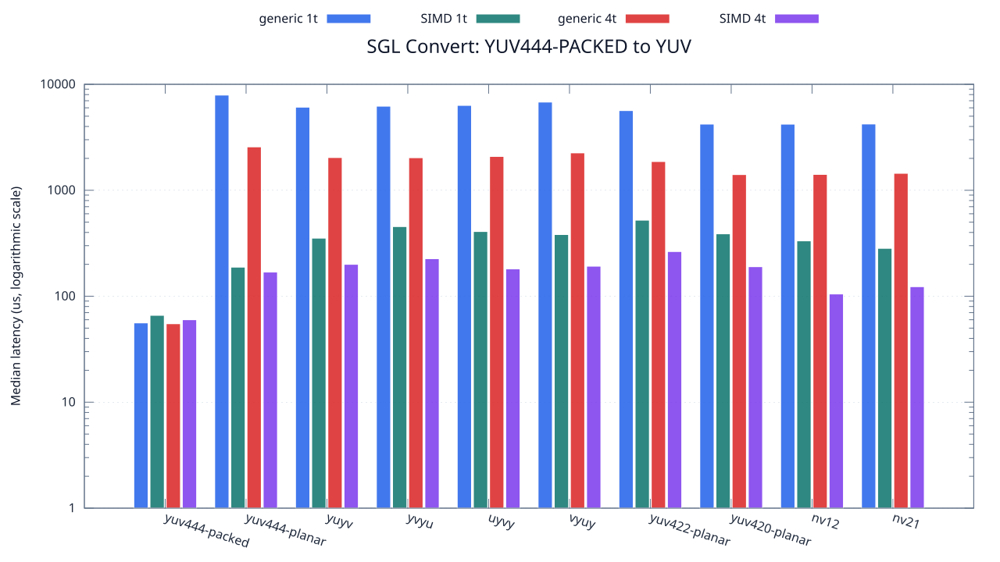

<!--
SPDX-License-Identifier: MIT

Copyright (c) 2025 Dylan Hong

This file is released under the MIT License.
For conditions of distribution and use, see the LICENSE file.
-->

Convert Benchmark: YUV444-PACKED Source
=======================================

[Convert index](../README.md) | [Benchmark index](../../README.md) | [Main README](../../../README.md#operation-benchmarks)

Every supported RGB and YUV destination is measured from the
`yuv444-packed` source format.

RGB Destinations
----------------

YUV Destinations
----------------

External Backend Coverage
-------------------------
| Library | Measured path | Coverage | Result relation |
| --- | --- | --- | --- |
| Cairo 1.18.4 | ARGB32 SOURCE copy | RGBA/ARGB/BGRA/ABGR identity, 1 thread | Byte-exact |
| NE10 v1.2.1 | Not available | No arbitrary FourCC/color-convert API | N/A |

Test Environment
----------------
| Environment | Value |
| --- | --- |
| Report generated | 2026-08-01T04:11:47+00:00 |
| OS | Ubuntu 24.04.4 LTS |
| Kernel | Linux 6.18.33.2-microsoft-standard-WSL2 (WSL2) |
| Runtime architecture | aarch64 |
| Target | Linux/aarch64 |
| CPU | ARM implementer 0x51, part 0x001 |
| Logical CPUs | 8 |
| Visible memory | 3.81 GiB |
| Execution | native |
| Input | resource/sample.png |
| Source revision | b815597 (dirty) |
| Chart generator | gnuplot 6.0 patchlevel 0 |

Build Configuration
-------------------
| Build option | Value |
| --- | --- |
| Toolchain | llvm |
| Compiler | Clang 18.1.3 |
| Compiler path | /usr/bin/clang |
| Build type | Release |
| C flags | `-O2 -DNDEBUG -std=gnu99 -Wall -Wextra -fno-vectorize -fno-slp-vectorize -fno-builtin-memcpy -fno-builtin-memset` |
| Compiler warnings | ON (-Wall, -Wextra) |
| Auto-vectorization | OFF (-fno-vectorize, -fno-slp-vectorize) |
| SIMD | ON (NEON) |
| Threading | ON (pthread) |
| Sanitizers | OFF |
| Stack protector | OFF |
| External comparison | ON (Cairo/NE10 where supported) |
| Warm-up calls | 3 |
| Measured calls | 10 |

Results
-------
| Case | Operation | Backend | Threads | Size | Median (us) | Average (us) | Min (us) | Max (us) | Pixels/s |
| --- | --- | --- | --- | --- | --- | --- | --- | --- | --- |
| 1056 | yuv444-packed-to-rgba | generic | 1 | 1280x720 | 9,365 | 9,398 | 9,294 | 9,542 | 98,408,969 |
| 1057 | yuv444-packed-to-rgba | generic | 4 | 1280x720 | 3,038 | 3,086 | 2,851 | 3,741 | 303,357,472 |
| 1058 | yuv444-packed-to-rgba | simd | 1 | 1280x720 | 962 | 994 | 950 | 1,231 | 958,004,158 |
| 1059 | yuv444-packed-to-rgba | simd | 4 | 1280x720 | 423 | 435 | 328 | 562 | 2,178,723,404 |
| 1060 | yuv444-packed-to-argb | generic | 1 | 1280x720 | 9,102 | 9,105 | 8,820 | 9,404 | 101,252,471 |
| 1061 | yuv444-packed-to-argb | generic | 4 | 1280x720 | 2,860 | 2,907 | 2,695 | 3,511 | 322,237,762 |
| 1062 | yuv444-packed-to-argb | simd | 1 | 1280x720 | 962 | 971 | 950 | 1,046 | 958,004,158 |
| 1063 | yuv444-packed-to-argb | simd | 4 | 1280x720 | 420 | 432 | 345 | 579 | 2,194,285,714 |
| 1064 | yuv444-packed-to-bgra | generic | 1 | 1280x720 | 9,221 | 9,280 | 9,062 | 9,728 | 99,945,775 |
| 1065 | yuv444-packed-to-bgra | generic | 4 | 1280x720 | 2,913 | 2,925 | 2,764 | 3,227 | 316,374,871 |
| 1066 | yuv444-packed-to-bgra | simd | 1 | 1280x720 | 819 | 836 | 809 | 922 | 1,125,274,725 |
| 1067 | yuv444-packed-to-bgra | simd | 4 | 1280x720 | 409 | 421 | 356 | 498 | 2,253,300,733 |
| 1068 | yuv444-packed-to-abgr | generic | 1 | 1280x720 | 9,179 | 9,198 | 9,044 | 9,513 | 100,403,094 |
| 1069 | yuv444-packed-to-abgr | generic | 4 | 1280x720 | 2,895 | 2,909 | 2,835 | 3,006 | 318,341,968 |
| 1070 | yuv444-packed-to-abgr | simd | 1 | 1280x720 | 824 | 880 | 809 | 1,007 | 1,118,446,601 |
| 1071 | yuv444-packed-to-abgr | simd | 4 | 1280x720 | 413 | 406 | 298 | 489 | 2,231,476,997 |
| 1072 | yuv444-packed-to-rgb | generic | 1 | 1280x720 | 9,170 | 9,238 | 9,092 | 9,598 | 100,501,635 |
| 1073 | yuv444-packed-to-rgb | generic | 4 | 1280x720 | 2,881 | 2,946 | 2,857 | 3,413 | 319,888,927 |
| 1074 | yuv444-packed-to-rgb | simd | 1 | 1280x720 | 915 | 895 | 809 | 985 | 1,007,213,114 |
| 1075 | yuv444-packed-to-rgb | simd | 4 | 1280x720 | 385 | 398 | 350 | 482 | 2,393,766,233 |
| 1076 | yuv444-packed-to-bgr | generic | 1 | 1280x720 | 9,215 | 9,367 | 9,047 | 9,864 | 100,010,851 |
| 1077 | yuv444-packed-to-bgr | generic | 4 | 1280x720 | 2,956 | 2,974 | 2,886 | 3,095 | 311,772,665 |
| 1078 | yuv444-packed-to-bgr | simd | 1 | 1280x720 | 820 | 849 | 810 | 977 | 1,123,902,439 |
| 1079 | yuv444-packed-to-bgr | simd | 4 | 1280x720 | 386 | 385 | 315 | 439 | 2,387,564,766 |
| 1080 | yuv444-packed-to-rgba-planar | generic | 1 | 1280x720 | 8,880 | 8,888 | 8,788 | 9,002 | 103,783,783 |
| 1081 | yuv444-packed-to-rgba-planar | generic | 4 | 1280x720 | 2,883 | 2,919 | 2,814 | 3,146 | 319,667,013 |
| 1082 | yuv444-packed-to-rgba-planar | simd | 1 | 1280x720 | 877 | 895 | 877 | 974 | 1,050,855,188 |
| 1083 | yuv444-packed-to-rgba-planar | simd | 4 | 1280x720 | 379 | 405 | 339 | 631 | 2,431,662,269 |
| 1084 | yuv444-packed-to-argb-planar | generic | 1 | 1280x720 | 8,950 | 8,961 | 8,804 | 9,134 | 102,972,067 |
| 1085 | yuv444-packed-to-argb-planar | generic | 4 | 1280x720 | 2,843 | 2,845 | 2,741 | 2,919 | 324,164,614 |
| 1086 | yuv444-packed-to-argb-planar | simd | 1 | 1280x720 | 813 | 827 | 778 | 956 | 1,133,579,335 |
| 1087 | yuv444-packed-to-argb-planar | simd | 4 | 1280x720 | 379 | 384 | 348 | 426 | 2,431,662,269 |
| 1088 | yuv444-packed-to-bgra-planar | generic | 1 | 1280x720 | 8,983 | 9,023 | 8,890 | 9,263 | 102,593,788 |
| 1089 | yuv444-packed-to-bgra-planar | generic | 4 | 1280x720 | 2,760 | 2,782 | 2,695 | 2,933 | 333,913,043 |
| 1090 | yuv444-packed-to-bgra-planar | simd | 1 | 1280x720 | 788 | 791 | 778 | 819 | 1,169,543,147 |
| 1091 | yuv444-packed-to-bgra-planar | simd | 4 | 1280x720 | 394 | 388 | 327 | 456 | 2,339,086,294 |
| 1092 | yuv444-packed-to-abgr-planar | generic | 1 | 1280x720 | 10,018 | 9,820 | 8,772 | 10,817 | 91,994,410 |
| 1093 | yuv444-packed-to-abgr-planar | generic | 4 | 1280x720 | 2,881 | 2,878 | 2,709 | 2,980 | 319,888,927 |
| 1094 | yuv444-packed-to-abgr-planar | simd | 1 | 1280x720 | 790 | 812 | 778 | 902 | 1,166,582,278 |
| 1095 | yuv444-packed-to-abgr-planar | simd | 4 | 1280x720 | 383 | 396 | 350 | 475 | 2,406,266,318 |
| 1096 | yuv444-packed-to-rgb-planar | generic | 1 | 1280x720 | 8,941 | 8,977 | 8,773 | 9,303 | 103,075,718 |
| 1097 | yuv444-packed-to-rgb-planar | generic | 4 | 1280x720 | 2,871 | 2,879 | 2,701 | 3,117 | 321,003,134 |
| 1098 | yuv444-packed-to-rgb-planar | simd | 1 | 1280x720 | 800 | 826 | 778 | 923 | 1,152,000,000 |
| 1099 | yuv444-packed-to-rgb-planar | simd | 4 | 1280x720 | 371 | 397 | 364 | 468 | 2,484,097,035 |
| 1100 | yuv444-packed-to-bgr-planar | generic | 1 | 1280x720 | 9,063 | 9,156 | 8,850 | 9,636 | 101,688,182 |
| 1101 | yuv444-packed-to-bgr-planar | generic | 4 | 1280x720 | 2,808 | 2,831 | 2,675 | 3,018 | 328,205,128 |
| 1102 | yuv444-packed-to-bgr-planar | simd | 1 | 1280x720 | 909 | 896 | 784 | 931 | 1,013,861,386 |
| 1103 | yuv444-packed-to-bgr-planar | simd | 4 | 1280x720 | 415 | 430 | 338 | 566 | 2,220,722,891 |
| 1104 | yuv444-packed-to-yuv444-packed | generic | 1 | 1280x720 | 56 | 56 | 55 | 60 | 16,457,142,857 |
| 1105 | yuv444-packed-to-yuv444-packed | generic | 4 | 1280x720 | 55 | 57 | 54 | 80 | 16,756,363,636 |
| 1106 | yuv444-packed-to-yuv444-packed | simd | 1 | 1280x720 | 66 | 65 | 59 | 74 | 13,963,636,363 |
| 1107 | yuv444-packed-to-yuv444-packed | simd | 4 | 1280x720 | 60 | 60 | 54 | 73 | 15,360,000,000 |
| 1108 | yuv444-packed-to-yuv444-planar | generic | 1 | 1280x720 | 7,913 | 7,908 | 7,784 | 8,063 | 116,466,573 |
| 1109 | yuv444-packed-to-yuv444-planar | generic | 4 | 1280x720 | 2,566 | 2,607 | 2,464 | 2,925 | 359,158,222 |
| 1110 | yuv444-packed-to-yuv444-planar | simd | 1 | 1280x720 | 188 | 194 | 187 | 218 | 4,902,127,659 |
| 1111 | yuv444-packed-to-yuv444-planar | simd | 4 | 1280x720 | 169 | 164 | 62 | 276 | 5,453,254,437 |
| 1112 | yuv444-packed-to-yuyv | generic | 1 | 1280x720 | 6,082 | 6,122 | 6,024 | 6,391 | 151,529,102 |
| 1113 | yuv444-packed-to-yuyv | generic | 4 | 1280x720 | 2,036 | 2,037 | 1,883 | 2,305 | 452,652,259 |
| 1114 | yuv444-packed-to-yuyv | simd | 1 | 1280x720 | 353 | 371 | 347 | 454 | 2,610,764,872 |
| 1115 | yuv444-packed-to-yuyv | simd | 4 | 1280x720 | 200 | 181 | 106 | 284 | 4,608,000,000 |
| 1116 | yuv444-packed-to-yvyu | generic | 1 | 1280x720 | 6,214 | 6,256 | 6,029 | 6,718 | 148,310,267 |
| 1117 | yuv444-packed-to-yvyu | generic | 4 | 1280x720 | 2,028 | 2,041 | 1,886 | 2,256 | 454,437,869 |
| 1118 | yuv444-packed-to-yvyu | simd | 1 | 1280x720 | 454 | 462 | 443 | 556 | 2,029,955,947 |
| 1119 | yuv444-packed-to-yvyu | simd | 4 | 1280x720 | 226 | 206 | 142 | 253 | 4,077,876,106 |
| 1120 | yuv444-packed-to-uyvy | generic | 1 | 1280x720 | 6,320 | 6,349 | 6,273 | 6,463 | 145,822,784 |
| 1121 | yuv444-packed-to-uyvy | generic | 4 | 1280x720 | 2,085 | 2,082 | 1,972 | 2,220 | 442,014,388 |
| 1122 | yuv444-packed-to-uyvy | simd | 1 | 1280x720 | 408 | 412 | 407 | 435 | 2,258,823,529 |
| 1123 | yuv444-packed-to-uyvy | simd | 4 | 1280x720 | 181 | 172 | 130 | 223 | 5,091,712,707 |
| 1124 | yuv444-packed-to-vyuy | generic | 1 | 1280x720 | 6,797 | 6,851 | 6,648 | 7,267 | 135,589,230 |
| 1125 | yuv444-packed-to-vyuy | generic | 4 | 1280x720 | 2,253 | 2,296 | 2,084 | 2,643 | 409,054,593 |
| 1126 | yuv444-packed-to-vyuy | simd | 1 | 1280x720 | 382 | 399 | 377 | 472 | 2,412,565,445 |
| 1127 | yuv444-packed-to-vyuy | simd | 4 | 1280x720 | 192 | 190 | 115 | 261 | 4,800,000,000 |
| 1128 | yuv444-packed-to-yuv422-planar | generic | 1 | 1280x720 | 5,649 | 5,661 | 5,523 | 5,878 | 163,143,919 |
| 1129 | yuv444-packed-to-yuv422-planar | generic | 4 | 1280x720 | 1,867 | 1,906 | 1,807 | 2,062 | 493,626,138 |
| 1130 | yuv444-packed-to-yuv422-planar | simd | 1 | 1280x720 | 522 | 529 | 516 | 569 | 1,765,517,241 |
| 1131 | yuv444-packed-to-yuv422-planar | simd | 4 | 1280x720 | 264 | 269 | 167 | 389 | 3,490,909,090 |
| 1132 | yuv444-packed-to-yuv420-planar | generic | 1 | 1280x720 | 4,212 | 4,414 | 4,143 | 4,897 | 218,803,418 |
| 1133 | yuv444-packed-to-yuv420-planar | generic | 4 | 1280x720 | 1,406 | 1,428 | 1,378 | 1,634 | 655,476,529 |
| 1134 | yuv444-packed-to-yuv420-planar | simd | 1 | 1280x720 | 388 | 391 | 387 | 404 | 2,375,257,731 |
| 1135 | yuv444-packed-to-yuv420-planar | simd | 4 | 1280x720 | 190 | 182 | 103 | 268 | 4,850,526,315 |
| 1136 | yuv444-packed-to-nv12 | generic | 1 | 1280x720 | 4,206 | 4,353 | 4,153 | 4,867 | 219,115,549 |
| 1137 | yuv444-packed-to-nv12 | generic | 4 | 1280x720 | 1,411 | 1,445 | 1,335 | 1,778 | 653,153,791 |
| 1138 | yuv444-packed-to-nv12 | simd | 1 | 1280x720 | 333 | 339 | 332 | 364 | 2,767,567,567 |
| 1139 | yuv444-packed-to-nv12 | simd | 4 | 1280x720 | 105 | 117 | 89 | 159 | 8,777,142,857 |
| 1140 | yuv444-packed-to-nv21 | generic | 1 | 1280x720 | 4,222 | 4,371 | 4,148 | 4,874 | 218,285,172 |
| 1141 | yuv444-packed-to-nv21 | generic | 4 | 1280x720 | 1,445 | 1,479 | 1,398 | 1,634 | 637,785,467 |
| 1142 | yuv444-packed-to-nv21 | simd | 1 | 1280x720 | 283 | 288 | 282 | 308 | 3,256,537,102 |
| 1143 | yuv444-packed-to-nv21 | simd | 4 | 1280x720 | 123 | 139 | 101 | 178 | 7,492,682,926 |

Results depend on the input, CPU frequency policy, scheduler load, compiler,
and build options. Refresh them on the target machine before comparison.
