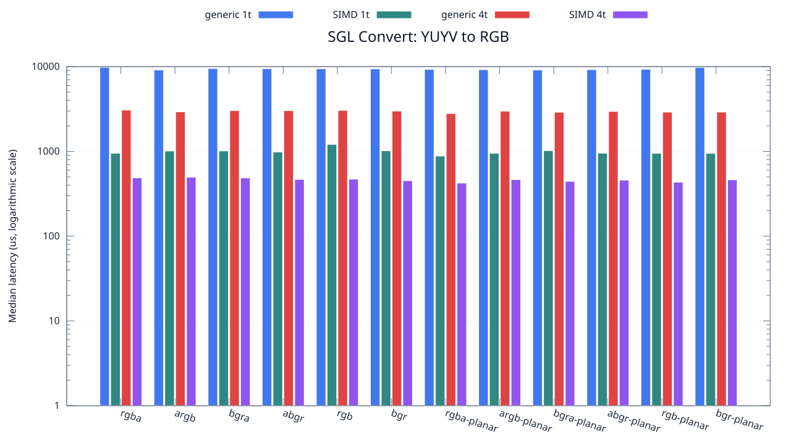
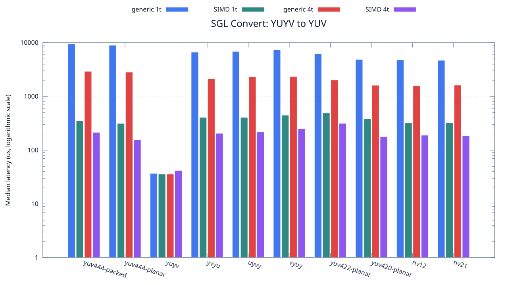

<!--
SPDX-License-Identifier: MIT

Copyright (c) 2025 Dylan Hong

This file is released under the MIT License.
For conditions of distribution and use, see the LICENSE file.
-->

Convert Benchmark: YUYV Source
==============================

[Convert index](../README.md) | [Benchmark index](../../README.md) | [Main README](../../../README.md#operation-benchmarks)

Every supported RGB and YUV destination is measured from the
`yuyv` source format.

RGB Destinations
----------------

YUV Destinations
----------------

External Backend Coverage
-------------------------
| Library | Measured path | Coverage | Result relation |
| --- | --- | --- | --- |
| Cairo 1.18.4 | ARGB32 SOURCE copy | RGBA/ARGB/BGRA/ABGR identity, 1 thread | Byte-exact |
| NE10 v1.2.1 | Not available | No arbitrary FourCC/color-convert API | N/A |

Test Environment
----------------
| Environment | Value |
| --- | --- |
| Report generated | 2026-08-01T04:11:47+00:00 |
| OS | Ubuntu 24.04.4 LTS |
| Kernel | Linux 6.18.33.2-microsoft-standard-WSL2 (WSL2) |
| Runtime architecture | aarch64 |
| Target | Linux/aarch64 |
| CPU | ARM implementer 0x51, part 0x001 |
| Logical CPUs | 8 |
| Visible memory | 3.81 GiB |
| Execution | native |
| Input | resource/sample.png |
| Source revision | b815597 (dirty) |
| Chart generator | gnuplot 6.0 patchlevel 0 |

Build Configuration
-------------------
| Build option | Value |
| --- | --- |
| Toolchain | llvm |
| Compiler | Clang 18.1.3 |
| Compiler path | /usr/bin/clang |
| Build type | Release |
| C flags | `-O2 -DNDEBUG -std=gnu99 -Wall -Wextra -fno-vectorize -fno-slp-vectorize -fno-builtin-memcpy -fno-builtin-memset` |
| Compiler warnings | ON (-Wall, -Wextra) |
| Auto-vectorization | OFF (-fno-vectorize, -fno-slp-vectorize) |
| SIMD | ON (NEON) |
| Threading | ON (pthread) |
| Sanitizers | OFF |
| Stack protector | OFF |
| External comparison | ON (Cairo/NE10 where supported) |
| Warm-up calls | 3 |
| Measured calls | 10 |

Results
-------
| Case | Operation | Backend | Threads | Size | Median (us) | Average (us) | Min (us) | Max (us) | Pixels/s |
| --- | --- | --- | --- | --- | --- | --- | --- | --- | --- |
| 1232 | yuyv-to-rgba | generic | 1 | 1280x720 | 9,805 | 9,761 | 9,544 | 10,035 | 93,992,860 |
| 1233 | yuyv-to-rgba | generic | 4 | 1280x720 | 3,072 | 3,185 | 2,989 | 3,817 | 300,000,000 |
| 1234 | yuyv-to-rgba | simd | 1 | 1280x720 | 950 | 971 | 938 | 1,121 | 970,105,263 |
| 1235 | yuyv-to-rgba | simd | 4 | 1280x720 | 487 | 487 | 416 | 642 | 1,892,402,464 |
| 1236 | yuyv-to-argb | generic | 1 | 1280x720 | 9,133 | 9,185 | 9,032 | 9,468 | 100,908,792 |
| 1237 | yuyv-to-argb | generic | 4 | 1280x720 | 2,927 | 2,914 | 2,805 | 2,993 | 314,861,633 |
| 1238 | yuyv-to-argb | simd | 1 | 1280x720 | 1,011 | 1,042 | 1,009 | 1,231 | 911,572,700 |
| 1239 | yuyv-to-argb | simd | 4 | 1280x720 | 496 | 535 | 443 | 811 | 1,858,064,516 |
| 1240 | yuyv-to-bgra | generic | 1 | 1280x720 | 9,492 | 9,503 | 9,288 | 9,845 | 97,092,288 |
| 1241 | yuyv-to-bgra | generic | 4 | 1280x720 | 3,029 | 3,028 | 2,947 | 3,155 | 304,258,831 |
| 1242 | yuyv-to-bgra | simd | 1 | 1280x720 | 1,012 | 1,034 | 1,000 | 1,115 | 910,671,936 |
| 1243 | yuyv-to-bgra | simd | 4 | 1280x720 | 487 | 515 | 431 | 679 | 1,892,402,464 |
| 1244 | yuyv-to-abgr | generic | 1 | 1280x720 | 9,448 | 9,476 | 9,348 | 9,796 | 97,544,453 |
| 1245 | yuyv-to-abgr | generic | 4 | 1280x720 | 3,024 | 3,023 | 2,852 | 3,202 | 304,761,904 |
| 1246 | yuyv-to-abgr | simd | 1 | 1280x720 | 982 | 984 | 969 | 1,010 | 938,492,871 |
| 1247 | yuyv-to-abgr | simd | 4 | 1280x720 | 467 | 469 | 432 | 526 | 1,973,447,537 |
| 1248 | yuyv-to-rgb | generic | 1 | 1280x720 | 9,436 | 9,475 | 9,290 | 9,726 | 97,668,503 |
| 1249 | yuyv-to-rgb | generic | 4 | 1280x720 | 3,048 | 3,049 | 2,917 | 3,159 | 302,362,204 |
| 1250 | yuyv-to-rgb | simd | 1 | 1280x720 | 1,208 | 1,243 | 1,174 | 1,522 | 762,913,907 |
| 1251 | yuyv-to-rgb | simd | 4 | 1280x720 | 470 | 488 | 407 | 561 | 1,960,851,063 |
| 1252 | yuyv-to-bgr | generic | 1 | 1280x720 | 9,401 | 9,404 | 9,327 | 9,517 | 98,032,124 |
| 1253 | yuyv-to-bgr | generic | 4 | 1280x720 | 2,990 | 2,998 | 2,865 | 3,206 | 308,227,424 |
| 1254 | yuyv-to-bgr | simd | 1 | 1280x720 | 1,017 | 1,061 | 1,000 | 1,196 | 906,194,690 |
| 1255 | yuyv-to-bgr | simd | 4 | 1280x720 | 452 | 470 | 440 | 565 | 2,038,938,053 |
| 1256 | yuyv-to-rgba-planar | generic | 1 | 1280x720 | 9,272 | 9,266 | 9,036 | 9,610 | 99,396,031 |
| 1257 | yuyv-to-rgba-planar | generic | 4 | 1280x720 | 2,796 | 2,832 | 2,754 | 3,031 | 329,613,733 |
| 1258 | yuyv-to-rgba-planar | simd | 1 | 1280x720 | 882 | 890 | 876 | 946 | 1,044,897,959 |
| 1259 | yuyv-to-rgba-planar | simd | 4 | 1280x720 | 423 | 424 | 364 | 468 | 2,178,723,404 |
| 1260 | yuyv-to-argb-planar | generic | 1 | 1280x720 | 9,212 | 9,248 | 9,015 | 9,751 | 100,043,421 |
| 1261 | yuyv-to-argb-planar | generic | 4 | 1280x720 | 2,982 | 3,008 | 2,911 | 3,264 | 309,054,325 |
| 1262 | yuyv-to-argb-planar | simd | 1 | 1280x720 | 949 | 976 | 938 | 1,229 | 971,127,502 |
| 1263 | yuyv-to-argb-planar | simd | 4 | 1280x720 | 465 | 485 | 421 | 670 | 1,981,935,483 |
| 1264 | yuyv-to-bgra-planar | generic | 1 | 1280x720 | 9,139 | 9,179 | 9,083 | 9,378 | 100,842,542 |
| 1265 | yuyv-to-bgra-planar | generic | 4 | 1280x720 | 2,896 | 2,894 | 2,787 | 3,112 | 318,232,044 |
| 1266 | yuyv-to-bgra-planar | simd | 1 | 1280x720 | 1,020 | 1,053 | 938 | 1,267 | 903,529,411 |
| 1267 | yuyv-to-bgra-planar | simd | 4 | 1280x720 | 443 | 449 | 353 | 608 | 2,080,361,173 |
| 1268 | yuyv-to-abgr-planar | generic | 1 | 1280x720 | 9,213 | 9,651 | 9,105 | 11,605 | 100,032,562 |
| 1269 | yuyv-to-abgr-planar | generic | 4 | 1280x720 | 2,960 | 3,005 | 2,857 | 3,305 | 311,351,351 |
| 1270 | yuyv-to-abgr-planar | simd | 1 | 1280x720 | 951 | 975 | 938 | 1,114 | 969,085,173 |
| 1271 | yuyv-to-abgr-planar | simd | 4 | 1280x720 | 458 | 460 | 381 | 558 | 2,012,227,074 |
| 1272 | yuyv-to-rgb-planar | generic | 1 | 1280x720 | 9,305 | 9,295 | 9,034 | 9,584 | 99,043,524 |
| 1273 | yuyv-to-rgb-planar | generic | 4 | 1280x720 | 2,906 | 2,911 | 2,789 | 3,054 | 317,136,958 |
| 1274 | yuyv-to-rgb-planar | simd | 1 | 1280x720 | 949 | 969 | 938 | 1,080 | 971,127,502 |
| 1275 | yuyv-to-rgb-planar | simd | 4 | 1280x720 | 433 | 437 | 405 | 475 | 2,128,406,466 |
| 1276 | yuyv-to-bgr-planar | generic | 1 | 1280x720 | 9,766 | 9,911 | 9,098 | 10,759 | 94,368,216 |
| 1277 | yuyv-to-bgr-planar | generic | 4 | 1280x720 | 2,911 | 2,905 | 2,743 | 3,005 | 316,592,236 |
| 1278 | yuyv-to-bgr-planar | simd | 1 | 1280x720 | 948 | 959 | 937 | 1,022 | 972,151,898 |
| 1279 | yuyv-to-bgr-planar | simd | 4 | 1280x720 | 462 | 487 | 404 | 676 | 1,994,805,194 |
| 1280 | yuyv-to-yuv444-packed | generic | 1 | 1280x720 | 9,494 | 9,463 | 8,916 | 10,205 | 97,071,834 |
| 1281 | yuyv-to-yuv444-packed | generic | 4 | 1280x720 | 2,941 | 2,939 | 2,737 | 3,155 | 313,362,801 |
| 1282 | yuyv-to-yuv444-packed | simd | 1 | 1280x720 | 353 | 363 | 346 | 425 | 2,610,764,872 |
| 1283 | yuyv-to-yuv444-packed | simd | 4 | 1280x720 | 215 | 215 | 107 | 300 | 4,286,511,627 |
| 1284 | yuyv-to-yuv444-planar | generic | 1 | 1280x720 | 8,998 | 9,019 | 8,804 | 9,320 | 102,422,760 |
| 1285 | yuyv-to-yuv444-planar | generic | 4 | 1280x720 | 2,842 | 2,855 | 2,731 | 2,955 | 324,278,676 |
| 1286 | yuyv-to-yuv444-planar | simd | 1 | 1280x720 | 315 | 318 | 315 | 327 | 2,925,714,285 |
| 1287 | yuyv-to-yuv444-planar | simd | 4 | 1280x720 | 158 | 155 | 98 | 204 | 5,832,911,392 |
| 1288 | yuyv-to-yuyv | generic | 1 | 1280x720 | 37 | 38 | 36 | 45 | 24,908,108,108 |
| 1289 | yuyv-to-yuyv | generic | 4 | 1280x720 | 36 | 35 | 35 | 36 | 25,600,000,000 |
| 1290 | yuyv-to-yuyv | simd | 1 | 1280x720 | 36 | 35 | 35 | 36 | 25,600,000,000 |
| 1291 | yuyv-to-yuyv | simd | 4 | 1280x720 | 42 | 41 | 36 | 47 | 21,942,857,142 |
| 1292 | yuyv-to-yvyu | generic | 1 | 1280x720 | 6,677 | 6,726 | 6,568 | 7,227 | 138,026,059 |
| 1293 | yuyv-to-yvyu | generic | 4 | 1280x720 | 2,146 | 2,157 | 2,075 | 2,322 | 429,450,139 |
| 1294 | yuyv-to-yvyu | simd | 1 | 1280x720 | 409 | 418 | 408 | 436 | 2,253,300,733 |
| 1295 | yuyv-to-yvyu | simd | 4 | 1280x720 | 206 | 208 | 130 | 254 | 4,473,786,407 |
| 1296 | yuyv-to-uyvy | generic | 1 | 1280x720 | 6,890 | 6,973 | 6,835 | 7,329 | 133,759,071 |
| 1297 | yuyv-to-uyvy | generic | 4 | 1280x720 | 2,337 | 2,333 | 2,126 | 2,555 | 394,351,732 |
| 1298 | yuyv-to-uyvy | simd | 1 | 1280x720 | 409 | 413 | 408 | 426 | 2,253,300,733 |
| 1299 | yuyv-to-uyvy | simd | 4 | 1280x720 | 218 | 226 | 152 | 296 | 4,227,522,935 |
| 1300 | yuyv-to-vyuy | generic | 1 | 1280x720 | 7,353 | 7,344 | 7,229 | 7,464 | 125,336,597 |
| 1301 | yuyv-to-vyuy | generic | 4 | 1280x720 | 2,352 | 2,358 | 2,284 | 2,436 | 391,836,734 |
| 1302 | yuyv-to-vyuy | simd | 1 | 1280x720 | 449 | 453 | 408 | 535 | 2,052,561,247 |
| 1303 | yuyv-to-vyuy | simd | 4 | 1280x720 | 250 | 293 | 153 | 591 | 3,686,400,000 |
| 1304 | yuyv-to-yuv422-planar | generic | 1 | 1280x720 | 6,273 | 6,430 | 6,192 | 7,272 | 146,915,351 |
| 1305 | yuyv-to-yuv422-planar | generic | 4 | 1280x720 | 2,021 | 2,026 | 1,944 | 2,102 | 456,011,875 |
| 1306 | yuyv-to-yuv422-planar | simd | 1 | 1280x720 | 492 | 506 | 486 | 627 | 1,873,170,731 |
| 1307 | yuyv-to-yuv422-planar | simd | 4 | 1280x720 | 316 | 334 | 287 | 493 | 2,916,455,696 |
| 1308 | yuyv-to-yuv420-planar | generic | 1 | 1280x720 | 4,892 | 4,910 | 4,821 | 5,095 | 188,389,206 |
| 1309 | yuyv-to-yuv420-planar | generic | 4 | 1280x720 | 1,618 | 1,634 | 1,557 | 1,919 | 569,592,088 |
| 1310 | yuyv-to-yuv420-planar | simd | 1 | 1280x720 | 387 | 388 | 376 | 416 | 2,381,395,348 |
| 1311 | yuyv-to-yuv420-planar | simd | 4 | 1280x720 | 179 | 247 | 159 | 413 | 5,148,603,351 |
| 1312 | yuyv-to-nv12 | generic | 1 | 1280x720 | 4,855 | 4,982 | 4,752 | 5,625 | 189,824,922 |
| 1313 | yuyv-to-nv12 | generic | 4 | 1280x720 | 1,585 | 1,609 | 1,503 | 1,721 | 581,451,104 |
| 1314 | yuyv-to-nv12 | simd | 1 | 1280x720 | 322 | 333 | 321 | 402 | 2,862,111,801 |
| 1315 | yuyv-to-nv12 | simd | 4 | 1280x720 | 190 | 175 | 114 | 245 | 4,850,526,315 |
| 1316 | yuyv-to-nv21 | generic | 1 | 1280x720 | 4,721 | 4,798 | 4,685 | 4,980 | 195,212,878 |
| 1317 | yuyv-to-nv21 | generic | 4 | 1280x720 | 1,629 | 1,611 | 1,513 | 1,701 | 565,745,856 |
| 1318 | yuyv-to-nv21 | simd | 1 | 1280x720 | 323 | 331 | 313 | 381 | 2,853,250,773 |
| 1319 | yuyv-to-nv21 | simd | 4 | 1280x720 | 185 | 191 | 103 | 314 | 4,981,621,621 |

Results depend on the input, CPU frequency policy, scheduler load, compiler,
and build options. Refresh them on the target machine before comparison.
