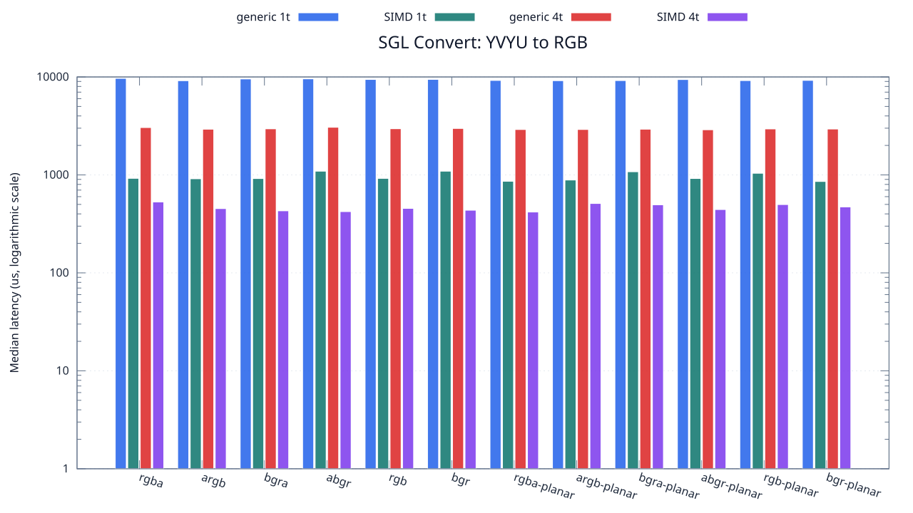
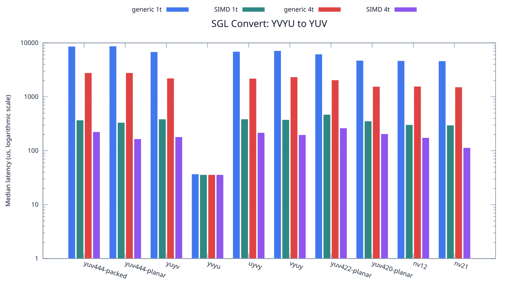

<!--
SPDX-License-Identifier: MIT

Copyright (c) 2025 Dylan Hong

This file is released under the MIT License.
For conditions of distribution and use, see the LICENSE file.
-->

Convert Benchmark: YVYU Source
==============================

[Convert index](../README.md) | [Benchmark index](../../README.md) | [Main README](../../../README.md#operation-benchmarks)

Every supported RGB and YUV destination is measured from the
`yvyu` source format.

RGB Destinations
----------------

YUV Destinations
----------------

External Backend Coverage
-------------------------
| Library | Measured path | Coverage | Result relation |
| --- | --- | --- | --- |
| Cairo 1.18.4 | ARGB32 SOURCE copy | RGBA/ARGB/BGRA/ABGR identity, 1 thread | Byte-exact |
| NE10 v1.2.1 | Not available | No arbitrary FourCC/color-convert API | N/A |

Test Environment
----------------
| Environment | Value |
| --- | --- |
| Report generated | 2026-08-01T04:11:47+00:00 |
| OS | Ubuntu 24.04.4 LTS |
| Kernel | Linux 6.18.33.2-microsoft-standard-WSL2 (WSL2) |
| Runtime architecture | aarch64 |
| Target | Linux/aarch64 |
| CPU | ARM implementer 0x51, part 0x001 |
| Logical CPUs | 8 |
| Visible memory | 3.81 GiB |
| Execution | native |
| Input | resource/sample.png |
| Source revision | b815597 (dirty) |
| Chart generator | gnuplot 6.0 patchlevel 0 |

Build Configuration
-------------------
| Build option | Value |
| --- | --- |
| Toolchain | llvm |
| Compiler | Clang 18.1.3 |
| Compiler path | /usr/bin/clang |
| Build type | Release |
| C flags | `-O2 -DNDEBUG -std=gnu99 -Wall -Wextra -fno-vectorize -fno-slp-vectorize -fno-builtin-memcpy -fno-builtin-memset` |
| Compiler warnings | ON (-Wall, -Wextra) |
| Auto-vectorization | OFF (-fno-vectorize, -fno-slp-vectorize) |
| SIMD | ON (NEON) |
| Threading | ON (pthread) |
| Sanitizers | OFF |
| Stack protector | OFF |
| External comparison | ON (Cairo/NE10 where supported) |
| Warm-up calls | 3 |
| Measured calls | 10 |

Results
-------
| Case | Operation | Backend | Threads | Size | Median (us) | Average (us) | Min (us) | Max (us) | Pixels/s |
| --- | --- | --- | --- | --- | --- | --- | --- | --- | --- |
| 1320 | yvyu-to-rgba | generic | 1 | 1280x720 | 9,671 | 9,766 | 9,568 | 10,391 | 95,295,212 |
| 1321 | yvyu-to-rgba | generic | 4 | 1280x720 | 3,044 | 3,035 | 2,967 | 3,106 | 302,759,526 |
| 1322 | yvyu-to-rgba | simd | 1 | 1280x720 | 922 | 960 | 907 | 1,103 | 999,566,160 |
| 1323 | yvyu-to-rgba | simd | 4 | 1280x720 | 529 | 549 | 422 | 775 | 1,742,155,009 |
| 1324 | yvyu-to-argb | generic | 1 | 1280x720 | 9,153 | 9,208 | 9,048 | 9,447 | 100,688,298 |
| 1325 | yvyu-to-argb | generic | 4 | 1280x720 | 2,927 | 2,925 | 2,745 | 3,072 | 314,861,633 |
| 1326 | yvyu-to-argb | simd | 1 | 1280x720 | 913 | 928 | 907 | 1,013 | 1,009,419,496 |
| 1327 | yvyu-to-argb | simd | 4 | 1280x720 | 453 | 477 | 403 | 643 | 2,034,437,086 |
| 1328 | yvyu-to-bgra | generic | 1 | 1280x720 | 9,541 | 9,838 | 9,288 | 10,808 | 96,593,648 |
| 1329 | yvyu-to-bgra | generic | 4 | 1280x720 | 2,954 | 2,965 | 2,861 | 3,085 | 311,983,750 |
| 1330 | yvyu-to-bgra | simd | 1 | 1280x720 | 918 | 921 | 907 | 951 | 1,003,921,568 |
| 1331 | yvyu-to-bgra | simd | 4 | 1280x720 | 430 | 424 | 362 | 480 | 2,143,255,813 |
| 1332 | yvyu-to-abgr | generic | 1 | 1280x720 | 9,565 | 9,572 | 9,285 | 9,918 | 96,351,280 |
| 1333 | yvyu-to-abgr | generic | 4 | 1280x720 | 3,065 | 3,082 | 2,928 | 3,328 | 300,685,154 |
| 1334 | yvyu-to-abgr | simd | 1 | 1280x720 | 1,091 | 1,096 | 1,065 | 1,206 | 844,729,605 |
| 1335 | yvyu-to-abgr | simd | 4 | 1280x720 | 422 | 433 | 378 | 515 | 2,183,886,255 |
| 1336 | yvyu-to-rgb | generic | 1 | 1280x720 | 9,428 | 9,497 | 9,303 | 10,021 | 97,751,378 |
| 1337 | yvyu-to-rgb | generic | 4 | 1280x720 | 2,961 | 2,973 | 2,844 | 3,165 | 311,246,200 |
| 1338 | yvyu-to-rgb | simd | 1 | 1280x720 | 921 | 930 | 908 | 994 | 1,000,651,465 |
| 1339 | yvyu-to-rgb | simd | 4 | 1280x720 | 455 | 466 | 415 | 563 | 2,025,494,505 |
| 1340 | yvyu-to-bgr | generic | 1 | 1280x720 | 9,439 | 9,489 | 9,283 | 9,703 | 97,637,461 |
| 1341 | yvyu-to-bgr | generic | 4 | 1280x720 | 2,979 | 3,056 | 2,845 | 3,360 | 309,365,558 |
| 1342 | yvyu-to-bgr | simd | 1 | 1280x720 | 1,091 | 1,112 | 1,065 | 1,250 | 844,729,605 |
| 1343 | yvyu-to-bgr | simd | 4 | 1280x720 | 436 | 445 | 394 | 512 | 2,113,761,467 |
| 1344 | yvyu-to-rgba-planar | generic | 1 | 1280x720 | 9,216 | 9,243 | 9,071 | 9,510 | 100,000,000 |
| 1345 | yvyu-to-rgba-planar | generic | 4 | 1280x720 | 2,907 | 2,888 | 2,765 | 3,010 | 317,027,863 |
| 1346 | yvyu-to-rgba-planar | simd | 1 | 1280x720 | 861 | 876 | 845 | 1,017 | 1,070,383,275 |
| 1347 | yvyu-to-rgba-planar | simd | 4 | 1280x720 | 418 | 429 | 387 | 488 | 2,204,784,688 |
| 1348 | yvyu-to-argb-planar | generic | 1 | 1280x720 | 9,160 | 9,176 | 9,062 | 9,425 | 100,611,353 |
| 1349 | yvyu-to-argb-planar | generic | 4 | 1280x720 | 2,909 | 2,936 | 2,754 | 3,237 | 316,809,900 |
| 1350 | yvyu-to-argb-planar | simd | 1 | 1280x720 | 887 | 890 | 876 | 916 | 1,039,007,891 |
| 1351 | yvyu-to-argb-planar | simd | 4 | 1280x720 | 511 | 514 | 441 | 599 | 1,803,522,504 |
| 1352 | yvyu-to-bgra-planar | generic | 1 | 1280x720 | 9,185 | 9,296 | 9,035 | 9,760 | 100,337,506 |
| 1353 | yvyu-to-bgra-planar | generic | 4 | 1280x720 | 2,928 | 2,940 | 2,863 | 3,095 | 314,754,098 |
| 1354 | yvyu-to-bgra-planar | simd | 1 | 1280x720 | 1,077 | 1,107 | 1,065 | 1,395 | 855,710,306 |
| 1355 | yvyu-to-bgra-planar | simd | 4 | 1280x720 | 495 | 503 | 415 | 636 | 1,861,818,181 |
| 1356 | yvyu-to-abgr-planar | generic | 1 | 1280x720 | 9,408 | 9,540 | 9,065 | 10,293 | 97,959,183 |
| 1357 | yvyu-to-abgr-planar | generic | 4 | 1280x720 | 2,889 | 2,889 | 2,786 | 3,017 | 319,003,115 |
| 1358 | yvyu-to-abgr-planar | simd | 1 | 1280x720 | 919 | 925 | 907 | 958 | 1,002,829,162 |
| 1359 | yvyu-to-abgr-planar | simd | 4 | 1280x720 | 443 | 450 | 414 | 530 | 2,080,361,173 |
| 1360 | yvyu-to-rgb-planar | generic | 1 | 1280x720 | 9,183 | 9,217 | 9,036 | 9,547 | 100,359,359 |
| 1361 | yvyu-to-rgb-planar | generic | 4 | 1280x720 | 2,947 | 2,947 | 2,791 | 3,085 | 312,724,804 |
| 1362 | yvyu-to-rgb-planar | simd | 1 | 1280x720 | 1,039 | 1,039 | 1,028 | 1,069 | 887,006,737 |
| 1363 | yvyu-to-rgb-planar | simd | 4 | 1280x720 | 498 | 506 | 379 | 652 | 1,850,602,409 |
| 1364 | yvyu-to-bgr-planar | generic | 1 | 1280x720 | 9,227 | 9,344 | 9,032 | 9,956 | 99,880,784 |
| 1365 | yvyu-to-bgr-planar | generic | 4 | 1280x720 | 2,940 | 3,004 | 2,866 | 3,215 | 313,469,387 |
| 1366 | yvyu-to-bgr-planar | simd | 1 | 1280x720 | 857 | 860 | 845 | 900 | 1,075,379,229 |
| 1367 | yvyu-to-bgr-planar | simd | 4 | 1280x720 | 471 | 472 | 401 | 606 | 1,956,687,898 |
| 1368 | yvyu-to-yuv444-packed | generic | 1 | 1280x720 | 8,632 | 8,689 | 8,531 | 8,925 | 106,765,523 |
| 1369 | yvyu-to-yuv444-packed | generic | 4 | 1280x720 | 2,792 | 2,820 | 2,696 | 3,093 | 330,085,959 |
| 1370 | yvyu-to-yuv444-packed | simd | 1 | 1280x720 | 370 | 378 | 370 | 411 | 2,490,810,810 |
| 1371 | yvyu-to-yuv444-packed | simd | 4 | 1280x720 | 225 | 204 | 107 | 324 | 4,096,000,000 |
| 1372 | yvyu-to-yuv444-planar | generic | 1 | 1280x720 | 8,728 | 8,762 | 8,596 | 9,108 | 105,591,200 |
| 1373 | yvyu-to-yuv444-planar | generic | 4 | 1280x720 | 2,792 | 2,872 | 2,713 | 3,226 | 330,085,959 |
| 1374 | yvyu-to-yuv444-planar | simd | 1 | 1280x720 | 334 | 343 | 333 | 380 | 2,759,281,437 |
| 1375 | yvyu-to-yuv444-planar | simd | 4 | 1280x720 | 166 | 178 | 96 | 366 | 5,551,807,228 |
| 1376 | yvyu-to-yuyv | generic | 1 | 1280x720 | 6,844 | 6,872 | 6,757 | 7,104 | 134,658,094 |
| 1377 | yvyu-to-yuyv | generic | 4 | 1280x720 | 2,211 | 2,253 | 2,131 | 2,536 | 416,824,966 |
| 1378 | yvyu-to-yuyv | simd | 1 | 1280x720 | 386 | 401 | 386 | 509 | 2,387,564,766 |
| 1379 | yvyu-to-yuyv | simd | 4 | 1280x720 | 181 | 175 | 118 | 229 | 5,091,712,707 |
| 1380 | yvyu-to-yvyu | generic | 1 | 1280x720 | 37 | 37 | 36 | 40 | 24,908,108,108 |
| 1381 | yvyu-to-yvyu | generic | 4 | 1280x720 | 36 | 36 | 35 | 37 | 25,600,000,000 |
| 1382 | yvyu-to-yvyu | simd | 1 | 1280x720 | 36 | 36 | 35 | 45 | 25,600,000,000 |
| 1383 | yvyu-to-yvyu | simd | 4 | 1280x720 | 36 | 37 | 35 | 50 | 25,600,000,000 |
| 1384 | yvyu-to-uyvy | generic | 1 | 1280x720 | 6,924 | 6,922 | 6,677 | 7,215 | 133,102,253 |
| 1385 | yvyu-to-uyvy | generic | 4 | 1280x720 | 2,195 | 2,210 | 2,066 | 2,546 | 419,863,325 |
| 1386 | yvyu-to-uyvy | simd | 1 | 1280x720 | 387 | 395 | 386 | 428 | 2,381,395,348 |
| 1387 | yvyu-to-uyvy | simd | 4 | 1280x720 | 217 | 211 | 119 | 268 | 4,247,004,608 |
| 1388 | yvyu-to-vyuy | generic | 1 | 1280x720 | 7,177 | 7,235 | 7,011 | 7,603 | 128,410,199 |
| 1389 | yvyu-to-vyuy | generic | 4 | 1280x720 | 2,335 | 2,338 | 2,174 | 2,554 | 394,689,507 |
| 1390 | yvyu-to-vyuy | simd | 1 | 1280x720 | 377 | 382 | 377 | 402 | 2,444,562,334 |
| 1391 | yvyu-to-vyuy | simd | 4 | 1280x720 | 198 | 200 | 116 | 280 | 4,654,545,454 |
| 1392 | yvyu-to-yuv422-planar | generic | 1 | 1280x720 | 6,195 | 6,202 | 6,119 | 6,328 | 148,765,133 |
| 1393 | yvyu-to-yuv422-planar | generic | 4 | 1280x720 | 2,053 | 2,092 | 1,942 | 2,544 | 448,904,042 |
| 1394 | yvyu-to-yuv422-planar | simd | 1 | 1280x720 | 470 | 475 | 470 | 498 | 1,960,851,063 |
| 1395 | yvyu-to-yuv422-planar | simd | 4 | 1280x720 | 264 | 268 | 158 | 364 | 3,490,909,090 |
| 1396 | yvyu-to-yuv420-planar | generic | 1 | 1280x720 | 4,733 | 4,824 | 4,666 | 5,407 | 194,717,937 |
| 1397 | yvyu-to-yuv420-planar | generic | 4 | 1280x720 | 1,554 | 1,556 | 1,484 | 1,694 | 593,050,193 |
| 1398 | yvyu-to-yuv420-planar | simd | 1 | 1280x720 | 355 | 360 | 355 | 391 | 2,596,056,338 |
| 1399 | yvyu-to-yuv420-planar | simd | 4 | 1280x720 | 206 | 217 | 128 | 408 | 4,473,786,407 |
| 1400 | yvyu-to-nv12 | generic | 1 | 1280x720 | 4,672 | 4,674 | 4,586 | 4,751 | 197,260,273 |
| 1401 | yvyu-to-nv12 | generic | 4 | 1280x720 | 1,565 | 1,557 | 1,489 | 1,594 | 588,881,789 |
| 1402 | yvyu-to-nv12 | simd | 1 | 1280x720 | 304 | 310 | 304 | 339 | 3,031,578,947 |
| 1403 | yvyu-to-nv12 | simd | 4 | 1280x720 | 175 | 176 | 115 | 215 | 5,266,285,714 |
| 1404 | yvyu-to-nv21 | generic | 1 | 1280x720 | 4,619 | 4,707 | 4,562 | 5,236 | 199,523,706 |
| 1405 | yvyu-to-nv21 | generic | 4 | 1280x720 | 1,518 | 1,536 | 1,461 | 1,743 | 607,114,624 |
| 1406 | yvyu-to-nv21 | simd | 1 | 1280x720 | 298 | 309 | 298 | 364 | 3,092,617,449 |
| 1407 | yvyu-to-nv21 | simd | 4 | 1280x720 | 114 | 125 | 93 | 185 | 8,084,210,526 |

Results depend on the input, CPU frequency policy, scheduler load, compiler,
and build options. Refresh them on the target machine before comparison.
