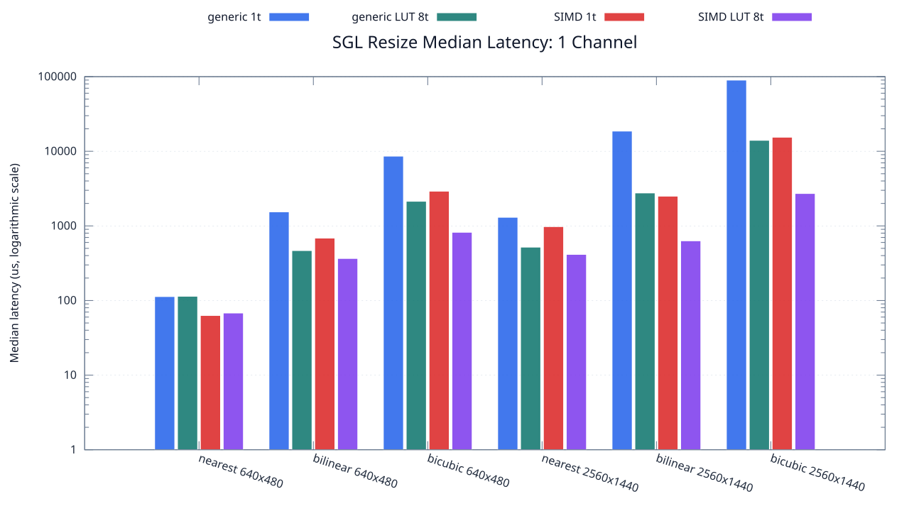
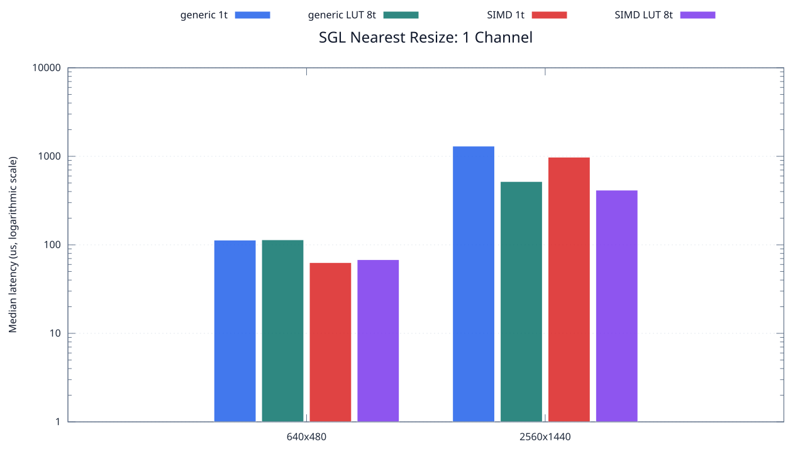
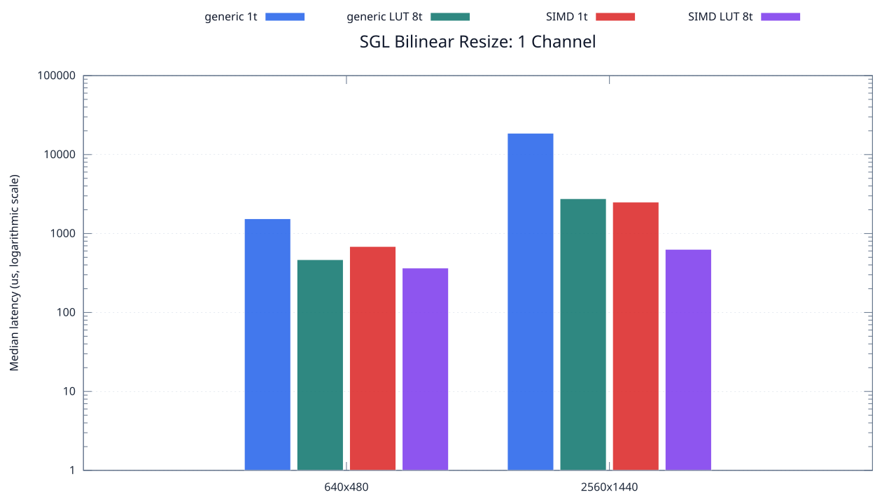
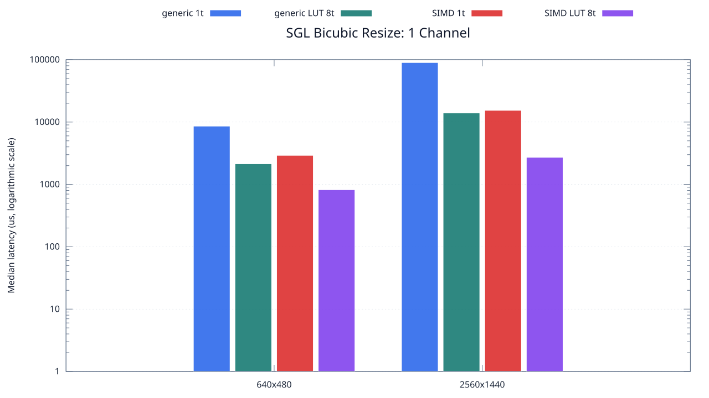

<!--
SPDX-License-Identifier: MIT

Copyright (c) 2025 Dylan Hong

This file is released under the MIT License.
For conditions of distribution and use, see the LICENSE file.
-->

SGL Resize Benchmark: 1 Channel
==============================

[Resize index](../README.md) | [Benchmark index](../../README.md) | **1 channel** | [2 channels](../2ch/README.md) | [3 channels](../3ch/README.md) | [4 channels](../4ch/README.md)

The charts and Markdown result table are generated from
[`../benchmark.csv`](../benchmark.csv) after the resize benchmark completes.

Overview
--------

Nearest
-------

Bilinear
--------

Bicubic
-------

Test Environment
----------------
| Environment | Value |
| --- | --- |
| Report generated | 2026-08-01T02:51:21+00:00 |
| OS | Ubuntu 24.04.4 LTS |
| Kernel | Linux 6.18.33.2-microsoft-standard-WSL2 (WSL2) |
| Runtime architecture | aarch64 |
| Target | Linux/aarch64 |
| CPU | ARM implementer 0x51, part 0x001 |
| Logical CPUs | 8 |
| Visible memory | 3.81 GiB |
| Execution | native |
| Input | resource/sample.png |
| Source revision | b815597 (dirty) |
| Chart generator | gnuplot 6.0 patchlevel 0 |

Build Configuration
-------------------
| Build option | Value |
| --- | --- |
| Toolchain | llvm |
| Compiler | Clang 18.1.3 |
| Compiler path | /usr/bin/clang |
| Build type | Release |
| C flags | `-O2 -DNDEBUG -std=gnu99 -Wall -Wextra -fno-vectorize -fno-slp-vectorize -fno-builtin-memcpy -fno-builtin-memset` |
| Compiler warnings | ON (-Wall, -Wextra) |
| Auto-vectorization | OFF (-fno-vectorize, -fno-slp-vectorize) |
| SIMD | ON (NEON) |
| Threading | ON (pthread) |
| Sanitizers | OFF |
| Stack protector | OFF |
| External comparison | ON (Cairo/NE10 where supported) |
| Warm-up calls | 3 |
| Measured calls | 10 |

Results
-------
| Case | Method | Backend | Threads | Size | Median (us) | Average (us) | Min (us) | Max (us) |
| --- | --- | --- | --- | --- | --- | --- | --- | --- |
| 0 | nearest | generic | 1 | 640x480 | 113 | 115 | 113 | 129 |
| 1 | nearest | simd | 1 | 640x480 | 63 | 64 | 62 | 78 |
| 2 | nearest | generic-lut | 1 | 640x480 | 113 | 122 | 112 | 209 |
| 3 | nearest | simd-lut | 1 | 640x480 | 63 | 66 | 60 | 106 |
| 4 | bilinear | generic | 1 | 640x480 | 1,541 | 1,572 | 1,524 | 1,725 |
| 5 | bilinear | simd | 1 | 640x480 | 686 | 706 | 673 | 820 |
| 6 | bilinear | generic-lut | 1 | 640x480 | 1,570 | 1,613 | 1,535 | 1,807 |
| 7 | bilinear | simd-lut | 1 | 640x480 | 685 | 697 | 671 | 822 |
| 8 | bicubic | generic | 1 | 640x480 | 8,604 | 8,378 | 7,458 | 9,045 |
| 9 | bicubic | simd | 1 | 640x480 | 2,918 | 3,053 | 2,826 | 3,695 |
| 10 | bicubic | generic-lut | 1 | 640x480 | 8,725 | 8,329 | 7,409 | 8,933 |
| 11 | bicubic | simd-lut | 1 | 640x480 | 2,889 | 2,916 | 2,820 | 3,059 |
| 12 | nearest | generic | 2 | 640x480 | 114 | 117 | 113 | 131 |
| 13 | nearest | simd | 2 | 640x480 | 64 | 72 | 63 | 131 |
| 14 | nearest | generic-lut | 2 | 640x480 | 122 | 137 | 116 | 197 |
| 15 | nearest | simd-lut | 2 | 640x480 | 62 | 63 | 61 | 76 |
| 16 | bilinear | generic | 2 | 640x480 | 868 | 891 | 815 | 1,056 |
| 17 | bilinear | simd | 2 | 640x480 | 390 | 408 | 369 | 476 |
| 18 | bilinear | generic-lut | 2 | 640x480 | 849 | 864 | 805 | 961 |
| 19 | bilinear | simd-lut | 2 | 640x480 | 433 | 429 | 384 | 489 |
| 20 | bicubic | generic | 2 | 640x480 | 4,548 | 4,642 | 4,391 | 5,289 |
| 21 | bicubic | simd | 2 | 640x480 | 1,582 | 1,599 | 1,533 | 1,725 |
| 22 | bicubic | generic-lut | 2 | 640x480 | 4,735 | 5,033 | 4,433 | 5,997 |
| 23 | bicubic | simd-lut | 2 | 640x480 | 1,663 | 1,681 | 1,525 | 1,905 |
| 24 | nearest | generic | 4 | 640x480 | 115 | 117 | 114 | 130 |
| 25 | nearest | simd | 4 | 640x480 | 65 | 67 | 64 | 91 |
| 26 | nearest | generic-lut | 4 | 640x480 | 134 | 140 | 114 | 246 |
| 27 | nearest | simd-lut | 4 | 640x480 | 69 | 71 | 65 | 84 |
| 28 | bilinear | generic | 4 | 640x480 | 532 | 682 | 510 | 1,478 |
| 29 | bilinear | simd | 4 | 640x480 | 241 | 255 | 229 | 348 |
| 30 | bilinear | generic-lut | 4 | 640x480 | 664 | 706 | 505 | 1,126 |
| 31 | bilinear | simd-lut | 4 | 640x480 | 247 | 285 | 232 | 409 |
| 32 | bicubic | generic | 4 | 640x480 | 3,122 | 3,065 | 2,553 | 3,480 |
| 33 | bicubic | simd | 4 | 640x480 | 913 | 947 | 810 | 1,332 |
| 34 | bicubic | generic-lut | 4 | 640x480 | 2,489 | 2,636 | 2,411 | 3,070 |
| 35 | bicubic | simd-lut | 4 | 640x480 | 929 | 948 | 852 | 1,150 |
| 36 | nearest | generic | 8 | 640x480 | 115 | 122 | 114 | 174 |
| 37 | nearest | simd | 8 | 640x480 | 67 | 78 | 63 | 166 |
| 38 | nearest | generic-lut | 8 | 640x480 | 114 | 115 | 113 | 126 |
| 39 | nearest | simd-lut | 8 | 640x480 | 68 | 79 | 66 | 128 |
| 40 | bilinear | generic | 8 | 640x480 | 564 | 596 | 366 | 969 |
| 41 | bilinear | simd | 8 | 640x480 | 346 | 329 | 166 | 459 |
| 42 | bilinear | generic-lut | 8 | 640x480 | 467 | 477 | 292 | 726 |
| 43 | bilinear | simd-lut | 8 | 640x480 | 366 | 412 | 289 | 595 |
| 44 | bicubic | generic | 8 | 640x480 | 2,027 | 2,509 | 1,660 | 4,669 |
| 45 | bicubic | simd | 8 | 640x480 | 948 | 915 | 617 | 1,182 |
| 46 | bicubic | generic-lut | 8 | 640x480 | 2,137 | 2,139 | 1,772 | 2,499 |
| 47 | bicubic | simd-lut | 8 | 640x480 | 821 | 1,094 | 787 | 3,054 |
| 48 | nearest | generic | 1 | 2560x1440 | 1,304 | 1,333 | 1,277 | 1,482 |
| 49 | nearest | simd | 1 | 2560x1440 | 978 | 1,051 | 850 | 1,668 |
| 50 | nearest | generic-lut | 1 | 2560x1440 | 1,293 | 1,353 | 1,272 | 1,681 |
| 51 | nearest | simd-lut | 1 | 2560x1440 | 865 | 864 | 853 | 889 |
| 52 | bilinear | generic | 1 | 2560x1440 | 18,648 | 19,077 | 18,451 | 23,125 |
| 53 | bilinear | simd | 1 | 2560x1440 | 2,502 | 2,646 | 2,432 | 3,461 |
| 54 | bilinear | generic-lut | 1 | 2560x1440 | 18,567 | 18,564 | 18,432 | 18,679 |
| 55 | bilinear | simd-lut | 1 | 2560x1440 | 2,482 | 2,585 | 2,427 | 3,101 |
| 56 | bicubic | generic | 1 | 2560x1440 | 89,927 | 90,198 | 89,468 | 92,080 |
| 57 | bicubic | simd | 1 | 2560x1440 | 15,427 | 15,914 | 15,219 | 17,945 |
| 58 | bicubic | generic-lut | 1 | 2560x1440 | 90,078 | 93,560 | 89,935 | 105,901 |
| 59 | bicubic | simd-lut | 1 | 2560x1440 | 15,303 | 15,306 | 15,202 | 15,541 |
| 60 | nearest | generic | 2 | 2560x1440 | 711 | 725 | 683 | 835 |
| 61 | nearest | simd | 2 | 2560x1440 | 531 | 723 | 458 | 1,566 |
| 62 | nearest | generic-lut | 2 | 2560x1440 | 688 | 729 | 672 | 994 |
| 63 | nearest | simd-lut | 2 | 2560x1440 | 479 | 486 | 461 | 570 |
| 64 | bilinear | generic | 2 | 2560x1440 | 8,503 | 9,577 | 7,949 | 14,516 |
| 65 | bilinear | simd | 2 | 2560x1440 | 1,209 | 1,207 | 1,127 | 1,280 |
| 66 | bilinear | generic-lut | 2 | 2560x1440 | 8,030 | 8,035 | 7,951 | 8,118 |
| 67 | bilinear | simd-lut | 2 | 2560x1440 | 1,156 | 1,196 | 1,129 | 1,421 |
| 68 | bicubic | generic | 2 | 2560x1440 | 45,979 | 46,868 | 44,837 | 50,225 |
| 69 | bicubic | simd | 2 | 2560x1440 | 8,629 | 8,682 | 8,254 | 9,763 |
| 70 | bicubic | generic-lut | 2 | 2560x1440 | 50,099 | 49,376 | 44,837 | 52,793 |
| 71 | bicubic | simd-lut | 2 | 2560x1440 | 8,302 | 8,397 | 8,237 | 9,246 |
| 72 | nearest | generic | 4 | 2560x1440 | 526 | 532 | 425 | 740 |
| 73 | nearest | simd | 4 | 2560x1440 | 446 | 465 | 302 | 728 |
| 74 | nearest | generic-lut | 4 | 2560x1440 | 549 | 604 | 453 | 1,116 |
| 75 | nearest | simd-lut | 4 | 2560x1440 | 381 | 404 | 313 | 651 |
| 76 | bilinear | generic | 4 | 2560x1440 | 5,026 | 5,021 | 4,961 | 5,087 |
| 77 | bilinear | simd | 4 | 2560x1440 | 805 | 842 | 742 | 1,160 |
| 78 | bilinear | generic-lut | 4 | 2560x1440 | 5,017 | 5,024 | 4,929 | 5,132 |
| 79 | bilinear | simd-lut | 4 | 2560x1440 | 758 | 753 | 673 | 848 |
| 80 | bicubic | generic | 4 | 2560x1440 | 27,529 | 27,465 | 26,681 | 27,681 |
| 81 | bicubic | simd | 4 | 2560x1440 | 4,969 | 5,010 | 4,893 | 5,381 |
| 82 | bicubic | generic-lut | 4 | 2560x1440 | 27,622 | 27,494 | 26,524 | 27,703 |
| 83 | bicubic | simd-lut | 4 | 2560x1440 | 4,941 | 4,927 | 4,789 | 5,055 |
| 84 | nearest | generic | 8 | 2560x1440 | 538 | 580 | 427 | 1,003 |
| 85 | nearest | simd | 8 | 2560x1440 | 452 | 490 | 337 | 787 |
| 86 | nearest | generic-lut | 8 | 2560x1440 | 519 | 548 | 383 | 934 |
| 87 | nearest | simd-lut | 8 | 2560x1440 | 415 | 464 | 354 | 671 |
| 88 | bilinear | generic | 8 | 2560x1440 | 3,137 | 3,207 | 3,011 | 3,697 |
| 89 | bilinear | simd | 8 | 2560x1440 | 677 | 698 | 521 | 1,084 |
| 90 | bilinear | generic-lut | 8 | 2560x1440 | 2,764 | 2,802 | 2,660 | 3,086 |
| 91 | bilinear | simd-lut | 8 | 2560x1440 | 631 | 687 | 516 | 984 |
| 92 | bicubic | generic | 8 | 2560x1440 | 14,024 | 14,052 | 13,963 | 14,188 |
| 93 | bicubic | simd | 8 | 2560x1440 | 3,112 | 3,192 | 2,674 | 3,893 |
| 94 | bicubic | generic-lut | 8 | 2560x1440 | 14,022 | 14,023 | 13,816 | 14,143 |
| 95 | bicubic | simd-lut | 8 | 2560x1440 | 2,719 | 2,822 | 2,577 | 3,507 |

Results depend on the input, CPU frequency policy, scheduler load, compiler,
and build options. Refresh them on the target machine before comparison.
