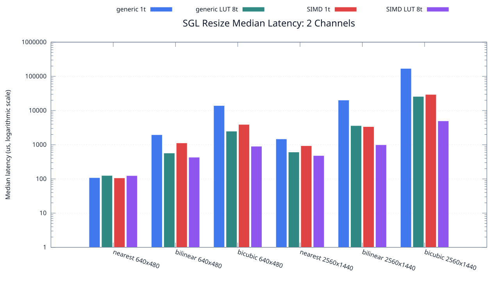
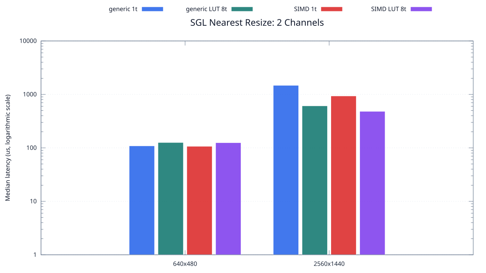
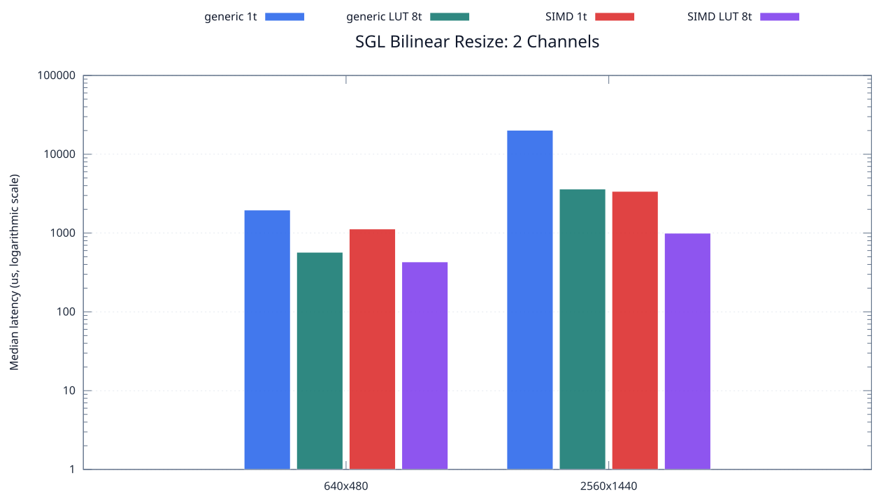
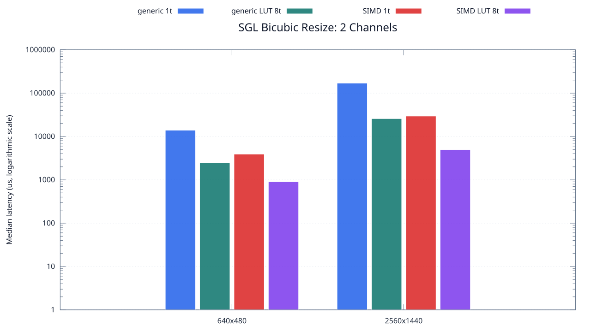

<!--
SPDX-License-Identifier: MIT

Copyright (c) 2025 Dylan Hong

This file is released under the MIT License.
For conditions of distribution and use, see the LICENSE file.
-->

SGL Resize Benchmark: 2 Channels
===============================

[Resize index](../README.md) | [Benchmark index](../../README.md) | [1 channel](../1ch/README.md) | **2 channels** | [3 channels](../3ch/README.md) | [4 channels](../4ch/README.md)

The charts and Markdown result table are generated from
[`../benchmark.csv`](../benchmark.csv) after the resize benchmark completes.

Overview
--------

Nearest
-------

Bilinear
--------

Bicubic
-------

Test Environment
----------------
| Environment | Value |
| --- | --- |
| Report generated | 2026-08-01T02:51:21+00:00 |
| OS | Ubuntu 24.04.4 LTS |
| Kernel | Linux 6.18.33.2-microsoft-standard-WSL2 (WSL2) |
| Runtime architecture | aarch64 |
| Target | Linux/aarch64 |
| CPU | ARM implementer 0x51, part 0x001 |
| Logical CPUs | 8 |
| Visible memory | 3.81 GiB |
| Execution | native |
| Input | resource/sample.png |
| Source revision | b815597 (dirty) |
| Chart generator | gnuplot 6.0 patchlevel 0 |

Build Configuration
-------------------
| Build option | Value |
| --- | --- |
| Toolchain | llvm |
| Compiler | Clang 18.1.3 |
| Compiler path | /usr/bin/clang |
| Build type | Release |
| C flags | `-O2 -DNDEBUG -std=gnu99 -Wall -Wextra -fno-vectorize -fno-slp-vectorize -fno-builtin-memcpy -fno-builtin-memset` |
| Compiler warnings | ON (-Wall, -Wextra) |
| Auto-vectorization | OFF (-fno-vectorize, -fno-slp-vectorize) |
| SIMD | ON (NEON) |
| Threading | ON (pthread) |
| Sanitizers | OFF |
| Stack protector | OFF |
| External comparison | ON (Cairo/NE10 where supported) |
| Warm-up calls | 3 |
| Measured calls | 10 |

Results
-------
| Case | Method | Backend | Threads | Size | Median (us) | Average (us) | Min (us) | Max (us) |
| --- | --- | --- | --- | --- | --- | --- | --- | --- |
| 96 | nearest | generic | 1 | 640x480 | 109 | 116 | 107 | 169 |
| 97 | nearest | simd | 1 | 640x480 | 107 | 107 | 107 | 108 |
| 98 | nearest | generic-lut | 1 | 640x480 | 122 | 148 | 110 | 229 |
| 99 | nearest | simd-lut | 1 | 640x480 | 125 | 123 | 109 | 128 |
| 100 | bilinear | generic | 1 | 640x480 | 1,961 | 1,981 | 1,939 | 2,102 |
| 101 | bilinear | simd | 1 | 640x480 | 1,128 | 1,127 | 1,109 | 1,140 |
| 102 | bilinear | generic-lut | 1 | 640x480 | 1,662 | 1,676 | 1,639 | 1,786 |
| 103 | bilinear | simd-lut | 1 | 640x480 | 955 | 966 | 943 | 1,039 |
| 104 | bicubic | generic | 1 | 640x480 | 13,954 | 13,992 | 13,878 | 14,221 |
| 105 | bicubic | simd | 1 | 640x480 | 3,922 | 3,967 | 3,872 | 4,240 |
| 106 | bicubic | generic-lut | 1 | 640x480 | 14,208 | 14,276 | 13,882 | 14,916 |
| 107 | bicubic | simd-lut | 1 | 640x480 | 3,880 | 3,899 | 3,862 | 4,012 |
| 108 | nearest | generic | 2 | 640x480 | 109 | 113 | 107 | 157 |
| 109 | nearest | simd | 2 | 640x480 | 108 | 114 | 107 | 149 |
| 110 | nearest | generic-lut | 2 | 640x480 | 107 | 111 | 106 | 144 |
| 111 | nearest | simd-lut | 2 | 640x480 | 110 | 114 | 107 | 127 |
| 112 | bilinear | generic | 2 | 640x480 | 955 | 975 | 880 | 1,166 |
| 113 | bilinear | simd | 2 | 640x480 | 573 | 588 | 546 | 728 |
| 114 | bilinear | generic-lut | 2 | 640x480 | 1,006 | 1,017 | 980 | 1,077 |
| 115 | bilinear | simd-lut | 2 | 640x480 | 564 | 584 | 544 | 675 |
| 116 | bicubic | generic | 2 | 640x480 | 8,056 | 7,829 | 7,161 | 8,359 |
| 117 | bicubic | simd | 2 | 640x480 | 2,230 | 2,263 | 2,148 | 2,484 |
| 118 | bicubic | generic-lut | 2 | 640x480 | 8,197 | 8,712 | 8,128 | 13,373 |
| 119 | bicubic | simd-lut | 2 | 640x480 | 2,217 | 2,278 | 2,099 | 2,895 |
| 120 | nearest | generic | 4 | 640x480 | 109 | 111 | 109 | 122 |
| 121 | nearest | simd | 4 | 640x480 | 108 | 109 | 107 | 119 |
| 122 | nearest | generic-lut | 4 | 640x480 | 107 | 110 | 106 | 140 |
| 123 | nearest | simd-lut | 4 | 640x480 | 107 | 162 | 107 | 540 |
| 124 | bilinear | generic | 4 | 640x480 | 636 | 658 | 593 | 849 |
| 125 | bilinear | simd | 4 | 640x480 | 488 | 481 | 403 | 541 |
| 126 | bilinear | generic-lut | 4 | 640x480 | 652 | 654 | 593 | 719 |
| 127 | bilinear | simd-lut | 4 | 640x480 | 426 | 431 | 371 | 477 |
| 128 | bicubic | generic | 4 | 640x480 | 4,578 | 4,588 | 4,457 | 4,764 |
| 129 | bicubic | simd | 4 | 640x480 | 1,414 | 1,445 | 1,365 | 1,596 |
| 130 | bicubic | generic-lut | 4 | 640x480 | 4,537 | 4,582 | 4,442 | 4,766 |
| 131 | bicubic | simd-lut | 4 | 640x480 | 1,416 | 1,419 | 1,303 | 1,559 |
| 132 | nearest | generic | 8 | 640x480 | 129 | 137 | 127 | 199 |
| 133 | nearest | simd | 8 | 640x480 | 127 | 129 | 126 | 136 |
| 134 | nearest | generic-lut | 8 | 640x480 | 126 | 138 | 125 | 237 |
| 135 | nearest | simd-lut | 8 | 640x480 | 125 | 156 | 125 | 261 |
| 136 | bilinear | generic | 8 | 640x480 | 558 | 586 | 467 | 796 |
| 137 | bilinear | simd | 8 | 640x480 | 434 | 475 | 388 | 611 |
| 138 | bilinear | generic-lut | 8 | 640x480 | 571 | 582 | 461 | 749 |
| 139 | bilinear | simd-lut | 8 | 640x480 | 431 | 436 | 322 | 617 |
| 140 | bicubic | generic | 8 | 640x480 | 2,544 | 2,575 | 2,405 | 2,950 |
| 141 | bicubic | simd | 8 | 640x480 | 918 | 930 | 898 | 1,002 |
| 142 | bicubic | generic-lut | 8 | 640x480 | 2,490 | 2,524 | 2,336 | 2,732 |
| 143 | bicubic | simd-lut | 8 | 640x480 | 902 | 898 | 789 | 995 |
| 144 | nearest | generic | 1 | 2560x1440 | 1,477 | 1,478 | 1,469 | 1,489 |
| 145 | nearest | simd | 1 | 2560x1440 | 936 | 947 | 894 | 1,067 |
| 146 | nearest | generic-lut | 1 | 2560x1440 | 1,488 | 1,473 | 1,261 | 1,734 |
| 147 | nearest | simd-lut | 1 | 2560x1440 | 935 | 1,039 | 893 | 1,602 |
| 148 | bilinear | generic | 1 | 2560x1440 | 20,189 | 20,571 | 19,903 | 22,599 |
| 149 | bilinear | simd | 1 | 2560x1440 | 3,386 | 3,402 | 3,251 | 3,766 |
| 150 | bilinear | generic-lut | 1 | 2560x1440 | 19,919 | 19,985 | 19,787 | 20,546 |
| 151 | bilinear | simd-lut | 1 | 2560x1440 | 3,270 | 3,363 | 3,239 | 3,906 |
| 152 | bicubic | generic | 1 | 2560x1440 | 170,194 | 173,947 | 167,735 | 191,209 |
| 153 | bicubic | simd | 1 | 2560x1440 | 29,553 | 29,791 | 29,338 | 31,433 |
| 154 | bicubic | generic-lut | 1 | 2560x1440 | 170,002 | 171,180 | 167,718 | 178,699 |
| 155 | bicubic | simd-lut | 1 | 2560x1440 | 29,751 | 29,905 | 29,456 | 30,619 |
| 156 | nearest | generic | 2 | 2560x1440 | 731 | 883 | 666 | 1,341 |
| 157 | nearest | simd | 2 | 2560x1440 | 558 | 610 | 495 | 954 |
| 158 | nearest | generic-lut | 2 | 2560x1440 | 765 | 789 | 675 | 1,085 |
| 159 | nearest | simd-lut | 2 | 2560x1440 | 559 | 604 | 487 | 828 |
| 160 | bilinear | generic | 2 | 2560x1440 | 10,385 | 10,428 | 10,115 | 10,987 |
| 161 | bilinear | simd | 2 | 2560x1440 | 1,925 | 1,984 | 1,811 | 2,531 |
| 162 | bilinear | generic-lut | 2 | 2560x1440 | 10,327 | 10,586 | 10,099 | 12,400 |
| 163 | bilinear | simd-lut | 2 | 2560x1440 | 1,874 | 1,916 | 1,836 | 2,225 |
| 164 | bicubic | generic | 2 | 2560x1440 | 85,850 | 88,104 | 83,708 | 105,777 |
| 165 | bicubic | simd | 2 | 2560x1440 | 15,727 | 16,171 | 15,665 | 18,658 |
| 166 | bicubic | generic-lut | 2 | 2560x1440 | 85,088 | 85,361 | 83,805 | 87,483 |
| 167 | bicubic | simd-lut | 2 | 2560x1440 | 15,690 | 15,807 | 15,645 | 16,425 |
| 168 | nearest | generic | 4 | 2560x1440 | 863 | 849 | 565 | 1,002 |
| 169 | nearest | simd | 4 | 2560x1440 | 587 | 602 | 435 | 882 |
| 170 | nearest | generic-lut | 4 | 2560x1440 | 670 | 706 | 493 | 1,339 |
| 171 | nearest | simd-lut | 4 | 2560x1440 | 463 | 478 | 415 | 671 |
| 172 | bilinear | generic | 4 | 2560x1440 | 6,322 | 6,474 | 6,258 | 7,931 |
| 173 | bilinear | simd | 4 | 2560x1440 | 1,225 | 1,237 | 1,129 | 1,376 |
| 174 | bilinear | generic-lut | 4 | 2560x1440 | 6,284 | 6,280 | 6,178 | 6,377 |
| 175 | bilinear | simd-lut | 4 | 2560x1440 | 1,241 | 1,321 | 1,167 | 1,707 |
| 176 | bicubic | generic | 4 | 2560x1440 | 51,509 | 51,629 | 51,272 | 52,799 |
| 177 | bicubic | simd | 4 | 2560x1440 | 9,435 | 10,102 | 9,115 | 13,546 |
| 178 | bicubic | generic-lut | 4 | 2560x1440 | 51,520 | 53,410 | 51,331 | 68,648 |
| 179 | bicubic | simd-lut | 4 | 2560x1440 | 9,329 | 9,360 | 9,276 | 9,513 |
| 180 | nearest | generic | 8 | 2560x1440 | 538 | 542 | 455 | 625 |
| 181 | nearest | simd | 8 | 2560x1440 | 473 | 505 | 411 | 647 |
| 182 | nearest | generic-lut | 8 | 2560x1440 | 611 | 646 | 485 | 905 |
| 183 | nearest | simd-lut | 8 | 2560x1440 | 482 | 499 | 366 | 680 |
| 184 | bilinear | generic | 8 | 2560x1440 | 3,483 | 3,578 | 3,330 | 4,005 |
| 185 | bilinear | simd | 8 | 2560x1440 | 910 | 969 | 802 | 1,588 |
| 186 | bilinear | generic-lut | 8 | 2560x1440 | 3,620 | 3,732 | 3,312 | 4,696 |
| 187 | bilinear | simd-lut | 8 | 2560x1440 | 997 | 981 | 837 | 1,152 |
| 188 | bicubic | generic | 8 | 2560x1440 | 25,868 | 26,262 | 25,760 | 28,972 |
| 189 | bicubic | simd | 8 | 2560x1440 | 4,938 | 4,994 | 4,823 | 5,614 |
| 190 | bicubic | generic-lut | 8 | 2560x1440 | 25,835 | 25,856 | 25,816 | 25,934 |
| 191 | bicubic | simd-lut | 8 | 2560x1440 | 4,979 | 5,241 | 4,868 | 6,240 |

Results depend on the input, CPU frequency policy, scheduler load, compiler,
and build options. Refresh them on the target machine before comparison.
