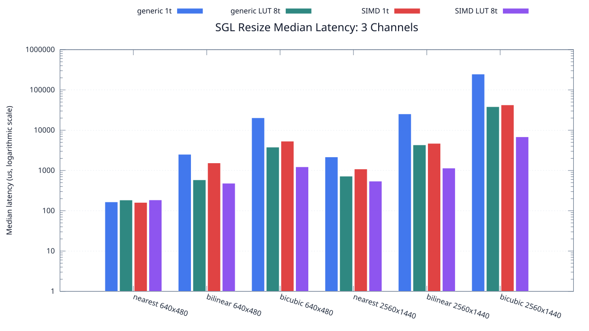
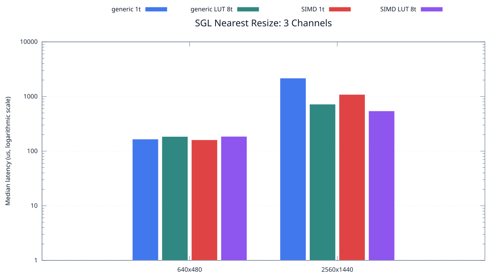
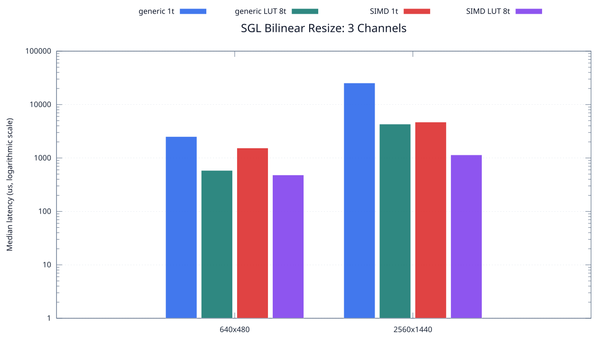
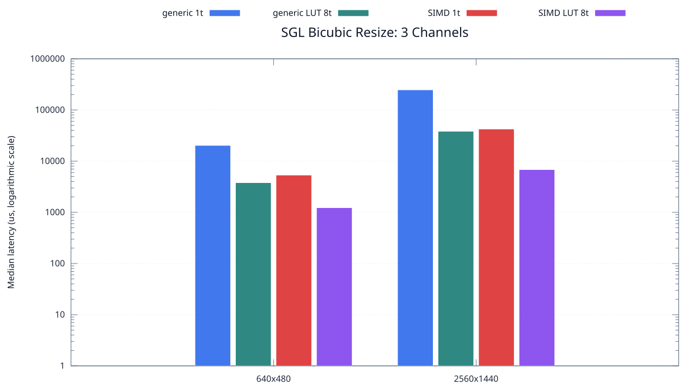

<!--
SPDX-License-Identifier: MIT

Copyright (c) 2025 Dylan Hong

This file is released under the MIT License.
For conditions of distribution and use, see the LICENSE file.
-->

SGL Resize Benchmark: 3 Channels
===============================

[Resize index](../README.md) | [Benchmark index](../../README.md) | [1 channel](../1ch/README.md) | [2 channels](../2ch/README.md) | **3 channels** | [4 channels](../4ch/README.md)

The charts and Markdown result table are generated from
[`../benchmark.csv`](../benchmark.csv) after the resize benchmark completes.

Overview
--------

Nearest
-------

Bilinear
--------

Bicubic
-------

Test Environment
----------------
| Environment | Value |
| --- | --- |
| Report generated | 2026-08-01T02:51:21+00:00 |
| OS | Ubuntu 24.04.4 LTS |
| Kernel | Linux 6.18.33.2-microsoft-standard-WSL2 (WSL2) |
| Runtime architecture | aarch64 |
| Target | Linux/aarch64 |
| CPU | ARM implementer 0x51, part 0x001 |
| Logical CPUs | 8 |
| Visible memory | 3.81 GiB |
| Execution | native |
| Input | resource/sample.png |
| Source revision | b815597 (dirty) |
| Chart generator | gnuplot 6.0 patchlevel 0 |

Build Configuration
-------------------
| Build option | Value |
| --- | --- |
| Toolchain | llvm |
| Compiler | Clang 18.1.3 |
| Compiler path | /usr/bin/clang |
| Build type | Release |
| C flags | `-O2 -DNDEBUG -std=gnu99 -Wall -Wextra -fno-vectorize -fno-slp-vectorize -fno-builtin-memcpy -fno-builtin-memset` |
| Compiler warnings | ON (-Wall, -Wextra) |
| Auto-vectorization | OFF (-fno-vectorize, -fno-slp-vectorize) |
| SIMD | ON (NEON) |
| Threading | ON (pthread) |
| Sanitizers | OFF |
| Stack protector | OFF |
| External comparison | ON (Cairo/NE10 where supported) |
| Warm-up calls | 3 |
| Measured calls | 10 |

Results
-------
| Case | Method | Backend | Threads | Size | Median (us) | Average (us) | Min (us) | Max (us) |
| --- | --- | --- | --- | --- | --- | --- | --- | --- |
| 192 | nearest | generic | 1 | 640x480 | 166 | 169 | 162 | 183 |
| 193 | nearest | simd | 1 | 640x480 | 161 | 173 | 159 | 242 |
| 194 | nearest | generic-lut | 1 | 640x480 | 186 | 200 | 185 | 277 |
| 195 | nearest | simd-lut | 1 | 640x480 | 185 | 200 | 184 | 278 |
| 196 | bilinear | generic | 1 | 640x480 | 2,521 | 2,520 | 2,275 | 2,692 |
| 197 | bilinear | simd | 1 | 640x480 | 1,540 | 1,563 | 1,509 | 1,663 |
| 198 | bilinear | generic-lut | 1 | 640x480 | 2,491 | 2,520 | 2,460 | 2,667 |
| 199 | bilinear | simd-lut | 1 | 640x480 | 1,280 | 1,304 | 1,267 | 1,404 |
| 200 | bicubic | generic | 1 | 640x480 | 20,332 | 20,395 | 20,253 | 20,823 |
| 201 | bicubic | simd | 1 | 640x480 | 5,342 | 5,354 | 5,311 | 5,418 |
| 202 | bicubic | generic-lut | 1 | 640x480 | 20,392 | 20,507 | 20,233 | 21,285 |
| 203 | bicubic | simd-lut | 1 | 640x480 | 5,384 | 5,381 | 5,326 | 5,442 |
| 204 | nearest | generic | 2 | 640x480 | 169 | 169 | 162 | 180 |
| 205 | nearest | simd | 2 | 640x480 | 160 | 170 | 159 | 236 |
| 206 | nearest | generic-lut | 2 | 640x480 | 175 | 186 | 158 | 255 |
| 207 | nearest | simd-lut | 2 | 640x480 | 179 | 191 | 158 | 310 |
| 208 | bilinear | generic | 2 | 640x480 | 1,256 | 1,268 | 1,242 | 1,361 |
| 209 | bilinear | simd | 2 | 640x480 | 752 | 772 | 738 | 868 |
| 210 | bilinear | generic-lut | 2 | 640x480 | 1,257 | 1,254 | 1,238 | 1,268 |
| 211 | bilinear | simd-lut | 2 | 640x480 | 789 | 798 | 720 | 892 |
| 212 | bicubic | generic | 2 | 640x480 | 11,702 | 11,390 | 10,175 | 12,029 |
| 213 | bicubic | simd | 2 | 640x480 | 3,140 | 3,186 | 2,995 | 3,535 |
| 214 | bicubic | generic-lut | 2 | 640x480 | 10,130 | 10,631 | 10,003 | 11,789 |
| 215 | bicubic | simd-lut | 2 | 640x480 | 2,888 | 2,949 | 2,864 | 3,366 |
| 216 | nearest | generic | 4 | 640x480 | 167 | 172 | 162 | 207 |
| 217 | nearest | simd | 4 | 640x480 | 185 | 194 | 168 | 293 |
| 218 | nearest | generic-lut | 4 | 640x480 | 171 | 194 | 166 | 381 |
| 219 | nearest | simd-lut | 4 | 640x480 | 162 | 171 | 157 | 240 |
| 220 | bilinear | generic | 4 | 640x480 | 821 | 820 | 770 | 894 |
| 221 | bilinear | simd | 4 | 640x480 | 534 | 539 | 478 | 663 |
| 222 | bilinear | generic-lut | 4 | 640x480 | 786 | 781 | 739 | 809 |
| 223 | bilinear | simd-lut | 4 | 640x480 | 532 | 538 | 497 | 585 |
| 224 | bicubic | generic | 4 | 640x480 | 6,449 | 6,776 | 6,356 | 8,395 |
| 225 | bicubic | simd | 4 | 640x480 | 1,821 | 1,827 | 1,760 | 1,907 |
| 226 | bicubic | generic-lut | 4 | 640x480 | 6,410 | 6,456 | 6,342 | 6,727 |
| 227 | bicubic | simd-lut | 4 | 640x480 | 1,899 | 1,893 | 1,777 | 1,999 |
| 228 | nearest | generic | 8 | 640x480 | 195 | 213 | 187 | 321 |
| 229 | nearest | simd | 8 | 640x480 | 201 | 215 | 187 | 290 |
| 230 | nearest | generic-lut | 8 | 640x480 | 185 | 198 | 184 | 278 |
| 231 | nearest | simd-lut | 8 | 640x480 | 186 | 196 | 184 | 275 |
| 232 | bilinear | generic | 8 | 640x480 | 649 | 663 | 574 | 773 |
| 233 | bilinear | simd | 8 | 640x480 | 502 | 511 | 450 | 621 |
| 234 | bilinear | generic-lut | 8 | 640x480 | 586 | 619 | 512 | 897 |
| 235 | bilinear | simd-lut | 8 | 640x480 | 482 | 474 | 386 | 531 |
| 236 | bicubic | generic | 8 | 640x480 | 4,128 | 4,000 | 3,461 | 4,789 |
| 237 | bicubic | simd | 8 | 640x480 | 1,218 | 1,253 | 1,097 | 1,460 |
| 238 | bicubic | generic-lut | 8 | 640x480 | 3,801 | 3,796 | 3,390 | 4,149 |
| 239 | bicubic | simd-lut | 8 | 640x480 | 1,233 | 1,484 | 1,116 | 3,358 |
| 240 | nearest | generic | 1 | 2560x1440 | 2,169 | 2,177 | 2,163 | 2,215 |
| 241 | nearest | simd | 1 | 2560x1440 | 1,089 | 1,179 | 1,050 | 1,568 |
| 242 | nearest | generic-lut | 1 | 2560x1440 | 1,863 | 1,942 | 1,835 | 2,342 |
| 243 | nearest | simd-lut | 1 | 2560x1440 | 1,245 | 1,318 | 1,224 | 1,740 |
| 244 | bilinear | generic | 1 | 2560x1440 | 25,407 | 25,522 | 25,235 | 26,091 |
| 245 | bilinear | simd | 1 | 2560x1440 | 4,711 | 4,673 | 4,283 | 5,099 |
| 246 | bilinear | generic-lut | 1 | 2560x1440 | 25,377 | 25,592 | 25,258 | 27,373 |
| 247 | bilinear | simd-lut | 1 | 2560x1440 | 4,379 | 4,586 | 4,277 | 5,182 |
| 248 | bicubic | generic | 1 | 2560x1440 | 247,592 | 254,012 | 245,102 | 272,640 |
| 249 | bicubic | simd | 1 | 2560x1440 | 42,499 | 43,048 | 41,966 | 44,995 |
| 250 | bicubic | generic-lut | 1 | 2560x1440 | 250,125 | 256,419 | 244,379 | 274,922 |
| 251 | bicubic | simd-lut | 1 | 2560x1440 | 42,121 | 42,756 | 41,828 | 47,717 |
| 252 | nearest | generic | 2 | 2560x1440 | 1,168 | 1,278 | 952 | 2,145 |
| 253 | nearest | simd | 2 | 2560x1440 | 621 | 661 | 551 | 989 |
| 254 | nearest | generic-lut | 2 | 2560x1440 | 1,152 | 1,188 | 1,093 | 1,505 |
| 255 | nearest | simd-lut | 2 | 2560x1440 | 724 | 730 | 554 | 1,019 |
| 256 | bilinear | generic | 2 | 2560x1440 | 13,015 | 13,184 | 12,878 | 14,116 |
| 257 | bilinear | simd | 2 | 2560x1440 | 2,351 | 2,448 | 2,301 | 3,071 |
| 258 | bilinear | generic-lut | 2 | 2560x1440 | 12,962 | 12,985 | 12,822 | 13,177 |
| 259 | bilinear | simd-lut | 2 | 2560x1440 | 2,439 | 2,501 | 2,297 | 3,095 |
| 260 | bicubic | generic | 2 | 2560x1440 | 125,868 | 127,120 | 124,569 | 135,310 |
| 261 | bicubic | simd | 2 | 2560x1440 | 22,531 | 22,584 | 22,363 | 23,127 |
| 262 | bicubic | generic-lut | 2 | 2560x1440 | 126,154 | 127,300 | 125,002 | 133,436 |
| 263 | bicubic | simd-lut | 2 | 2560x1440 | 22,454 | 22,543 | 22,322 | 23,034 |
| 264 | nearest | generic | 4 | 2560x1440 | 742 | 875 | 698 | 1,643 |
| 265 | nearest | simd | 4 | 2560x1440 | 521 | 514 | 445 | 571 |
| 266 | nearest | generic-lut | 4 | 2560x1440 | 797 | 871 | 689 | 1,470 |
| 267 | nearest | simd-lut | 4 | 2560x1440 | 569 | 554 | 441 | 645 |
| 268 | bilinear | generic | 4 | 2560x1440 | 8,065 | 8,243 | 7,960 | 9,230 |
| 269 | bilinear | simd | 4 | 2560x1440 | 1,494 | 1,548 | 1,461 | 1,857 |
| 270 | bilinear | generic-lut | 4 | 2560x1440 | 7,870 | 7,894 | 7,787 | 8,112 |
| 271 | bilinear | simd-lut | 4 | 2560x1440 | 1,449 | 1,476 | 1,293 | 1,763 |
| 272 | bicubic | generic | 4 | 2560x1440 | 76,392 | 76,258 | 75,171 | 76,474 |
| 273 | bicubic | simd | 4 | 2560x1440 | 13,196 | 13,229 | 13,037 | 13,579 |
| 274 | bicubic | generic-lut | 4 | 2560x1440 | 76,342 | 76,424 | 76,155 | 76,861 |
| 275 | bicubic | simd-lut | 4 | 2560x1440 | 13,269 | 13,270 | 13,177 | 13,412 |
| 276 | nearest | generic | 8 | 2560x1440 | 837 | 842 | 741 | 987 |
| 277 | nearest | simd | 8 | 2560x1440 | 538 | 575 | 453 | 975 |
| 278 | nearest | generic-lut | 8 | 2560x1440 | 723 | 796 | 583 | 1,139 |
| 279 | nearest | simd-lut | 8 | 2560x1440 | 544 | 560 | 425 | 883 |
| 280 | bilinear | generic | 8 | 2560x1440 | 4,271 | 4,343 | 4,172 | 4,697 |
| 281 | bilinear | simd | 8 | 2560x1440 | 1,131 | 1,227 | 993 | 1,842 |
| 282 | bilinear | generic-lut | 8 | 2560x1440 | 4,321 | 4,387 | 4,189 | 4,748 |
| 283 | bilinear | simd-lut | 8 | 2560x1440 | 1,146 | 1,251 | 1,024 | 2,007 |
| 284 | bicubic | generic | 8 | 2560x1440 | 38,334 | 38,369 | 38,255 | 38,576 |
| 285 | bicubic | simd | 8 | 2560x1440 | 6,893 | 6,904 | 6,851 | 7,061 |
| 286 | bicubic | generic-lut | 8 | 2560x1440 | 38,383 | 38,539 | 38,283 | 39,782 |
| 287 | bicubic | simd-lut | 8 | 2560x1440 | 6,848 | 6,864 | 6,779 | 6,980 |

Results depend on the input, CPU frequency policy, scheduler load, compiler,
and build options. Refresh them on the target machine before comparison.
