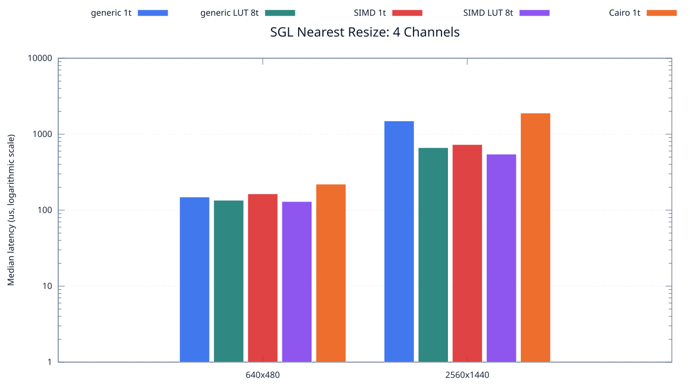
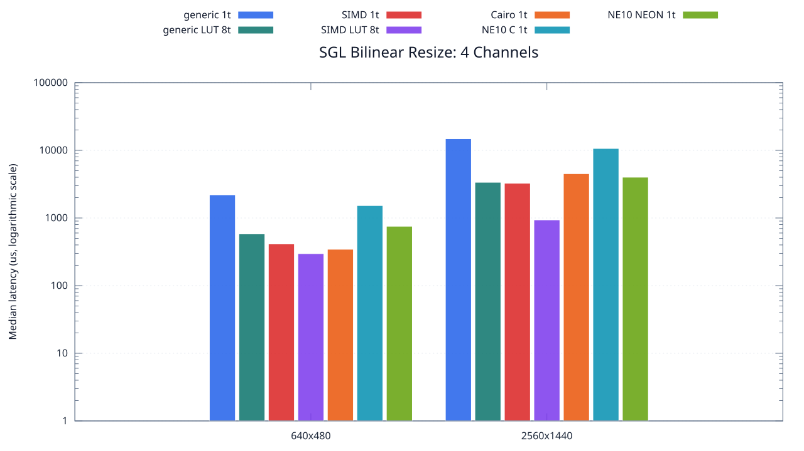
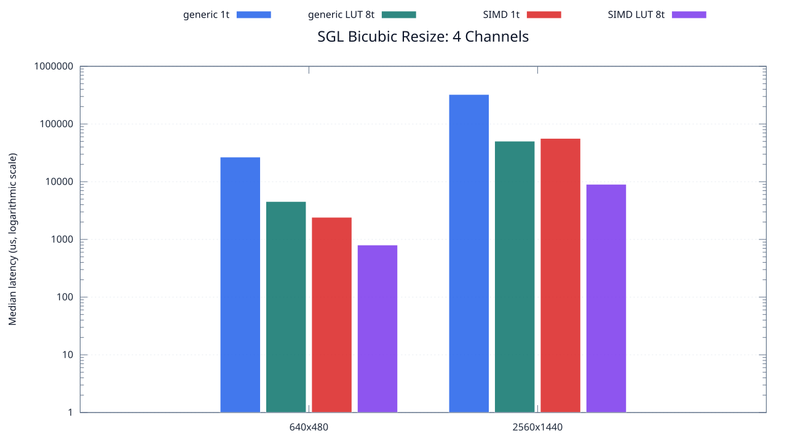

<!--
SPDX-License-Identifier: MIT

Copyright (c) 2025 Dylan Hong

This file is released under the MIT License.
For conditions of distribution and use, see the LICENSE file.
-->

SGL Resize Benchmark: 4 Channels
===============================

[Resize index](../README.md) | [Benchmark index](../../README.md) | [1 channel](../1ch/README.md) | [2 channels](../2ch/README.md) | [3 channels](../3ch/README.md) | **4 channels**

The charts and Markdown result table are generated from
[`../benchmark.csv`](../benchmark.csv) after the resize benchmark completes.

Overview
--------

Nearest
-------

Bilinear
--------

Bicubic
-------

Test Environment
----------------
| Environment | Value |
| --- | --- |
| Report generated | 2026-08-01T02:51:21+00:00 |
| OS | Ubuntu 24.04.4 LTS |
| Kernel | Linux 6.18.33.2-microsoft-standard-WSL2 (WSL2) |
| Runtime architecture | aarch64 |
| Target | Linux/aarch64 |
| CPU | ARM implementer 0x51, part 0x001 |
| Logical CPUs | 8 |
| Visible memory | 3.81 GiB |
| Execution | native |
| Input | resource/sample.png |
| Source revision | b815597 (dirty) |
| Chart generator | gnuplot 6.0 patchlevel 0 |

Build Configuration
-------------------
| Build option | Value |
| --- | --- |
| Toolchain | llvm |
| Compiler | Clang 18.1.3 |
| Compiler path | /usr/bin/clang |
| Build type | Release |
| C flags | `-O2 -DNDEBUG -std=gnu99 -Wall -Wextra -fno-vectorize -fno-slp-vectorize -fno-builtin-memcpy -fno-builtin-memset` |
| Compiler warnings | ON (-Wall, -Wextra) |
| Auto-vectorization | OFF (-fno-vectorize, -fno-slp-vectorize) |
| SIMD | ON (NEON) |
| Threading | ON (pthread) |
| Sanitizers | OFF |
| Stack protector | OFF |
| External comparison | ON (Cairo/NE10 where supported) |
| Warm-up calls | 3 |
| Measured calls | 10 |

Results
-------
| Case | Method | Backend | Threads | Size | Median (us) | Average (us) | Min (us) | Max (us) |
| --- | --- | --- | --- | --- | --- | --- | --- | --- |
| 288 | nearest | generic | 1 | 640x480 | 149 | 149 | 128 | 174 |
| 289 | nearest | simd | 1 | 640x480 | 164 | 205 | 144 | 454 |
| 290 | nearest | generic-lut | 1 | 640x480 | 131 | 141 | 121 | 217 |
| 291 | nearest | simd-lut | 1 | 640x480 | 157 | 188 | 132 | 357 |
| 292 | nearest | cairo | 1 | 640x480 | 220 | 237 | 204 | 360 |
| 293 | bilinear | generic | 1 | 640x480 | 2,201 | 2,209 | 2,190 | 2,255 |
| 294 | bilinear | simd | 1 | 640x480 | 413 | 427 | 395 | 588 |
| 295 | bilinear | generic-lut | 1 | 640x480 | 1,872 | 1,874 | 1,859 | 1,897 |
| 296 | bilinear | simd-lut | 1 | 640x480 | 409 | 410 | 400 | 425 |
| 297 | bilinear | cairo | 1 | 640x480 | 345 | 360 | 337 | 476 |
| 298 | bilinear | ne10-c | 1 | 640x480 | 1,526 | 1,543 | 1,489 | 1,629 |
| 299 | bilinear | ne10-neon | 1 | 640x480 | 755 | 769 | 720 | 908 |
| 300 | bicubic | generic | 1 | 640x480 | 26,763 | 26,831 | 26,632 | 27,561 |
| 301 | bicubic | simd | 1 | 640x480 | 2,421 | 2,436 | 2,399 | 2,514 |
| 302 | bicubic | generic-lut | 1 | 640x480 | 26,810 | 26,813 | 26,600 | 26,977 |
| 303 | bicubic | simd-lut | 1 | 640x480 | 2,413 | 2,457 | 2,395 | 2,635 |
| 304 | nearest | generic | 2 | 640x480 | 137 | 144 | 124 | 237 |
| 305 | nearest | simd | 2 | 640x480 | 115 | 139 | 103 | 244 |
| 306 | nearest | generic-lut | 2 | 640x480 | 141 | 153 | 123 | 278 |
| 307 | nearest | simd-lut | 2 | 640x480 | 125 | 134 | 112 | 215 |
| 308 | bilinear | generic | 2 | 640x480 | 1,040 | 1,050 | 1,013 | 1,158 |
| 309 | bilinear | simd | 2 | 640x480 | 274 | 273 | 238 | 293 |
| 310 | bilinear | generic-lut | 2 | 640x480 | 1,130 | 1,134 | 1,008 | 1,343 |
| 311 | bilinear | simd-lut | 2 | 640x480 | 272 | 301 | 246 | 429 |
| 312 | bicubic | generic | 2 | 640x480 | 14,788 | 14,730 | 13,403 | 17,584 |
| 313 | bicubic | simd | 2 | 640x480 | 1,388 | 1,407 | 1,309 | 1,550 |
| 314 | bicubic | generic-lut | 2 | 640x480 | 13,724 | 13,840 | 13,205 | 14,996 |
| 315 | bicubic | simd-lut | 2 | 640x480 | 1,545 | 1,539 | 1,403 | 1,689 |
| 316 | nearest | generic | 4 | 640x480 | 161 | 161 | 124 | 230 |
| 317 | nearest | simd | 4 | 640x480 | 138 | 140 | 127 | 173 |
| 318 | nearest | generic-lut | 4 | 640x480 | 133 | 139 | 115 | 219 |
| 319 | nearest | simd-lut | 4 | 640x480 | 131 | 146 | 114 | 263 |
| 320 | bilinear | generic | 4 | 640x480 | 752 | 762 | 718 | 836 |
| 321 | bilinear | simd | 4 | 640x480 | 279 | 284 | 231 | 331 |
| 322 | bilinear | generic-lut | 4 | 640x480 | 749 | 746 | 695 | 803 |
| 323 | bilinear | simd-lut | 4 | 640x480 | 206 | 236 | 194 | 348 |
| 324 | bicubic | generic | 4 | 640x480 | 8,463 | 8,501 | 8,373 | 8,752 |
| 325 | bicubic | simd | 4 | 640x480 | 904 | 937 | 807 | 1,113 |
| 326 | bicubic | generic-lut | 4 | 640x480 | 8,539 | 8,521 | 8,331 | 8,610 |
| 327 | bicubic | simd-lut | 4 | 640x480 | 947 | 941 | 857 | 1,011 |
| 328 | nearest | generic | 8 | 640x480 | 158 | 172 | 147 | 298 |
| 329 | nearest | simd | 8 | 640x480 | 138 | 152 | 126 | 249 |
| 330 | nearest | generic-lut | 8 | 640x480 | 135 | 153 | 132 | 249 |
| 331 | nearest | simd-lut | 8 | 640x480 | 130 | 142 | 117 | 249 |
| 332 | bilinear | generic | 8 | 640x480 | 719 | 719 | 629 | 808 |
| 333 | bilinear | simd | 8 | 640x480 | 257 | 280 | 187 | 429 |
| 334 | bilinear | generic-lut | 8 | 640x480 | 581 | 602 | 543 | 674 |
| 335 | bilinear | simd-lut | 8 | 640x480 | 297 | 312 | 219 | 410 |
| 336 | bicubic | generic | 8 | 640x480 | 4,716 | 4,753 | 4,473 | 5,367 |
| 337 | bicubic | simd | 8 | 640x480 | 736 | 730 | 622 | 813 |
| 338 | bicubic | generic-lut | 8 | 640x480 | 4,543 | 4,544 | 4,421 | 4,716 |
| 339 | bicubic | simd-lut | 8 | 640x480 | 801 | 800 | 696 | 880 |
| 340 | nearest | generic | 1 | 2560x1440 | 1,496 | 1,502 | 1,471 | 1,540 |
| 341 | nearest | simd | 1 | 2560x1440 | 731 | 813 | 669 | 1,202 |
| 342 | nearest | generic-lut | 1 | 2560x1440 | 1,343 | 1,364 | 1,264 | 1,544 |
| 343 | nearest | simd-lut | 1 | 2560x1440 | 708 | 770 | 671 | 1,068 |
| 344 | nearest | cairo | 1 | 2560x1440 | 1,898 | 1,966 | 1,874 | 2,468 |
| 345 | bilinear | generic | 1 | 2560x1440 | 14,848 | 15,543 | 14,674 | 17,383 |
| 346 | bilinear | simd | 1 | 2560x1440 | 3,266 | 3,309 | 3,233 | 3,526 |
| 347 | bilinear | generic-lut | 1 | 2560x1440 | 14,757 | 14,853 | 14,659 | 15,284 |
| 348 | bilinear | simd-lut | 1 | 2560x1440 | 3,251 | 3,368 | 3,214 | 4,373 |
| 349 | bilinear | cairo | 1 | 2560x1440 | 4,516 | 4,427 | 3,971 | 4,576 |
| 350 | bilinear | ne10-c | 1 | 2560x1440 | 10,661 | 10,664 | 10,504 | 10,888 |
| 351 | bilinear | ne10-neon | 1 | 2560x1440 | 4,009 | 4,111 | 3,854 | 5,329 |
| 352 | bicubic | generic | 1 | 2560x1440 | 325,365 | 325,564 | 322,557 | 328,785 |
| 353 | bicubic | simd | 1 | 2560x1440 | 56,376 | 56,486 | 55,981 | 57,252 |
| 354 | bicubic | generic-lut | 1 | 2560x1440 | 324,580 | 324,736 | 322,150 | 327,708 |
| 355 | bicubic | simd-lut | 1 | 2560x1440 | 56,670 | 56,727 | 56,029 | 57,643 |
| 356 | nearest | generic | 2 | 2560x1440 | 868 | 844 | 691 | 977 |
| 357 | nearest | simd | 2 | 2560x1440 | 542 | 614 | 481 | 998 |
| 358 | nearest | generic-lut | 2 | 2560x1440 | 871 | 866 | 698 | 1,127 |
| 359 | nearest | simd-lut | 2 | 2560x1440 | 601 | 609 | 481 | 770 |
| 360 | bilinear | generic | 2 | 2560x1440 | 7,902 | 7,955 | 7,879 | 8,093 |
| 361 | bilinear | simd | 2 | 2560x1440 | 1,980 | 1,975 | 1,761 | 2,155 |
| 362 | bilinear | generic-lut | 2 | 2560x1440 | 8,021 | 8,133 | 7,911 | 9,078 |
| 363 | bilinear | simd-lut | 2 | 2560x1440 | 1,837 | 2,026 | 1,780 | 3,550 |
| 364 | bicubic | generic | 2 | 2560x1440 | 171,340 | 171,035 | 165,585 | 177,850 |
| 365 | bicubic | simd | 2 | 2560x1440 | 29,921 | 30,336 | 29,844 | 32,048 |
| 366 | bicubic | generic-lut | 2 | 2560x1440 | 164,762 | 169,169 | 164,324 | 195,076 |
| 367 | bicubic | simd-lut | 2 | 2560x1440 | 29,755 | 29,815 | 29,655 | 30,047 |
| 368 | nearest | generic | 4 | 2560x1440 | 723 | 749 | 614 | 881 |
| 369 | nearest | simd | 4 | 2560x1440 | 507 | 582 | 432 | 904 |
| 370 | nearest | generic-lut | 4 | 2560x1440 | 643 | 706 | 453 | 1,110 |
| 371 | nearest | simd-lut | 4 | 2560x1440 | 596 | 690 | 528 | 1,102 |
| 372 | bilinear | generic | 4 | 2560x1440 | 4,778 | 4,816 | 4,700 | 4,994 |
| 373 | bilinear | simd | 4 | 2560x1440 | 1,237 | 1,316 | 1,087 | 2,117 |
| 374 | bilinear | generic-lut | 4 | 2560x1440 | 4,705 | 4,858 | 4,635 | 6,146 |
| 375 | bilinear | simd-lut | 4 | 2560x1440 | 1,250 | 1,286 | 1,053 | 1,550 |
| 376 | bicubic | generic | 4 | 2560x1440 | 100,618 | 100,427 | 99,033 | 101,081 |
| 377 | bicubic | simd | 4 | 2560x1440 | 17,569 | 17,636 | 17,356 | 17,856 |
| 378 | bicubic | generic-lut | 4 | 2560x1440 | 100,764 | 100,663 | 99,424 | 101,268 |
| 379 | bicubic | simd-lut | 4 | 2560x1440 | 17,569 | 17,585 | 17,477 | 17,718 |
| 380 | nearest | generic | 8 | 2560x1440 | 752 | 782 | 573 | 1,292 |
| 381 | nearest | simd | 8 | 2560x1440 | 624 | 697 | 500 | 1,438 |
| 382 | nearest | generic-lut | 8 | 2560x1440 | 665 | 683 | 495 | 855 |
| 383 | nearest | simd-lut | 8 | 2560x1440 | 546 | 551 | 429 | 784 |
| 384 | bilinear | generic | 8 | 2560x1440 | 3,039 | 3,171 | 2,965 | 4,001 |
| 385 | bilinear | simd | 8 | 2560x1440 | 1,157 | 1,340 | 925 | 2,730 |
| 386 | bilinear | generic-lut | 8 | 2560x1440 | 3,368 | 3,512 | 2,655 | 5,283 |
| 387 | bilinear | simd-lut | 8 | 2560x1440 | 938 | 986 | 815 | 1,366 |
| 388 | bicubic | generic | 8 | 2560x1440 | 50,561 | 51,465 | 50,435 | 56,715 |
| 389 | bicubic | simd | 8 | 2560x1440 | 9,060 | 9,067 | 8,973 | 9,277 |
| 390 | bicubic | generic-lut | 8 | 2560x1440 | 50,504 | 50,578 | 50,337 | 51,158 |
| 391 | bicubic | simd-lut | 8 | 2560x1440 | 9,032 | 9,068 | 8,973 | 9,196 |

Results depend on the input, CPU frequency policy, scheduler load, compiler,
and build options. Refresh them on the target machine before comparison.
